# 跨境电商智慧中台 AI 应用项目 AI 模块详细开发设计文档

> 文档编号：AIH-AI-LLD-001 ｜ 版本：0.1 ｜ 日期：2026-11-11（Asia/Shanghai） ｜ 状态：第 11 步设计交付，待下一步独立审查。
>
> 本文只交付设计及派生阅读材料，不初始化应用工程、不编写业务实现、不连接企业接口、不调用业务模型、不实施部署。示例标识和数据结构均为设计示意；验收项是未来实施门槛，不能理解为已通过测试。

## 01 结论、依据与设计状态

**【确定】保持 S01—S10、17 个公共模块、22 项候选需求、P0/P1/P2 和 M0—M4 不变。正式任务仍为 W01→O01→ScenarioHandler→公共能力→DomainResult→O01 报告。所有模型访问经 A01，模型工具由 A03 提供受控只读门面，外部业务写入只归 C03。**

**【建议】先以显式 Workflow 和按用途配置的 A01/A02/A03 完成实际业务闭环。Agent Runtime 是 ScenarioHandler 可选调用的场景内部库，不是新增模块、进程、公共任务平台或状态权威。首批 S02 最小代码基座继续不开启模型，不因本文设计完整而加入 Agent/缓存/框架/Memory。**

本轮将概要设计 V14 细化为可审查的接口、状态、隔离、预算和评测方案；V14 不因此自动关闭，须独立审查后冻结。本文的【确定】表示用户约束或四份基线中既定边界；【建议】表示本次工程提案；【待验证】表示缺少企业事实、能力实测或批准条件。建议及示例不构成生产承诺。

### 1.1 唯一项目依据及引用范围

| 授权文件 | 版本与直接使用位置 | 本文采用内容 |
|---|---|---|
| [需求文档草案](智慧中台AI应用项目_需求文档草案.md) | v0.2，§4—10、§13—16 | 需求、模块、只读与人工控制、预算、AC/NFR、阶段 |
| [总体逻辑架构与流程设计](智慧中台AI应用项目_总体逻辑架构与流程设计.md) | v0.2，§2—9、§11—12 | 逻辑依赖、数据权威、公开契约及部署边界 |
| [可行性分析报告](智慧中台AI应用项目_可行性分析报告.md) | v1.0，§4—9、§12—15 | 数据/接口/效果/容量/成本尚需验证，硬门槛与业务收益口径 |
| [概要开发设计文档](智慧中台AI应用项目_概要开发设计文档.md) | v0.2，直接工程基线；§4—16、§19 | 包归属、MC01—MC12、ER01—ER10、QueryRun、预算、持久化与恢复 |

文件实际页眉中的历史“待复核”不推翻本次用户确认的审查基线；本文不宣布其通过生产验收。读取范围仅上述四份文件及本轮任务。未追读它们链接的历史修订说明、业务指南、旧版文件、其他会话或旧代码；不以这些文件补足企业事实。新产物仅链接四份基线和本次新产物。通用文档构建依赖属于制图工具，不构成项目设计依据。基线 SHA-256 记录见 [输入指纹](ai-design/baseline-manifest.json)。

### 1.2 范围与读法

设计覆盖 Prompt、Context、Harness、Loop、A01 网关与缓存、A03 工具/Skills、必要的多角色协作、LLMOps、评测和 S01—S10。组件图是逻辑与代码职责图，不是部署采购图。本文出现的 Runtime、ContextBuilder、ToolExecutor、Reviewer 均为已有模块内部角色，不新增编号。

详细契约的建议版本为 `aiContractVersion=0.1`，与基线 `AnalysisContext.schemaVersion=0.2` 分开；不得为新增 Agent 字段擅自更改既有语义。Python/FastAPI、模块化单体+独立 Worker、MySQL 的工程方向不变。依赖小版本、模型/提供方、阈值、成本与留存均未冻结。

## 02 AI 工程架构与代码归属

### 2.1 唯一职责与调用边界

| 组件 / 唯一所有者 | 用途、输入与输出 | 调用关系及失败语义 |
|---|---|---|
| O01 / orchestration | 正式 task/plan/participant/report、共享预算、检查点；输入 AnalysisContext，输出 reportRef | 只调 ScenarioHandler、D03/D04 和联合报告限定 A01/A03；必需域缺失由 O01 判整体限制，不执行领域步骤 |
| ScenarioHandler / S01—S10 | 领域依赖、确定性规则、Context 选择、结果及领域降级 | 调 B01/B02/A01—A03，可选 Runtime；不能反调 O01 或私下启动另一场景；新依赖以结果中的缺口返回 O01 |
| Agent Runtime / 场景内部应用流程，按实际使用方提取纯库 | 有界状态转移、消息组装、工具提案处理、调用观察；返回内部 RunOutcome | 无任务 API、队列、私有预算表、审批表、独立调度器；任务检查点经 O01 公开用例保存，失败只返回运行原因供 Handler 判定 |
| A01 / capabilities/models | ModelProvider、能力匹配、消息适配、输出校验、技术韧性和可选精确缓存 | 不执行 tool request，不判断 RULES_ONLY，不计算业务指标；返回技术状态和 usage |
| A02 / capabilities/understanding | 内容分类、翻译、抽取、UNKNOWN 和人工修订版本 | 需要 LLM 时经 A01；非 LLM 解析亦可接入；不负责分母、映射主数据或最终质检结论 |
| A03 / capabilities/retrieval | RAG、受控查询、ToolRegistry/ToolExecutor；即席 QueryRun 控制 | 查询指标走 B01，证据走 D04，数据走所有者公开读口；不含 C03，不提供任意 SQL/URL/shell |
| B01/B02 | B01 唯一确定性指标；B02 预测、情景及求解 | B02→B01 单向评价；LLM 不生成权威金额、缺口、首次缺货日或优化可行性结论 |
| D01—D04 | D01 只读接入，D02 身份/投影，D03 输入 manifest，D04 证据定位/血缘 | Runtime 不存一份来源数据或 manifest；新输入须由 D03 新快照和 O01 重规划协调 |
| G01/G02 | 当前权限与策略；审计、模型用量事实、Trace 与评测 | 各边界强制执行；Prompt 不能授予权限，观测不能成为业务事实账本 |
| I01 | MySQL、既有持久工作项/租约/备份/凭据承载 | 只投递已注册 workKind；不理解 Agent 计划或外部执行结果 |
| C01/C02/C03 | 建议、独立审批、另行受控执行 | 只由 W01 明确人工命令进入；模型/Runtime 无直接执行通路 |

### 2.2 AI 公共底座架构图

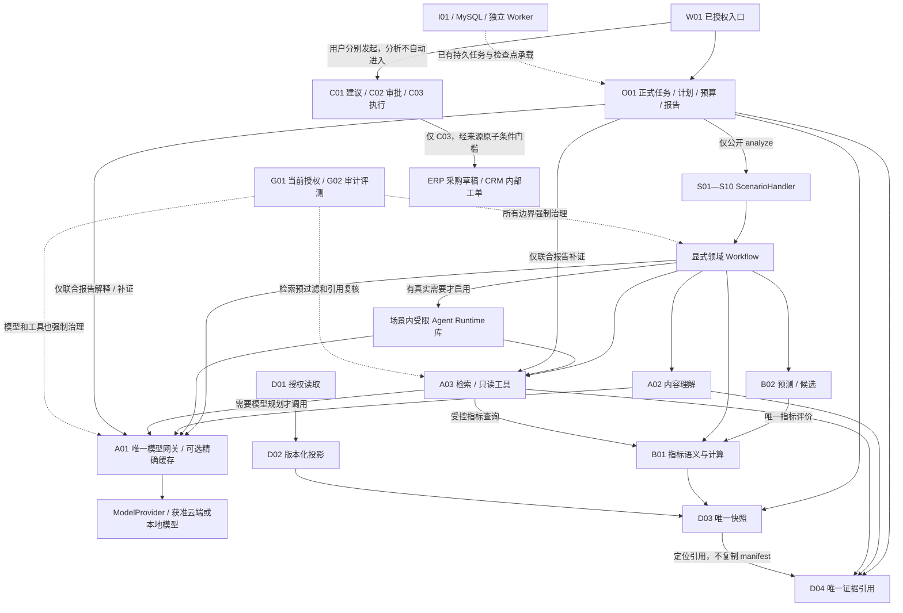

D02/D03/D04 的公开端口用于能力读取，图只画主要依赖，不授权直读私表。G01/G02 覆盖所有节点，治理虚线不表示只保护图中落点。C03 的条件读取、原键核对和审批事务仍以概要设计 §12.3/§13.2.1 为唯一细则，本设计不重写。

### 2.3 Runtime 与 Handler、O01 的关系

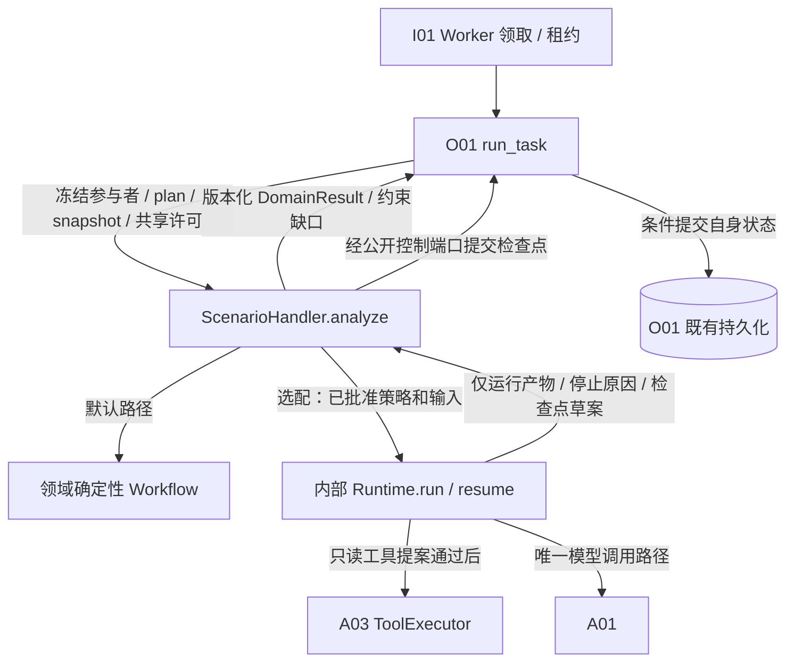

O01 跨场景编排决定“哪些场景、什么依赖、何版输入、总体预算、何种报告”；场景内部编排决定“这个领域按什么步骤处理输入、是否补证、是否可解释、何时返回”。Runtime 不知道其他场景注册表，不取得 `O01.run_task/create_task` 能力。O01 联合报告仅执行固定的报告组合流程，不作为调用任意领域工具的 Supervisor。

### 2.4 未来代码映射（只设计，不创建这些目录）

| 既有建议包 | 本次细化内容 | 何时创建 |
|---|---|---|
| orchestration/contracts、application | 原 AnalysisContext/DomainResult；TaskBudgetHandle、检查点与受限参与者控制视图 | 首批已有必要子集按概要；AI 专用字段在真实消费者出现后兼容增补 |
| scenarios/sXX_…/application | Workflow、依赖/降级策略、场景 Prompt/Context/Skill、RunState schema | 随对应 P0/P1/P2 场景排期 |
| capabilities/models/contracts、application、ports | ModelRequest/Response、能力配置、缓存策略、ModelProvider | M1 中首次真实 AI 用例，不加入首批 MC 闭环 |
| capabilities/understanding | 通用抽取/分类 Prompt、taxonomy、产物与修订 | S03 等真实内容理解用例 |
| capabilities/retrieval | ToolSpec/Registry/Executor、QuerySpec、RAG；即席控制有使用方再建 | 首期必要查询子集；完整 QueryRun 按概要 §6.4 过门槛 |
| scenarios 内部 runtime.py；必要时 scenarios/_runtime | 状态转移、Loop 纯逻辑、取消点和 context 消息值对象 | 第一个真实 Loop 先就近实现；第二个经评测证明有复用方后再提取，不能先建平台 |
| governance/access、observability | 当前策略、脱敏、调用/评测记录 | 复用 G01/G02；不新建 Prompt/预算/日志平台 |
| adapters/models、retrieval、mysql/owner | 具体提供方、查询后端、所有者持久化 | 验证一个接一个，不预生成厂商空适配器 |

## 03 核心契约、状态、版本与错误

### 3.1 必要数据结构

以下字段是应冻结的语义，不是已发布 SDK。引用统一携带 `tenantId/id/version`，范围与身份由服务端绑定；未知字段默认拒绝，不能使用任意 metadata 扩权。大内容使用受控 Ref，禁止跨层复制完整资产。

| 结构 / 所有者 | 必需字段 | 不变量与失败 |
|---|---|---|
| ParticipantView / O01 | 既有 taskId、planVersion、participantId、scenarioId/version、snapshotId、effectiveScope、policyContextRef、budgetHandleRef、deadline、traceId | 计划和快照执行前非空；来自 AnalysisContext 0.2 的受限视图；不是新的顶层任务上下文 |
| AgentSpec / 使用方场景 | agentId/version、ownerScenario、input/output/stateSchema、prompt/skillRefs、requiredCapabilities、allowedToolVersions、loopPolicyRef | 可信代码注册；不含任意类导入路径/可执行脚本；未实现能力不注册 |
| AgentState / 场景定义，O01 checkpoint 承载 | runId、roleId、stepOrdinal、phase、objectiveRef、contextManifestRef、pendingCallIds、toolResultRefs、partialOutputRef、stopReason、stateVersion | runId 为参与者内部步骤标识，无独立 task API；不保存隐藏思维链、密钥、源主账或完整聊天备份 |
| Checkpoint / O01 | checkpointId/revision、task/plan/participant/snapshot、lease/fence、agent/stateSchemaVersion、versionBundleRef、completedStepRefs、pendingCalls、usageRefs、resumeCondition | O01 唯一持久化；CAS 和当前租约保护；回滚本地状态不撤销供应商计费 |
| ContextBundle / 当前调用方 | contextId/schema、purpose、segments、tokenEstimate、omissionReasons、sourceVersionDigest、currentPolicyRef、expiresAt | segment 含来源/信任/敏感度/引用；不是 D03 第二份 manifest |
| RunOutcome / 场景内部 | COMPLETED、NEED_INPUT、CAPABILITY_MISSING、LIMIT_REACHED、TECH_FAILED、CANCELLED；outputRefs、checkpointDraft、consumptionRefs | 仅运行结果枚举；Handler 转 DomainResult 和领域限制，不能当 O01 公开 Task State |
| VersionBundle / O01 关联引用，各定义仍原归属 | codeArtifact、scenario、runtime、prompt/hash、contextPolicy、harness/loop、model/deployment、tool/schema、skill、knowledge/index、metric、taxonomy、policy、pricing、evaluationSet | 每项精确版本或显式 notApplicable；“latest”不能用作重放依赖；不复制各模块版本目录 |

Task State 仍为 O01 的 QUEUED/RUNNING/SUCCEEDED/FAILED/CANCELLED；报告 COMPLETE/PARTIAL/RULES_ONLY/BLOCKED 表示业务完整性；AgentState 表示内部执行游标；Checkpoint 是有版本的恢复记录；长期 Memory 仅是经确认且可撤销的偏好。这五者互不替代。

### 3.2 公共接口与失败语义

| 接口 / 所有者 | 调用者 → 输入 → 输出 | 失败处理 |
|---|---|---|
| ScenarioHandler.analyze / 各 S，O01 契约 | O01→ParticipantView→DomainResult | 返回缺失依赖/业务限制；技术异常有界重入，不在内部改 O01 任务终态 |
| Runtime.run / resume / 场景内部库 | Handler→AgentSpec+受限视图+state→RunOutcome | 参数/版本/权限不匹配停止；无后台线程自续跑，无自有预算 |
| save_participant_checkpoint / O01 公开窄控制用例【建议】 | Handler→expectedRevision+leaseToken+checkpointDraft→checkpointRef | 失租约、旧计划或 CAS 冲突拒绝；不允许 Runtime 写 O01 私表 |
| TaskBudgetHandle.reserve / settle / O01 | 场景、A02/A03 子调用、联合报告→callId/attempt/上界/期限→allowanceRef/结算 | 原子预留不足不调用；usage 未知保留占额；同 callId 结算幂等 |
| A01.invoke_model / A01 | 有权限调用方→ModelRequest+allowance→ModelResponse 或 TechnicalError | 只映射技术错误；A01 验证许可，G02 记录 usage，不直接写 O01 预算表 |
| A01.describe_capabilities / A01 | 调用方→用途/已审核 deploymentRef→能力描述 | 未知/不可用/不满足返回 UNSUPPORTED_CAPABILITY，不假装等效 |
| A02.understand / A02 | 场景→内容引用+taskType+taxonomy+许可→understandingRef | 低置信/无法识别为 UNKNOWN；技术失败区别于语义 UNKNOWN；不伪造 confidence |
| A03.retrieve/query_semantic/invoke_read_tool / A03 | 场景/联合限定用例/即席→QuerySpec 或 ToolInvocation→结果/证据 | 拒绝权限、危险计划、越界输出；不自动拓展来源与工具 |
| D04.resolve_evidence / D04 | 消费者→evidenceRef+当前权限+版本约束→受控视图 | 不存在、撤权、删除、版本不符返回安全缺口，不能以缓存绕过 |
| G02.record_usage/trace/evaluate / G02 | 所有者→事件、callId/版本/引用→记录Ref | 必需审计不可写时禁新有费调用；调用后记录失败保留未决预留，通过既有工作项核对 |

A03 即席用例沿用 QueryRunContext 和本方预留/结算，不接收伪造 TaskBudgetHandle，也不调用 O01 创建假任务。两入口用 G01 获准分配约束，涉及跨入口共享硬总额时，未验证并发总额核算则关闭相关收费入口（概要 §6.4）。

`ScenarioHandler.analyze` 仍只返回既有 DomainResult；本文的 NeedInput / NeedReplan 是其 `constraints` 中需O01处理的缺口/运行请求语义，不新增顶层返回类型或公开任务状态。确需增加可选结构字段时须经过兼容契约审查，不能靠任意JSON逃避类型与权限校验。

### 3.3 Agent 生命周期与持久恢复

1. **注册**：组合根加载已审核 AgentSpec，校验版本、工具实际存在、Prompt/schema 与模型能力、预算必填配置；动态用户上传不受理。相同 ID/version 内容冲突拒绝启动该能力。
2. **初始化**：O01 已有 task/plan/snapshot；Handler 检查领域前提并创建 runId 和空游标，绑定同一预算及版本。无调用需要时直接运行 Workflow。
3. **运行**：每个安全步骤前检查取消、deadline、当前 G01 权限、lease/fence、计划/输入适配、余额；结束后形成 checkpointDraft，由 O01 条件保存。网络请求在数据库锁外。
4. **暂停**：内部 phase 可为 WAITING_INPUT/WAITING_RETRY。Handler 将内部 NEED_INPUT 或可重试运行原因映射为 DomainResult.constraints 和检查点请求；O01 经已有工作项机制持久交接，不让 Runtime 心跳永远等待。不新增公开 PAUSED/WAITING 任务状态。
5. **人工介入**：W01 展示缺字段、冲突证据和选择项，人工补充是有身份/commandId 的输入事件，不是批准。短期限内 O01 任务仍可处于 RUNNING，工作项释放执行资源；仅显式恢复命令或原 deadline 的收尾工作项唤醒，不按轮询重复调用模型。
6. **恢复**：O01 验证恢复命令去重、当前身份/计划/快照/版本/租约后，Handler 装载 stateSchema 相容的 checkpoint；先核对 pendingCall，不重新获得预算。超期则按策略发布受限/BLOCKED 报告或明确技术失败，终态不复活；继续分析需新的明确任务并关联旧任务。
7. **取消与终止**：排队取消或安全边界协作停止；供应商在途请求可尽力取消，usage 不明保留占额；迟到输出不得发布、不得复活 task。内部 run 结束无独立任务终态；Handler 输出领域结果，O01 发布报告。C03 在途/UNKNOWN 仍由 C03 核对，取消分析不能改变它。

恢复保留冻结输入的历史解释语义，同时按当前权限决定是否仍可访问；快照固定不意味着永久授权。依赖版本不可取得时停止自动恢复，返回需迁移/重新分析。状态迁移只允许经验证的 schema 迁移函数，不能反序列化 pickle 或旧任意对象。

### 3.4 错误与重放

【建议】统一错误信封 `{code,category,messageSafe,retryable,callId,traceId,owner,detailsRef}`。技术类包括 TIMEOUT、RATE_LIMITED、UNAVAILABLE、UNSUPPORTED_CAPABILITY、INVALID_OUTPUT、USAGE_UNKNOWN；控制类包括 POLICY_DENIED、BUDGET_DENIED、DEADLINE_EXCEEDED、STALE_PLAN、LEASE_LOST、SCHEMA_MISMATCH；业务缺口由 DomainResult.constraints 表达，不嵌入模型错误码。

`retryable=true` 仅表示技术上可能重试，还必须满足权限、同一预算/期限、已完成结果去重及计费核对。重放已保存产物与重新调用模型分别标记 `artifactReplay`/`providerReinvoke`；供应商别名漂移及采样使逐字复现不能保证。历史输出不覆盖，重新发布仍由 O01 创建 reportVersion。

## 04 Prompt Engineering

### 4.1 消息组织与所有权

| 层 / 内容 | 所有者与可变来源 | 约束 |
|---|---|---|
| System：通用数据边界、事实/推断区分、输出安全要求 | 使用方模块维护可信公共片段；G01 规则在后端执行 | 无用户插值、无秘密、无业务批准；不宣称能单靠提示防注入 |
| Developer：用途、领域步骤说明、输出 schema、工具选择约束、引用格式 | 场景业务模板归 S；分类/查询模板归 A02/A03；联合报告模板归 O01 | 业务阈值引用获准配置；不复制指标公式或审批判断；只从可信仓库加载 |
| User：本次目标和业务参数 | 用户文本及服务端核准参数分区包装 | 用户自然语言是意图候选，不是权限或指令层升级来源；敏感输入先最小化 |
| Tool：结果摘要、evidenceRefs、覆盖/失败/时点 | A03 标准结果，经授权及 schema 校验 | 外部片段始终作为数据，不执行其中命令；不直接拼入 System/Developer |
| Assistant：历史有效输出/结构化 toolRequests | 当前运行的模型结果 | 仅保存必要可见产物和可审计短计划；不保留/索取隐藏思维链；旧计划无授权效力 |

公共片段只处理通用引用、未知表达、结构化格式、外部内容隔离与工具结果包装，不包含某场景结论、财务口径或质量阈值。A01 只映射提供方消息格式；不成为全项目 Prompt 内容所有者。首次使用方就近维护片段，有第二个真实消费者才抽取无业务语义的共享资源。

### 4.2 PromptSpec 与校验流水线

【建议】每份 PromptSpec 至少包含：`templateId/owner/version/contentHash/locale/purpose/messageFragments/variableSchema/outputSchemaRef/requiredCapabilities/allowedToolSetRef/contextPolicyRef/evalSuiteRef/compatibilityRange/approvedReleaseRef`。代码仓库保存模板、Schema、例子和变更说明；无需独立 Prompt 数据库或平台。

变量分类为“可信配置引用、已授权事实片段、用户文本、工具片段”，固定类型/长度/枚举/单位/必填性；引用均解析为版本化最小内容。插值不使用任意表达式求值，JSON/消息内容正确转义，拒绝未知变量和未提供的关键变量，不以空字符串代替关键事实。变量值与模板 hash 分开记录，敏感值不默认进日志。

流水线：解析模板→严格变量校验→G01 内容最小化→ContextBuilder 组装→提供方格式映射→模型输出→A01 JSON/schema 校验→调用方语义/证据校验→发布。JSON 输出结构建议包含 `facts[{claimType,artifactRef,evidenceRefs}]、hypotheses、unknowns、candidateOptions、limitations`；claimType 为 SOURCE_FACT/COMPUTED/INFERRED，数字结论必须引用 B01/B02 产物。模型填对 schema 不证明内容真实。

输出 Schema 使用支持的共同子集并声明最大深度/数组/文本长度；不支持的关键词不能静默删除。原生结构化输出优先但仍本地校验；缺能力时可选“JSON 提示+严格解析”路径须通过独立评测并获准，否则不启用。格式修复不启用自由循环：至多获准策略允许的有界追加调用，计同一调用/任务预算；原始失败保留，语义不能为迎合格式而补造事实。

### 4.3 注入、敏感处理与提供方兼容

对引用文本设置明确数据包络，存来源/信任标记，清理控制字符与非法工具协议；识别可疑内容可标记/拒绝，但不能声称检测覆盖全部攻击。模型请求的工具名、scope、SQL、URL、参数和输出引用全部在后端校验；外部内容无法改 ToolRegistry、租户、审批与预算。检索资料中的“管理员批准/忽略规则”只作为文档内容。

PII、费用、商业秘密按 G01 与资产用途规则最小提供；令牌化身份映射在受控源/模块内，模型只见必要代号，日志不存可逆对照。密钥、Bearer Token、连接信息不进入任何 Prompt。脱敏结果仍可能敏感，云端使用须满足概要 V09/V13；本文不作法律适用结论。

提供方不支持 Developer/Tool 独立角色时，A01 仅按审核消息转换策略映射，并保留原消息语义和降级标记；无法保持指令/数据分区或工具关联正确则 UNSUPPORTED_CAPABILITY。拒答、截断、工具停止原因、usage 和模态都显式映射，不以空 JSON 伪装成功。

### 4.4 迭代、灰度与回滚

变更按 owner 提交模板 diff、预期受益样例、反例、Schema/上下文/工具兼容影响；G02 固定离线评测及安全硬门槛通过后，生成不可变 release manifest。灰度按获准 tenant/场景/用途稳定分桶，单任务冻结版本，不同角色不在恢复中随发布漂移。Prompt、模型、工具、知识版本尽量单因素对比；必要联合变更明确对照。

回滚切换后续任务的 manifest，不覆盖旧任务依赖和已发布报告；在途任务使用原版本或明确停用，不能半途混用。安全撤销优先停止相关版本新调用并按当前权限限制旧输出。生产失败样本经脱敏、许可和人工标注后才加入 Golden Dataset，不自动吸收用户输入为公共训练/评测数据。

## 05 Context Engineering

### 5.1 来源、信任与选择

信任至少分“控制可信度”和“事实可靠度”两条轴：获准系统配置可作为控制；源事实虽可靠也只是数据。用户、Tool、Memory 和模型历史永远不能授予权限。不能简单地认为 Tool 消息比 User 消息更有指令权。

| 来源 | 控制可信度 / 事实使用条件 | 组装与排序 |
|---|---|---|
| 服务端 task/plan/scope/预算/Prompt 版本 | 可信控制；O01/G01 签发并当前复核 | 固定控制头；tenant/policy 字段不交模型自行填写 |
| D02/D03 事实、B01 指标、B02 情景 | 数据；检查质量/时点/版本，情景显式标假设 | 必要事实和约束优先，保留单位/窗口/分母/缺项 |
| A03 查询/RAG、D04 引用 | 数据；预过滤后回源复核，有效知识版本 | 先适用范围/有效性，再相关性和覆盖，去重后按需保留反证 |
| 用户输入与附件 | 不可信控制；参数经后端校验，意图有歧义待确认 | 目标与数据分区，不接受角色/预算/租户覆盖 |
| 历史消息与模型摘要 | 派生数据；不视为已发生事实或最新状态 | 同 tenant/user/session/run 且版本匹配，必要摘要不整段重放 |
| A02 标签/工具结果 | 派生数据；置信度/UNKNOWN/源位置/失败状态明确 | 原文与标签分层，错误不伪装空结果 |
| 长期偏好 Memory | 经用户确认可撤销；只影响语言/格式等表达 | 低于本次明确偏好和业务规则，不作为库存/费用/批准事实 |

ContextBuilder 由本次场景/A02/A03/O01 联合报告用例持有：声明 purpose 与必需证据→G01 有效范围→按固定 snapshot/知识版本选内容→D04 验证引用→排序去重→预算→形成 ContextBundle→A01。缺必要内容时不调用模型补猜。A03 不为同一个查询再嵌套无界 Agent。

### 5.2 Token 预算、压缩与保真

【建议】有效输入容量 `C=min(模型已验证窗口, 本次获准输入上限)-预留输出-工具schema/协议开销-安全余量`。这些量均有版本配置，不从供应商宣传值推定。必需控制/Schema/事实/关键证据先占额，剩余按目的分给辅助证据与历史；超出时优先删冗余历史和低相关片段。上下文窗口容量与总任务 token/费用上限分别约束，不能以窗口还有空位为理由增加总预算。

输入估算使用适配器可用的 tokenizer/保守估算并标 `estimated=true`；提供方返回实际 usage 后结算差异。没有可靠最大输入/输出/多模态计费上界时禁用需要硬费用封顶的调用，不以字符数等于 token 数作为事实。输出截断返回 OUTPUT_TRUNCATED，结构化产物不发布部分 JSON。

压缩优先确定性投影、字段筛选、去重和分段；需 LLM 摘要则计同一预算，摘要绑定原文 hash/版本、claim→evidenceRefs、遗漏清单、summaryPrompt/modelVersion。金额/数量/单位、正负号、时间窗、分母、质量 UNKNOWN、关键否定和相反证据不得只保留无来源摘要。摘要不是原始证据，最终引用仍定位原文。无法保证必需信息保真则拆分有界批次或返回 CONTEXT_INSUFFICIENT，不无限摘要摘要。

### 5.3 RAG、失效与传递

检索前在 A03 服务端生成 tenant+scope+字段+资产有效版本+知识适用条件过滤；适配器无法证明必要预过滤则禁止用于该私有数据。检索候选经 D04/所有者公开端口检查当前权限、删除标记、版本与固定输入兼容，再进入上下文。排序可以关键词/结构化起步；向量、rerank 和 GraphRAG 均须真实效果与隔离验证，非独立部署前提。

引用使用 `evidenceId/assetVersion/locator`，支持段落/字段/页码或图像区域；每个重要事实关联证据，核查的是“支持这条主张”而非“存在一个链接”。冲突资料并列保留并交规则或人工裁决，模型不得静默选对自己有利的条目。

长任务每次新调用检查 ContextBundle.expiresAt、currentPolicy、knowledge/indexGeneration 和 snapshot 适配。固定快照内补取已有证据只消耗原工具/期限预算；引入快照外输入、改变参与者或依赖需 Handler 返回 NeedReplan，O01 扣统一 maxReplans 并协调 D03。恢复不把最新查询覆盖旧版本，不跨不兼容输入拼报告。

Agent 间仅传任务受限视图、结构化目标、最小产物/证据引用、版本和剩余额度许可；不转发完整聊天、原始客户资料、模型内部推理或用户 Token。接收者权限为任务范围∩角色工具范围∩当前 G01 权限，转委派不能扩大权限。

### 5.4 复用、隔离和 Memory

| 内容 | 可复用范围 | 禁止行为 / 失效条件 |
|---|---|---|
| 不含业务数据的 Prompt/schema/可信 Skill | 经审核的代码制品可复用 | 模板中混入客户文本；修改同版本内容 |
| 企业内公开、不可变版本知识片段 | 同 tenant、双方有权限且用途/版本一致 | 默认跨企业共享；撤权/删除/失效后继续引用 |
| A02 已存理解产物 | 同内容版本/taxonomy/model/人工修订且当前授权相容 | 将标签当身份权威或自动补成缺陷事实；由 A01 另建标签库 |
| 动态库存/价格/费用/订单状态 | 当前固定 snapshot 的同一任务受限产物引用 | 当长期 Memory 或跨任务最新事实；缓存输出冒充当前可执行依据 |
| 客户资料/客服历史 | 单用户/会话和最小角色范围，仍需授权 | 完整聊天在其他用户/Worker角色之间广播；脱敏后自动公共化 |
| 审批/执行状态 | C01/C02/C03 当前公开视图，按用途实时复核 | 从 Memory/摘要/缓存推断批准有效或外部动作成功 |
| 用户语言/展示偏好 | 仅经确认的 tenant+user 偏好，当前请求优先 | 存隐含业务事实、敏感画像、跨租户经验池 |

当前不引入 Memory 服务或表。若确有偏好持久化需求，再明确现有 W01 用户设置等归属、确认/撤销 API、加密/留存/删除与 G01 权限后评审；禁用不影响业务执行。任务短期 state 与 checkpoint 从不视为长期 Memory。

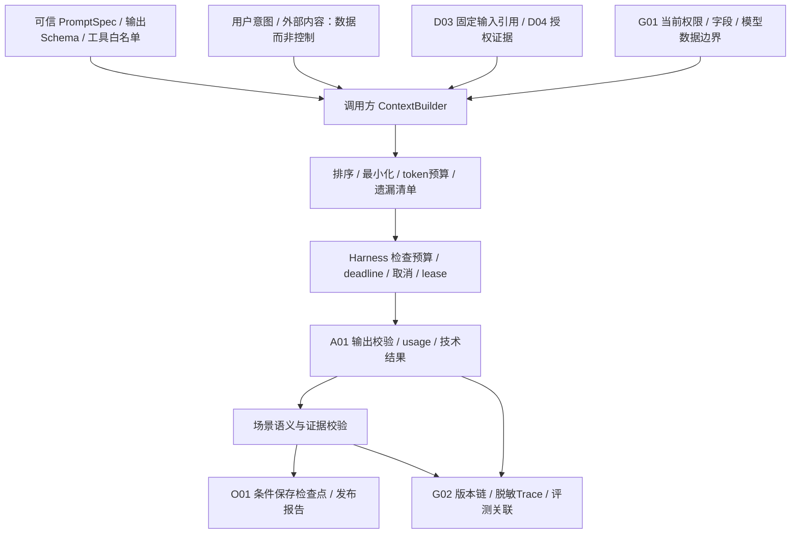

## 06 Harness：必要运行保障与预算

### 6.1 环境和执行边界

【确定】正式场景在独立 Worker 生命周期内运行，同一模块化制品复用契约。Runtime 是库级限制，不把语言层白名单称为操作系统安全沙箱。模型没有解释器、shell、文件系统任意路径、网络任意出口、数据库凭据或外部写 SDK。

【建议】由可信 ToolExecutor 执行已登记只读能力；服务端固定目标、连接和字段。处理文档/图片时仅通过 A02 受控解析器，校验媒体类型、大小、页数、解压比和超时。外部代码/插件上传、任意浏览器自动化、模型生成代码执行均不进入本范围。若未来真实解析器需 OS 级隔离，先按具体库风险验证受限子进程/网络/临时目录和资源回收；不预建通用沙箱集群。

最小控制链为 `G01用途与范围→输入schema→能力/工具白名单→原子预算预留→deadline/取消/lease→执行→输出schema与引用权限→G02记录→条件checkpoint`。Runtime 的校验与 A03/A01 的独立边界校验互补，避免绕过 Runtime 的直接调用不受控。

### 6.2 共享预算和计费不确定性

| 预算维度 | 唯一控制与预留对象 | 超限、并发及未知处理 |
|---|---|---|
| 任务模型次数、输入/输出token、费用 | O01 TaskBudgetHandle；A01 持许可才发起 | 场景/角色/重试/联合审查共用；先预留最坏可计费上界，再按实际结算 |
| 工具次数、返回行/字节、执行时长 | 同一任务许可，A03 执行前复核 | 包括失败工具、重新检索及嵌套付费查询；嵌套子调用沿父 callId 使用剩余额度，不能重复领满额 |
| taskDeadline、loopSteps、无进展次数 | O01 冻结总期限；Handler/LoopPolicy 给更小内部上限 | 最早截止优先；内部上限只是总预算的切片，不是第二份预算 |
| 领域并行 | O01 `maxDomainParallelism=2` 初始默认 | 总参与者可多于2；内部角色/工具并行另外计入任务已分配的内部槽和系统资源上限，不能借角色数放大并发 |
| 整体重规划 | O01 `maxReplans=1` 初始默认 | 补证/审校共用；内部短计划调整不重置任何额度 |
| 租户/提供方配额与系统并发 | G01 获准策略、A01 技术接入限额，I01 资源配置 | 区别于任务余额；多进程硬上限须用 MySQL 条件计数/租约验证，进程 semaphore 只能作为局部限额 |
| A03 即席请求和周期额度 | A03 已有 QueryRun/QuotaWindow，非 O01 任务 | 按概要 §6.4；切入口不能重复使用同一笔已分配额度 |

【待验证】除并行2/重规划1外，费用、token、步数、无进展阈值、调用/重试/并发/期限没有企业实测值。启用前必须冻结数值和预算策略版本；未配置不开放收费或自主 Loop，不以“无限”代替。

调用标识层次为 `logicalCallId→attemptId→providerRequestId`。每次实际可能收费的发送单独预留，A01 不得在 SDK 暗自重试。相同逻辑请求重复提交时先查本次状态/已保存结果；发送前崩溃可确认未发才释放，发送后 timeout/断连/失租约则 pending usage 保守占额。G02 用唯一 attemptId 记录实际调用成本事实，O01/A03 的余额只作控制；A01 不能另建费用账本。

模型未提供最终 usage 时，保留预留金额与估算标识，通过已有 G02/提供方记录核对；供应商无法证明消耗时人工处置，不自动退款再调用。即使重试只读模型不改变业务状态，也可能重复计费；不承诺 exactly-once 模型调用或费用。预算结算/必需审计提交失败则停止派发后续收费步骤，保留可恢复记录。

预留/结算在所有者短事务内以 `(tenant,task或query,attemptId)` 去重，CAS/行锁保护并发余额，锁外调用。检查点保存不代替预留；旧 Worker 即使仍在网络等待，也不能再次预留/提交结果。未知调用在恢复时先核对，不能重置 attemptId 伪装新额度。

### 6.3 故障、人工介入和建设分级

| 情况 | Handler / O01 处理 | 最低实现与未来增强 |
|---|---|---|
| 技术超时/限流 | A01 给技术事实；调用方用原期限和余额决定有界重试/受限报告 | 必需：错误分类、deadline 传播；未来才评估自适应路由 |
| 必需事实/能力缺失 | 返回缺口，阻断相关结论；人工补字段或新任务补证 | 必需：W01 缺口说明与命令审计；不把 C02 审批当补证对话 |
| 可选解释失败 | 领域规则结果可保留，Handler/O01 按冻结矩阵标 RULES_ONLY/PARTIAL | 必需：业务矩阵；不能从 TIMEOUT 直接映射“采购安全” |
| 重复调用/无进展 | 命中运行内去重，或停止并返回 LIMIT_REACHED | 必需：fingerprint、步数与预算；未来复杂自动修复需评测 |
| 工作进程崩溃 | O01/I01 按既有租约/检查点恢复，未决模型费用先核对 | 必需：CAS、恢复和迟到结果门禁；不引入框架第二 checkpointer |
| 发布后被质疑 | 关联 report/claim/call/evidence 进入 G02 反馈和人工复核 | 必需：版本和反馈关联；未来才考虑独立 LLMOps 产品 |

首个 AI 用例必须实现授权、Schema、共享预算、取消/超时、最小检查点/幂等、敏感日志保护及离线评测。高级在线自动调参、模型自我反思平台、动态代码工具、独立沙箱池、多 Agent 服务、自动生成 Skills、长期经验 Memory 均不预建。

## 07 Agent Loop Engineering

### 7.1 选择与循环语义

确定步骤、数据口径清楚的业务用 Workflow；只有“下一步只读证据取哪一类”需要根据中间发现选择且固定路径效果不足时，才评估受限 Loop。计划不是可执行代码，仅是 `goal/subgoal/allowedToolCandidate/evidenceGap` 的短结构化说明。规则引擎决定可执行性，模型不决定授权、金额、审批或 C03 动作。

| 阶段 | 处理及责任 | 进入下一步条件 |
|---|---|---|
| Observe | Handler 检查版本/权限/质量，读取已完成最小产物 | 同一计划/快照且仍有权；缺必需数据返回 NEED_INPUT |
| Plan | 可选 LLM 在已暴露只读工具中提出短计划或最终回答 | Schema 合法、未要求新场景/快照外事实；否则转缺口给 O01 |
| Act | Runtime 验证 tool proposal，A03 独立再检权限/Schema/预算执行 | 只有完整、合法、获准的工具请求才执行；多个工具有依赖则顺序 |
| Evaluate | 确定性校验目标覆盖、引用、重复性与剩余额度；必要人工/模型辅助评审 | 模型评审只是信号，不能豁免硬门槛；满足完成条件才返回结果 |
| Checkpoint / Stop | Handler 提交游标与产物引用，O01 CAS 持久化 | 终止、等待或下一轮均受原 budget/deadline/lease 限制 |

每轮开始和发每次调用前检查停止条件；本轮结束也检查总 token、费用、模型/工具次数、内部轮数、无进展、taskDeadline、取消/撤权、失租约、结果已经完成。完成以场景 output schema、业务约束与证据齐备判断，不仅相信模型的“已完成”。

同一轮 Tool 请求按工具 fingerprint 去重：`toolVersion+canonicalArgs+serverScopeDigest+snapshotId+sourceVersions+policyVersion`。同请求且已完成、数据/权限适配可复用运行内引用；失败重试也消耗原次数，记录同 logicalCallId 的新 attempt。相同信息反复无新增证据、或模型反复改写同答案不视为进展。工具错误作为标准数据返回模型，不自动隐藏失败或无限换工具。

信息缺失：NEED_INPUT；能力不足：CAPABILITY_MISSING；工具不可用：按 required/optional 返回限制；预算耗尽：LIMIT_REACHED；格式不合法：INVALID_OUTPUT，有获准修复额度才追加调用；任何停止不得伪装业务成功。结果可用程度由 Handler 和 O01 分层判断。

### 7.2 Loop 与 Tool Calling 时序

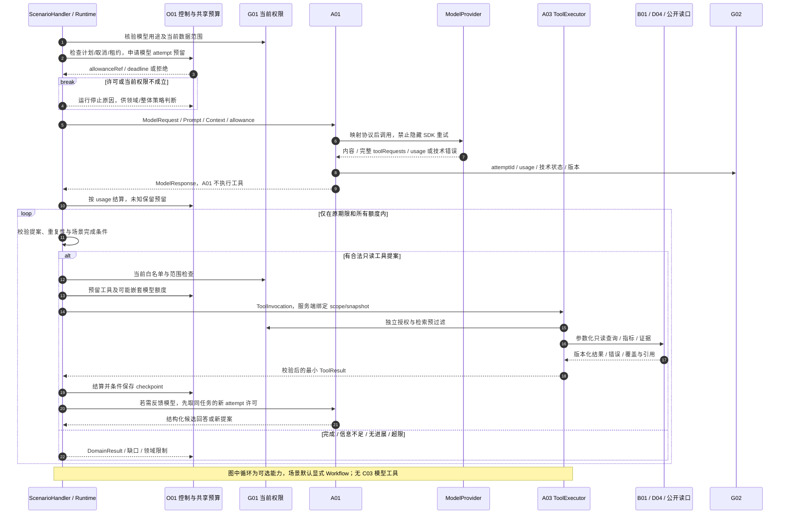

反馈模型仍须完整走 A01→提供方→G02→结算路径，图末的简写不跳过许可/usage。工具流式参数尚未完成时不预执行；ToolResult 中外部内容不提高为控制指令。

### 7.3 重规划和恢复

在同 plan/snapshot/依赖内修改检索次序或内部短计划，不额外消耗 O01 maxReplans，但受原步骤/工具/时长总预算控制；不得利用“内部计划”引入新场景、新快照或缺失数据。改变参与者/依赖、引入新输入需要重跑，由 Handler 返回 NeedReplan 给 O01，O01 校验后使用单任务默认1次额度并更新 planVersion，D03 需要时生成新 snapshotId。Runtime 无权限自行放宽 maxReplans，也不能每个角色各领一次。

Checkpoint 保存 phase/ordinal、已完成工具/模型产物引用、pendingCalls、context manifest、版本和预算关联；不保存框架私有状态作为第二权威。恢复对已完成步骤先验证兼容和权限再复用，未完成请求先查原 attempt 状态/usage。流式中断时部分字节不算完成产物，不回填缓存；明确重发会新增 attempt 及实际可能费用，并受原预留余额约束。

## 08 Agent 范式与框架选型

### 8.1 范式决策矩阵

本表是【建议】的项目适配判断，成本为相对调用/调度复杂度，不是实测费用或收益。范式不等于必须采用某产品。

| 范式 | 适用条件 / 优势 | 成本与主要风险 | 项目对应 / 启用决定 |
|---|---|---|---|
| 确定性 Workflow | 步骤、规则和依赖可列明；可测可恢复 | 变化需显式改流程，复杂路径维护成本 | S01—S04、S07、S09 默认；其余也以此起步 |
| Router / Dispatch | 在有限已知任务类型间路由 | 模型误分与扩大能力范围 | O01 首期按获准模板确定参与者；S05 意图可规则优先，低置信人工澄清；路由不授予权限 |
| ReAct | 证据查找次序取决于中间结果 | 多轮延迟、注入、重复取证、计费 | S05/S10 可选只读检索 Loop；固定 RAG 达不到金标准且收益验证后启用 |
| Plan-and-Execute | 单领域复杂研究需先列步骤 | 错误计划、快照外取数和无界扩展 | S08 可选单场景方案解释；求解仍 B02；不可替代 O01 跨场景计划 |
| Supervisor | 有真实不同能力角色需协调 | 角色膨胀、中心上下文泄露和重复监督 | 无 P0 必需用例；S08 专项验证才考虑，领域内固定角色优先 |
| Orchestrator–Worker | 输入可拆成独立内容块 | 部分失败、结果合并、调用放大 | S03 多语言批次/S07 多文档可确定性分批；先不用多个自主 Agent |
| Evaluator–Optimizer | 文案存在可测改进标准 | 自评偏差、反复润色、成本攀升 | S06 候选生成+规则/人工评审优先；独立评审角色在质量增益证实后启用 |
| Handoff | 任务需明确转至其他角色/人工 | 所有权不清、上下文越界、预算重置 | W01 人工接手是默认；跨场景转交由 O01 显式 participants，不建 Agent 私网 |
| 并行 Agent | 子任务独立且需不同视角/知识 | 并发额度、冲突合并和相同幻觉 | 先用有界并行函数/批次；S08 独立候选评审为未来假设，非首期必建 |
| 混合编排 | 计算与事实固定，解释/补证有限自适应 | 控制点模糊会导致模型越权 | 推荐 Workflow→B/A结果→可选受限Loop→规则审校；保留 Handler/O01 双层职责 |

采用多个提示词、并行 HTTP 请求或 A02 批处理，不自动等于多 Agent。必须证明角色独立性和相对单流程增益，再增加调度复杂度。

### 8.2 框架决策与替换边界

【建议】当前不引入 LangGraph、LangChain、Dify 或其他完整 Agent 平台作为运行依赖。先用显式 Python Workflow 与小范围 Runtime 纯逻辑。下列仅评估“若使用，需要验证什么”，未核对任何框架的当前发行版、许可、API、生产成熟度或部署方式，不把这些当已验证事实；因此不冻结版本、不声称某产品已满足能力。

| 候选 | 拟评估用途 | 必须证明的适配能力 | 本项目决定与成本风险 |
|---|---|---|---|
| 显式 Python Workflow | 少数可枚举步骤、依赖注入和确定性状态转移 | 可取消、版本/恢复/预算与工具边界按本文实现 | 默认建议；维护必要控制逻辑，避免自行发展通用 DAG 平台 |
| LangGraph | 复杂领域内循环/分支的图表达候选 | 能把状态/恢复接入 O01 唯一 checkpoint，关闭或映射独立调度/持久化；调用拦截不可绕过 G01/预算 | 暂缓；真实 Loop 复杂度、测试维护成本和效果对照证实收益才选用 |
| LangChain | 模型/检索调用组合辅助库候选 | A01/A03 端口内封装，不向 Handler 泄漏厂商链对象；无隐式重试/记忆/工具执行 | 暂缓；若只减少少量包装代码不足以覆盖依赖成本则不引入 |
| Dify | 非生产原型/提示词探索候选 | 企业数据许可、版本可导出、模型/日志/权限/工具边界可控；不成为第二任务/审批/数据权威 | 不作为首期正式运行平台；沙箱原型也不使用未经许可企业样本 |
| 其他 SDK / 自定义轻量适配 | 只解决一个明确协议缺口 | 相同端口、版本、usage、取消和隔离契约；依赖/许可锁定 | 按真实用例评估，不因已有组件就全场景套用 |

框架 Spike 的退出证据为同样 Golden Dataset、同样预算和故障/隔离用例下，与显式 Workflow 对照质量、延迟、成本和维护复杂度；不得复制 O01/I01/G01/G02 的状态、预算和治理来使框架“更易接入”。无法关闭/接入独立状态权威的方案不采纳。选型试验与实际引入均待独立审查后的实施任务授权。

## 09 A01 AI 网关详细设计与缓存

### 9.1 ModelRequest / Provider 契约

| 对象 / 所有者 | 字段与使用方式 | 校验和失败 |
|---|---|---|
| ModelRequest / A01 | schemaVersion、logicalCallId/attemptId、task或query关联、purpose、tenant/principal/policyRef、deploymentRef、requiredCapabilities、消息/ContextBundleRef、Prompt/hash、outputSchemaRef、toolSpecsDigest、parameters、allowanceRef、deadline、cachePolicyRef | 服务端构造身份/范围；消息已最小化；工具能力描述不等于执行许可；参数/模态/Schema 不支持即拒绝 |
| ModelProvider / A01 端口 | describe_capabilities(deploymentRef)、invoke(normalizedRequest)、stream(获准时)、cancel(能力声明支持时) | 适配层只处理协议/技术状态，不能回调 A03 执行工具；cancel 不能保证不计费 |
| CapabilityDescriptor / A01 | provider/deployment/实际modelRevision、模态、窗口、输出上限、Schema子集、工具/流式/usage/cancel支持、地域与数据策略引用、校验日期 | 配置审核+小样本探测；能力发现不让模型自动联网找提供方；未知能力默认不支持 |
| ModelResponse / A01 | status、content或validatedObject、完整toolRequests、finishReason、providerRequestId、actualModelRevision、usageRef、cacheInfo、timings、versionBundleRef | 截断/拒答/异常输出不能伪装成功；同一次响应 content/toolRequests 互斥或共存按协议明确映射 |
| Usage / G02 | attemptId、input/output/cached/reasoning或其他计费维度（适用且已知）、数量/估算标识、currency、pricingVersion、actualCost或unknown、providerRequestRef | 不支持的维度记 unknown/notApplicable，不填0；Decimal 计费，控制金额与账单最终核对分开 |

模型选择由获准配置确定性筛选：用途/数据地域→模态/结构化/工具能力→已评测版本→可用限额→获准优先级。无满足者返回 UNSUPPORTED_CAPABILITY/UNAVAILABLE；模型不决定选择更昂贵或更广数据传输范围。云端需 V09/V13 数据/条款/配额证据；本地需模型许可、硬件、并发/效果、运维与实际协议证据，两者都不预设更便宜或更安全。

### 9.2 流式、韧性与技术降级

流式仅用于获准的人类可见草稿/进度，事件 `start/delta/tool_proposal_complete/usage/final/error` 携 callId 与序号。Schema 通过的 final 才能成为产物；流中的工具参数不得边收边执行，最终引用/权限通过前不以可信报告发布。断流保留 usage 未知与部分传输状态，不写响应缓存，不自动把第二次流拼成一次成功。客户端 SSE/WebSocket 是否需要仍按基线按需，不强加首期前端流式。

重试只覆盖明确技术错误，需新 attempt 许可、剩余 deadline 与同租户限额；按获准策略退避并遵守提供方限制，SDK 内自动重试关闭或暴露为受控 attempt。熔断按 provider/deployment/错误维度隔离，避免一个模型异常拖垮其他用途；半开探测也计调用预算/授权且不携未经许可真实数据。具体阈值待压测。

技术降级仅指“在同数据边界和能力/Schema/评测兼容配置中切换已获准 deployment，记录实际版本”，不自动换数据地域、不隐式降低语义要求。原版本任务是否允许切换须在 manifest 明示兼容集合，checkpoint 关联变化；不同模型结果不得与旧输出混作同一次调用。业务上的 PARTIAL/RULES_ONLY/BLOCKED 仍归 Handler/O01。

### 9.3 网关缓存的明确决定

**【建议】首个 A01 版本默认 `responseCache=OFF`。先复用各所有者已经保存且有版本的 A02 理解产物、B01 指标和 O01 报告引用，避免重复产生资产。只有命中率、有效节约、隔离与失效证据充分，才按用途开启有界进程内精确响应缓存；初期不建 Redis、不缓存工具执行、不启用语义响应缓存。**

精确缓存比较同一请求的规范化内容和全部控制/数据版本，适合静态非敏感的可替代生成；语义缓存依赖“语义相近也可复用”的业务证明，而相似问题可能租户、日期、SKU、知识适用范围不同。库存/费用/客服/政策核查的“差不多”不能接受，因此语义缓存只留待验证事项，不生成向量缓存库或默认候选部署。

供应商侧前缀/输入缓存与本地响应缓存分别记录：前者仍是一次供应商调用，费用、保留、数据隔离和 usage 按获准条款及实际响应确认；不能从本地命中推断供应商缓存，也不能把其保留策略当本项目已经许可。未证实条款的供应商缓存不得传敏感资料或宣称“零留存”。

### 9.4 缓存准入与隔离矩阵

下列是精确响应缓存的准入上限，均需独立启用；“可”不等于当前已打开。未标明可复用的响应默认禁止缓存。TTL 必须有正数配置且小于各来源/授权有效期，不设无依据统一秒数。

| 类别 | 准入 / 最小隔离 | 跨用户 / 跨会话 | 版本与有效期 / 失效 |
|---|---|---|---|
| 仅公共模板/schema/无业务文本格式示范 | 可；租户分区、APPROVED_TEMPLATE 用途 | 同租户经批准可 / 可；跨租户仍默认禁止响应共享 | 模板/模型/schema/参数精确相同；有界TTL；版本/策略变化即miss |
| 企业内公开的稳定知识解释 | 条件可；TENANT_PUBLIC 且无私有上下文/个性化/工具提案 | 同tenant双方当前有知识权限才可 / 可 | 不可变知识版本、适用范围、Prompt/模型绑定；更新/删除/撤权即拒绝旧命中 |
| 用户自己的静态低敏文本改写 | 条件可；USER 或 SESSION，需获准用途 | 不可 / USER且明确无会话依赖才可 | 内容hash+user授权+Prompt/模型；留存受用户内容政策约束；本轮默认关闭 |
| 聊天、售后回复、客户资料、用户个性化 | 不准入持久或共享网关缓存；最多同次调用结果引用去重 | 不可 / 不可 | 不做跨请求响应缓存；任务恢复仍用原受控产物并当前鉴权 |
| 动态库存、供给、价格、实时订单/履约状态 | 禁止网关响应缓存 | 不可 / 不可 | 业务产物固定snapshot可回溯，但不作当前事实；发送前实时校验归C03 |
| 费用、贡献、币种/汇率、财务核查 | 禁止网关响应缓存 | 不可 / 不可 | B01已有固定版本产物按权限复用，禁止LLM缓存伪装财务权威 |
| 建议确认、审批、批准/撤销、执行与回执状态 | 禁止 | 不可 / 不可 | 当前状态经C所有者公开接口读取；不设短TTL绕过实时复核 |
| Tool Calling / 需运行时工具 / 含动态RAG结果 | 首期禁止缓存模型toolRequests或最终响应 | 不可 / 不可 | 防跳过工具权限、执行及usage；静态证据摘要以后另行准入验证 |
| 含秘密、敏感个人信息、未知授权或分类 | 禁止；分类失败默认拒绝 | 不可 / 不可 | 不能只把tenant/user加进key就认为可以缓存秘密 |
| 错误、拒绝、部分流、截断、INVALID_OUTPUT、usage未知 | 禁止成功响应缓存 | 不可 / 不可 | 技术熔断/负载状态不是内容缓存；拒绝权限后不做全局负缓存泄露资源存在性 |
| 政策核查的适用性结论 | 禁止；可复用版本化原文引用不等于复用结论 | 不可 / 不可 | 有效时间/地区/商品属性/适用性必须每次核查与专业复核 |

“必须极短有效期”的数据若未来确需优化，只能先定义业务时效、来源事件/版本验证和撤权边界再单项评审；在没有这些证据时保持禁止，而非自行填一个短 TTL。当前静态准入也没有批准的生产 TTL，缺配置即 OFF。

### 9.5 Cache Key 与命中验证

【建议】`key = ai-response:v1 : tenantPartition : HMAC(cacheKeySecretVersion, canonicalJSON(KeyMaterial))`。使用带密钥摘要避免从 key 猜测低熵客户文本；key/日志不含明文文本、用户号或秘密。缓存值含原 responseRef、producerCallId、sourceVersionDigest、createdAt/expiresAt、cachePolicyVersion、敏感分类和校验版本；不作为新的业务资产权威。

| KeyMaterial 字段 | 绑定规则 |
|---|---|
| tenantId / sharingMode | tenantId 必填且所有模式均禁止跨tenant；sharingMode=SESSION/USER/TENANT_PUBLIC/APPROVED_TEMPLATE，来自G01策略不由模型/客户端选择 |
| principalPartition / sessionPartition | SESSION包含user与session；USER包含user、session显式NO_SESSION_DEPENDENCY；获准租户共享用显式TENANT_PUBLIC标记代替user/session，不能偷偷省略；任何私有变量出现自动降级隔离或禁缓存 |
| effectiveScopeDigest / policyVersion / authEpoch | 当前获准店铺/仓库/字段/用途/角色范围规范化指纹；当前授权变化导致miss/deny；原用户权限不能代表所有读取者 |
| provider / deployment / actualModelRevision / capabilityPolicy | 实际受评测的不可变版本；若仅有可能漂移的别名，不能安全钉住时禁缓存 |
| Prompt/hash / schema / normalizedParameters | System/Developer/User全部有效内容hash、语言、输出Schema、temperature等实际参数；缺省值展开且参数规范化版本固定 |
| contextDigest / dataVersions | 消息顺序、每段内容hash、snapshotId（适用时）、映射/指标/理解/人工修订、知识/asset/chunk/indexGeneration、时间/地区适用域；未列清依赖则禁缓存 |
| toolSetDigest / toolPolicy | tool名/版本/Schema/白名单hash；首期任何动态tool request路径直接bypass；不能缓存后省略本该执行的工具 |
| runtime/context/harness/cachePolicy versions | 选择、压缩、敏感处理、准入及Key规范版本；改变则miss |

缓存查找必须在 G01 当前授权和输入准入之后；命中后再次验证来源未删除/失效、当前 authEpoch、引用可解析/有权限、模型/Prompt未禁用、TTL和结果Schema；返回前在 G01 规定的授权线性化点确认当前策略。不依赖异步清理保证撤权：撤权事务提交后开始的读取必拒绝旧授权，跨在途窗口的输出再复核；无法读到当前策略/失效信息时 fail-closed 或不返回缓存。缓存miss后也不能在权限系统不可用时继续模型调用。

来源“已知版本”更新时，由来源所有者/A03 更新当前版本/删除状态及有效代际；A01 通过公开只读状态验证依赖。缓存键与条目依赖明确版本，旧值即使还在其他进程内存也无法再次命中。后台逐出仅节约空间，不能承担权限正确性。固定历史快照的正常回放与“当前答案缓存”不同；回放仍当前鉴权并标历史版本。

### 9.6 缓存路径、计费与多进程

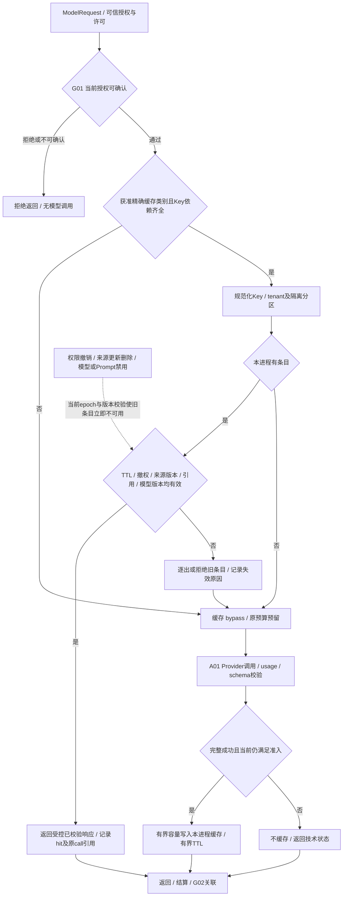

缓存命中也受请求并发/调用规模/期限及审计控制；正式任务可先获得逻辑请求许可，只有miss才预留供应商费用，或先保守预留再按hit结算为无供应商调用，两种实现只选一种并保持幂等。**hit时本次供应商调用数/供应商token和费用为0**，但读取/校验成本记录为内部服务开销；原调用费用只归 producerCallId，不在每个hit重复累计。记录 `cacheStatus=OFF/BYPASS/MISS/HIT/INVALIDATED`、key摘要/隔离类别、originCallRef、source版本、lookup/validation/provider耗时；不记录原文key。

离线模型效果评测默认 bypass 缓存，明确标缓存对照实验；在线质量按hit/miss分层，不能用命中带来的低时延宣称模型变快。节约金额只记录“估算避免调用成本”并带估算方法，不能当实际账单节省；有效命中率、错误复用率、授权拒绝、失效和容量逐出一起监控。

多进程可各自拥有非权威有界缓存，命中率较低不影响正确性；失效正确性依赖当前 G01/来源版本复核，不能仅靠进程内广播。相同key的进程内 single-flight 可减少同时miss，同一收费请求仍有不同attempt的准确审计；取消某个等待者不能随意取消仍被其他合法等待者使用的调用，首版实现复杂时直接禁用合并。跨进程去重/限流/配额用既有所有者MySQL控制，不因缓存需求默认Redis。

只有实测重复率、延迟/费用节约和多实例瓶颈显著，且集中缓存的权限/删除/可用性/运维收益超过成本，才评估 Redis 等共享存储；也不能把它提升为状态、额度或事实权威。共享缓存故障可bypass，但仅在授权、预算和审计仍可完成时调用模型，避免缓存故障放大模型流量超额。

## 10 Skill 与 Function Calling

### 10.1 角色与注册

Skill 是可信方法/模板及有限资源的版本化包，由使用场景或 A02/A03 持有；Tool 是服务器能力的窄包装，A03 管目录与执行门面；Function Calling 是 A01 适配的模型提案协议。三者不是三个任务平台，也不赋予权限。

| 契约 / 所有者 | 最小字段/职责 | 调用与失败 |
|---|---|---|
| ToolSpec / A03，业务实现仍原所有者 | name/version、owner、purpose、input/outputSchemaRef、readOnly=true、dataDomains、requiredScopes、sensitivity、maxRows/bytes、timeoutPolicy、costClass、idempotency/dependencies、implementationRef | 可信组合根注册；implementationRef指已审核实现绑定而非动态导入字符串；C03或任意副作用工具注册即失败 |
| ToolRegistry / A03 | register、resolve、select_allowed；校验唯一ID/version/hash与实际可用状态 | 工具暴露为任务/用途/当前权限的交集；发现不表示自动可调用；不向模型暴露全部系统目录 |
| ToolInvocation / A03 | invocationId、logicalCallId/attempt、toolRef、arguments、serverBoundContext、allowanceRef、deadline、trace/parentSpan | tenant/scope/snapshot/principal从服务端上下文绑定，模型同名字段拒绝；不接受任意URL/SQL/脚本 |
| ToolExecutor / A03 | 校验、权限、参数/输出限制、超时、调用公开能力、审计 | 失败返回参数/权限/版本/超时/能力错误；不自动安装工具、改参数扩权或转C03 |
| ToolResult / A03 | invocationId/status、typedData或artifactRef、evidenceRefs、sourceVersions、coverage/observedAt、truncation/unknown标记、usageRef | 输出再鉴权与限额；截断不当完整数据，出错不回空数组冒充“无风险” |
| SkillSpec / 实际使用方 | skillId/version/hash、owner、triggerPredicate、input/outputSchema、requiredCapabilities、allowedToolRefs、promptRefs、budgetSlicePolicy、evalSuite、compatibility | 加载条件为已排期用例+版本兼容+授权+工具可用；不携任意可执行下载/安装脚本 |

### 10.2 最小工具目录与参数样例

下列为拟议逻辑工具名，不代表已开发或企业API已有。每个场景工具上限仅包含表内其必需子集；B02/A02 确定性流程直接调用其公开能力，无需全部暴露给模型。

| 工具名 / 版本提案 | 实现归属与输入 → 输出 | 白名单范围与禁止项 |
|---|---|---|
| metric.read@0.1 | A03→B01 read_metric_result / 受控指标QuerySpec → resultRef/单位/分母/缺项 | 已注册指标与维度；不允许模型传公式、SQL或私有表名 |
| knowledge.retrieve@0.1 | A03→RetrievalProvider → evidenceRefs/适用时间/覆盖 | 已授权collection/assetVersion，server预过滤；不任意联网或全网爬取 |
| evidence.resolve@0.1 | A03→D04→所有者解析 → 最小字段/原文位置 | 当前有权证据ID，限制批量；ID不证明有权 |
| projection.read@0.1 | A03→D02公开只读视图 → 固定snapshot所需字段 | 白名单view/fields/filter/sort/pageSize；只读语义计划编译，不接受模型SQL |
| domain_result.read@0.1【有消费者才建】 | A03经O01公开结果读取 → 已发布领域结果摘要/Refs | 只读已完成且兼容结果，不能触发ScenarioHandler或隐藏新增参与者 |

例如 `knowledge.retrieve` 输入 Schema 只允许 `queryText:string(maxLength获准值)、collectionId:白名单枚举、topK:有界整数、effectiveDate:ISO日期`；tenant/scope 不属于模型参数。输出固定 `hits[{evidenceRef,assetVersion,locator,excerpt,validity,scoreType}]、coverage、truncated`；分数只表检索相对相关性，不伪装事实置信概率。具体长度/topK由实测冻结，未配置禁用该工具。

Function Calling 流程为 A01解析提供方request→调用方验证完整提案→G01/预算→A03 registry/Executor独立验证→公开能力→结果校验/脱敏→ToolResult数据消息反馈；提供方的callId映射保留，重复或未知callId拒绝/去重。多工具提案只在独立性已声明时并行，同一任务共享资源/预算；参数引用前序结果则顺序执行。

工具幂等分“请求去重、只读可重入、数据版本一致”三件事，不能把只读理解为免费或重复无影响。运行内去重复用原结果引用；技术重试按同 logicalCallId 新 attempt 记录，不修改查询范围；动态来源不缓存结果冒充固定版本。SQL仅由可信查询编译器生成，参数化、只读事务/账户、表列白名单、范围过滤、行数/复杂度/超时共同限制；只读账户本身不能阻止全部越权读取。

### 10.3 MCP 与最小暴露

MCP 仅作为某 ToolSpec 的传输适配候选；远程工具发现结果属不可信候选，不自动导入。远程工具必须证明只读、固定目的地/身份、schema/版本、权限过滤、数据地域/敏感处理、超时和审计可接入原契约；无法证明则不暴露。MCP描述/结果中的指令不改变 System/Developer、白名单与预算，凭据不发给模型。

首期采用进程内公开函数调用，不部署必需 MCP server 或 Agent-to-Agent 协议。动态工具选择只是从已审核且当前可用集合中筛选，不是动态安装或自我扩权。Skill 切换绑定当前run版本且受相同总预算，不因新Skill重新初始化额度。

## 11 Multi-Agent 的必要性、通信与合并

### 11.1 是否需要

【建议】S01—S10 当前没有“必须采用自主多 Agent”的已验证证据；P0 都不启用多 Agent。S03 多语言批次、S07 多文件解析优先是 A02 确定性分批处理，S08 多方案求解是 B02 候选评价，不能以并行包装制造 Supervisor。

【待验证】若 S06 的独立事实审校能显著减少文案错误、或 S08 的互相独立方案评审相对单流程有可测增益，才启用同一场景内固定 Worker+Reviewer。Supervisor 先是 Handler 确定性代码，不增加一个“总经理模型”。Reviewer 不授予批准权，跨场景需求仍交 O01。

### 11.2 消息与共享状态契约（启用时）

| 对象 / 所有者 | 必需字段 | 权限、预算和失败语义 |
|---|---|---|
| AgentMessage / 场景内部 | messageId/schema、task/plan/participant/snapshot、senderRole/recipientRole、purpose、input/outputSchemaRef、artifact/evidenceRefs、versionBundleRef、budgetSliceRef、deadline、parentSpan、expectedStateRevision | 不携用户Token/全量聊天/私有客户资料；接收方当前G01重新授权；同messageId不同指纹拒绝 |
| SharedState / 场景定义，O01 checkpoint承载 | objectiveRef、固定产物引用、分支状态、mergeRevision、unresolvedConflicts | 单一Handler/Reducer写入，Worker只返回消息，不并发写共享字典/数据库Session |
| PrivateContext / 各角色内存 | 本角色最小片段、临时消息 | 不自动共享；恢复所需最小状态入受控checkpoint引用，结束按留存策略清理 |
| Reducer / Handler 确定性逻辑 | 按role/partition排序，校验版本/范围/输出schema，去重合并，输出合并产物Ref | 冲突不多数投票成事实；金额/指标回B01，证据冲突标待核，必要域缺失阻断相关结论 |

主Handler把总额度原子分配为受限 slice，预留额度之和不能超过 task 可用额，所有子调用仍经同 TaskBudgetHandle/allowance 链扣减；role slice仅限额上界不另增余额。并行扇出也要预留工具/模型并发槽；某分支停止只释放可证明未消耗额度，pending usage 继续占额。

### 11.3 条件通信图与部分结果

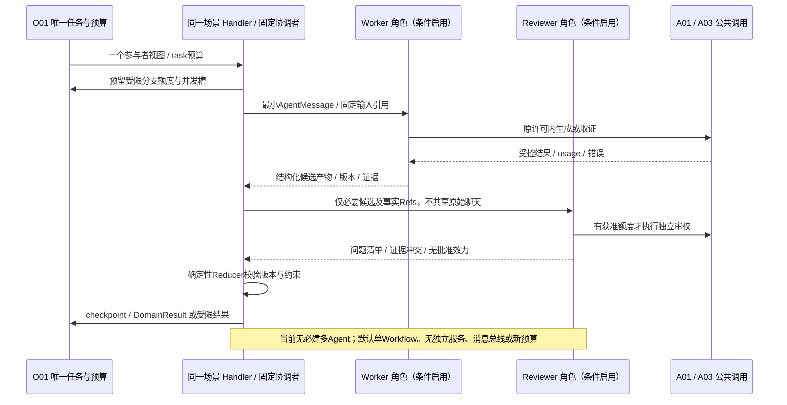

分支超时/失败返回显式状态，必需分支失败阻断依赖结论，可选分支缺失按场景策略输出部分结果；不能平均多个角色分数隐藏关键错误。取消传播至所有子调用，迟到消息按 task/plan/snapshot/mergeRevision/lease 拒绝，已发生费用保留。冲突保留各自证据，不以模型“调和”成不存在的新事实。

通信优先进程内函数/有界并发；需跨进程持久等待、长任务恢复时使用 O01 checkpoint + I01 既有工作项，仅新增明确 workKind 和payloadRef，不建立独立Agent任务表。只有安全隔离/规模/团队边界已证明必须独立进程时另评审协议与身份；不默认消息总线或 Agent-to-Agent 网络服务。

## 12 LLMOps 与 G02 可观测闭环

### 12.1 版本、环境与发布

| 对象 | 所有者 / 版本载体 | 环境和发布约束 |
|---|---|---|
| Prompt / 场景 / Skill / Runtime / Schema | 各使用方代码制品+不可变manifest | 开发用脱敏fixture/桩；测试固定用例；真实模型验证须单独获准密钥/预算 |
| 模型 / deployment /能力 / pricing | A01审核配置，G02记录实际版本和usage | 测试/预发布/生产凭据、数据用途、额度分别隔离；不默认CI可以用生产模型 |
| 工具与查询模板 | A03注册；实现由B01/D等原模块持有 | 按环境只注册真实可用项；测试工具不能在生产伪成功 |
| 知识 / indexGeneration | 正文为既有授权资产；A03管理索引代际，D04证据定位 | 发布明确覆盖/有效版本/删除状态；灰度不能读取另一租户资产 |
| 输入事实 / snapshot / metric / taxonomy | D02/D03/B01/A02分别拥有 | 不因发布覆盖旧资产；模型回滚不能回滚企业事实或人工修订 |
| Golden Dataset / rubric / evaluationRun | G02记录，业务owner制定标签与裁决 | 许可/敏感度/分层/划分/版本固定；线上反馈需批准处理后才入集 |

【建议】release manifest 绑定上述版本和适用tenant/场景/用途，预发布执行结构/隔离/故障/质量回归，经技术和业务负责人评审后按获准分桶灰度。这里的变更审批是既有研发发布流程，由团队责任人执行；**不新建一套业务审批系统，也不把 C02 采购/工单批准挪作代码发布工具。** 未提供企业发布流程时标待确认，本文不声称已存在某平台。

放量门槛包括安全硬失败为0、确定性规则全部符合样例、模型/业务质量达到冻结阈值、成本/时延不超获准限额；灰度最小样本、观察窗、停止阈值尚待 V05/V13 冻结。回滚切后续 manifest，必要时禁用问题模型/Prompt/工具版本；原任务版本可恢复性和安全撤销优先级按 §3/§4 执行。

### 12.2 Trace、指标与反馈

推荐 Trace 树：`HTTP受理→O01 task run→participant/ScenarioHandler→Workflow/Agent step→Context/RAG→A01 model attempt或A03 tool→provider/data adapter`；重启恢复以原trace关联新span/attempt，不复用旧span伪装一次调用。联合报告是 O01 的独立span，不能和领域调用混记。即席以 queryId 关联同类span，不伪造taskId。

| 观测点 / G02唯一记录 | 必需关联字段 / 指标 | 诊断用途与注意 |
|---|---|---|
| 任务/参与者/Loop | task/query、plan/participant/snapshot、run/phase/step、stopReason、lease/work、versionBundle | 队列/执行/等待时延、完成/阻断/取消、重规划、无进展；报告状态与技术状态分别统计 |
| 模型 | logicalCallId/attempt/providerRequest、actualModelRevision、Prompt/context/schema、usage/pricing、cache状态、错误/finishReason | 输入/输出及适用计费维度、费用/未知占额、p50/p95/p99延迟、失败/限流；不在标签里放客户ID/原始文本 |
| 工具 / RAG | tool/name/version、queryPlan摘要、当前policy、knowledge/index、evidenceRefs、过滤/截断/覆盖 | 工具选择/参数错、召回缺口、来源陈旧；不得记录越权命中的正文 |
| 预算 | reserve/settle/reconcile关联、余额快照/未知预留引用 | 并发超发、重复结算、未知长期占额、成本停止；余额记录不是G02费用事实的替身 |
| 用户反馈 | feedbackId、reportVersion/claimId、证据/call/版本Ref、分类、复核人/结果 | 事实错/遗漏/解释不清/无帮助等区分；用户点赞不等于口径正确或收益成立 |
| 审计 | 主体引用、用途、资源、允许/拒绝、命令、版本、时间/trace | 最小不可抵赖操作链；秘密和完整聊天不入默认审计 |

敏感正文默认不记录；必要的失败抽样进入经G01保护且明确留存期限的受控样本资产，G02只引用。审计/任务/评测集/备份/缓存的删除与保留受 V09/V15 约束；期限未定前不开放生产采集全量Prompt。Trace日志按allowlist字段脱敏，技术指标使用低基数维度，详细资源ID留受控记录。

### 12.3 故障诊断与分阶段建设

定位顺序是权限/范围→D03覆盖/时点→B01口径/A02标签→A03证据与适用性→Prompt/Context遗漏→实际模型/工具版本→预算/时延/重试→报告组合。修正事实回所有者产生新版本，修正模板走评测发布，不在G02日志或报告里手填数字冒充修复。

M1/M2必要：结构化日志、Trace ID/版本链、usage/预算、基础离线评测、人工反馈关联与导出。M3增加审批/执行链及UNKNOWN关联，仍归C/G原模块。M4仅在真实运营需求出现后评估独立 LLMOps 产品、在线抽样评审、漂移分析和实验面板；选型必须证明数据许可、导出/删除、版本与成本记录可对接，不能另做模型网关/任务状态/权限/数据主账。现有G02可承担基础记录与评价，没有证据要求额外部署观测集群。

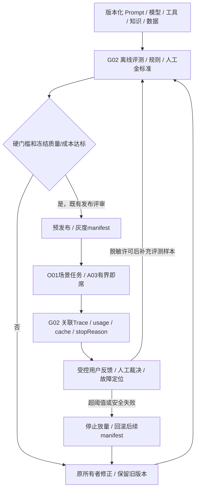

## 13 AI 分层评估体系

### 13.1 层次、指标和评分边界

| 层次 | 离线评估及指标定义 | 在线观察 / 评分责任 |
|---|---|---|
| 模型调用/结构输出 | 合法JSON且Schema通过数/调用数；拒答/截断/错误映射、usage已知率 | A01/G02技术指标；有效结构不等于业务正确 |
| Prompt | 固定输入事实保持、引用支撑、未知表达、语言/格式按rubric逐项评分 | 人工抽样复核；记录template/model/context版本，不能只打整体“流畅度” |
| Tool Calling | 工具选择precision/recall、参数字段exact match、危险提案拦截、实际执行范围 | A03+场景；模型提案越权与系统实际越权分别记，后者为阻断失败 |
| RAG检索 | 适用有权证据recall@K、相关性、反证覆盖、过滤/删除/版本正确 | A03/G02；K/金标准由样本冻结，不能用回答质量掩盖无权召回 |
| RAG回答 | claim级证据支持比例、引用定位正确、缺信息拒答/澄清、适用时间/地区一致 | 业务人工裁决；LLM-as-Judge可辅助定位，不单独授予通过 |
| Agent任务 | 满足所有必需目标且无硬失败任务数/可评任务数；限定内完成、正确停止、重复调用率 | Handler/O01；阻断正确性另列，不能把安全拒答全算成任务失败或全算成功 |
| 多Agent（启用后） | 与单Workflow配对比较质量/费用/时延、冲突发现、Reducer正确、分支部分失败 | 启用前无此生产指标；多角色一致意见不是正确性的证明 |
| 业务规则/指标 | AC固定样例、单位/金额/分母/缺项、B02→B01依赖、领域降级与终点正确 | B01/B02/各S，确定性断言；不让模型评分覆盖金额错误 |
| 安全 | 跨tenant/user/session/字段/工具、撤权、注入、日志/缓存泄露、scope伪造 | G01+安全owner；任何验收集实际泄露/越权调用为阻断 |
| 资源 | 每任务总与分层tokens/费用/未知消耗，p50/p95/p99延迟、并发/队列/工具次数 | G02运行事实；缓存hit/miss、语言、任务复杂度分层 |
| 业务收益 | 人工耗时、交接、建议采纳后完成、可比损失与贡献变化 | 业务/财务；与模型评分分开，不把工单创建算问题解决 |

规则评分用于Schema、版本、预算、金额、权限、引用存在性和明确业务约束；人工评分用于语义、适用性、错误严重性和业务可用性；LLM-as-Judge仅作非权威辅助，与被评模型/Prompt版本分开，盲化候选顺序并用人工标注校准偏差，判据/模型/成本有版本。裁判输出同样可错误，不评最终审批/合规有效性，不自行获取更高权限资料。

### 13.2 Golden Dataset 与门槛

【建议】评测项结构 `caseId/version/owner/licenseSensitivity/split/tenantScope/taskType/language/sourceVersions/inputRefs/goldenFacts/evidenceRefs/requiredTools/expectedConstraints/allowedAbstention/rubric/blockerTags`。训练/调试/锁定测试集按对象与时间隔离，S03避免同订单或相同文本跨集合，预测滚动按截止时间切分，知识核查按生效版本分组。人工分歧保留并由领域负责人裁决，UNKNOWN样本不能丢弃以美化准确率。

可研建议的每核心场景30—50个代表任务、VOC300—500条脱敏文本可作为初始采样讨论，不是已备齐样本或统计充分性保证；应补齐语言、店铺/仓库、少数主题、缺项、乱序、过旧、撤权、恶意文档、重复/取消/断流和预算耗尽。样本不足的分层明确“证据不足”，不发布全产品准确率。

| 门槛类型 | 本次提出的通过定义 | 未冻结项与启用条件 |
|---|---|---|
| 安全/权限/工具/终点硬门槛 | 验收集中实际越权读取、敏感泄露、模型直接外写、错误批准/重复动作、跨租户缓存复用为0；任一出现阻断相关发布 | 0是验收容忍度，不宣称生产零风险；独立安全owner签署用例范围 |
| 确定性口径硬门槛 | 冻结的AC与业务边界样例全部符合，错误金额/单位/分母/缺项不可被平均分抵消 | 业务签认样例和期望；未冻结不进入相关场景验收 |
| 接口/预算/恢复硬门槛 | 被系统接受并发布的结构化输出100%通过Schema/引用门禁；双实例不超发，未知用量不自动退额，取消/旧计划不发布 | 原始模型Schema失败率另测；不能将拒绝后的“全通过”冒称模型输出全正确 |
| 语义质量 | 分场景/语言/关键错误类型冻结 `tauQuality`、重点问题召回下限、人工通过率和非劣幅度；分层均需达标 | V13与各业务owner用金标准确定具体数值/置信要求，未配置则不放量 |
| 资源/体验 | 任务总成本≤获准硬上限；延迟分位数、队列和未知用量比例达到冻结目标 | V05冻结规模、并发、计价和deadline，不能引用可研占位价格/规模当SLA |
| 收益 | 与观察窗/可比对象比较，说明混杂因素，分开产能与现金，事件级去重 | 可研收益未证实，需业务/财务真实数据；不能用模型任务完成率替代ROI |

质量阈值以明确配置/签认样例冻结，是实施前必填项而非“以后随便看看”。如果为了示范暂设某阈值，必须标示非生产、不得据此放量；本文不擅自给企业准确率/收益目标。回归不仅看均值，还看每个blocker、必需主题/语言分层、样本外未知处理；硬失败不进入加权平均。

### 13.3 离线、在线与回归矩阵

离线是在获准固定数据/版本下可重复比较模型/Prompt/Context/工具行为，默认关闭响应缓存，使用真实模型时记录配额/费用和是否有供应商版本漂移。在线只采获准实际任务的最小运行指标、反馈和受控抽样，不在用户请求中偷偷额外调用Judge或进行影响业务的实验；线上评审费用也受批准采样预算，不偷用任务余额。

Prompt、模型、toolSchema、ContextPolicy、知识代际、taxonomy、metric、harness/loop或缓存准入变化，均触发相应消费者契约+既有P0回归+隔离/预算样例。模型升级必须比较旧版，缓存策略变更必须单独验证撤权/删除/来源更新、多进程残留和费用去重。框架切换和多Agent引入必须对照单Workflow；没有质量增益或复杂度收益则维持原方案。评测结果记录失败，不在本文标注任何业务测试已通过。

## 14 S01—S10 Agent / Workflow 逐场景设计

### 14.0 共同契约与逐场景边界

下列每个S都经O01 analyze，按ParticipantView固定task/plan/snapshot/预算，以DomainResult回O01；表中的“state”在无Agent时为Workflow游标，也由O01 checkpoint承载。公共只读工具名均为 §10 的拟议名，不代表已实现。每个场景只能用获准工具子集，模型/工具/重试共享 task 总预算。各图省略反复的 G01/预算/Trace 连线以便阅读，但在每次调用前/结果返回/发布时均强制执行；时序以相关能力未来启用为条件。

十个场景的只读终点均为已发布报告/辅助草稿及限制。候选方案不自动产生C01；只有用户另行选择才走C01确认、明确提交C02独立审批、另行触发C03。P1/P2设计并不新增写权限、模型能力或部署承诺。

| 场景 / 阶段 | 默认方案 | 自主Agent / 多Agent | 仅有证据后评估的扩展 |
|---|---|---|---|
| S01 / P0及原P1深化 | B01/B02确定性Workflow，可选结果解释 | 否 / 否 | 学习型预测归B02，不默认Agent化 |
| S02 / P0及原P1深化 | 事件与超承诺规则分流 | 否 / 否；首批无模型 | B02到货预测、可选解释 |
| S03 / P0 | A02批处理+B01成熟群组统计 | 否 / 否 | 多语言分批与标签质量提升，不另建统计Agent |
| S04 / P0及原P1深化 | B01贡献/费用核查Workflow | 否 / 否 | 核查规则和证据覆盖，不用LLM算账 |
| S05 / P1 | 意图澄清+固定RAG+人工草稿复核 | 默认否 / 否 | 单个受限只读ReAct，需胜过固定Workflow |
| S06 / P1 | 生成+确定性事实审校+人工确认 | 默认否 / 否 | 有界Evaluator–Optimizer或独立Reviewer，需证明增益 |
| S07 / P1 | A02字段抽取+跨单规则 | 否 / 否 | 专业解析器/语言扩展，非多个自主Agent |
| S08 / P2 | B02求解+B01评价+解释 | 默认否 / 否 | 单场景Plan-and-Execute/独立评审，仅专项验证 |
| S09 / P2 | A02视觉提供方+规则/人工 | 否 / 否 | 真实样本证明视觉能力，不引入自由Loop |
| S10 / P2 | 版本化RAG+条款比对+专业复核 | 默认否 / 否 | 单个受限补证ReAct；不默认联网或多Agent |

### 14.1 S01 供需与库存分析（P0；预测/滞销/供应商深化依原规划）

| 设计项 | 场景设计 |
|---|---|
| 目标 / 输入输出 | 输入店铺/仓/SKU、asOf、需求窗口、可售分桶、未收供给/可售日期、MOQ/倍数、质量依赖；输出B01逐日指标、B02候选及评价Refs、风险/替代方案/限制，不生成采购批准 |
| Agent / 多Agent必要性 | 不需要自主Agent或多Agent。确定性Workflow能表达计算、候选、质量门槛；可选一次LLM解释不构成Agent |
| 范式与理由 | Workflow→B01→B02→领域检查→可选解释。联合质量分析由O01显式S01+S03，不能让“采购Agent”私调“质量Agent” |
| 规则 / SQL / B / A职责 | D02公开读口取固定数据；D03检查映射/覆盖；B01计算可售/逐日余额/首次缺货/缺口；B02构造预测候选并调用B01评价；A03取授权规格/供应证据，不能重写公式 |
| 真正LLM步骤 | 仅把已计算候选、证据、假设解释为可读比较；不推测供应承诺、不算数量日期、不把缺质量信号解释为安全 |
| State / Context | 游标baseline→candidates→constraints→narrative；保留metric/forecastRefs、质量依赖满足情况；Context含单位/可售日/窗口/缺项/UNKNOWN和候选假设，不长期存动态库存 |
| 只读工具清单 | metric.read、evidence.resolve、knowledge.retrieve；projection.read仅冻结白名单字段；默认不启用模型循环/动态工具 |
| 权限 / 预算 | 店铺/仓/SKU及采购可见字段最小权限，私有库存/费用禁网关缓存；B02算力和可选模型都计获准task期限/资源，无额外Agent额度 |
| 失败 / 降级 / 人工 / 终止 | 缺映射、库存过旧、重复供给或必需质量缺失阻断可执行补货结论；B02不可用时仅有依据的B01基线，不虚构候选；解释失败可规则报告；质量阈值与来源矛盾人工调查 |
| O01及跨场景协作 | S03已有结果须口径/时效/权限兼容；确需重跑S03则O01变更participants成JOINT。领域结果归O01综合，质量调查优先级按已冻结业务矩阵 |
| 观测 / 验收 | 记录快照/指标/情景/质量依赖/模型版本。沿用AC-02可售55、目标90、缺口15、候选20及逐日B01评价；AC-03改D8到货应显露D6首次短缺；AC-04不称12%缺陷率。数字为基线演示，不是实测 |
| 未验证及启用门槛 | V02/V03真实库存分桶、供给终点/交期、MOQ/映射；V04质量依赖矩阵；学习型预测须滚动回测，未验证不声称有准确率/收益 |

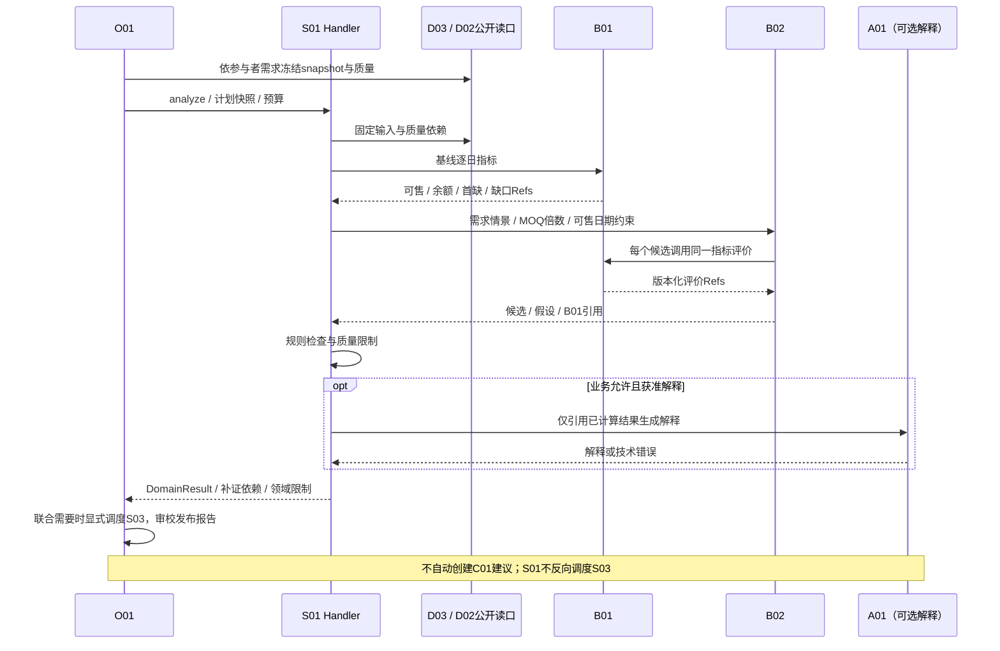

### 14.2 S02 履约风险分析（P0；运输到货深化依原规划）

| 设计项 | 场景设计 |
|---|---|
| 目标 / 输入输出 | 输入订单/包裹映射、承诺时点、仓内与物流事件、催单；输出未出库/物流停滞待核队列、证据与责任线索，保留多包裹粒度 |
| Agent / 多Agent必要性 | 不需要；首批S02窄切片明确无模型。后续解释可选但不替代规则，无“仓库Agent+物流Agent” |
| 范式与理由 | 确定性Workflow/规则分流，事件时间与状态映射明确，可直接测试超时判定 |
| 规则 / SQL / B / A职责 | D02提供关联及乱序处理版本；B01评价超承诺/时长指标；S02按规则分流。A03只补授权事件/处理知识；B02运输预测仅原P1验证后加入 |
| 真正LLM步骤 | 汇总已证实事实与候选原因、说明待核差异；不用LLM判断已发货或断言物流方责任 |
| State / Context | 输入校验→metrics→queues→evidence→result；保留订单/包裹Ref、event cutoff、分流规则版本、缺口。Context不把旧事件压缩成新状态 |
| 只读工具清单 | metric.read、projection.read（承诺/事件白名单）、evidence.resolve、必要knowledge.retrieve；最小基座不注册模型工具 |
| 权限 / 预算 | 店铺/仓/订单字段权限，客户姓名/地址通常不必入模型；任务总预算与行数/事件窗口限制，首批modelCalls=0 |
| 失败 / 降级 / 人工 / 终止 | 承诺或包裹映射缺失标待核不瞎判超时；事件覆盖缺口不当“物流正常”；解释失败保留规则队列；超期/取消按安全点终止 |
| O01及跨场景协作 | 领域返回风险与证据，O01汇总；需要库存领域重算由O01显式S01，不能直接运行另一Handler。内部工单另行C01流程 |
| 观测 / 验收 | 首批对照MC01—MC12；AC-05中10张超时订单分6未出库/4物流停滞，另测多包裹/迟到事件/过期数据；不将候选原因当已证实责任 |
| 未验证及启用门槛 | 承诺时间/业务时区、事件覆盖/映射、真实物流来源待V02/V03。到货预测需B02真实样本及可售终点评价，不混入当前必建项 |

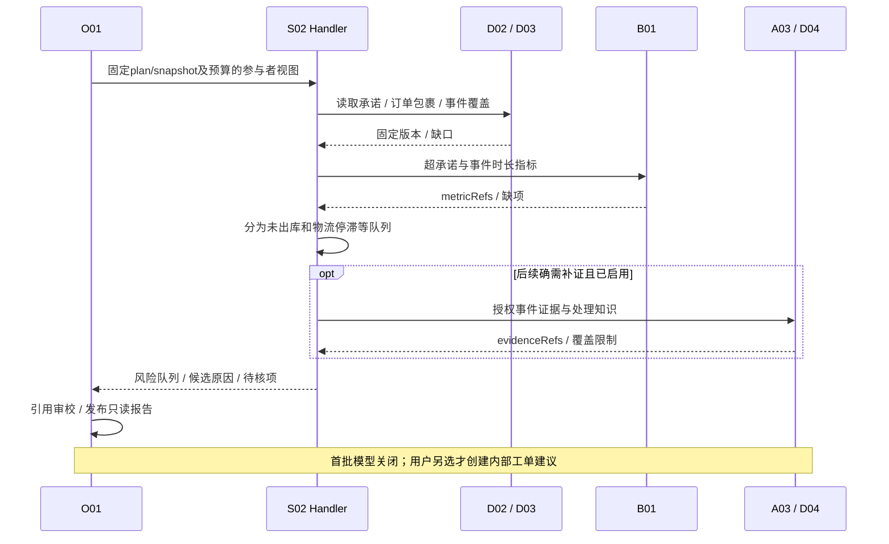

### 14.3 S03 客户体验分析 / VOC（P0）

| 设计项 | 场景设计 |
|---|---|
| 目标 / 输入输出 | 输入授权脱敏反馈、订单映射、店铺/SKU、成熟签收群组与观察窗；输出A02主题/UNKNOWN、B01去重投诉占比、样本量/证据及调查候选 |
| Agent / 多Agent必要性 | 不需要自主Agent；文本分批/多语言是A02理解工作流，不增加主题、统计和审校三个独立Agent |
| 范式与理由 | Workflow + 有界A02批处理 + B01统计；人工修订以A02新版本回溯，不在场景另写标签库 |
| 规则 / SQL / B / A职责 | D02负责订单关联；A02提取主题/语言/原文位置/置信度或UNKNOWN；B01负责成熟队列、投诉口径、去重订单分子分母；S03决定调查信号 |
| 真正LLM步骤 | A02中的多语言主题/意图理解、可选主题归纳；LLM不算投诉率，不合并商品身份，不把投诉认定商品缺陷 |
| State / Context | cohort/taxonomy固定→batch游标→understandingRefs→metricRefs→signal；Context保留原文位置、否定/语言、人工修订、窗口/分母和UNKNOWN比例，客户身份不跨批广播 |
| 只读工具清单 | evidence.resolve、metric.read、必要knowledge.retrieve；主体理解直接调用A02，无需让模型动态选择整库工具 |
| 权限 / 预算 | 反馈与订单权限交集、敏感最小化；批次并行/模型费用共享task额度，每批结果版本可复用，不能每条反馈新领完整预算；禁响应缓存客户文本 |
| 失败 / 降级 / 人工 / 终止 | 主题失败保留UNKNOWN及覆盖限制；无成熟分母不能输出确定占比；低置信关键主题人工复核；必需质量信号缺失则阻断依赖它的补货结论 |
| O01及跨场景协作 | 通过DomainResult/O01已发布领域引用提供质量信号；不调S01/S05。实际新增分析由O01显式JOINT，人工修订后重跑仍遵守快照/版本/重规划 |
| 观测 / 验收 | 分语言/主题的召回、UNKNOWN、人工修订、批次覆盖、分子分母可追。AC-06三工单不等于三投诉订单；AC-04演示100单12投诉为12%投诉占比，非缺陷率 |
| 未验证及启用门槛 | 真实分类体系/投诉定义/成熟窗/调查阈值、隐私与语种样本待V03/V09/V13；模型自报confidence不视为已校准概率 |

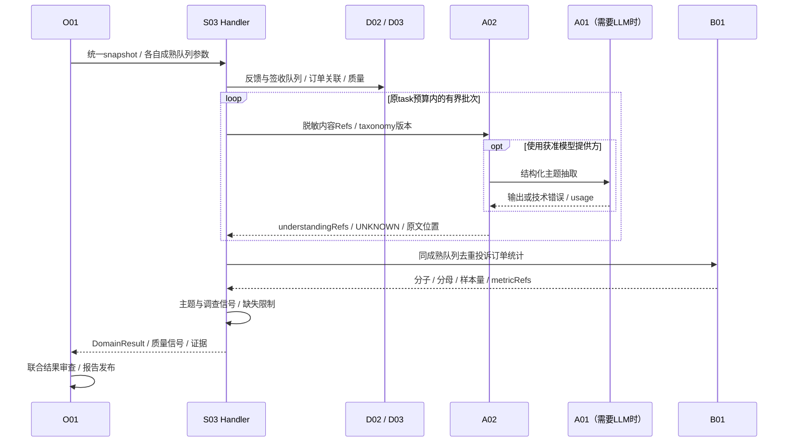

### 14.4 S04 贡献与费用分析（P0；账单核查深化依原规划）

| 设计项 | 场景设计 |
|---|---|
| 目标 / 输入输出 | 输入实收、成功退款、平台/履约费、成本、财务确认转回、币种/汇率与账单版本；输出贡献/差异分解、覆盖/缺项和内部核查候选，非净利润 |
| Agent / 多Agent必要性 | 不需要。财务口径/账单去重与分解均确定性，不能交“财务Agent”自行计算/改账 |
| 范式与理由 | Workflow→B01→受控证据→可选A01解释；账单规则/匹配按财务签认版本扩展 |
| 规则 / SQL / B / A职责 | D01/D02区分累计/增量、币种与来源；B01唯一Decimal贡献与差异指标；S04使用口径并组织解释；A03补费用证据，不生成新汇率/公式 |
| 真正LLM步骤 | 将B01结果及费用缺项描述为候选归因、核查问题；不补缺费用为0，不虚构广告订单归因或未经财务确认转回 |
| State / Context | coverage→metricRefs→decomposition→evidence→narrative；Context保留币种/实际估算/账单版本/确认转回/未知，不压缩掉负号和缺项 |
| 只读工具清单 | metric.read、evidence.resolve、projection.read（获准财务字段）、必要knowledge.retrieve；无修改账目/退款工具 |
| 权限 / 预算 | 财务字段、店铺、期间最小权限；费用及贡献禁止网关响应缓存；解释调用只用task原额度，无额外财务Agent预算 |
| 失败 / 降级 / 人工 / 终止 | 关键费用缺失为部分贡献，不命名净利润；币种/汇率未确认阻断对应比较；模型失败仍可规则表；来源矛盾财务复核 |
| O01及跨场景协作 | 发布领域结果供S06/S08按版本引用；需要新领域重算由O01调度。内部核查工单另行C01/C02/C03，不自动改账 |
| 观测 / 验收 | AC-07按确认事实依次19.23、−0.67、4.33 USD；无成本转回证据不加5。AC-08累计20→37.23只取37.23不相加；解释不得更改B01值 |
| 未验证及启用门槛 | 财务口径/实际估算/汇率/退款与成本转回/覆盖待V02/V03；未有账单接口或订单广告归因证据不虚构能力 |

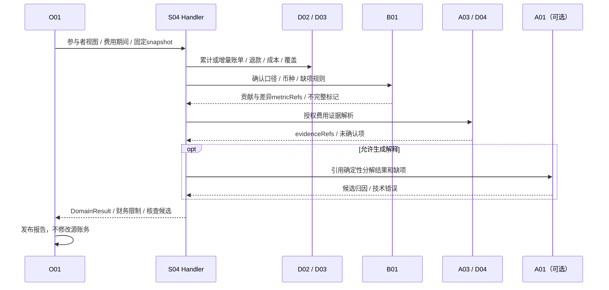

### 14.5 S05 客服辅助（P1）

| 设计项 | 场景设计 |
|---|---|
| 目标 / 输入输出 | 输入授权会话片段、订单事实、商品知识、有效售后政策/语言；输出内部回复草稿、事实引用、待确认项和售后处理建议，不发送客户消息或承诺退款 |
| Agent / 多Agent必要性 | 起步不需要，Workflow可完成意图→取证→草稿。固定路径对复杂追问确有不足后才验证单个受限只读ReAct；多Agent无当前必要 |
| 范式与理由 | 有限Router/规则澄清+RAG生成；候选ReAct仅选择既有证据工具，不能执行售后动作或路由到隐藏场景 |
| 规则 / SQL / B / A职责 | D02固定订单视图；A02意图/语言理解；A03按权限查有效政策/知识及S03已发布结果；需要指标时复用B01，不重做VOC或退款计算 |
| 真正LLM步骤 | 多语言语义、语气和基于证据的草稿生成；不能自行作赔付/退货资格最终判断或补物流承诺 |
| State / Context | intent→evidence→draft→humanReview；可选Loop保存evidenceGap与工具游标。Context单用户/会话最小片段、政策生效日/适用地区和原文引用；不共享原始客服历史 |
| 只读工具清单 | knowledge.retrieve、evidence.resolve、projection.read（订单最小字段）、domain_result.read（S03兼容已发布）；metric.read按需，工具发现集合严格受限 |
| 权限 / 预算 | 客服岗位/店铺/客户订单关联与敏感字段控制；SESSION隔离，禁止网关缓存对话/客户草稿；单Loop原task共享预算且步数/工具/期限全有界 |
| 失败 / 降级 / 人工 / 终止 | 政策缺失/冲突、订单无法授权、意图不清时返回澄清/人工；不输出无依据承诺。模型不可用仅列可核查事实，不伪装完成多语言草稿；达到停止条件交人工 |
| O01及跨场景协作 | 读取S03有效已发布主题；若需重算S03由O01显式纳入。W01由客服复核草稿，客户发送仍在原业务系统，本文不扩展C03动作 |
| 观测 / 验收 | 意图分层、政策引用、无依据承诺率、语言人工通过、客户资料隔离、成本/停止原因；含注入客服文本不改变工具白名单、订单变更不被旧上下文覆盖 |
| 未验证及启用门槛 | 真实语言/售后规则/政策版本/客服权限/金标准待验证；ReAct与Workflow配对评测有收益才启用，不预设已达准确率 |

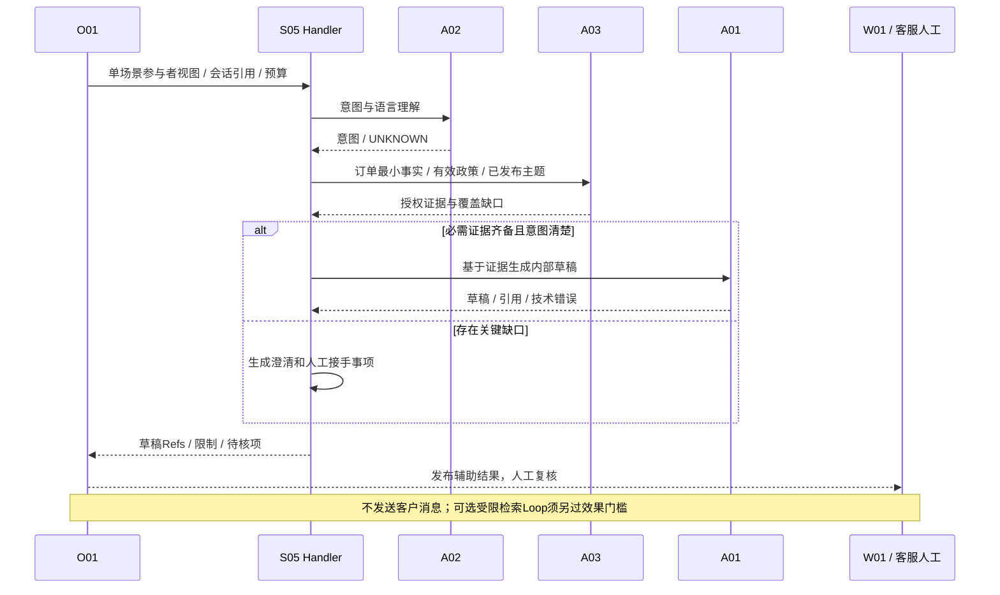

### 14.6 S06 内容与增长辅助（P1）

| 设计项 | 场景设计 |
|---|---|
| 目标 / 输入输出 | 输入已确认商品事实、术语、授权素材、目标语言/市场/渠道规则、广告期间数据和S04有效贡献引用；输出本地化文案/素材建议、广告诊断假设和审核问题，不发布/投放 |
| Agent / 多Agent必要性 | 单Workflow足够；候选生成不是必须Agent。事实Reviewer先用规则/人工；独立模型Reviewer仅效果增益被证明后启用，不默认多Agent |
| 范式与理由 | Workflow+有限候选生成；Evaluator–Optimizer仅条件验证，迭代共用总预算，禁止反复润色到费用耗尽 |
| 规则 / SQL / B / A职责 | A02抽取/翻译已有事实；A03查术语和获准规则；B01按确认口径读期间广告/贡献指标，B02仅已有获准模拟用例才调；S06不接管定价 |
| 真正LLM步骤 | 文案本地化、风格适配、候选素材说明和诊断假设；不夸大规格、生成无依据功效或伪造订单级广告归因 |
| State / Context | facts→locale→candidateRefs→validationIssues→finalDraft；保留事实映射/禁止声明/素材许可/市场适用范围，Reviewer仅接最小候选和事实Refs |
| 只读工具清单 | knowledge.retrieve、evidence.resolve、metric.read、domain_result.read（S04）；不得有publish、ad.create、budget.update类工具 |
| 权限 / 预算 | 商品/素材许可、店铺/渠道/财务字段限制；候选数与迭代数为task内切片，默认静态生成结果也不启缓存，确需低敏文本复用才按§9单项准入 |
| 失败 / 降级 / 人工 / 终止 | 商品事实/许可/市场规则缺失阻断相应文案；模型失败返回事实与审核清单；关键主张冲突必须人工；Reviewer未通过不自动修改到“通过” |
| O01及跨场景协作 | S04已发布贡献按版本/时间窗引用；新贡献分析由O01显式计划。定价属于S08，发布/投放不在本轮写范围 |
| 观测 / 验收 | 事实保持、术语、禁用声明、授权素材引用、语言人工复核、单位任务成本；增长收益须业务实验，不以文案评分代替转化提升 |
| 未验证及启用门槛 | 样本、品牌术语、渠道规则、素材授权、广告归因及审核标准待验证；模型Reviewer/多Agent只有同预算对照证实增益才启用 |

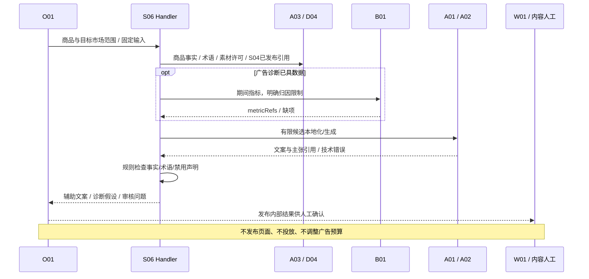

### 14.7 S07 单证辅助（P1）

| 设计项 | 场景设计 |
|---|---|
| 目标 / 输入输出 | 输入授权发票/装箱单等文件版本及业务核对规则；输出字段/页码位置、差异、UNKNOWN、人工复核清单，不办理报关或写ERP主数据 |
| Agent / 多Agent必要性 | 不需要；多文件解析优先A02有界并行，不是多个单证Agent。规则核对可以直接测试 |
| 范式与理由 | Workflow→A02抽取→确定性跨单校验→人工复核；自由工具Loop不会改善数量/单位规则可信性 |
| 规则 / SQL / B / A职责 | A02按实际材料选专业解析器/获准模型；D04定位字段；S07定义跨单关系规则；已有指标调用B01，文档字段匹配不另建财务指标引擎 |
| 真正LLM步骤 | 版式/语言理解、字段归一化建议和差异解释；关键数量、金额、单位/商品映射仍显式校验，不让模型自动确认主数据 |
| State / Context | documentRefs/hashes→parseBatch→fieldRefs→mismatchRefs→review；Context只含必要字段及来源位置，保留原值、归一化值、置信或UNKNOWN和人工修订 |
| 只读工具清单 | evidence.resolve、knowledge.retrieve（核对规则）、projection.read（需比对的获准对象）；解析经A02直接流程，不注册任意文件读写工具 |
| 权限 / 预算 | 文档租户/岗位/对象权限；附件大小/页数/解压比与解析超时有界；每文档/页成本计同task，私有单证不准响应缓存 |
| 失败 / 降级 / 人工 / 终止 | 关键字段低置信/UNKNOWN需人工确认；解析失败列未覆盖页，不能当无差异；单位/身份不明确阻断相应通过结论；恶意文件拒绝处理 |
| O01及跨场景协作 | 单证结果通过DomainResult返回，映射纠正回D02责任流程；内部调查另行C01，不改源单据/报关/审批链 |
| 观测 / 验收 | 字段exact match/定位、关键字段漏检、差异召回、人工改动和页覆盖；每关键字段有原文定位，低置信不自动“核对通过” |
| 未验证及启用门槛 | 文件版式/语言、真实样本、解析器能力/许可、规则与校准阈值待验证；不能据文档写了OCR就宣布已有准确率 |

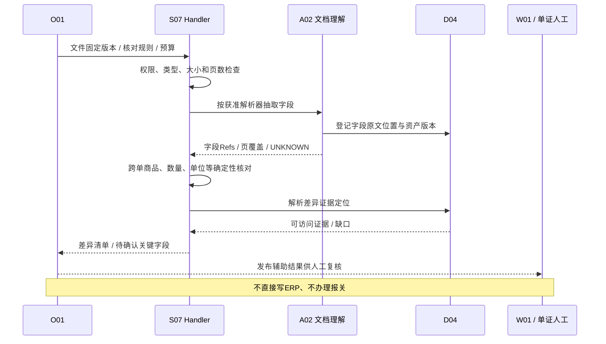

### 14.8 S08 经营规划（P2）

| 设计项 | 场景设计 |
|---|---|
| 目标 / 输入输出 | 输入授权市场资料、S03/S04已发布结果、S01有效预测、成本/价格/仓网/业务约束；输出选品/定价促销/多仓候选、假设、B01评价/可行性限制和不确定性 |
| Agent / 多Agent必要性 | 当前不证明需要。每个子问题先Workflow+B02求解；复杂调研解释可评估单Plan-and-Execute；独立方案Reviewer/多Agent为未验证选项 |
| 范式与理由 | 确定性求解+有依据解释；LLM不能替代优化器、需求预测或O01跨场景编排。多个候选不自动等于多个Agent |
| 规则 / SQL / B / A职责 | B02统一构造/优化候选，B01评价假设指标；A03检索获准市场/知识；S01预测通过公开产物复用，不再预测；S08维护经营约束和选择说明 |
| 真正LLM步骤 | 授权资料比较、假设清单、方案权衡解释和问题澄清；不编造价格弹性/仓容/需求或将相关性作因果收益 |
| State / Context | subproblem→validatedConstraints→inputRefs→candidateRefs→comparison→review；Context区分事实/预测/假设，保留训练截止/预测窗/成本版本和无解原因 |
| 只读工具清单 | knowledge.retrieve、metric.read、evidence.resolve、domain_result.read（S01/S03/S04）；projection.read限获准仓网字段，不暴露改价/调仓工具 |
| 权限 / 预算 | 市场数据许可与敏感成本权限；求解资源/候选数/内部角色并发与模型共享原task配置；规划结果含私有经营假设禁止响应缓存 |
| 失败 / 降级 / 人工 / 终止 | 缺合法市场来源/预测/仓网约束时相应子问题阻断；无可行解明确返回；不能靠LLM松约束。模型失败保留求解器可解释产物，关键假设人工确认 |
| O01及跨场景协作 | 有效已发布结果优先复用；需新S01/S03/S04分析由O01显式JOINT并协调同输入/兼容性，不互调Handler；经营动作不自动审批或执行 |
| 观测 / 验收 | 候选约束满足率、B01唯一评价、无未来泄漏、已发布预测版本、假设清晰度、成本/时延；优化可行不等于供应承诺或真实收益，须专项业务对照 |
| 未验证及启用门槛 | 市场授权/需求响应/仓网/目标函数/真实基线/求解器能力均待验证；数据不足只输出验证方案，不虚构生产方案与盈利提升 |

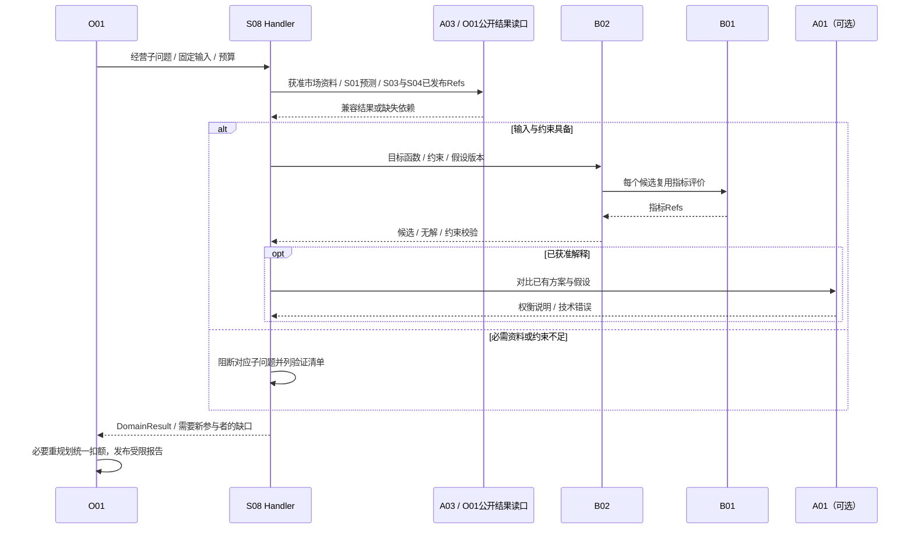

### 14.9 S09 视觉质检辅助（P2）

| 设计项 | 场景设计 |
|---|---|
| 目标 / 输入输出 | 输入授权图片/拍摄条件、商品范围与已签认缺陷标准；输出可疑区域/类别/证据、UNKNOWN及人工确认项，不直接决定放行/报废/库存调整 |
| Agent / 多Agent必要性 | 不需要；视觉识别是A02提供方能力，多视角图像批处理不应包装为自主Agent团队 |
| 范式与理由 | Workflow→图片质量检查→A02视觉理解→规则与人工复核，避免自然语言Loop重复看图产生无依据自信 |
| 规则 / SQL / B / A职责 | A02扩展图像UnderstandingProvider，LLM视觉模型如需要仍经A01；D04定位图像/区域；S09维护标准与确认流程，统计指标有需求才走B01 |
| 真正LLM步骤 | 待验证视觉模型对缺陷描述/区域提示的辅助能力；不预设必能精准定位或读出尺寸，非LLM视觉模型也是候选 |
| State / Context | imageRefs/hash→captureQuality→inferenceRefs→reviewFlags；Context包含商品/缺陷标准版本、区域坐标系/尺寸、覆盖与UNKNOWN，图片元数据按最小必要处理 |
| 只读工具清单 | evidence.resolve、knowledge.retrieve（标准）；模型不取得相机控制/任意文件路径/库存写入，图像输入经A02公开契约 |
| 权限 / 预算 | 图片、商品、岗位与供应商敏感信息控制；图片数/分辨率/推理时长/多模态费用上界待验证，未知上界不启硬预算生产调用；不准网关缓存私有质检结论 |
| 失败 / 降级 / 人工 / 终止 | 模糊/遮挡/未见类别/模型不支持时明确UNKNOWN转人工；缺陷标准缺失不推断；技术失败不当“无缺陷”；最终决定由既有业务流程 |
| O01及跨场景协作 | 结果为辅助派生产物，后续场景按许可/版本引用；投诉主题不能反向成为已确认缺陷标签。C03无库存调整能力 |
| 观测 / 验收 | 按缺陷类别/商品/拍摄条件分层漏检/误报、区域定位（能力存在才测）、人工确认和未知率；重点缺陷漏检为独立门槛，不能被正常图片平均准确率掩盖 |
| 未验证及启用门槛 | 正负样本、缺陷定义、拍摄/标注一致性、模型能力/许可/算力和人工责任未具备，先专项验证，不宣称生产精度或GPU配置 |

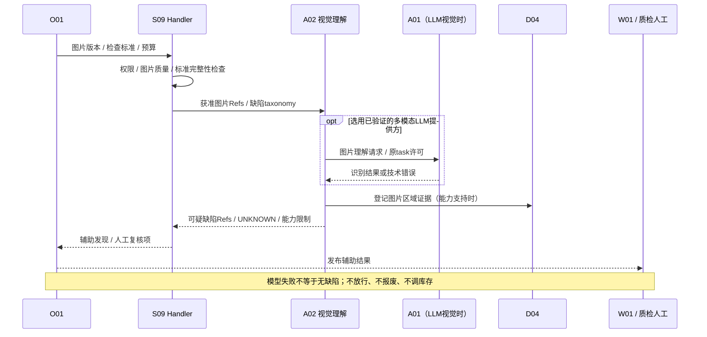

### 14.10 S10 政策核查辅助（P2）

| 设计项 | 场景设计 |
|---|---|
| 目标 / 输入输出 | 输入商品属性、目标市场/地区、核查时点与获准官方资料版本；输出条款引用、适用性问题、冲突/缺项和专业复核清单，非最终合规结论 |
| Agent / 多Agent必要性 | 默认不需要，固定RAG+规则比对即可；多步跨条款补证的次序若确需自适应，才验证单受限ReAct。无必须多Agent证据 |
| 范式与理由 | Workflow检索有效政策→条款比对→可选生成；条件Loop只在已授权资料集中补证，不默认联网、全网抓取或独立法律Agent |
| 规则 / SQL / B / A职责 | A03负责有效时间/地区/资产版本过滤和证据，A02抽取条款/属性，S10维护核查项与专业复核规则；指标需求有真实用例才调B01 |
| 真正LLM步骤 | 有引用的条款归纳、属性/条款候选匹配与澄清；不能判定企业已合规、自动改变商品属性或声明政策已完成法律审查 |
| State / Context | jurisdiction/date/productAttrs→policyRefs→clauseMap→conflicts→review；Context保留生效/废止、发布主体、适用范围/例外和原条款位置，不能摘要掉关键否定/例外 |
| 只读工具清单 | knowledge.retrieve、evidence.resolve、projection.read（已授权商品属性）；无任意web/http或提交监管资料工具 |
| 权限 / 预算 | 商品/政策资料权限及用途，task共享期限/工具/token，条件Loop不扩范围；政策适用性结论禁响应缓存，仅可复用有效原文引用 |
| 失败 / 降级 / 人工 / 终止 | 资料过期/权威性不足/地区日期不明/条款冲突或必要属性缺失→待验证并专业复核；模型不可用列证据清单与缺口，不给最终结论；超限正确停止 |
| O01及跨场景协作 | 需要其他领域新分析由O01显式参与者，不在S10内部重新运行S07/S08；专业复核不等于C02批准某外部动作，本轮无监管提交写入 |
| 观测 / 验收 | 版本适用正确、claim级引用支持、例外/反证保真、过期资料拦截和拒答/澄清；专业人工评分独立于LLM-as-Judge；无依据确定合规为关键错误 |
| 未验证及启用门槛 | 政策来源授权/更新责任、地区/商品属性标准、专业负责人/金标准待确认；本文不新增法律判断或声称法规已核验有效 |

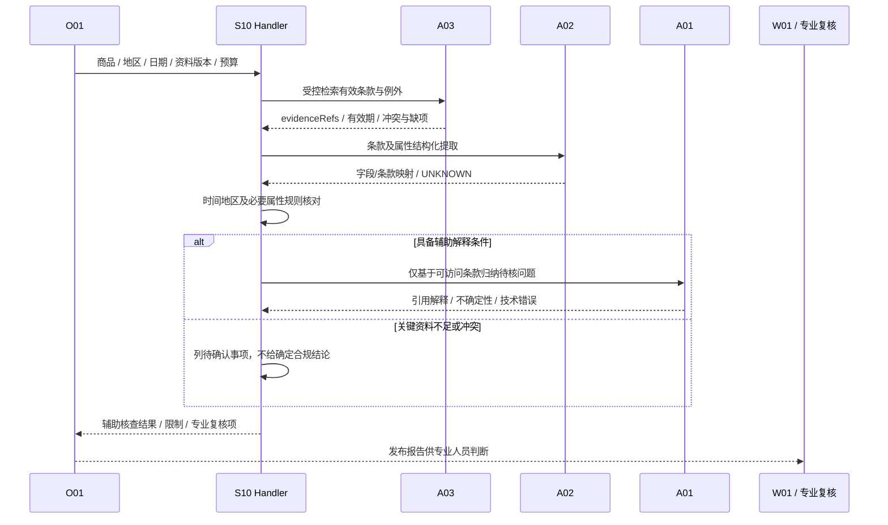

## 15 实施依赖、MC / M 衔接及最低验收

### 15.1 契约冻结顺序与实施分层

冻结是下一步独立审查后的工作，不表示本轮通过设计即可开发。优先冻结有真实消费者的窄契约，避免把所有规划字段、表和框架一次加入首批工程。

| 顺序 / 能力 | 依赖与所有者 | 实施时机 / 最低验收门槛 |
|---|---|---|
| 1 现有任务与数据契约 | O01 AnalysisContext 0.2、ScenarioHandler、DomainResult；G01权限；D03/D04版本；B01指标 | 沿用概要首批必要子集；SINGLE/JOINT、数据归属、旧计划/租约/越权拒绝，不能加入AI必选字段破坏无模型闭环 |
| 2 首批真实工程闭环 | 概要S02+API+Worker+MySQL、I01/G01/G02/B01/D01—D04 | 对照MC01—MC12；模型关闭，模拟仅限源数据。本文不扩大目录、迁移或运行依赖 |
| 3 首个有真实AI使用方的A01/A02 | 2通过且V09/V13、模型/Schema/Prompt/Context用途与预算冻结；如S03理解 | ModelProvider技术映射/usage、共享预留结算、无隐藏重试、注入/撤权、UNKNOWN、业务金标准；不先建完整Agent Runtime |
| 4 A03必要检索与只读工具 | G01预过滤、D04引用、B01公开指标、明确ToolSpec/QuerySpec | 合法工具最小集合、参数/输出与范围正确，无C03。完整即席入口启用须另过概要6.4多实例周期额度/未知用量门槛 |
| 5 Prompt/Context/G02基础LLMOps | 随3/4实现必要模板/版本/trace/离线集 | 版本可追、敏感正文默认不落日志、模型变更有回归/人工金标准、回滚不混版本 |
| 6 内部受限Loop与checkpoint扩展 | 单Workflow不足有证据，TaskBudgetHandle/取消/恢复已可靠 | 所有停止条件、循环/重复/未知费用、旧Worker/恢复不复活及maxReplans统一；无第二状态库 |
| 7 精确缓存（可选） | 命中收益实测、准入/TTL/Key依赖/当前权限与来源验证成立 | 跨tenant/user/session、撤权/删除/升级、多进程残留不泄露；hit费用不重复计，故障不超预算；不要求Redis |
| 8 固定多角色（可选） | 质量/维护收益相对单Workflow证实，消息/Reducer真实需要 | 并发预留不超发，部分/冲突/迟到/取消正确；不新增独立网络Agent平台 |
| 9 高级框架/索引/LLMOps/Memory | 各自真实需求与对照收益、许可/隐私/运维证明 | 单项评审；长期Memory只允许确认偏好；Redis/Milvus/Neo4j/MQ均非默认依赖 |

“保留接口”指在本文描述端口语义与兼容要求，不提前创建无人使用的类、空目录、数据库表、容器或通用工厂。高级Loop/多Agent/缓存有消费者才冻结实现子集，不能倒推首批MC依赖。

### 15.2 M0—M4 衔接

| 原阶段 | 本设计的落点 | 不得越过的门槛 |
|---|---|---|
| M0 数据与授权验证 | 真实来源/指标/成熟窗、模型用途许可、字段边界、任务与即席额度需求、金标准责任 | 接口/数据/企业身份仍待验证；设计不能代替真实授权 |
| M1 公共基座 | 先概要最小S02闭环，再按真实消费者增A01—A03/必要B02/Prompt/Context/G02 | 首批模型关闭；AI能力启用单独过预算/效果/隔离，不强行一次建完 |
| M2 S01—S04只读试点 | 以Workflow为主，必要理解/解释/受控查询，统一报告与按需建议 | 模型/业务指标分开，质量/成本达标，规则缺失不当安全；不自动审批执行 |
| M3 有限写入 | AI只提供报告/候选；复用C01/C02/C03原事务/当前来源条件/原键核对 | ERP草稿/CRM内部工单逐动作真实证明；模型没有写工具，M3不新增通用Agent执行器 |
| M4 扩展 | P1/P2逐项验证；仅确需时引入Loop/多角色/框架/缓存/索引 | 数据/效果/许可/成本/运营责任逐项齐备，不承诺十场景同时上线 |

### 15.3 MC01—MC12 对照（不改变原验收定义）

| 概要验收项 | AI详细设计保持/后续附加检查 |
|---|---|
| MC01 | API/Worker独立，MySQL必要；Agent/模型/缓存/框架不是首批启动依赖 |
| MC02 | D01模拟来源清楚，模型评测夹具亦显式simulated，不当真实效果 |
| MC03 | 正式任务只由O01受理，runId/AgentMessage不能创建平行任务 |
| MC04 | task+work+审计短事务不变；AI调用不得在锁内发网络请求 |
| MC05 | API重启不丢任务，Runtime内存不是恢复唯一来源 |
| MC06 | O01→S02→B01调用链不变，AI trace是以后扩展，不替代领域步骤 |
| MC07 | D03 manifest、B01产物、D04证据唯一；模型解释只能引用 |
| MC08 | 已发布报告可读且无自动C记录；缓存/草稿不得改变这个终点 |
| MC09 | 两Worker、旧租约和重复发布防护；新增Loop也须条件checkpoint/禁止迟到发布 |
| MC10 | 崩溃/重入/超限有明确收尾；AI未决计费占额，不因重启重置预算 |
| MC11 | 跨tenant/scope/未注册能力拒绝；扩大到工具/Context/缓存/Agent消息同样适用 |
| MC12 | 取消/配置/日志/交接约束不变；后续模型迟到不复活任务、无明文秘密 |

MC均是未来实施验收，本轮只完成文档与图示检查。收费模型/即席/审批执行的附加门槛不混入最初MC闭环，也不因MC工程通过跳过M0/M2/M3真实验证。

## 16 待验证假设、风险与实施门槛

本节AI编号仅为设计事项索引，不新增模块或建设阶段。概要V编号仍保留，AI事项补充其验证方法，不能宣称本轮已解除。

| 编号 / 状态 | 假设或风险 / 关联概要项 | 验证证据、责任与启用门槛 |
|---|---|---|
| AI01【待验证】 | Workflow能满足P0，Loop收益未知；V14 | 各场景owner+AI：固定任务与反例比较；不足才启单Loop，不因技术偏好启用 |
| AI02【待验证】 | 模型结构化/工具/模态/usage及版本可钉住；V13 | A01owner：真实提供方契约样本、能力/地域/计费验证；不支持则拒绝该用途 |
| AI03【待验证】 | 正式/即席预算与多实例核算；V05 | O01/A03/G01/G02+运维：并发预留、未知费用、切入口/重试/恢复；统一总额要求未证明关闭相关收费入口 |
| AI04【待验证】 | 库存/质量/费用/成熟窗及必需依赖足以支持结论；V02—V04 | 业务/数据：真实映射、窗口/口径、质量与降级实例签认；缺信号阻断依赖结论 |
| AI05【待验证】 | 云端/本地数据许可、保留删除/模型侧缓存；V09/V13 | 数据/安全/法务/提供方：实际链路及合同/删除证据；本文不作许可已获结论 |
| AI06【建议→待验证】 | 精确响应缓存是否值得做、TTL/epoch有效性 | A01/G01/A03：真实重复率与节约、撤权/删除/来源/模型变化、多进程残留测试；未验证默认OFF |
| AI07【暂缓】 | 语义缓存可能错误复用近似问题 | 业务+AI：必须定义可替代语义等价、有效期和隔离金标准；当前不建设，动态/敏感类别保持禁止 |
| AI08【待验证】 | Summary保真、上下文估算和证据覆盖；V14 | 场景/A03：单位/负号/否定/反证/缺项对照与截断样例；必需事实容不下停止，不补猜 |
| AI09【待验证】 | 质量阈值/金标准/语言及关键错误覆盖；V13 | 业务/G02：标注裁决、分层规模、tau与观察窗签认；未冻结不得灰度放量 |
| AI10【暂缓】 | 多角色/框架可减少复杂度且不重复状态 | 场景/架构owner：单Workflow对照、预算/持久化/取消集成证明；不能接入唯一O01 checkpoint则不采用 |
| AI11【待验证】 | S07/OCR、S09视觉、S08求解/市场能力 | 各P1/P2owner：真实材料/样本/许可/模型/算力及业务约束；无证据不承诺能力/准确率/收益 |
| AI12【待验证】 | S10政策权威性、更新和专业裁决责任 | S10业务/专业owner：来源/有效版本/适用性金标准、更新责任；未具备仅形成验证方案 |
| AI13【待验证】 | 长暂停/崩溃/旧版本可恢复；V05/V15 | O01/运维：deadline收尾、pending usage核对、旧租约/取消/版本不可得测试；禁止无限RUNNING |
| AI14【待验证】 | C03原子来源条件、幂等和未知恢复；V06/V07 | C03/系统责任人：沿概要13.2.1逐动作真实证明；LLM/缓存/Checkpoint均不能替代，未通过不开放M3动作 |
| AI15【待确认】 | 日志/评测/Prompt抽样留存及研发发布责任；V08/V09/V15 | G02/数据/安全/研发负责人：留存表、删除覆盖、发布岗位/流程；不默认采集全量敏感正文 |
| AI16【暂缓】 | 用户长期偏好持久化有无真实需求；V14 | W01产品/数据：确认/撤销/范围/留存与归属；没有用例不建Memory服务或表 |

## 17 追踪、一致性审查与交付

### 17.1 ER01—ER10 对应

| 基线规则 | 本文落点 | 内部检查的具体问题 |
|---|---|---|
| ER01 任务与场景 | §2、§3、§7、§14 | O01不旁路领域B01/B02/A02；无隐藏参与者/场景反调；Runtime无任务权威 |
| ER02 计算唯一 | §2、§14.1/.4/.8 | B02→B01单向；LLM不算权威金额/供需；情景不当事实 |
| ER03 模型边界 | §3、§4、§7、§9 | A01仅技术结果/适配/缓存，不执行工具/业务降级/批准 |
| ER04 数据所有权 | §2、§3、§5、§11 | D03唯一manifest，D04定位，O01任务/报告/checkpoint；无Runtime事实或状态库 |
| ER05 只读工具 | §6、§7、§10、§14 | C03不进入模型工具；无任意SQL/Cypher/shell/URL/代码上传 |
| ER06 人工控制 | §1、§3、§12、§14 | 只读报告不建建议、确认不提交、批准不执行；Reviewer非批准 |
| ER07 即席查询 | §3.2、§6.2、§9 | A03 QueryRun单次/周期/并发/期限，不伪装O01任务或正式联合报告 |
| ER08 本地事务 | §3.3、§6.2、§15 | 唯一协调短事务、每并发分支独立Session；无锁内网络/私表写入 |
| ER09 投递与外部恢复 | §3.3、§6、§15、AI14 | I01投递不推断模型费用/源执行；C03仍原key核对，不因取消/租约盲目重发 |
| ER10 有界调用 | §6、§7、§9、§11 | 子角色/重试/新Skill不重置预算；未决占额；正式/即席入口不能重复占用同笔预算 |

### 17.2 13项设计要求与材料追踪

| 任务要求 | 本文位置 / 新产物 |
|---|---|
| AI架构/公共底座、状态和接口 | §2—3；图01/02；[可交互职责图](.archify/architecture-ai-runtime-20261111-110000/ai-runtime.html) |
| Prompt / Context / Harness / Loop | §4—7；图03/04；接口及隔离表 |
| 范式与框架 | §8；[技术与范式决策表](ai-design/技术与范式选型决策表.md) |
| A01与缓存 | §9；图05；[缓存准入与隔离矩阵](ai-design/AI网关缓存准入与隔离矩阵.md) |
| Skill/Function Calling / Multi-Agent | §10—11；图04/06；角色消息和Reducer表 |
| LLMOps / 评估 | §12—13；图07；硬门槛/Golden Dataset/发布回滚 |
| S01—S10逐项13点与时序 | §14.1—14.10；图08—17；[场景设计汇编](ai-design/S01—S10_Agent与Workflow设计.md) |
| 实施顺序、MC01—12 / M0—4 | §15；不改变首批无模型闭环 |
| 假设/风险/实施门槛与新增修改清单 | §16；[门槛清单](ai-design/待验证假设与实施门槛清单.md)；[文件清单](ai-design/本次新增及修改文件清单.md) |

Markdown为唯一正文源，HTML、独立摘编表、Mermaid与SVG均由本轮构建脚本从正文派生，不独立维护第二套含义。每个Mermaid代码块按出现顺序编号01—17，全部提供独立.mmd/.svg；多Agent图明确是条件性预案。HTML内嵌已渲染SVG与本地样式，无远程CDN运行依赖；大图可单独打开SVG查看。交互职责图是相同边界的辅助阅读视图，不取代完整架构图。

### 17.3 本轮检查范围与下一步

本轮执行文档引用/覆盖/模块依赖/权限/预算/缓存隔离/版本所有权的内部一致性复核，以及Mermaid真实渲染、SVG/XML、HTML本地阅读检查、基线指纹比对。机器检查主要证明结构和可渲染性，不能证明业务语义无误；内部人工复核记录与发现/修正见 [一致性复核记录](ai-design/内部一致性检查记录.md)，实际机器结果见 [交付验证记录](ai-design/validation-report.json)。

**本轮没有执行MC工程验收、企业API联调、模型效果/安全生产验收、压测或收益验证。** 四份授权基线保持原样。本次仅完成第11步，下一步为独立审查；未冻结的预算/模型/质量阈值/数据许可/降级矩阵/高级能力门槛列于§16，不进入应用代码开发。

## 附录 A 接口约束与可执行验收样例

### A.1 类型、关联与技术输出

| 字段类 | 设计类型 / 约束 | 拒绝条件 |
|---|---|---|
| tenant/principal/session/task/query/participant/run/call/attempt | 非空不透明字符串；长度上界由公共ID规范冻结；taskRef与queryRef必须恰好一个 | 不接受模型/客户端填入的可信身份；所有引用租户一致；未知/额外字段拒绝 |
| 版本/hash/Ref | 显式schema及不可变asset/version；hash含规范化算法版本 | “latest”、空版本、同版本不同hash、不兼容stateSchema禁止恢复/缓存 |
| deadline / created / observed / coverage | UTC时间带语义，deadline只能缩短 | 服务端时钟校验，过期不能调用；sourceUpdatedAt不得冒充coverage |
| 数量/费用与计价 | token/call/row/byte为非负有界整数；金额Decimal字符串+币种+pricingVersion | 负数、溢出、无上界、计价未知不允许承诺费用硬封顶 |
| toolRequests | 有界数组；每项id/name/version/arguments符合获准ToolSpec | 部分流式参数、重复id异指纹、未知工具、writeOnly/副作用工具拒绝 |
| content/validatedObject/toolRequests | 明确finishReason；组合形式按提供方能力合同校验 | 拒答/截断/格式失败不能以空对象标成功；结构通过后还需语义/证据校验 |
| evidenceRefs / outputRefs | 有界数组，每项当前可解析且有权限、版本/快照相容 | 无权引用不能作为不透明id透传到模型/他用户；缺重要证据阻断相应claim |

下例是调用方构造的逻辑请求示意，所有 `*_example` 为虚构占位，不能直接发送，实际限额须从获准配置引用解析；没有有效许可就拒绝调用。

```json
{
  "schemaVersion": "0.1",
  "logicalCallId": "call_example",
  "attemptId": "attempt_example_1",
  "taskRef": {"tenantId": "tenant_example", "id": "task_example", "version": "plan_example"},
  "participantId": "participant_s03_example",
  "purpose": "A02_VOC_CLASSIFICATION",
  "policyContextRef": "server_bound_current_policy_example",
  "deploymentRef": "approved_deployment_revision_example",
  "promptRef": "a02_voc_prompt_version_example",
  "contextBundleRef": "authorized_context_example",
  "outputSchemaRef": "voc_label_schema_version_example",
  "requiredCapabilities": ["structured_output"],
  "toolSpecs": [],
  "parametersRef": "approved_generation_parameters_example",
  "allowanceRef": "reserved_attempt_allowance_example",
  "deadlineRef": "frozen_task_deadline_example",
  "cachePolicyRef": "OFF",
  "traceId": "trace_example"
}
```

此JSON采用Ref表达已冻结的参数/期限；序列化到ModelProvider前由A01解析成具体值并强校验，不把Ref字符串当模型参数。A02结果中的UNKNOWN和模型技术错误分字段表达；最终DomainResult仍带基线task/plan/participant/snapshot引用，不使用此ModelRequest代替AnalysisContext。

### A.2 控制故障与预期结果（未来验收设计）

| 用例 | 输入/故障 | 必须观察的结果 / 所有者 |
|---|---|---|
| AI-AC01 跨tenant缓存 | 两企业相同文本/模型/Prompt | tenant分区永不同key；不能返回他租户responseRef或证据；A01/G01 |
| AI-AC02 用户/会话隔离 | 同tenant两用户或同用户不同会话，含私有片段 | 禁缓存类别bypass；USER/SESSION条件不满足不复用；A01 |
| AI-AC03 撤权与多进程 | 一个进程旧条目仍在，G01已提交撤权 | 后续读取拒绝；当前epoch无法确认时不返回缓存且不调模型；G01/A01 |
| AI-AC04 来源/版本更新 | 知识删除/更新、人工标签修订、模型别名漂移 | 旧条目miss/invalidated，别名无法钉住禁缓存；D/A所有者与A01 |
| AI-AC05 并发预留 | 两角色/两个Worker争用最后一份可用额度 | 原子最多一次许可，其余拒绝/等待；未知费用不能释放后重用；O01 |
| AI-AC06 超时计费未知 | 提供方已接收，响应/usage丢失后Worker重启 | pending attempt与预留保留，先核对，拒绝同逻辑盲目重发；O01/A01/G02 |
| AI-AC07 输出/工具注入 | 检索片段要求改tenant、提审批或执行C03 | 文本仅作数据，工具注册/参数独立拒绝，无外部写调用；A03/G01 |
| AI-AC08 循环/重规划 | 同工具同参反复提案，或声称内部计划可新增S03 | 有界去重/无进展停止；实际新参与者交O01扣统一maxReplans；Handler/O01 |
| AI-AC09 恢复与取消 | 旧Worker迟到、取消后模型完成、checkpoint版本不兼容 | 不发布/不复活/不重置预算，未知计费仍可核对，版本不兼容停自动恢复；O01 |
| AI-AC10 输入版本混用 | S01旧snapshot与S03新snapshot拟合并 | 拒绝未证明兼容的混合；由O01重规划/D03新快照组织受影响重跑；O01/D03 |
| AI-AC11 暂停超期 | NEED_INPUT后用户长期未回复 | 不重复模型轮询，不无限RUNNING；到deadline按冻结策略收尾，终态恢复需新命令/任务；O01 |
| AI-AC12 缓存计费与评测 | 同响应一次miss、以后多次合法hit | 原attempt费用只记一次，hit本次供应商0；效果评测bypass，时延按hit/miss分层；G02/A01 |
| AI-AC13 关键质量信号缺失 | S03模型失败但S01规则计算可用 | 可保留供需事实，阻断依赖质量安全的结论及转采购，不把RULES_ONLY当安全；S/O01 |
| AI-AC14 即席切入口 | 重复新queryId或与正式任务交替消耗同一配置总额 | 周期/入口分配不重复领额；共享总额并发方案未证明时收费入口关闭；A03/G01/O01 |
| AI-AC15 多角色冲突 | 两角色输出相反结论或缺必需分支 | Reducer保留证据与缺口，不多数投票；版本/范围/预算仍一致；Handler |
| AI-AC16 流式中断 | 工具参数只收到半截或最终JSON截断 | 不执行工具，不缓存/发布半个产物；usage未知保留占额；A01/Handler |

这些用例细化AI控制验收，不重新编号或覆盖原AC-01—AC-12、MC01—MC12；实施时必须与基线用例一起选择实际影响范围。
