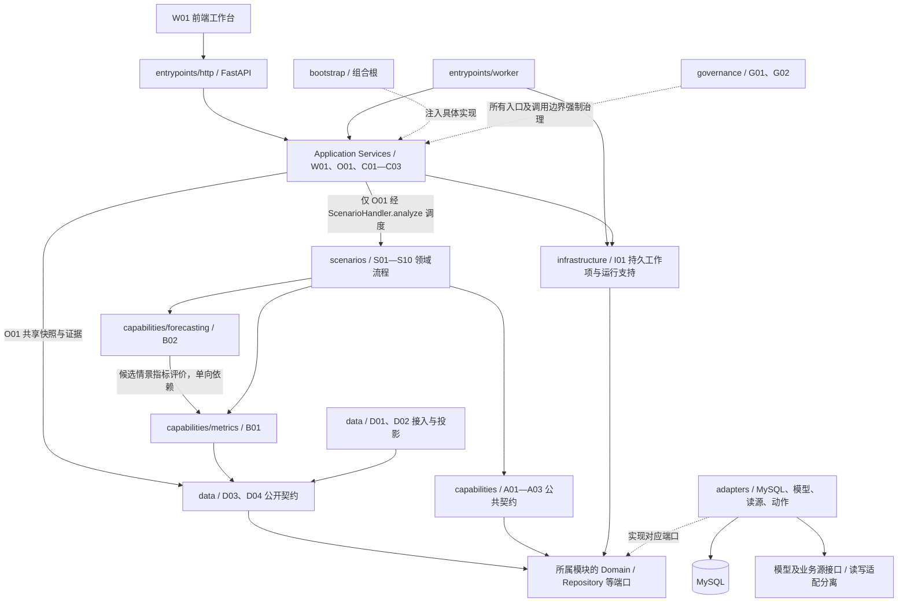
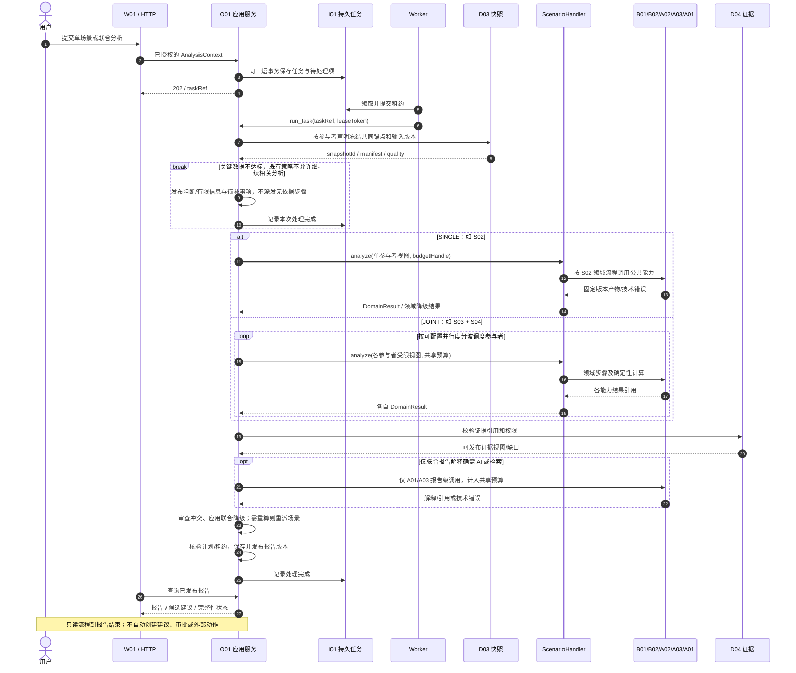
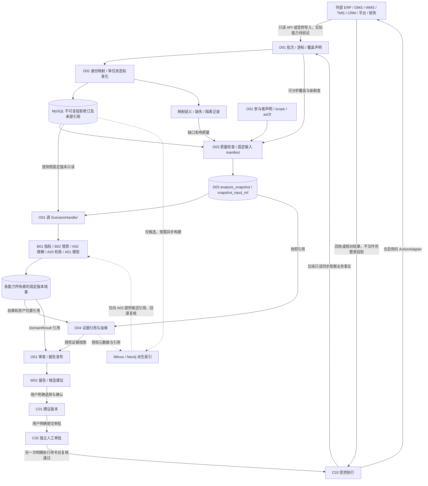
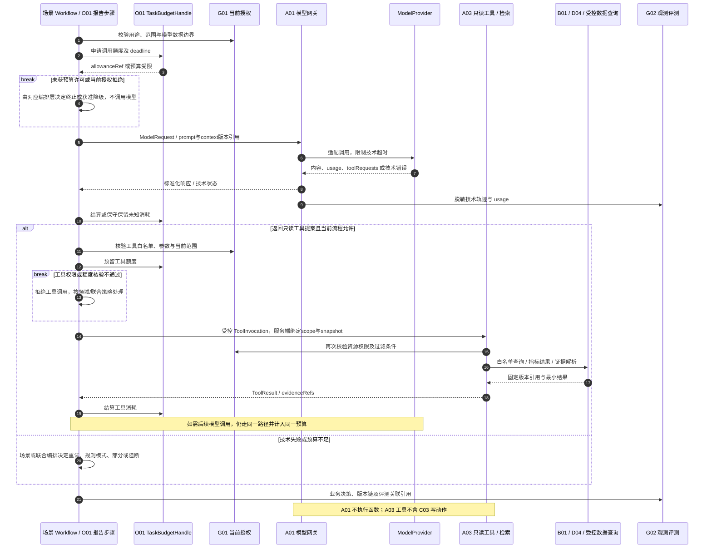
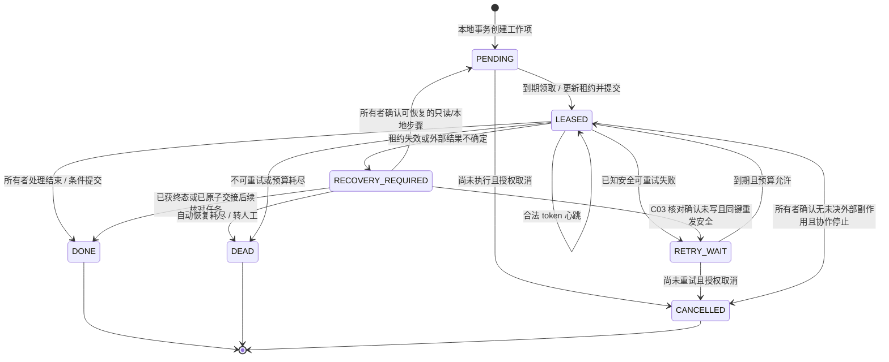
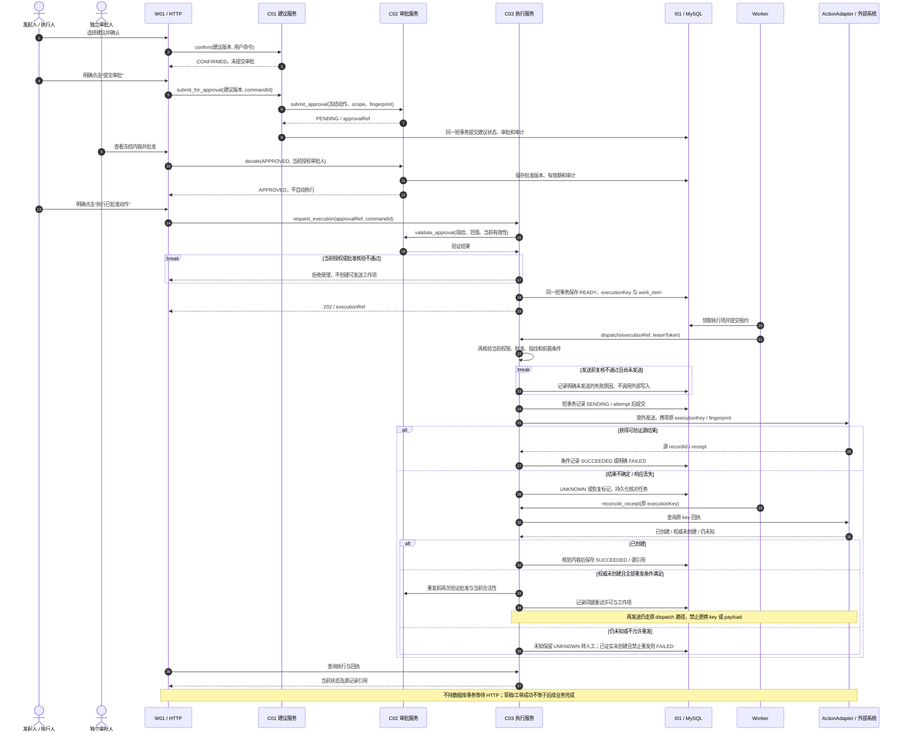

# 跨境电商智慧中台 AI 应用项目概要开发设计文档

> 文档编号：AIH-HLD-001 ｜ 版本：0.1 ｜ 日期：2026-11-11 ｜ 状态：第 8 步概要设计，待独立审查
>
> 设计基线：需求文档草案 v0.2、总体逻辑架构与流程设计 v0.2（含最新两项图示修正）、可行性分析报告 v1.0。本文将已确认的逻辑架构映射为工程方案，保留 S01—S10、17 个公共模块、22 项候选需求及既有建设阶段。
>
> 本次仅形成文档、Mermaid 源图及阅读版，不创建应用工程、不编写业务代码、不连接企业业务系统。接口名称、目录、表名和状态实现方案属于概要设计建议，不表示已经开发或验证。

## 01 设计结论、依据与决策状态

采用 **Python/FastAPI 模块化单体 + 独立异步 Worker + MySQL** 作为工程方向。API 与 Worker 共享模块代码和契约，通过 MySQL 中的持久任务协作；逻辑模块不直接等同于服务或进程。场景负责领域流程，公共能力负责唯一实现，O01 负责单场景与跨领域的任务级协调。

本文用三种标记区分确定程度：**【确定】**来自用户技术方向或已确认基线；**【建议】**为本轮提出、待概要设计审查冻结的工程选择；**【待验证】**必须用真实接口、数据、运维条件或业务口径验证的假设。建议不自动转为已批准实施决策。

| 依据 | 采用的约束 | 本文落点 |
|---|---|---|
| [需求文档草案 v0.2](智慧中台AI应用项目_需求文档草案.md) | 完整场景、唯一归属、公开契约、权限与人工控制、分期 | 第 02、05—09、13、18—20 节 |
| [总体逻辑架构与流程设计 v0.2](智慧中台AI应用项目_总体逻辑架构与流程设计.md) | O01→ScenarioHandler 路径；B02→B01 单向依赖；显式提交审批与执行；五层及横向治理 | 第 03—07、11—14 节及全部工程图 |
| [可行性分析报告 v1.0](智慧中台AI应用项目_可行性分析报告.md) | 接口、容量、质量、安全、人员和预算均有验证门槛；成本示算不是实测 | 第 08、10—12、16—20 节 |

【确定】不调整已通过 R01—R09 的职责边界。原文中历史性的“待复核”页眉不构成本轮重新设计依据；以用户确认的复核结果和最新图示修正为准。三份基线正文及已有图文件保持不变。

【待验证】企业接口尚未被本文接通或测通；真实租户/店铺/仓库规模、数据量、同步频率、任务峰值、模型地域与审批岗位尚不足以冻结容量和上线日期。可研的人月、价格和收益示例不得直接写成 API SLA、线程数或采购配置。

## 02 产品范围、分期与工程建设边界

### 2.1 完整场景与公共基座复用

| 场景 | 保留的业务规划与阶段 | 主要公共能力复用 | 场景自身负责的内容 |
|---|---|---|---|
| S01 供需与库存分析 | P0 分析；预测、滞销、供应商等按原规划扩展 | D01—D04、B01/B02、A01/A03、C01—C03 | 供需解释、候选方案约束、领域降级与建议判断 |
| S02 履约风险分析 | P0；运输方案扩展按原规划 | D01—D04、B01/B02、A01/A03、C01 | 履约窗口、异常判定、风险归因与处置建议 |
| S03 客户体验分析（VOC） | P0 | D01—D04、A02/A03、B01、C01—C03 | VOC 分群规则、成熟队列口径选择、工单建议 |
| S04 贡献与费用分析 | P0；费用审查扩展按原规划 | D01—D04、B01、A01/A03、C01 | 贡献口径使用、费用归因、证据组织与业务解释 |
| S05 客服辅助 | P1 | A01—A03、D01—D04、C01/C02 | 多语言、售后建议与人工确认；不因此开放客户消息发送 |
| S06 内容与增长辅助 | P1 | A01—A03、D01—D04、B01/B02、C01/C02 | 本地化、素材和广告建议；不因此开放自动投放 |
| S07 单证辅助 | P1 | D01—D04、A02/A03、C01/C02 | 字段比对、规则与人工复核；专业解析器按材料需要评估 |
| S08 经营规划 | P2 | D01—D04、B01/B02、A01/A03、C01/C02 | 市场、定价、多仓方案；不因此开放自动改价或调仓 |
| S09 视觉质检辅助 | P2 | D01—D04、A01/A02、C01/C02 | 图像检查标准、异常解释；视觉模型与算力另行验证 |
| S10 政策核查辅助 | P2 | D01—D04、A02/A03、C01/C02 | 政策版本适用、条款比对与专业复核；不把模型答复当最终合规结论 |

所有场景统一使用 W01、O01、G01/G02、I01。表中的复用是可调用的能力范围，不要求每次任务调用所有能力，更不要求一次部署全部候选存储或模型。

### 2.2 分期保持不变

| 原阶段 | 工程交付重点 | 进入下一阶段的证据 |
|---|---|---|
| M0 数据与授权验证 | 数据清单、身份/映射责任、接口样本、动作幂等与回执可行性 | 可研验证清单及真实系统责任人确认；不以 Mock 替代 |
| M1 公共基座 | 统一契约、权限、数据投影/质量/证据、任务、模型和指标基础 | 公共契约与可靠性测试通过，来源与指标可追溯 |
| M2 四类只读场景 | S01—S04 按公共契约接入；建议由用户按需创建 | 单场景与联合分析均满足原验收标准；建议不自动审批 |
| M3 有限写入 | 只开放验证通过的 ERP 采购草稿、CRM 内部工单动作 | 独立审批、幂等、UNKNOWN 恢复、权限和业务责任均验证 |
| M4 扩展规划 | 按需求推进 P1/P2 场景和确有收益的候选技术 | 每个场景单独通过数据、效果、成本与运营门槛 |

【确定】采购草稿创建不等于采购批准或到货，工单创建不等于问题解决。首期不增加库存调整、退款、支付、自动改价、自动投放或客户消息发送。后续新增写入动作必须经过独立的范围与风险评审。

## 03 五层逻辑架构到工程与部署的映射

### 3.1 逻辑模块、代码包和物理单元

| 逻辑层 | 既有模块 | 建议工程归属 | 物理运行位置 |
|---|---|---|---|
| L1 交互层 | W01 | workspace；HTTP 入口及前端交互契约 | 前端静态资源/现有门户 + FastAPI 进程；前端框架待选 |
| L2 场景与任务层 | S01—S10、O01 | scenarios、orchestration | 短命令在 API；持久分析在 Worker；共用同一代码制品 |
| L3 通用能力层 | B01/B02、A01—A03、C01—C03 | capabilities、collaboration | 作为 Python 模块被调用；重计算和外部执行由 Worker 承担 |
| L4 数据与集成层 | D01—D04 | data + 按归属组织的 adapters | Worker 同步、API/Worker 查询；MySQL 为权威持久化 |
| L5 基础设施层 | I01 | infrastructure + adapters | MySQL、进程运行、配置/凭据、任务领取、备份设施 |
| 横向治理 | G01/G02 | governance | API、Worker、工具和适配器边界均执行；不是单独部署要求 |

【确定】至少区分 API 与 Worker 的进程生命周期；【建议】同一版本制品、不同启动入口和配置，按实际负载配置 Worker 数量。API 重启不丢任务；Worker 重启不丢业务状态。前后端可通过现有入口部署，本文不新增网关或前端服务要求。

MySQL 是需要运行的持久化组件。云模型是外部依赖；本地模型服务仅在算力、许可和数据边界验证后部署。Milvus、Neo4j 均不出现在当前必需部署清单。执行凭据需要更强隔离时，可用同一 Worker 制品的受限执行角色/独立配置运行，不据此提前拆分独立业务服务。

### 3.2 工程模块与依赖图

下图为工程分层和主要依赖视图，不逐一展开第 5 节中的全部允许调用。实线表示主要使用依赖，虚线表示实现、注入或治理约束；不表示每个框都是一个进程。API 与 Worker 是入口，模块内部的数据访问须经所属 Repository 端口。



图中 Application Services、Domain/Ports、adapters 是代码层和目录分组，不是新增的万能服务或统一执行器。O01 只直接使用 D03/D04 及联合报告限定的 A01/A03；场景按公开契约使用其他数据/能力。A02 需要模型时调用 A01；A03 即席查询由 W01 进入，指标查询复用 B01。这些细部调用按第 5、7、10 节执行，未在工程分层图重复连线。外部写入适配器只注入 C03，读源适配器只用于 D01；G01/G02 对所有边界生效，不能解读为只保护图中所连节点。

### 3.3 API、Service、Domain、Repository、Adapter

| 工程角色 | 职责与允许依赖 | 禁止内容 |
|---|---|---|
| API / 入口 | HTTP 参数与响应映射、身份建立、调用应用服务；Worker 入口接收已注册任务类型 | 在路由中计算供需、拼 Prompt、直接执行 SQL 或第三方写入 |
| Application Service | 所属模块用例、权限检查、事务边界、状态机与对外能力协调；依赖领域和端口 | 越过其他模块公开服务写其私有表；持有跨网络长事务 |
| Domain | 值对象、确定性规则、状态转换、不变量；依赖标准库及必要纯领域类型 | FastAPI、数据库 Session、模型 SDK、HTTP 请求上下文、环境变量读取 |
| Repository 端口 | 面向真实聚合/查询的数据契约，如 TaskStore、SnapshotReader；由需要它的模块拥有 | 全系统 GenericRepository/任意表 CRUD；跨模块共享 ORM 实体 |
| Adapter | 实现 Repository、ModelProvider、SourceConnector、ActionAdapter 等端口；封装 SDK、SQL、协议和重试事实 | 选择业务降级、暗改指标、在模型适配器中审批或执行工具 |
| bootstrap 组合根 | 装配配置、依赖、公开服务、注册表和客户端生命周期 | 承担场景流程；作为任意模块反向查找依赖的全局服务定位器 |

源码依赖方向是 **入口→应用服务→领域/所属端口；适配器→端口；组合根→具体实现**。运行时通过注入到达适配器，不意味着领域代码反向导入基础设施。跨模块仅导入对方公开契约/服务协议；DTO 与 ORM 不跨越持久化边界。内部 Python 调用不转成 HTTP 自调用。

【建议】HTTP DTO 使用 Pydantic 校验并转换为领域类型；领域金额、数量和状态规则保持可独立测试。使用异步 I/O 处理模型和数据接口，CPU 密集预测/视觉任务放入 Worker 的独立进程执行路径，不阻塞 API 事件循环。同步 SDK 如确有需要，在适配器边界使用有界隔离执行，不能默认为所有调用开无限线程。

## 04 建议代码目录与协作归属

以下是未来工程目录提案，不是本轮已生成的工程。每个模块按实际职责建立 application/domain/ports/contracts；只有薄包装的模块不强制填满全部空目录。S05—S10 当前只保留归属和注册约定，实施时再创建其代码与迁移。

```text
commerce-ai-hub/                         # 未来代码工程，本文不初始化
├─ pyproject.toml                        # 依赖、检查配置；锁文件工具待冻结
├─ migrations/                          # 推荐 Alembic；单一迁移历史
├─ src/commerce_hub/
│  ├─ bootstrap/                        # 配置、依赖装配、场景/工具/动作注册
│  ├─ entrypoints/
│  │  ├─ http/                          # FastAPI 应用、路由、错误映射
│  │  └─ worker/                        # 领取循环、任务分派、优雅退出
│  ├─ contracts/                        # 最小共享引用/身份/错误信封；非全量 DTO 仓库
│  ├─ workspace/                        # W01 工作台应用服务与响应视图
│  ├─ orchestration/                    # O01：task、plan、budget、report 内部分工
│  │  ├─ contracts/                    # AnalysisContext、ScenarioHandler、DomainResult
│  │  ├─ application/                  # 调度、检查点、联合审查与发布
│  │  ├─ domain/                       # 任务/计划/预算/报告不变量
│  │  └─ ports/                        # TaskStore、BudgetHandle 等真实需求
│  ├─ scenarios/
│  │  ├─ s01_supply_inventory/          # 领域流程，不另建模型网关或指标库
│  │  ├─ s02_fulfillment/
│  │  ├─ s03_customer_voc/
│  │  ├─ s04_contribution_fees/
│  │  └─ s05…s10/                      # 未来按阶段落地，非当前空工程要求
│  ├─ capabilities/
│  │  ├─ metrics/                      # B01
│  │  ├─ forecasting/                  # B02
│  │  ├─ models/                       # A01 网关、ModelProvider 契约
│  │  ├─ understanding/                # A02
│  │  └─ retrieval/                    # A03；受控查询、工具定义与检索端口
│  ├─ data/
│  │  ├─ sync/                         # D01
│  │  ├─ projection/                   # D02
│  │  ├─ quality/                      # D03 质量与快照
│  │  └─ evidence/                     # D04 引用与血缘
│  ├─ collaboration/
│  │  ├─ suggestions/                  # C01
│  │  ├─ approvals/                    # C02
│  │  └─ executions/                   # C03
│  ├─ governance/
│  │  ├─ access/                      # G01
│  │  └─ observability/               # G02 审计、Trace、成本与评测契约
│  ├─ infrastructure/                 # I01 持久任务、运行配置、凭据引用
│  └─ adapters/
│     ├─ mysql/<owner>/               # 按 O01/D03/C02 等归属实现 Repository
│     ├─ sources/<source_type>/       # D01 读连接器；具体 ERP/CRM 待验证
│     ├─ actions/<action_type>/       # C03 写动作；与只读凭据和接口分离
│     ├─ models/<provider>/           # A01 云端/本地协议适配
│     └─ retrieval/                  # A03 基础 MySQL 查询；候选索引按需添加
├─ tests/
│  ├─ unit/<owner>/
│  ├─ contract/
│  ├─ integration/
│  └─ faults/                         # 并发、回执丢失、越权和恢复
└─ docs/
   ├─ contracts/                      # 版本化公开接口及样例
   ├─ decisions/                      # 已冻结/暂缓决策与依据
   └─ handoff/                        # 模块交接与测试证据，非聊天记录堆积
```

前端工程归属待企业现有门户和团队技术栈确认，概要阶段不凭空选定 React/Vue。前端只消费 W01/API 的契约，不直接访问数据库、模型密钥或 Worker。不存在没有明确职责的 utils、万能 common、通用索引工厂或独立 Memory 服务。

## 05 模块公共契约与唯一责任

### 5.1 公开接口目录

以下方法为建议的模块级接口语义，不承诺最终函数签名。`Ref` 均包含资源 ID、版本与租户范围；调用还须携带服务端生成的授权上下文、Trace 和必要的预算许可。返回大型结果时返回受控引用及摘要，不在每层复制全文。

| 模块 | 职责与建议公开接口 | 输入 → 输出 | 上下游及扩展方式 |
|---|---|---|---|
| W01 | 工作台查询、分析和人工操作入口；`submit_analysis`、`read_report`、`submit_approval_command` | 用户参数/明确操作 → taskRef、只读视图、命令结果 | 调 O01、A03 即席查询、C01/C02/C03 公开用例；新增页面复用既有命令，不增加前端业务状态权威 |
| O01 | `create_task`、`run_task`、`cancel_task`、`read_report`；内部计划、预算、调度、联合报告职责分工 | AnalysisContext → task/plan、DomainResult 引用、reportRef | 调 ScenarioHandler、D03/D04；A01/A03 仅联合报告解释/检索；新增场景通过注册表，非新分支堆入调度器 |
| D01 | `sync`、`read_batch_status`；只读取数/游标/覆盖范围 | SourceRequest、cursor、授权范围 → SourceBatchRef、coverage、技术错误 | 外部只读接口→D02；新增 SourceConnector，必须声明分页、增量/删除、限流及授权能力 |
| D02 | `normalize_batch`、`resolve_identity`、`read_projection` | batchRef、mapping/ruleVersion → projectionRevisionRef、映射问题 | 消费 D01；供 D03/B01/A02/A03 按公开查询读取；新增标准化规则不改源系统事实 |
| D03 | `check_quality`、`freeze_snapshot`、`read_manifest` | participant 数据需求、scope、asOf、投影版本 → QualityResult、snapshotId/manifest | 读 D01 覆盖元数据与 D02 固定版本；供 O01/场景；新增领域质量规则，快照仍唯一归属 D03 |
| D04 | `register_evidence`、`resolve_evidence`、`read_lineage` | 受控资产/结果引用、位置、版本、权限 → evidenceId、证据视图/血缘 | 引用 D03 快照、B/A 结果及来源；供报告/建议/工具；新证据类型只增解析适配，不复制原文与指标 |
| B01 | `evaluate_metrics`、`read_metric_result` | MetricRequest、事实或显式假设输入引用、metricDefinitionVersion → MetricResultRef、质量/约束 | 读 D02/D03；被场景、B02、A03 受控指标工具调用；新增指标注册口径与测试，唯一计算实现 |
| B02 | `forecast`、`evaluate_candidates` | ForecastRequest、约束、候选假设、模型版本 → Forecast/ScenarioResultRef、B01 评价引用 | 场景→B02→B01；新增预测器/候选策略；不实现第二套逐日平衡/缺口公式 |
| A01 | `invoke_model`、`describe_capabilities` | ModelRequest、上下文片段、输出模式、调用许可 → ModelResponse/TechnicalError、usage | 由场景/A02/A03/O01 报告环节调用；注入 ModelProvider；不执行工具、不判断业务降级 |
| A02 | `understand`、`revise_annotation` | 文本/文档/图像受控引用、taxonomyVersion → 结构化标签、置信度/UNKNOWN、修订引用 | 读 D02/D03，需要时调 A01；供场景/B01 使用其结果；不计算投诉率分母、不自行合并身份 |
| A03 | `retrieve`、`query_semantic`、`invoke_read_tool` | QuerySpec、scope、snapshot/assetVersion、toolVersion → 证据/指标引用、受控结果 | 读 D02/D03/D04，指标调用 B01；解释需要时调 A01；新增 RetrievalProvider/白名单只读工具 |
| C01 | `create_suggestion`、`confirm`、`submit_for_approval`、`supersede` | 已发布分析/证据引用、用户选择、版本 → SuggestionRef、确认状态/approvalRef | 人工经 W01 触发；C01→C02 提交公开命令；不因建议确认自动审批；不写外部系统 |
| C02 | `submit_approval`、`decide`、`revoke`、`validate_approval` | 冻结建议/动作/指纹、审批人操作 → ApprovalRef、当前有效性及范围 | 读 C01 公开查询核验版本；供 C03；独立审批规则可扩展，不承担动作执行 |
| C03 | `request_execution`、`dispatch`、`reconcile_receipt`、`read_execution` | 有效审批引用、明确执行命令、executionKey → ExecutionRef、源记录/回执状态 | 检查 C01/C02/G01，借 I01 排队，调用 ActionAdapter；唯一外部写入模块 |
| G01 | `authenticate`、`authorize`、`derive_scope` | 验证后身份、资源/动作/工具、当前策略 → EffectiveScope/允许或拒绝 | 所有入口及敏感调用；角色、数据范围、字段与动作规则扩展；不让调用方自报可信权限 |
| G02 | `record_audit`、`record_usage`、`record_trace`、`evaluate` | 最小事件、版本/引用、Trace、评测结果 → 审计/观测/评测记录 | 横向采集；不成为报告、审批或业务指标的第二权威；后续可导出外部观测平台 |
| I01 | `enqueue`、`claim`、`heartbeat`、`complete`、`defer/recover`；配置/连接/备份支持 | workKind、owner/payloadRef、lease → workRef、领取许可/投递结果 | 被 O01/C03/D01 等真实异步用例使用；采用 MySQL 持久任务；不预设 Redis/MQ/通用 Blob/Index 抽象 |

### 5.2 O01 内部职责不拆服务

| 内部职责 | 边界及输入输出 |
|---|---|
| 任务与参与者管理 | 校验 SINGLE/JOINT、登记 participant、建立计划与版本；不实现任何场景领域步骤 |
| 计划/预算协调 | 冻结 budgetPolicyVersion、分配并行槽、重规划判定和调用预算；不替场景决定领域降级 |
| 快照协调与派发 | 按参与者数据声明向 D03 请求一致锚点与 manifest，注入受限视图给 ScenarioHandler |
| 联合审查、报告组合与发布 | 聚合 DomainResult 引用、冲突/缺证据判定、联合层降级、只读报告发布；不重新计算 B01/B02/A02 结果 |

这些是 O01 内部类/用例组织建议，仍共享一个任务领域和版本记录。单场景也经过同一任务流程；没有第二套“单 Agent 专属调度器”。报告审查发现领域结果需重算时，重新派发对应 ScenarioHandler，不能直接调用领域能力修补结果。

### 5.3 允许与禁止的调用关系

| 主题 | 允许 | 禁止 |
|---|---|---|
| 任务与场景 | O01 调注入的 ScenarioHandler 协议；场景返回 DomainResult | O01 直接跑 B01/B02/A02 领域步骤；场景反向调度 O01 或直接启动另一场景 |
| 计算 | B02 调 B01 评价假设；B01 将 scenarioInputRef 视为不透明输入引用 | B01 导入 B02 实体/调用预测器；场景另建逐日指标实现 |
| 模型 | A01 返回模型内容/工具请求提案/技术错误；调用方决定下一步 | A01 选择 RULES_ONLY、替业务缩小范围、直接执行函数或审批 |
| 数据 | 模块通过所有者 Query 接口或其授权只读投影视图读取 | 导入别人的 ORM/Repository 私有实现，直接更新他方表，源 Connector 兼做写动作 |
| 工具与动作 | A03 工具白名单仅只读；C03 经独立动作适配器写入 | 将 C03、原始 SQL/Cypher、shell、任意 HTTP 地址注册成模型工具 |
| 人工控制 | 用户→W01→C01→C02 明确提交；另一次授权执行→C03 | 把确认建议当审批提交；把 APPROVED 当自动执行指令 |
| W01 查询 | 无任务的受控即席问题可到 A03；有快照/报告要求的分析到 O01 | 用即席接口绕过任务预算/场景规则生成跨领域正式分析报告 |

### 5.4 抽象的实际需求与克制范围

| 抽象/端口 | 服务的真实需求与至少一个用例 | 当前范围与不预建内容 |
|---|---|---|
| ScenarioHandler | S02 单场景和 S03+S04 联合分析采用同一调度协议 | 固定输入/输出/取消点；不做通用 DAG 平台 |
| MetricEvaluator（B01） | B02 对多个候选供需情景复用逐日评价 | 指标契约；不抽象任意计算引擎 |
| ModelProvider（A01） | 云 API 与本地模型协议不同且可能切换 | invoke/capabilities/technical errors；不统一所有厂商附加功能 |
| SourceConnector（D01） | ERP、物流、CRM 的分页、增量和限流不同 | 只读取数和覆盖声明；不预建所有平台 SDK |
| ActionAdapter（C03） | ERP 草稿和 CRM 工单的幂等、回执各异 | 前置核验、execute/queryReceipt；无证明的动作不注册启用 |
| RetrievalProvider（A03） | 知识/证据检索可由基础关系查询或未来向量/图查询实现 | 受控 QuerySpec→引用；不先建万能 IndexStore |
| 所有者 Repository 端口 | O01 保存计划，D03 固定 manifest，C02 保存批准版本 | 按真实聚合/查询定义；无 GenericRepository 或跨模块万能 CRUD |
| TaskBudgetHandle（O01） | S03、S04 并行调用不能各自消耗完整任务预算 | 预留/结算、截止时间与剩余额度；不是新模块或网络服务 |
| 持久 WorkItemStore（I01） | API 重启不丢分析，C03 崩溃后能回执核对 | MySQL 领取/租约/恢复；无消息平台抽象大而全实现 |
| 本地事务范围 | 创建 task+work、提交 suggestion+approval 需原子落库 | 单 MySQL 短事务；无分布式事务框架 |

新增抽象必须同时交代所有者、现有用例、公开输入输出及测试边界。没有真实使用方的能力只记入待验证清单，不提前生成代码接口或独立组件。

公开契约沿用基线的 `ScenarioHandler.analyze`、`ActionAdapter.execute/queryReceipt`、MetricDefinition、Forecast/OptimizerProvider、UnderstandingProvider、Retrieval/QueryProvider 等语义。未来 Python 方法可按工程规范采用 snake_case，但须在接口说明中一一映射，不能借更名改变责任或协议。第 5.1 节列出的模块应用用例并不取代这些扩展契约。

## 06 核心数据结构、契约版本与 HTTP 边界

### 6.1 AnalysisContext 与参与者视图

保留基线 `schemaVersion="0.2"` 的统一结构。下例为冻结前的 JOINT 任务；时间与业务参数仅为结构示意，不是企业配置。

```json
{
  "schemaVersion": "0.2",
  "taskId": "task_example",
  "analysisMode": "JOINT",
  "participants": [
    {"participantId": "p_voc", "scenarioId": "S03", "scenarioVersion": "0.1", "required": true, "businessParameters": {"cohortPolicyRef": "voc_policy_example"}},
    {"participantId": "p_fees", "scenarioId": "S04", "scenarioVersion": "0.1", "required": true, "businessParameters": {"metricPolicyRef": "fees_policy_example"}}
  ],
  "scope": {"tenantId": "tenant_example", "storeIds": ["store_example"], "warehouseIds": [], "canonicalSkuIds": []},
  "window": {"asOf": "2026-11-11T00:00:00Z"},
  "planVersion": null,
  "snapshotId": null,
  "policyContextRef": "server_policy_example",
  "budgetPolicyVersion": "budget_policy_example",
  "budget": {"maxDomainParallelism": 2, "maxReplans": 1}
}
```

【确定】SINGLE 采用完全相同结构且恰好一个参与者；JOINT 至少两个，参与者数量可以大于并行度，按波次执行。O01 冻结 planVersion，D03 冻结 snapshotId，不能由客户端伪造。scope 与 policyContextRef 由服务端核准；“空仓库/SKU 列表”的全量或不适用含义由 QuerySpec 明示，不能因空值放宽授权。

共同 `asOf` 是一致分析锚点，不要求各领域窗口相同。S03 的成熟订单队列、S04 费用期间、S01 未来供需窗口在各参与者业务参数/口径中声明。子参与者获得同一 task/plan/snapshot 的受限只读视图，不另造一份互不相干的 AnalysisContext。确需新增实际场景时须显式变更 participants/analysisMode 并走重规划，不能暗中跨域。

| 契约 | 主要字段与所有者 | 关键约束 |
|---|---|---|
| CommandContext | G01 产生 principalRef、effectiveScope、policyVersion；入口补 traceId、commandId | 不保存长期可复用用户 Bearer Token；Worker 恢复按当前策略复核 |
| DomainResult | O01 契约：participantId/scenarioId/scenarioVersion、taskId、planVersion、snapshotId、结论摘要、artifact/evidenceRefs、constraints、领域输出状态 | 必须匹配当前计划与参与者；不复制所有指标明细；未知/不完整不得伪装为完整结果 |
| MetricRequest/Result | B01：metricDefinitionVersion、inputRef、事实/假设类型、窗口、单位、resultRef、quality | 候选假设显式标注；使用同一评价器与口径，不把预测值冒充事实 |
| ModelRequest/Response | A01：provider/modelRef、prompt/contextVersionRefs、outputSchemaVersion、callAllowanceRef、deadline；输出内容、toolRequests、usage/技术状态 | 技术失败不带业务降级结论；厂商扩展保留在适配器内，结构校验不可跳过 |
| EvidenceRef | D04：evidenceId、assetRef/assetVersion、locator、snapshot/resultRef、权限标签、lineage | 引用可解析、可鉴权；hash 只辅助完整性，不代替原始证据或权限 |
| Suggestion/ApprovalRef | C01/C02：各自 ID/version、actionType/version、scope、payloadFingerprint、有效期 | 确认、提交、批准各自留痕；改建议内容使原批准不再覆盖新内容 |
| ExecutionRequest/Receipt | C03：executionKey、approvalRef、actionType/version、requestFingerprint；源 recordId/status/observedAt | 相同 key 不得换 payload；技术接收与业务动作结果分离 |
| WorkItem | I01：workId、owner、workKind/version、payloadRef、dedupeKey、runAfter、attempt、leaseToken/expiry | 保存投递元数据而非第二份业务状态；仅执行注册类型，不反序列化任意可执行对象 |
| 版本化事件信封 | 原业务生产者：eventId、schemaVersion、producer、tenantId、aggregateId/Version、occurredAt、traceId、payloadRef | 生产者唯一、消费去重；可在本地事务/既有工作项中传递，不要求新增消息总线 |

### 6.2 版本兼容与结果重放

【建议】HTTP 路径大版本 `/api/v1` 与 AnalysisContext schema 版本、指标版本、计划版本独立。契约可选字段新增需给定安全默认并通过消费者契约测试；删除字段、改变单位/空值语义/权限行为须升级不兼容版本和迁移计划。计划、快照、提示词、模型标识、工具、映射、指标和审批版本分别记录，不以一个“系统版本号”替代。

分析结果至少可追溯 `task/participant/plan/snapshot + scenario/metric/model/prompt/tool/policy versions + evidenceRefs`，完整关联可经引用链取得，不要求在每行重复全部字段。代码发布以提交/制品版本记录。重放优先复用固定输入及已保存产物；模型输出受供应商版本和采样影响，不能承诺仅凭同一 Prompt 必然逐字复现。

### 6.3 HTTP 与前后端边界

| 建议资源接口 | 应用服务归属 | 行为与响应边界 |
|---|---|---|
| `POST /api/v1/analysis-tasks`、`GET .../{id}`、`POST .../{id}/cancel` | W01→O01 | 创建持久任务返回 202/taskRef/Location；查询与取消都验证数据范围 |
| `GET /api/v1/reports/{id}` | W01→O01 | 返回有权限的已发布版本；下载/证据访问重新鉴权 |
| `POST /api/v1/queries` | W01→A03 | 受控即席查询及独立限额；不允许任意 SQL 或替代正式联合任务 |
| `POST /api/v1/suggestions`、`POST .../{id}/confirm`、`POST .../{id}/submit-approval` | W01→C01 | 每个动作来自明确用户操作；提交才产生 C02 PENDING |
| `POST /api/v1/approvals/{id}/decision`、`POST .../{id}/revoke` | W01→C02 | 核验审批人身份、独立性、版本与状态；批准不排执行任务 |
| `POST /api/v1/executions`、`GET .../{id}` | W01→C03 | 明确执行命令 + 当前有效审批；返回受理引用，不把 202 当源写入成功 |

以上为资源级概要，不是本轮完整 OpenAPI。前端可先轮询状态，WebSocket/SSE 暂无必需证据。建议统一错误信封含 `code/message/details/traceId/retryable`，details 脱敏。401 表示未认证、403 表示未授权，资源存在性需掩蔽时使用统一 404；422 为参数错误，409 为版本/状态冲突。已受理异步任务的业务失败由任务/报告查询表达，不以最初 HTTP 成功码隐含业务成功。前端不得自行推断审批有效性或执行终态。

## 07 单场景与跨领域任务执行

### 7.1 统一工程路径



图中循环是逻辑波次表示，实现可并行运行，但每个并发分支独享数据库 Session。公共能力 P 是为缩短时序图的参与者分组，不允许通过一个万能执行器绕过模块契约。O01 的两处 P 调用中，前者来自场景领域流程，后者严格限联合报告 A01/A03；没有 O01→B01/B02/A02 的隐藏调用。

### 7.2 计划、检查点与业务降级

【确定】领域输入不足、预测不可用、分类置信度不足的业务处理由 ScenarioHandler 决定；跨参与者结果缺失、冲突、联合报告证据不足由 O01 决定。A01 仅返回 timeout、rate_limit、provider_unavailable、invalid_response 等技术事实。A02 的 UNKNOWN 是语义输出，不等同于 C03 的外部执行 UNKNOWN。

【建议】每个场景声明依赖、required/optional 结果及可用降级策略版本。检查点绑定当前 task/plan/participant/snapshot 与输出引用。恢复时只复用版本匹配、证据仍可访问的已完成产物。计划失效/输入变更时重派场景，而不是手工覆盖报告里的指标数字。

联合层可输出 COMPLETE、PARTIAL、RULES_ONLY、BLOCKED 等报告完整性语义，具体适用条件由原业务口径冻结；这些不是 A01 技术错误码，也不是任务投递状态。必需参与者失败不能默认为可跳过；哪些场景允许 PARTIAL 或规则模式须完成业务降级矩阵确认后才能启用。

### 7.3 可配置预算

| 参数 | 默认/确定程度 | 调整依据与约束 |
|---|---|---|
| maxDomainParallelism | **2，沿用基线** | 正整数；基于连接池、源限流、模型配额、峰值及耗时验证；多场景排队不丢弃 |
| maxReplans | **1，沿用基线** | 非负整数；新增参与者、改变依赖/需重算的输入变更才计重规划；普通取证不另算重规划 |
| taskDeadline、模型/工具调用数、tokens/费用上限 | 【建议】必须配置；数值待测 | 用可研压力情景和真实负载校准，未冻结前不开放无上限生产运行 |
| retryLimit、backoff、providerTimeout | 【建议】按只读/模型/动作分别配置；值待测 | 依据错误类型、供应商限流、回执 SLA 和剩余预算；不是一个全局重试装饰器 |
| leaseDuration、heartbeatInterval、pollInterval、claimBatchSize | 【建议】配置；值待负载与恢复演练冻结 | 心跳显著短于租约，数据库时间判定；选择领取索引/批量上限，避免轮询拖累业务 |

任务启动时固定 budgetPolicyVersion 和有效上限，后续策略调整不改写历史任务。O01 TaskBudgetHandle 在并发模型/工具调用前原子预留额度，完成后结算实际 usage；未知消耗保守占额并记录待核对，不因超时自动退还全部预算。场景、联合审查、检索与重试共用总预算，不能每个 Agent 重新获得一份上限。技术超预算返回调用受限事实；是否降级/终止由对应场景或 O01 决策并审计。

## 08 MySQL 数据域、归属与概要模型

### 8.1 核心数据域

MySQL 保存关系型业务投影、任务/审批/执行和审计。下列为**候选逻辑表组**，用于说明所有者、关系与设计原则，不是待一次性执行的 DDL；P1/P2 不在本轮提前建全表。

| 唯一写入所有者 | 概要表组示例 | 核心关系与约束 |
|---|---|---|
| D01 | source_connection、ingestion_batch、sync_cursor | 来源、授权范围、批次、游标和覆盖声明；密码不入业务明文列 |
| D02 | identity_mapping、projection_revision、normalized_*_version | 映射审核版本；投影行关联来源记录/版本及批次；保留修订/删除标记 |
| D03 | quality_check、analysis_snapshot、snapshot_input_ref | snapshot→固定输入 manifest；记录覆盖、新鲜度、缺失及阻断原因 |
| D04 | evidence_ref、evidence_edge | evidence→来源/投影/快照/结果的受控位置引用；边只表达血缘/证据关系 |
| B01 | metric_definition、metric_result | 唯一指标口径版本；结果绑定事实/假设输入和窗口；不由 O01 再存一份指标主表 |
| B02 | forecast_scenario、optimization_result | 假设/预测/约束及模型版本；候选指标只保存 B01 resultRef |
| A02 | understanding_result、annotation_revision | 标签、置信度/UNKNOWN、分类体系及人工修订；不是身份主数据 |
| O01 | analysis_task、task_plan、participant_run、analysis_report、budget_usage | task→plan→participant；report 引用领域结果与证据；拥有计划/报告/预算账本 |
| C01 | suggestion_version、risk_alert | 建议内容、去重、确认/提交状态和来源报告版本；建议变更追加版本 |
| C02 | approval_record、approval_decision | 冻结动作、范围、指纹、有效期、审批人；与建议版本关联 |
| C03 | execution、execution_attempt、receipt_observation | 执行聚合、每次尝试/核对、源回执引用；唯一键与请求指纹分别保留 |
| G01 | principal_binding、role_scope_binding、policy_revision | 与企业身份的绑定、范围授权、当前策略；不是默认再建完整企业 IAM |
| G02 | audit_event、trace_summary、evaluation_case/result | 只保存观测/审计/评测所需信息和业务引用；不复制审批/报告正文作为第二账本 |
| I01 | work_item、work_attempt | 工作项领取、租约、重试时间、终止/恢复元数据；payload 指向所有者记录 |

W01 不另设业务事实账本；A01 的提供方配置优先配置文件/环境引用，调用成本与轨迹归 G02。A03 若以后采用索引，索引代际/构建任务等元数据按实际需要增加，由 A03 管理，不能先把向量/图写成当前必建数据域。知识正文归已声明的受控来源/数据资产，D04 只引用，不成为万能文档库。

### 8.2 业务源、投影与跨模块只读

【确定】ERP/OMS/WMS/TMS/CRM/平台和财务系统仍是各自事实权威，中台 D02 是带来源和版本的分析投影。D01 同步、D02 映射、B01 指标或 AI 标签均不得反向覆盖源订单、库存和账务主事实。来源权威冲突按业务责任人确认的优先级处理，不能凭名称相似自动合并 SKU。

跨模块优先调用所有者的公开查询服务，返回版本化只读 DTO/Ref。确有批量分析需求时，可由所有者提供只读投影查询端口/数据库视图，明确字段、范围、版本与性能契约；这不授权调用者导入私有 ORM 或写表。共享 MySQL 实例不代表共享任意表访问权。API 与 Worker 的数据库账户按运行职责最小授权，模块级边界另由代码依赖检查和契约测试保证。

### 8.3 表与字段设计原则

【建议】业务表关联键包含 tenantId，唯一键及跨表关联同时约束租户，防止 ID 正确但跨租户误连。聚合使用内部不透明 ID；来源保留 sourceSystem/sourceRecordId/sourceVersion，不把外部 ID 作为全系统唯一键。状态更新使用 expectedVersion/乐观锁；关键幂等、审批和任务领取增加数据库唯一约束与必要行锁。

金额使用 Decimal/DECIMAL 并记录币种、汇率口径与版本；库存数量按计量单位选择精度，不统一用二进制浮点。时间保存 UTC 的带语义字段（如数据库 DATETIME(6) 约定 UTC），同时保留源时区/业务日规则；asOf、源发生时间、observedAt、coverageThrough 不混用。JSON 仅用于版本化参数/假设和有限扩展，关键状态/租户/索引条件/金额不藏进无约束大 JSON。

索引优先覆盖租户+业务查询键、来源去重键、任务 `status/runAfter/leaseExpiry` 领取条件、幂等键和审批关联。分区、分库、读副本不预设；只有容量测试、保留周期和查询计划证明有必要时再引入。持久化和模型日志不得无限保留，业务/法务确认的删除策略要覆盖派生产物和候选索引。

### 8.4 D03、D04、O01 的边界

| 对象 | 唯一归属 | 可以保存 | 不应保存 |
|---|---|---|---|
| snapshotId / 输入 manifest | D03 | 固定投影/映射/质量版本、数据范围、共同锚点及源覆盖 | 调度计划、完整报告、第二份所有来源数据 |
| evidenceId / 引用与血缘 | D04 | assetVersion、locator、snapshot/resultRef、权限标签、关系边 | 重复输入 manifest、指标明细、另一份报告正文 |
| taskId / planVersion / reportVersion | O01 | 参与者、调度、预算、DomainResult 引用、报告解释/结论、快照/证据引用 | 独立维护第二套数据版本清单、重新计算指标/标签 |

固定输入版本不能仅保存“latest”查询条件。D03 的 manifest 必须能解析到仍保留的不可变投影修订/批次和规则版本；保存 hash 但底层记录已覆盖并不能重现输入。若原始内容删除，证据解析应标示不可用并按保留政策处理，不谎称仍可复核。跨系统共同 asOf 是质量受控的一致锚点，不承诺多个外部系统的原子事务快照。

## 09 同步、标准化、质量、分析快照与数据流

### 9.1 同步与冻结规则

【建议】D01 的读批次以源分页/增量/导出机制形成 batchRef；D02 将映射、单位、状态转换为固定 projectionRevision。源支持变更版本则保留源版本，不支持时记录读取时间、导出批次与内容指纹，明确可重放限制。增量记录和删除标记均需去重，重放同一批次不重复累加库存或费用。

只有投影与该批次处理状态提交成功，才推进可用同步游标；若分阶段暂存，原始读取进度与“投影可分析进度”分别记录。隔离/失败记录会影响 coverage/quality，不得因最新游标很新就宣称数据齐备。没有可靠增量接口时可用受控文件导入作为过渡，但要记录人工提交人、文件版本、覆盖范围和延迟，不视为接口已连接。

D03 按场景声明的必需数据、scope 和 asOf 检查覆盖、成熟队列、延迟、映射和缺失，固定到已提交投影版本。不使用长时间持有的数据库事务/MVCC 读视图充当永久分析快照。质量未通过时提供阻断/缺口结果，由场景和 O01 按既有边界决定业务终点。

### 9.2 数据同步到分析快照图



此图是工程数据流，不改变既有逻辑数据流。源数据进入 D01 的路径和 C03 写入路径分开；执行回执不能直接篡改分析投影。写入后是否产生新的分析任务/快照由业务明确触发，不默认原报告随源更新自动变更。

### 9.3 Milvus、Neo4j 与 MySQL

【候选/待验证】Milvus 只用于 A03 确有收益的语义召回；Neo4j 只用于关系路径查询确实超出关系查询的成本/表达能力。基础阶段可用 MySQL 的结构化查询、受控关键词查询和 D04 evidence_edge；这些不能被宣称为已达到语义检索或复杂 GraphRAG 效果。

若引入候选索引，以 MySQL/受控源资产为事实与元数据权威，索引是可重建的派生副本。由 A03 维护 indexGeneration、asset/version/chunk、embeddingModel/version、构建覆盖/状态；通过 I01 已有持久任务异步更新，不建立双主写入或跨库分布式事务。写入 MySQL 与索引成功可有时间差，查询必须暴露覆盖与新鲜度，不能把“任务已排队”当索引已更新。

检索请求在后端生成租户、授权范围、资产与版本过滤条件；未能证明后端满足必要预过滤约束的适配器不得承载该数据查询，不能仅靠召回后删几条越权结果。候选命中还需通过 D04/所有者回源核验当前权限、有效版本和快照适配性，才进入模型上下文。Milvus 支持元数据过滤的机制可作为候选验证基础，具体版本和索引方案仍须实测。[Milvus 官方过滤检索说明](https://milvus.io/docs/filtered-search.md)

图查询采用白名单参数化模板/受控 QuerySpec，限制跳数、返回规模和超时；路径中每个节点/边都须符合租户与权限，不只检查起点。Neo4j 具体版本/许可、备份与运维成本待确认；查询参数化的技术依据参见 [Neo4j Python 官方查询文档](https://neo4j.com/docs/python-manual/current/query-simple/)。两种候选均需完成效果提升、真实规模、隔离、删除、重建及运维验证，才列入某阶段部署清单。

## 10 Agent 与 AI 公共基座概要

### 10.1 模型网关与运行位置

【确定】所有业务 Agent、A02/A03 及 O01 联合报告解释都通过 A01；云端和本地模型接入 ModelProvider，模型名称不散布在路由与场景代码中。【建议】统一 ModelRequest 的输出 schema、超时、预算许可与 Trace；适配器映射模型特性、响应格式、工具请求、usage 和技术错误。不同提供方不一定支持同样的结构化输出、多模态或工具协议，能力声明不满足场景要求时返回不支持，不能静默换成语义不同的输出。

Agent/Workflow 作为场景内部的应用流程运行，正式持久任务在 Worker 内执行；小型同步即席查询也必须受限额、截止时间和权限约束。同一场景可包含多个角色，但不产生新的业务模块号、独立任务权威或专属模型/检索网关。O01 管参与者和任务级流程，不接管每个 Agent 的内部领域步骤。初期可用可测试的显式 Python Workflow，是否采用专门 Agent 框架留待第 11 步效果与复杂度评估。

### 10.2 Function Calling、工具和权限

【建议】A03 承担受控只读工具目录/执行门面，ToolSpec 包含 name/version、输入输出 schema、所需范围、资源限制和只读属性。首批真实用例包括 B01 指标查询、A03 资料检索、D04 证据解析。工具注册由可信代码/配置完成，不接受用户或模型动态安装 Python 函数、任意 Skill 或外部地址。

模型返回的 tool request 只是提案。所属场景的 Workflow（或 O01 的联合报告解释步骤）校验工具白名单、参数结构、当前 G01 权限、任务预算与截止时间，再调用 A03；服务端绑定 tenant/snapshot/scope，不采用模型自报的权限。工具返回最小必要结果和证据引用，不能把未经清洗的源文本直接提升为系统指令。A01 不执行工具，A03 不注册 C03 写动作，模型不能通过 Function Calling 跳过用户确认、独立审批或执行命令。

若后续通过 MCP 接入工具，它只是同一 ToolSpec/权限契约的传输适配形式，不产生第二套工具业务逻辑、授权系统或必需部署的 MCP 服务。

### 10.3 Prompt、Context、Skills、Memory 的归属

| 资产 | 归属及基本版本管理 | 本阶段范围 |
|---|---|---|
| Prompt | 场景业务模板归场景；A02/A03 通用模板归其模块；联合报告模板归 O01；A01 只做提供方格式适配 | 建议以 Git 管理模板和元数据，记录 templateId/version/hash 与输出 schema，不建专门 Prompt 平台 |
| Context | O01 管 task/scope/plan/snapshot/预算锚点；场景按用途组织受限片段，D04 管证据引用 | 统一引用与权限规则；切片、压缩、上下文窗口策略详细设计留第 11 步 |
| Skills | 属于实际使用的场景或 A02/A03 能力，必须有名称/版本、输入输出、允许工具和评测例 | 是可信能力清单/流程资源，不构成任意代码执行插件市场 |
| Memory | 按基线仅允许经确认、可撤销的偏好；事实查询仍来自 D02/D03/D04，任务状态/检查点归 O01，不能冒充长期 Memory | 当前不引入独立 Memory 服务或表；偏好持久化有明确需求后再定义归属、授权和保留期，不扩展为未经确认的经验事实库 |
| 检索资产 | 正文归既有受控资产，引用归 D04，检索协议和候选索引归 A03 | RAG 统一走 A03；知识更新和删除须能传播到派生索引 |

禁止各场景私自保存第二套长期“事实记忆”、重复建 embedding 网关、工具权限系统或模型重试框架。Prompt 中的 scope 提示不能替代 G01 的服务端权限。业务降级政策归场景/O01，A01 不因提示词、提供方默认值或低置信度擅自改变业务流程。

### 10.4 AI 公共调用路径图



图仅定义公共路径和一次工具往返的控制点，不在本阶段冻结 Agent Loop、停止条件算法、完整 Harness/Context Engineering 或 LLMOps 平台。G02 记录延迟、tokens/费用、错误、人工采纳/修订和版本引用；不能以“模型调用成功”替代业务效果评测。

## 11 异步 Worker、任务持久化与恢复

### 11.1 职责与三种状态机

【建议】Worker 领取 I01 工作项，按 workKind 调用所属模块应用服务：分析由 O01 驱动场景，数据同步由 D01 驱动标准化链，执行/回执核对由 C03 驱动。Worker 不自行计算业务结论或改审批状态。注册 workKind/version 和 payloadRef，不用任意 Python 导入路径、pickle 或脚本串调度。

| 状态体系 | 所有者与建议状态 | 含义 |
|---|---|---|
| 分析任务技术进度 | O01：QUEUED、RUNNING、SUCCEEDED、FAILED、CANCELLED | 任务是否完成处理；最终报告完整性另行表达 |
| 持久工作项投递 | I01：PENDING、LEASED、RETRY_WAIT、RECOVERY_REQUIRED、DONE、DEAD、CANCELLED | 领取/投递/恢复；不代替业务状态 |
| 建议/审批/外部执行 | C01/C02/C03 使用已确认状态，见第 13 节 | 不能因工作项 DEAD 推断源动作失败；UNKNOWN 必须保留 |

分析流程正确发布 BLOCKED 报告可视为技术处理成功，但不表示业务分析完整；执行模块处理出明确 FAILED 时，对应投递可 DONE；回执核对耗尽自动预算可将工作项置 DEAD/人工处理，但执行仍 UNKNOWN。三者互不覆盖。

### 11.2 MySQL 领取与租约

【建议】使用 MySQL InnoDB 任务表：短事务选择到期工作项并通过 `FOR UPDATE SKIP LOCKED` 避免多个 Worker 同时领取，更新 owner/leaseToken/leaseExpiry/attempt 后立即提交；外部接口调用在锁外执行。该机制适合队列式竞争，不应用于需要完整一致数据集的业务分析查询。[MySQL 官方锁定读取说明](https://dev.mysql.com/doc/refman/8.4/en/innodb-locking-reads.html)

心跳、完成、重排和检查点使用 leaseToken/版本条件更新；以数据库 UTC 时间判定租约过期。旧 Worker 失去租约后不能覆盖新状态或发布旧计划报告。并发任务各自创建 Session，不能把同一个 AsyncSession 放进并发 gather；这是 SQLAlchemy 的明确使用边界。[SQLAlchemy 官方异步并发说明](https://docs.sqlalchemy.org/en/20/orm/extensions/asyncio.html#using-asyncsession-with-concurrent-tasks)

租约只约束本地状态写入，不足以撤回旧 Worker 已发出的外部请求；系统是**至少一次工作项处理 + 业务幂等/核对**，不宣称外部 exactly-once。租约超时后按 workKind 进入恢复判断，外部执行工作项不得被通用队列自动重新发送。

### 11.3 生命周期图



此状态机属于 I01。RECOVERY_REQUIRED→RETRY_WAIT 的 C03 分支必须满足第 13 节全部核对与复核条件，不能只凭租约过期或“未收到响应”触发重发。人工恢复创建有审计的新恢复工作项并关联原 workId，不任意把已结束记录改回运行。

### 11.4 重试、取消与最小事件机制

只读数据查询、确定失败的模型请求可按错误分类、指数退避/抖动建议及剩余预算重试；实际次数和时间待验证。模型重试也可能重复计费，必须记账。数据库死锁仅重试已回滚的短事务，并保留同一业务命令去重键。ActionAdapter 不套用通用 HTTP 写重试。

取消采用协作式检查点：排队项可取消；运行中的领域步骤在安全边界检查取消/权限变化，不再派发新步骤。迟到的结果因任务/计划/租约条件不匹配而不能发布。C03 已进入 SENDING 或结果不明时，不能用“取消任务”断言动作未执行，也不能新增一个未经基线确认的 CANCELLED 执行状态；保留状态并核对回执。尚未发送的执行若被撤销/阻断，记录明确未发送原因与失败结果。

必需事件限状态变化通知、审计、工作项触发。与业务强一致的审计或触发记录和业务状态同一短事务提交；可延迟的观测导出使用已有 I01 任务重试。当前不部署事件总线、独立 MQ 或通用 Saga/事件溯源系统；未来出现明确跨进程消费和吞吐证据时才评估 outbox/MQ，不能以可能扩展为由现在落地。

FastAPI BackgroundTasks 可用于无需可靠恢复的小型请求附带工作，但不能承担分析、审批或外部执行的唯一持久机制；官方也将较重后台计算与进程内附带任务区分。[FastAPI 官方后台任务说明](https://fastapi.tiangolo.com/tutorial/background-tasks/)

## 12 事务边界与一致性

### 12.1 本地事务清单

| 用例 | 同一短事务内完成 | 事务外完成与失败处理 |
|---|---|---|
| O01 创建分析任务 | task/初始 plan + I01 work_item + 必需审计 | Worker 后续取数/模型；事务失败则整体不受理 |
| D01/D02 批次可用提交 | 对应投影修订、批次处理标记、可分析游标推进 | 读源在事务外；大批分段后以提交标记暴露可用版本 |
| D03 冻结快照 | 快照及固定 manifest、质量结论引用 | 输入必须已提交；不长期锁定源/投影；失败不发布半个 manifest |
| C01 用户提交审批 | 核验建议版本；C02 PENDING；C01 SUBMITTED；必需审计 | 由发起用例协调公开服务，共享当前本地事务，不自动执行 |
| C02 决策 | 决策、批准范围/指纹/有效期、审计 | 不在此事务中调用外部系统或自动创建执行任务 |
| C03 请求执行 | 验证批准和状态后保存执行意图、稳定 key、I01 work_item、审计 | 返回 202，Worker 在发送前再复核；不长持审批锁等 HTTP |
| C03 发送/回执 | 发送前记录 SENDING/attempt；回执后按 key/version 更新聚合和引用 | 实际 HTTP 在两段短事务之间；崩溃/超时走 UNKNOWN 核对 |
| O01 报告发布 | 计划/租约条件核验、报告版本与输出引用、任务终态 | 证据查询/模型解释先在锁外完成；不覆盖旧报告版本 |

【建议】由发起用例持有一段本地事务范围；跨模块调用仍走公开服务，各模块仅通过自己的 Repository 写表，不能让每层 Service 各自 commit。组合根注入同一事务上下文，**仅用于顺序的同一命令**；并发分支各用独立 Session/事务。提交失败可整体回滚，不能用“大家共用数据库”作为直接跨表写入的理由。

C01→C02 提交命令与 C02→C01 只读版本核验通过窄协议注入，避免双向构造整个服务对象或递归业务调用。无需引入独立 CQRS 平台或跨服务事务框架。

### 12.2 一致性等级与不确定窗口

任务/审批/执行聚合及其必需投递记录以 MySQL 本地事务和唯一约束保证局部一致；源系统→分析投影、投影→候选索引属于带覆盖/延迟标记的最终一致。跨系统 `asOf`、数据库提交与外部写入没有统一原子事务。必须显式记录已知、过期、缺失和 UNKNOWN，而非以技术重试掩盖。

发送前授权复核与外部真正接受之间仍有竞态窗口。支持源版本/条件写入时使用其前置条件；不支持时需冻结业务可接受的时效与撤销边界，无法满足风险要求的动作不启用。数据库租约、指纹和审批锁都不能自动解决该外部竞态。

## 13 建议、审批、受控执行与失败恢复

### 13.1 人工终点及状态保持基线

| 阶段 | 已确认状态 | 流程终点及下一步触发者 |
|---|---|---|
| 只读分析 | 报告完整性与任务状态分离 | 报告/候选输出即结束；用户可另外选择创建建议 |
| C01 建议 | DRAFT、CONFIRMED、SUBMITTED、SUPERSEDED、CANCELLED | 确认只得到 CONFIRMED；发起人明确点击提交审批才进入 SUBMITTED |
| C02 审批 | PENDING、APPROVED、REJECTED、EXPIRED、REVOKED | 独立授权审批人作出决定；APPROVED 仍只是可执行资格 |
| C03 执行 | READY、SENDING、SUCCEEDED、FAILED、UNKNOWN | 另一次明确授权执行；SUCCEEDED 仅证明被批准动作的源结果 |

### 13.2 幂等键、指纹和回执契约

| 标识 | 目的与归属 | 不能替代的内容 |
|---|---|---|
| commandId / HTTP Idempotency-Key | 所属应用用例去重用户重复提交；相同 key + 不同请求内容拒绝 | 不证明源系统只执行一次 |
| work dedupeKey / leaseToken | I01 避免重复排队、约束当前领取者本地写入 | 不证明旧 Worker 没发外部请求 |
| executionKey | C03 为被批准的某个动作生成稳定不透明 key；唯一约束含租户、审批版本、approvedActionRef | 不因重启/重试另生成 key；不能换 payload |
| requestFingerprint | C02/C03 对冻结 actionType/schema/payload/scope 的规范化摘要 | 不替代审批原内容；同 key 指纹不同视为冲突 |
| sourceRecordId / receiptRef | ActionAdapter 核对源动作与请求的真实关系 | “请求已接收”不等于草稿/工单已创建，更不等于业务最终完成 |

ActionAdapter 至少声明 actionType/version、权限要求、前置条件核验能力、execute(executionKey)、queryReceipt(executionKey)，以及源幂等范围/期限、查询时延、NOT_FOUND 的权威性。默认不假设任何企业 API 已有这些能力。仅源接收号或网关 200 而无可验证结果时，不得据此进入业务 SUCCEEDED。

【确定】超时、断网、进程崩溃、租约失效而无法证明未发送时转 UNKNOWN；先用**原 executionKey** 查询源回执。只有权威查询确认未创建、适配器证明同 key 重发安全、批准/当前权限/业务前置条件仍有效、预算允许，才可同键重试。NOT_FOUND 若只是索引延迟、查错范围或暂不可见，不构成重发依据。核对仍不明则继续 UNKNOWN 并转人工，不自动换 key 创建第二单。

回执核对可由最小权限的系统恢复身份继续进行，以确定已发生事实；任何新的写入重试仍须当前合法授权及有效审批，不能凭历史用户 Token 继续写。撤销、超时、内容变更使新写入不再合法时禁止重发，但已发请求仍须核对，不得伪造失败或回滚。

### 13.3 技术调用链



若 Worker 在 SENDING 提交后崩溃而来不及写 UNKNOWN，恢复服务据 SENDING + 租约过期先进入核对路径，不能直接重发。图中的 C03 自检包含 G01、C01/C02 公开核验，未省略安全要求。审批人与发起人独立性的具体岗位/代理规则待业务冻结，但不得由同一 Agent 替代独立人工审批。

## 14 安全与权限概要

### 14.1 身份、JWT 与数据范围

【建议】若企业已有身份提供方，优先 OIDC/OAuth2 接入；API 校验 JWT 的签名、公钥来源、固定算法允许列表、issuer、audience、exp/nbf 等。JWT 是身份载体，租户、角色和数据权限仍由 G01 当前策略判定，不能只相信长期 Token 内的历史角色。若无企业 IAM，认证来源及账号生命周期另行冻结，不默认为已具备 SSO。[FastAPI 官方 JWT 安全示例](https://fastapi.tiangolo.com/tutorial/security/oauth2-jwt/)

前端通过 TLS 访问 API；浏览器 Token 保存方式、Cookie/CSRF 策略须结合实际门户冻结，不将官方教程中的登录方式直接视为企业已选认证流程。Worker 使用受控运行身份并保留发起人/批准人引用，恢复时复核权限，不保存用户长期明文 Token。需要撤销/禁用时利用 MySQL 当前身份/策略版本校验，无依据不引入 Redis 黑名单服务。

G01 按租户、店铺、仓库、字段、工具、动作及用途实施权限；后台查询/检索、证据解析、导出和执行每个敏感边界重新检查。快照固定数据版本，不固定永久授权。MySQL 不被假定有应用可直接依赖的行级安全，范围过滤由公开查询和数据适配器强制实现并用跨租户测试证明。即使 ID 不可猜，也不构成授权措施。

### 14.2 参数与敏感数据

API 校验长度、枚举、时间窗、数量、分页、参与者和输出规模，拒绝额外的危险字段；SQL 参数化，文件导入校验类型/大小与来源，外部调用目标由可信配置固定。模型不得控制连接字符串、数据库标识、任意 URL 或秘密参数。

密钥通过环境或企业既有密钥设施引用，日志/Trace/任务 payload 不记录明文；生产与测试权限隔离、模型调用前最小化/脱敏，字段级敏感度规则由 G01 与数据所有者管理。审计保留身份引用、动作、资源、决策、版本、时间和 Trace，不默认保留完整个人信息及全部 Prompt。

数据保存地域、跨境传输、供应商数据使用条款、保留/删除期限均沿用可研待确认项；本文不假定已签署合同或已获合规许可。备份、派生索引、缓存式上下文及评测集都必须纳入同一删除/保留策略。没有当前使用需求时不为这些事项额外创建合规平台或复杂脱敏组件。

## 15 测试、观测、评测与故障验证

### 15.1 测试分层与关键验收

| 类型 | 重点验证内容 | 不能混淆的证据 |
|---|---|---|
| 单元测试 | B01 逐日平衡/窗口/单位和贡献口径；B02 候选均调用 B01；状态转换、预算与场景降级 | 不以 Mock 模型“答得对”证明真实效果 |
| 契约测试 | ScenarioHandler/DTO 版本、ModelProvider 技术错误映射、SourceConnector、ActionAdapter 回执/幂等声明、ToolSpec | 测试桩通过不等于企业接口连通或允许写入 |
| MySQL 集成测试 | 租户关联、唯一键、事务回滚、并发领取、租约/CAS、游标与投影原子可用性、迁移 | SQLite 不能替代 MySQL 锁、精度、隔离和驱动验证 |
| 关键故障测试 | READY/SENDING 崩溃、源已建但响应丢失、查询延迟/伪 NOT_FOUND、旧 Worker 迟到、审批撤销竞态、超时/取消/死锁 | 测到一次成功不能证明 exactly-once；必须证明不确定时不盲目重发 |
| 安全测试 | 直接访问他租户报告、工具参数伪造、旧权限快照、索引跨域召回、图路径越权、Prompt 注入/敏感字段 | 不仅测 HTTP 层，也测 Worker、查询适配器和证据解析 |
| AI/业务评测 | 固定样本/金标准、VOC 分类与 UNKNOWN、检索证据命中、幻觉/口径/人工采纳、延迟和单位任务成本 | 分语言/场景/模型版本，不能仅看总体平均分或模型自评分 |

额外必须覆盖：SINGLE 与 JOINT 同一契约；三个以上参与者在默认并行度 2 下分波不丢任务；maxReplans=1 时超限行为；O01 不直接调用领域步骤；A01 技术失败由场景/O01 决策；建议确认不创建 PENDING，审批批准不创建外部写入；同 executionKey 不同 payload 被拒绝；UNKNOWN 恢复不会换 key。

### 15.2 观测与评测基础

【建议】结构化日志包含 UTC 时间、level、moduleId、traceId、task/participant/plan/snapshotRef、work/executionRef、attempt 和安全错误码；按事件类型最小化字段。Trace 从 HTTP 延续到持久任务和外部适配器，不把用户输入直接作为日志格式字符串。G02 保存审计与评测记录/必要摘要，普通运行日志可先接企业现有输出与采集设施，不强制部署完整观测集群。

技术指标包括任务排队/执行耗时、领取与恢复次数、模型错误/usage、工具耗时、数据覆盖/滞后、UNKNOWN 规模和核对时长；业务指标遵守 B01 唯一口径，G02 不重算贡献或投诉率。评测集包含数据/标签/许可版本、评测规则和模型/prompt/tool 版本，模型升级需与基线对比后放量。在线真实模型评测按预算和隐私单独授权环境配置，不能把 CI 默认为可调用生产密钥。

本阶段定义测试计划与必要门槛；实际业务自动化测试、性能报告和模型效果结果留待开发验证，不在文档中声称已经通过。

## 16 配置、迁移、版本与基本 CI

【建议】配置分环境，明确配置 schema、必需项和安全默认。数据库连接、身份发行方、模型能力、允许工具/动作、预算、租约、重试、同步覆盖阈值分别归属模块；非秘密策略有版本，秘密只有 secretRef。配置启动校验失败即阻止相关能力启动，不能自动降为无认证或无限预算。

建议使用 Pydantic Settings 类配置方案、SQLAlchemy 的稳定受支持版本系列和 Alembic 迁移；具体 Python 小版本、SQLAlchemy 2.0/2.1 维护线及 MySQL 异步驱动待兼容矩阵测试后锁定。统一依赖锁、Python 版本与制品标识，不把当前文档可运行环境当生产版本。[Alembic 官方迁移教程](https://alembic.sqlalchemy.org/en/latest/tutorial.html)

迁移保持一条受控历史，按模块标注所有者、数据回填、锁影响和兼容窗口；由唯一集成负责人检查 revision 冲突。生产迁移不由每个 API 进程启动时执行，不使用 create_all 替代迁移。采用先扩展字段/兼容读取、回填验证、再收缩旧字段的演进方式；数据破坏性变更不能承诺靠一次 downgrade 无损回退，需备份/恢复演练与明确变更计划。

FastAPI 应用通过组合根创建并管理连接/客户端生命周期；启动不自动生成业务表、不暗中启动 Worker 或同步任务。部署前检查配置、迁移状态、数据库与所需依赖；ready 与进程活着分开表达，非必需候选索引不可用不应导致所有无关只读能力同时下线。

CI 建议最小顺序：锁依赖可复现检查→格式/静态检查（Ruff）与一种类型检查器→单元/契约测试→真实 MySQL 集成/迁移→关键故障与隔离测试→小规模离线评测及文档/契约一致性检查。暂不选定 CI 厂商，不要求 Kubernetes。pytest、httpx、Uvicorn 等为建议配套，依赖版本、许可证和平台支持在冻结时核对。

## 17 技术选型决策表

| 技术/方案 | 状态与解决的实际问题 | 为什么采用/建议 | 替代方案 | 引入或暂缓条件 | 维护成本与主要风险 |
|---|---|---|---|---|---|
| Python | 【确定方向】领域计算、AI 与集成主语言 | 同一基座承载指标、模型适配和业务流程 | 企业现有其他语言栈，仅在明确约束时重新评估 | 小版本与科学计算/驱动支持待验证 | 依赖治理、CPU 重计算与异步阻塞 |
| FastAPI + 建议 Uvicorn | FastAPI【确定】；服务器实现【建议】；HTTP 契约 | 类型化校验、OpenAPI、异步 I/O，适合模块化单体入口 | Django/Flask；其他兼容 ASGI 服务器 | 配套版本/运行参数在工程冻结时确认 | 路由膨胀、生命周期、错误处理不一致 |
| 模块化单体 + 独立 Worker | 【确定方向】API 响应与持久任务分离 | 复用代码和本地事务，匹配当前团队/复杂度 | 未来有独立扩缩/团队边界证据再拆服务 | 不因模块数量预拆微服务 | 需守住依赖边界；Worker CPU/凭据隔离 |
| MySQL / InnoDB | 【确定】业务投影、状态、审计、持久队列 | 一个关系型权威存储支撑本地事务/唯一约束 | 若企业标准改变可另评估 PostgreSQL；本轮不切换 | 【建议】8.4 LTS 作兼容验证候选，最终受企业支持矩阵约束 | 锁/索引/备份/容量；轮询任务竞争业务连接 |
| SQLAlchemy + Alembic | 【建议】Repository 实现和版本化迁移 | 限制 ORM 在适配器内，管理 schema 演进 | 直接 SQL+迁移脚本；其他 ORM | 选择维护线和异步驱动，验证事务/精度/迁移 | ORM 隐式 I/O、Session 并发误用、迁移冲突 |
| Pydantic / Settings | 【建议】DTO 与配置边界校验 | 与 FastAPI 协作，显式 schema 和环境配置 | dataclass+显式校验/其他配置库 | 不向纯领域传播 Web 校验依赖；版本锁定 | 严格/宽松转换差异、配置泄密 |
| MySQL 持久工作项 | 【建议实现】异步领取、恢复与短事务触发 | 先满足真实可靠性，不引入额外消息平台 | 后续成熟任务框架/MQ，需迁移收益证据 | 实测轮询/锁竞争满足规模；超出时重新评估 | 自建有限领取机制需故障演练，不包揽调度平台功能 |
| 统一 ModelProvider | 【确定方向】云 API/本地模型适配 | 场景不重复接 SDK、技术错误、usage 处理 | 厂商直连各场景不满足复用约束；可用轻量 SDK 封装 | 每个提供方先验证能力、数据地域、配额与输出 | 模型变更、费用/超时、协议特性差异 |
| 本地模型/GPU | 【候选】特殊隐私、时延或成本需求 | 仅有可证明优势时引入 | 云端合规 API；缩小可用模型场景 | 数据边界、效果、并发、显存、许可与运维评估通过 | GPU 投入、模型服务/升级和容量；不默认为更低成本 |
| Milvus | 【候选】大规模语义召回 | 统一 A03 端口可增加向量能力 | 先受控 MySQL/关键词检索；其他满足契约的向量后端需另评估 | 实测效果、规模、过滤/删除/备份和团队能力证明价值 | 索引重建、embedding 版本、资源与部署依赖；非当前必需 |
| Neo4j | 【候选】复杂多跳关系与解释路径 | 图查询有明确场景收益才增加 | MySQL 关系查询及 D04 evidence_edge | 关系结构/查询复杂度、隔离、许可与运维验证 | 同步一致性、路径权限、备份与版本；非当前必需 |
| httpx/供应商 SDK | 【建议】外部异步 I/O 适配 | 统一超时/连接与受控目标，SDK 特性封装 | 兼容 HTTP 客户端/同步 SDK 有界隔离 | 实际接口验证后选择，动作重试单独约束 | 连接泄漏、默认重试、SDK 日志泄露 |
| JWT / OIDC 接入 | 身份认证需求【确定】，具体方案【建议/待验证】 | 复用企业身份，不另建 IAM 平台 | 既有认证网关/会话方案，需一致安全契约 | 明确 issuer/audience/密钥轮换/撤销和浏览器方案 | Token 泄漏、授权过期、SSO 并非已接通 |
| pytest / Ruff / 类型检查 | 【建议】可测性与多人协作 | 统一契约与依赖质量门槛 | 企业已有等效工具；mypy/pyright 只选一套规则 | 冻结工具/锁文件与 CI 环境 | 维护有意义的故障测试，避免镜像实现式测试 |
| Redis | 【暂缓】尚无证据需要独立缓存/分布式限流 | 任务和权限先用 MySQL 可满足的路径 | 进程内受限非权威缓存；现有 DB 策略 | 真实瓶颈/多实例强限流需要再评估 | 失效、双存储一致性、运维；不得成为默认依赖 |
| MQ / Celery 等任务平台 | 【暂缓】尚无高吞吐多消费者证据 | 当前持久任务足够表达需求，不为框架增加 broker | MySQL 工作项；未来按需求选平台 | 规模/延迟/路由/消费边界证明自建方案不合适 | 额外 broker、投递语义、监控和迁移，不能解决源幂等 |
| 微服务 / Kubernetes | 【暂缓】无独立部署边界证据 | 当前本地事务、团队协作和运维更可控 | 模块化单体 + Worker；企业已有托管运行环境 | 多团队/扩缩/安全或发布隔离收益明确时评估 | 网络契约、分布式一致性、平台成本 |
| Agent 框架/LLMOps 平台/长期 Memory | 【暂缓到第 11 步及需求验证】复杂运行/治理需求 | 先保留公共契约和版本引用，不重复造底座 | 显式 Workflow + A01/A03/G02 基础能力 | 真实 Agent Loop、效果评测和运营需求证实后选择 | 框架耦合、重复状态、隐私与不可控循环 |

官方资料核对日期为 2026-11-11，链接用于说明机制，不冻结自动更新的文档页对应的最新发行版。选型需记录最终锁定版本、兼容矩阵、许可证和变更依据，不能以“官方最新”代替本项目版本控制。

## 18 扩展与多 AI 编码 Agent 交接规范

### 18.1 四类主要扩展

| 扩展 | 新增内容 | 必须复用/不能修改的内容 | 必要验证 |
|---|---|---|---|
| 新业务场景，如 S07 单证 | 场景 Handler、业务参数 schema、质量/输出声明、模板/评测、注册信息 | O01 协议和预算、D01—D04、A01/A03、权限/审批机制；不在 O01 写领域分支 | 单场景/联合兼容、证据可解析、领域降级；真实单证材料效果 |
| 新模型提供方 | A01 适配器、能力声明与技术错误映射、配置 | 统一 ModelRequest、工具执行边界、业务降级归属 | schema/工具请求/usage/超时、脱敏和预算；不支持能力显式报错 |
| 新数据源 | D01 Connector、D02 映射规则、来源/覆盖和质量声明 | 数据归属、快照/证据契约；无第二套取数脚本链 | 身份映射、增量/删除、重放、权限/限流与新鲜度 |
| 新动作类型 | 经范围批准后新增 C03 ActionAdapter、schema/风险与批准范围 | C01/C02/C03 状态与幂等/UNKNOWN 机制；不变成模型工具 | 源幂等/回执/条件写入、权限、取消/撤销竞态、故障恢复 |

### 18.2 交接材料与并行修改规则

【建议】后续每个开发任务必须指定：需求/验收编号、模块所有者、允许修改目录、公开接口及 schemaVersion、依赖接口版本、数据写入归属、错误/幂等/权限语义、测试样例与未验证假设。AI 编码 Agent 使用同一冻结契约和目录归属，不凭聊天摘要创建第二套公共能力。

公共契约变更先给出兼容影响和消费者清单，通过审查后再并行开发调用方。迁移链、组合根、共享引用结构和公开 API 由指定集成人协调；不同任务不能同时各改一份统一接口或自行创建“暂用公共库”。提交交接包括变更文件、运行/测试命令、真实结果、配置项/密钥引用、迁移顺序和遗留项，不提交真实凭据或未经许可的企业样本。

接口文档采用可版本控制的 schema/样例，HTTP OpenAPI 由未来代码生成并与文档校验；本轮只定义其归属与语义，不伪造已存在的 OpenAPI、SDK 或测试通过记录。依赖检查至少限制 O01 对场景实现/领域能力的越界调用、场景对私有适配器导入、B01→B02 反向依赖、A01→C01/C02/C03 和工具写入能力。

## 19 尚未冻结的决策与验证清单

下列编号为概要设计审查/验证事项，不是新增模块、阶段或产品功能。未解决项不阻止本轮文档交付，但会限制后续代码冻结、真实集成或动作启用。

| 编号 | 待确认/待验证事项 | 建议责任方与所需证据 | 冻结/启用门槛 |
|---|---|---|---|
| V01 | Python、FastAPI/Pydantic、SQLAlchemy 维护线、MySQL/驱动及部署 OS 的兼容版本 | 技术负责人：异步事务、精度、锁与客户端兼容测试 | 公共工程初始化前冻结；不能自动取 latest |
| V02 | ERP/OMS/WMS/TMS/CRM/财务真实接口、授权与样本 | 系统责任人+数据负责人：接口合同、测试环境、分页/增量/删除/限流及覆盖 | M0；Mock 通过不得替代真实连通 |
| V03 | 统一 SKU/单位/状态、权威来源、指标口径与领域窗口 | 业务+数据负责人：映射审核、成熟队列/贡献等口径样例 | 相关场景开发与验收前冻结 |
| V04 | required/optional 参与者及领域/联合降级矩阵 | 各场景负责人：COMPLETE/PARTIAL/RULES_ONLY/BLOCKED 判定实例 | 禁止未冻结策略隐式跳过必要领域 |
| V05 | 实际容量、预算、租约/超时/重试和保留配置 | 技术+运维+财务：峰值、连接池/源配额、成本、故障恢复测量 | 默认并行 2、重规划 1 保留；其他数值通过验证冻结 |
| V06 | 两类动作的源幂等、key 期限、权威回执/NOT_FOUND 与条件写入 | ERP/CRM 责任人：响应丢失、迟到、重复请求及查询演练 | M3 动作逐一启用门槛；无可靠保证则保留人工流程 |
| V07 | 批准有效期、独立审批人/代理规则、撤销与发送竞态 | 业务+安全：岗位矩阵、允许的线性化边界和失败处置流程 | C02/C03 实际启用前冻结；不承诺撤回在途请求 |
| V08 | 身份发行方、JWT/浏览器方案、禁用/撤销时效、字段权限 | 安全+前端：认证协议与威胁评审、范围测试 | 上线认证与执行前冻结；不假设已有 SSO |
| V09 | 数据地域、供应商条款、个人信息/快照/审计/备份的保留删除 | 业务数据责任人+法务+安全：适用性与合同、删除验证 | 相应数据用于云模型/生产前确认 |
| V10 | Milvus 引入收益与版本/部署依赖 | 检索负责人+运维：分语言召回、隔离、过滤、删除、容量与成本对比 | A03 基础方案不能满足且收益成立才部署 |
| V11 | Neo4j 引入价值与版本/许可 | 数据/业务+运维：真实多跳查询、MySQL 对照、权限和成本 | 确有关系查询收益才部署；无收益不建组件 |
| V12 | 前端门户/框架、依赖锁工具、类型检查器、CI 平台与运行方式 | 工程负责人：企业现状、维护能力与可复现构建方案 | 工程初始化前选定必要项；不影响逻辑契约 |
| V13 | 模型提供方/本地算力、输出能力、质量/成本阈值 | AI+安全+运维：评测集、供应商配额/地域、GPU 实测 | 每个提供方/业务用途独立验证后开放 |
| V14 | 完整 Agent Harness、Context、Loop、Skills/Memory 策略与 LLMOps | 第 11 步设计负责人：真实工作流、失败样本和运营需求 | 本轮只冻结公共边界；不在此提前落地完整平台 |
| V15 | 备份恢复、审计完整性、任务长期积压与人工恢复责任 | 运维+模块负责人：恢复演练、保留周期、值守/核对流程 | 生产前冻结 RPO/RTO 与故障处置，不引用示例代替实测 |

【建议】独立审查优先核对：模块归属/禁止调用、三类状态与事务边界、工具只读/审批执行隔离、快照可解析、候选技术暂缓条件。接口能力不足时保留有条件可行结论，不通过扩大假设来“补全设计”。

## 20 基线对应关系、完整性与本轮交付

### 20.1 文档级追踪

| 基线位置 | 保持的内容 | 概要设计对应 |
|---|---|---|
| 需求第 04/06/08 节；架构第 02/07/09 节 | 五层、17 公共模块、依赖和部署边界 | 第 03—06 节，工程依赖图 |
| 需求 6.1/6.2、8.1/8.3；架构 2.2、7.1 | O01 分工、B01/B02 边界、上下文、预算 | 第 05—07、10—11 节，任务与 AI 路径图 |
| 需求第 09 节；架构第 06 节、7.2；可研第 06/07 节 | 源事实/投影、质量、快照、证据、数据责任 | 第 08—09、12、14 节，数据同步图 |
| 需求第 10/13 节；架构第 03—05 节及最新图示修正 | 只读、建议、人工审批、受控执行与 UNKNOWN | 第 07、11—14 节，任务/状态/审批执行图 |
| 需求第 12—15 节；架构第 10—12 节 | 可复用扩展、验收、完整范围分期 | 第 02、15—20 节 |
| 可研第 05、08—10、13—15 节 | 技术/组织可行性、验证和上线条件 | 第 10—19 节，技术选型与验证清单 |
| 可研第 11—12 节 | 成本/收益为假设，需要真实数据校准 | 第 01、07、17、19 节；不把演算直接变为容量或采购决策 |

### 20.2 22 项需求的工程归属核对

| 原候选项 | 归属不变 | 对应工程设计与分期 |
|---|---|---|
| 1 供需与库存 | S01 | 第 02/05/07 节；M2，复用 B01/B02 |
| 2 履约风险 | S02 | 第 02/05/07 节；M2 单场景示例 |
| 3 VOC | S03 | 第 02/07/10 节；M2，复用 A02+B01 |
| 4 贡献与费用 | S04 | 第 02/05/08 节；M2，唯一 B01 口径 |
| 5 主数据/质量 | D02/D03 | 第 08—09 节；M0/M1 |
| 6 预测、7 滞销、8 供应商 | S01 | 第 02/05/18 节；沿原规划扩展，无专属公共基座 |
| 9 运输方案 | S02 | 第 02/05/18 节；沿原规划扩展 |
| 10 多语言、11 售后 | S05 | 第 02/10/18 节；P1，不增加客户消息写入 |
| 12 本地化、13 广告 | S06 | 第 02/10/18 节；P1，不增加自动投放 |
| 14 费用审查 | S04 | 第 02/05/08 节；沿原规划扩展 |
| 15 单证 | S07 | 第 02/10/18 节；P1 |
| 16 自然语言查询/知识 | W01+A03 | 第 05/06/09/10 节；按基础与扩展需求分步实现 |
| 17 建议/审批/执行协作 | C01—C03 | 第 05/12/13 节；建议按需，写入 M3 验证后开放 |
| 18 市场、19 定价、20 多仓 | S08 | 第 02/05/18 节；P2，不提前建全量表 |
| 21 视觉 | S09 | 第 02/10/17 节；P2，模型/算力候选 |
| 22 政策 | S10 | 第 02/09/10 节；P2，证据/专业复核 |

### 20.3 本轮文件与图示规范

Markdown 是唯一正文维护源；HTML 由其派生，内嵌预渲染 SVG，无远程运行依赖。Mermaid 代码块分别导出到 `design/mermaid/`，保留 `.mmd` 和 `.svg` 成对文件：

| 图号 | 文件基名 | 内容 |
|---|---|---|
| 01 | 01-engineering-dependencies | 工程模块与依赖关系 |
| 02 | 02-single-joint-analysis | 单场景/联合任务 |
| 03 | 03-data-to-snapshot | 数据同步到快照及报告/写入边界 |
| 04 | 04-ai-tools-common-path | AI 模型/只读工具公共路径 |
| 05 | 05-work-item-lifecycle | Worker 投递状态与恢复 |
| 06 | 06-approval-execution-recovery | 人工提交、审批、受控执行和 UNKNOWN |

本轮校验限文档内容、基线指纹、Mermaid 渲染、SVG/XML、离线 HTML 与阅读布局，不等于代码测试、接口联调、容量验证或 AI 效果验证。`design/validation-report.json` 记录实际校验结果；`design/file-manifest.json` 列出新增文件及用途。基线文档、旧图、原有构建工具均不修改。完成后等待独立审查，不自动推进工程初始化或第 11 步详细设计。
