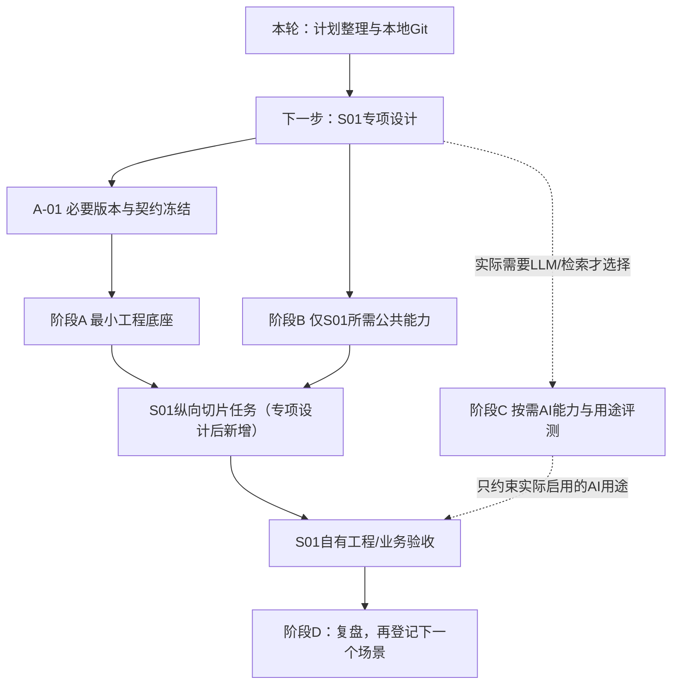

# 代码底座与通用AI能力分阶段开发计划 v0.2

日期：2026-11-11。当前范围：精简计划、协作机制、旧稿归档、本地Git初始化与提交；不初始化业务代码，不执行下列开发任务。下一条指令可以直接进入S01专项设计，不再等待S02或全部通用能力。

## 1. 依据、顺序变更与唯一正文

直接工程依据是[概要开发设计v0.2](architecture/DEVELOPMENT_DESIGN.md)及[AI详细开发设计v0.2](agents/AI_DETAILED_DESIGN.md)。正文保持原样。本次用户明确将实施顺序改为S01纵向切片；变更依据、影响及验收映射见[DECISIONS](DECISIONS.md)。旧96项草案原文/历史状态已[归档](archive/plan96-v0.1/README.md)，96个旧ID逐条见[TASK_MAPPING](TASK_MAPPING.md)，不是待逐项完成的路线。

当前只有本MD是一份计划正文；PLAN.html由文档工具生成，离线内嵌SVG，无远程脚本。任务状态与证据唯一在[TASKS](TASKS.md)，[进度视图](generated/STATUS.md)从其生成，不手工维护完成率。A—D是本次工程工作轨道，不改原M0—M4产品阶段，也不等同旧草案中同名的A/B验收节点。

## 2. A—D轨道与必需/按需边界

| 轨道 | 目标与近期范围 | 交付物/启用边界 |
|---|---|---|
| A 最小工程底座 | Python/FastAPI，MySQL/SQLAlchemy/Alembic，配置/错误/日志，G01身份/权限/租户最小子集，API与独立Worker，I01持久投递/租约/恢复，O01最小任务契约与测试基础 | 仅创建实际使用包/迁移；可启动、可查询、可取消/恢复、有真实MySQL故障证据。无S02/模型/外写前置 |
| B 必要业务公共能力 | 按S01字段与验收分批实现D01读取适配、D02映射标准化、D03质量/snapshot、D04证据、B01供需指标、B02基线/候选约束、O01 Handler/报告、G01/G02边界 | 不是一开始建完所有数据域/连接器；按S01设计选择当次所需子集，模块职责不合并/复制 |
| C 通用AI能力 | A01/ModelProvider、Prompt/Context版本、预算/费用/超时/调用记录、最小评测；A02、A03/RAG、Function Calling/Skill按真实用例启用 | S01规则闭环可完全不依赖C；实际启用模型前必须完成该用途的许可、预算、结构/安全/质量门槛 |
| D 业务场景按需 | 先S01专项设计，再确认公共能力→拆纵向切片任务→实现→测试验收→复盘；S02—S10只登记 | 本轮仅登记S01下一项设计任务，不预拆其他场景的空实现任务；“Agent”是业务名称，默认范式仍按已认可Workflow选择 |

**不预建**独立Agent平台、完整LLMOps、长期Memory、Redis、MQ、Milvus、Neo4j或复杂多Agent通信。响应缓存默认OFF，不创建缓存表/实例/清理线程/失效通道等设施。基础Harness的权限、Schema、预算、deadline、取消和记录随实际模型调用必需；自主Loop、暂停恢复、多角色、专用框架只有固定Workflow确实不足且有评测证据才评审启用，不能变成基座前置。

## 3. 开发顺序与可并行事项

S01设计现在可准备，下一条明确指令到达即可开展；不依赖A/B代码完成、S02、A02/VOC或所有真实来源就绪。设计中缺资料标待确认，禁止补造企业字段/模型能力。

实现时按真实依赖推进：A-01后A-02→A-03；身份A-04和运行骨架可在不相交文件内并行；A-05持久任务依赖存储/授权，A-06验收工程。S01设计给定字段/约束后，B-03纯指标可与读取适配B-01并行；B-02依赖映射，B-04依赖B-03，B-05依赖最小任务和快照/证据契约。公共契约、迁移链、组合根、依赖锁与台账单一集成人合入。

阶段B各任务只落实当前切片所需范围，不能用“B整阶段全部完成”作S01设计门槛。S01实现任务在专项设计后才拆；其dependsOn逐项列实际选中的A/B/C任务，不依赖抽象的“全AI就绪”。C-01/C-04只在该切片真用模型时成为启用门槛，A02/A03有真实用例才排期。

## 4. 阶段A的启动、交付与验收

版本/驱动/OS/事务语义在A-01验证冻结，不使用latest或将当前文档工具环境当生产标准。拟定入口如下，均是未来工程实现后的命令，本轮不执行、不声称文件已存在：

| 步骤 | 拟定方式 | 验收要求 |
|---|---|---|
| 配置 | 从经审查的示例配置/环境注入DB/身份/预算/日志；秘密不入Git | 必填项缺失拒绝启动相关能力；不降匿名、不放无限预算；日志无明文秘密 |
| MySQL | 复用获准实例或经确认的本地测试实例；不默认新增中间件 | InnoDB/精度/UTC/连接权限/目标版本可核验；SQLite不能替代 |
| 迁移 | `alembic upgrade head`，显式单次执行 | 干净库可迁移，唯一迁移历史；API/Worker启动不自行迁移 |
| API | `uvicorn commerce_hub.entrypoints.http.app:create_app --factory` | live/ready区分，ready检查真实依赖；不内嵌启动Worker |
| Worker | `python -m commerce_hub.entrypoints.worker` | 与API同制品/迁移版本、独立PID，按注册workKind领取 |
| 测试 | 具体命令随工程工具锁定；至少真实MySQL集成与双进程故障验证 | API重启不丢任务，重复投递/旧lease/超限/取消有界，任务/审计/工作项事务一致 |

A交付最小代码/配置/依赖锁、迁移、入口/短事务/租约与授权实现、测试、运行/恢复说明和实际commit/日志。生产组合根不注册伪S02/S01 Handler，不静态返回DomainResult冒充执行；尚无业务Handler时用**仅测试装配**的受控工作项验证I01工程链，不能发布第二套任务平台/生产探针API。S01正式路径留专项设计后自己的纵向切片验证。

## 5. 阶段B按S01实际需求建设

| 能力/所有者 | 首个S01切片的必要内容 | 暂不建设 / 验收关键点 |
|---|---|---|
| D01 | 一个明确模式的模拟文件/读取适配器；真实ERP接口授权后另验证 | 不接全部ERP/OMS/WMS/CRM；来源/批次/覆盖/失败/重复读取可追 |
| D02 | S01实际SKU/仓库/单位/库存分桶/供给状态映射及不可变投影 | 不猜商品身份、不重建主账、不相加库存镜像；歧义/未映射隔离 |
| D03 | 必需字段质量/时效/覆盖与固定snapshot manifest | 新输入新snapshot，不能只存latest/hash；不保存O01计划/报告 |
| D04 | 原记录、B01/B02结果的受控证据引用及血缘 | 当前权限/版本/删除可复核；不复制manifest/指标明细 |
| B01 | 已确认输入下可售、逐日余额、首次缺货日、缓冲与缺口等实际使用子集 | 唯一确定性计算，单位/时间窗/缺项显式；LLM不算数 |
| B02 | 明确假设的需求基线、MOQ/倍数/可售日期候选与约束比较 | 每候选调用B01评价；学习型预测/大型求解器没有证据不提前引入 |
| O01 | task/plan/participant/snapshot引用、ScenarioHandler、报告/取消与恢复契约 | 不重做领域步骤，场景不反向调度；测试Handler不能冒充生产场景 |
| G01/G02 | 实际租户/字段/证据权限，必需审计、Trace/版本/调用记录 | 默认拒绝；测试身份仍校验，不将日志做第二业务主账 |

B01/D01等编号指**既有模块**，A-xx/B-xx/C-xx是新台账任务ID，不改变模块编号。库存/采购日期/质量信号等具体字段、指标和输入假设在S01专项设计中冻结。S03质量分析不强制先整体开发；若缺必需质量信号，S01可以验证有依据的供需计算，但相关安全/采购结论必须阻断，不能认定“无投诉=安全”。若真需执行另一场景分析，仍由O01显式纳入参与者，不隐藏互调。

## 6. 阶段C最小AI路径与门槛

A01提供统一ModelRequest→内部ProviderRequest、能力匹配、Schema/技术错误、受控超时/重试、usage与版本。复用O01任务预算或A03获准QueryRun控制，禁止A01再建预算/任务权威；taskRef与planVersion分开，参数/Prompt/工具引用按AI详设v0.2统一。

| 能力 | 必需时点 | 最低验收 |
|---|---|---|
| Prompt/Context | 首个真实模型用途 | 模板/变量/输出Schema/内容hash和来源/信任/遗漏清单可追；外部文本不升级成指令 |
| 预算/记录 | 每次有费调用前 | 原子预留→A01→Provider→G02→结算；未知usage占额不按0退还，重试/恢复不重置 |
| A02 | S01或下一场景有真实理解/抽取需求 | 成功/技术失败/业务UNKNOWN区分，结构和引用校验，金标准/权限/用途许可具备；不以VOC开发作S01前置 |
| A03/RAG/Tool/Skill | 真的需要检索/只读工具时 | 先权限过滤后检索/回源，ToolSpec/版本/Schema/白名单/预算最小集合；模型提案不等于执行许可，无C03/任意SQL/shell/URL |
| 最小评测 | 启用某模型用途前 | 授权Golden Dataset、规则/人工分层、结构/引用/注入/UNKNOWN/费用/时延阈值；硬失败不平均 |
| Runtime/Harness/Loop | 明确证明固定Workflow不足后 | 不建第二O01；共享预算/停止/检查点/恢复/RunOutcome与YIELD门禁验证；未通过不启用 |

不启用模型时，S01规则MVP仍可推进。供应商/模型版本/地域/计费/保留未确认则该用途保持关闭，而非阻塞全部S01专项设计。语义/响应缓存都不作为收益假设，OFF不实例化缓存设施。

## 7. 近期任务及进入S01条件

台账当前仅18项：本轮SETUP-001；阶段A 6项；B 5项；C 5项（含按需评估）；D只登记下一项S01专项设计。状态/负责人/范围/依赖/逐条验收/测试/风险唯一见TASKS。近期开工顺序：

| 任务 | 交付与验收 | 计划测试方式（尚未执行） |
|---|---|---|
| D-S01-01 S01专项设计 | 字段/流程/约束/质量/输出/公共能力子集/自有S01-AC、实现切片清单；不以S02/全AI为前置 | 模拟样例桌面走查、口径/依赖/权限/降级审查；缺口列明 |
| A-01 必要版本/契约 | 精确技术版本、最小task/Handler/Refs/错误/事务/测试契约、所有者与创建时点 | 兼容矩阵与契约正反例，变更评审 |
| A-02 最小骨架/配置 | FastAPI应用工厂、统一配置/错误/基本日志、依赖锁 | 启动/缺配置/无秘密日志/错误信封验证 |
| A-03 MySQL/ORM/迁移 | 真实MySQL连接、单迁移链、短事务/Repository子集 | 干净库迁移、回滚、Decimal/UTC/唯一键 |
| A-04 身份/租户子集 | 签名/身份校验、当前scope与字段/租户边界 | 越权/过期/错误签名、Worker/证据边界负例 |
| A-05 API/Worker/持久任务 | API与独立Worker、MySQL投递、租约/重试/恢复与O01最小用例 | 两PID停启/重启/并发领取/旧lease/事务失败/取消 |
| A-06 工程闭环验收 | 真实运行/故障证据、配置/迁移/交接与commit | 复现工程链；不能宣称S02领域MC或真实ERP通过 |

**进入S01专项设计**只需收到下一条设计指令、可定位的两份工程基线和当前Git管理文件；不需要等上述开发任务完成。建议下一步输入见HANDOFF。**进入S01代码切片**则需该切片专项设计/关键业务口径获评审、实际选中的契约/权限/配置/数据策略可用及测试期望明确；代码任务在专项设计后追加稳定ID，按它的真实依赖选择A/B/C子集，不预建所有目录。本轮没有执行D-S01-01或任何A/B/C任务。

## 8. 原M0—M4及MC01—MC12保留/映射

| 原阶段 | 本次保留的要求 / 影响 |
|---|---|
| M0 | 来源/授权/口径/责任/质量/预算等前提未删除。缺真实接口时可做标simulated的工程设计/验证，不声称M0真实条件已满足 |
| M1 | 公共基座按S01纵向切片逐项实施，允许S01设计先准备；原S02最小闭环及其MC验收作为独立保留项，不再是S01硬依赖 |
| M2 | 先交付S01切片，不等于四类P0/联合只读试点全部验收；其他场景准备开发时另立专项 |
| M3 | 两类外写仍须独立审批/当前源条件/原子保障/幂等/回执真实证明；本轮及首个只读S01不开放 |
| M4 | P1/P2继续登记并按价值/资料/质量/费用/运维逐项验证；不展开旧96项路线 |

MC原文以HLD§4.3为准，本表只分离验收证据，不改测试主体/预期。当前以下全部**未执行**：

| MC | 原验收保留 | S01后续新增验收 / 不冒用原则 |
|---|---|---|
| MC01 | 干净测试库迁移、API/Worker独立启动 | S01-AC-ENG01自有工程证据；不能推导原整组MC通过 |
| MC02 | D01 simulated批次及S02 A/B映射投影期望 | S01-AC-DATA01供应/库存输入另列；不是S02夹具验收 |
| MC03 | 正式授权分析202及task/plan/work/审计原子持久化 | S01-AC-TASK01按S01参与者验证，保留原任务契约 |
| MC04 | 原受理事务故障全回滚/去重 | S01-AC-TX01记录S01路径，不篡改原MC记录 |
| MC05 | 原task停Worker/API重启后可续跑 | S01-AC-REC01另留同类工程证据 |
| MC06 | 明确Worker→O01→S02.analyze→B01链 | 待真正S02实施再验；S01调用链绝不填为此项PASS |
| MC07 | S02固定asOf下A超承诺/B不误报及快照/指标/证据/报告 | 待S02实施再验；S01数量/日期/逐日曲线用S01-AC-CALC01等 |
| MC08 | 原报告可重读且无自动C01/C02/C03 | S01-AC-REPORT01自有证据，保持无自动建议/动作终点 |
| MC09 | 原双Worker/旧lease/去重发布 | S01-AC-CONC01另记场景和版本，不隐式冒充S02验证 |
| MC10 | 原崩溃/报告后重入/重试超限收尾 | S01-AC-FAULT01，未知计费/源动作另按原所有者处理 |
| MC11 | 原跨租户/扩大scope/未注册能力/关键数据缺失 | S01-AC-SEC01按S01资源与质量反例覆盖 |
| MC12 | 原取消/不复活/配置日志/文档交接 | S01-AC-CANCEL01自有证据及未完成事项 |

上述S01-AC是**建议验收槽位**，具体输入/期望/命令由S01专项设计冻结，尚未成为已实施测试。原MC记录未删除、未标PASS/不适用，也不将旧M1-019/020标为已完成。若未来正式修订原验收范围，须另有明确评审，不能靠本表暗改基线。

## 9. 模拟、真实ERP与未验证条件

| 证据类别 | 可证明 | 不能证明 / 未具备时处理 |
|---|---|---|
| 模拟输入+真实工程组件 | 指定样例的确定性指标、真实MySQL事务/租约/Handler/快照/证据/报告/恢复 | 不证明企业接口连通、授权/覆盖/时效、实际收益、生产容量；报告标simulated |
| 真实ERP/其他必要来源只读 | 经许可接口/导出版本、字段/单位/映射、分页/增量/删除、覆盖和源责任 | 一次API成功不等于数据就绪；未知字段列待确认，保留模拟工程路线和限制 |
| 真实模型用途验证 | 已许可内容、实际模型/Schema/usage/预算与分层质量 | Mock响应/Schema成功不证明效果；未冻结版本/计价/质量目标则关闭用途 |
| 真实外部动作 | 原批准范围、当前源条件/原子性、幂等/权威回执与UNKNOWN恢复 | 当前未授权；只读S01/采购候选不代表允许创建采购草稿，更不是采购批准/到货 |

S01设计需要优先确认：SKU/仓/单位；库存分桶及互斥/镜像；需求来源/窗口；未收供给/预计可售日；MOQ/倍数/交期/缓冲；质量调查/缺信号阻断；输入模式/脱敏样例及期望输出。真实ERP品牌/版本/API/权限未提供则明确待确认，不预建厂商SDK。

技术版本/DB环境/身份发行方/数据地域与留存、模型用途/预算/计价、任务期限/并发/租约、质量/时延/恢复目标尚需逐项冻结。它们限制相关实现/启用，不要求先完成全项目调研才允许写S01专项设计。

## 10. 场景登记与后续流程

| 登记ID | 场景 | 当前安排 |
|---|---|---|
| REG-S01 | 供需/库存/补货 | 第一个实施场景；下一步D-S01-01专项设计，默认确定性Workflow，必要时AI解释 |
| REG-S02 | 履约风险 | 后续按需；原S02优先切片/MC仍保留，非S01前置 |
| REG-S03 | VOC | 后续按需；质量信号缺失不得自动认安全 |
| REG-S04 | 贡献/费用 | 后续按需；B01唯一金额口径 |
| REG-S05 | 客服/售后辅助 | 后续专项设计，不默认对客发送/退款 |
| REG-S06 | 内容/增长辅助 | 后续专项设计，不自动发布/投放 |
| REG-S07 | 单证辅助 | 后续专项设计，抽取+规则+人工 |
| REG-S08 | 经营规划 | 后续专项设计，求解/指标复用，无自动改价/调仓 |
| REG-S09 | 视觉质检 | 后续专项验证，技术失败非无缺陷 |
| REG-S10 | 政策核查 | 后续专项设计，版本证据+专业复核 |
| REG-ACTIONS | C01—C03有限协作/动作 | 业务需要时单独评审/拆任务；不从只读报告自动进入 |
| REG-ADHOC | A03完整即席查询 | 真需要时按HLD§6.4实现请求/周期额度，不开放无界入口 |

每个新场景遵循“专项详细设计→必要公共能力确认→任务拆解→实现→测试验收→复盘”。登记不是空开发任务或完成状态；将来采用新任务ID，保留与旧ID映射。原场景默认范式/模块/data归属不改变。

## 11. 管理、Git与本轮停止点

最短接手：根AGENTS→HANDOFF→TASKS当前任务/相关契约，实时读取branch/HEAD/dirty；状态规则唯一在TASKS，重要决策在DECISIONS。结束/中断记录真实提交、命令/结果和未完成项，生成进度，不覆盖他人修改，不绑定某AI模型/工具。

本轮仅初始化当前目录**本地**仓库（若已存在则复用），只暂存显式安全白名单，不git add .；不创建远端、不push、不改远端权限。忽略秘密/数据库/缓存/虚拟环境/日志/权重，记录保留未跟踪内容。初始提交SHA用后续本地记录引用，最终HEAD由Git读取，不要求提交写自己的SHA。

本轮文件变化、归档/ID映射、白名单/扫描与Git回执见[交付清单](planning/FILES.md)、[校验记录](planning/validation-report.json)、[仓库回执](planning/repository-receipt.json)。本轮完成后停止，等待下一条S01专项设计/开发指令，不执行任何后续业务任务。
