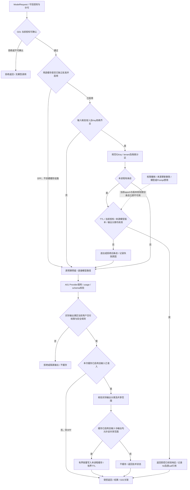

# AI网关缓存准入与隔离矩阵

> 从[AI模块详细开发设计文档](AI_DETAILED_DESIGN.md) v0.2自动摘编，唯一维护源为正文；状态和未验证项与正文一致。

### 9.3 网关缓存的明确决定

**【建议】首个 A01 版本默认 `responseCache=OFF`。先复用各所有者已经保存且有版本的 A02 理解产物、B01 指标和 O01 报告引用，避免重复产生资产。只有命中率、有效节约、隔离与失效证据充分，才按用途开启有界进程内精确响应缓存；初期不建 Redis、不缓存工具执行、不启用语义响应缓存。**

**D04实施门槛：OFF是“没有响应缓存执行路径”，不只是创建缓存后将命中率设为0。首次真实AI用例只需A01现有配置识别OFF并在G02记录cacheStatus=OFF，不提前创建CacheStore/缓存服务/目录、缓存表/索引/迁移、LRU实例、single-flight锁/后台清理线程、分布式失效通道或Redis等基础设施；文中的Key、矩阵和图05是以后按需启用时的设计，不要求先写缓存接口空壳。**

| 门槛 | 才可推进的实现内容 | 必须先提供的证据 |
|---|---|---|
| OFF（当前默认） | 复用ModelRequest中的cache-off配置与既有G02字段，模型路径按原权限/预算执行 | 无需缓存设施；首个S03/A02示例固定OFF，仍不使AI成为首批S02基座依赖 |
| 单项用途精确缓存批准 | 仅为真实获准用例实现有界进程内缓存、准入/输出分类/Key/失效与测试 | 实际重复请求与收益、正数TTL/容量/留存、当前授权/来源校验、输入和**实际输出**共享分类均能证明；独立评审通过 |
| 跨用户共享启用 | 只开放现有矩阵允许的同tenant公开类别，原隔离限制不变 | 输出本身无私有上下文/个性化/敏感内容，来源引用对共享范围均有权；分类规则/决策Ref和当前epoch可验证，反例通过 |
| 多进程共享存储/语义缓存 | 本次不实施；已有方案不足时重新评估 | 额外性能/运维收益与隔离证据；不因“未来缓存可能跨进程”提前创建基础设施 |

输入分类仅决定“是否值得进入候选缓存路径”，**不能作为输出公开性的证明**。模型可能复述私有工具资料、生成可识别人名/订单、夹带敏感推断或无来源内容；A01在完整响应Schema校验后，依据G01既有字段/用途/敏感规则及可解析来源标签对**实际输出**形成 `outputClassification={level,sharingScope,ruleVersion,decisionRef,status}`。此为服务器判定元数据，不采信模型自报“PUBLIC”。规则/检测无法证明输出适合共享时status=UNVERIFIABLE，禁止共享且默认不写缓存，不通过自动降为USER偷偷保留本来不准缓存的数据。

有效共享范围是“用途准入∩输入/Context/证据各自允许范围∩实际输出分类允许范围∩当前G01策略”的交集，任何一项禁止/未知就不共享；tenant边界始终不扩大。输出越权/含秘密时先按现有安全输出规则拒绝、隔离或脱敏重校验，不能只bypass缓存就向当前用户返回。若只是共享不可证但当前用户交付合法，可受控返回而不缓存。缓存条目（未来启用后）须保存outputClassification的规则版本/decisionRef及输出内容指纹；命中时复核规则未撤销/升级且当前共享范围仍合法，无法确认则miss/拒绝旧条目。此逻辑复用A01/G01/G02，不新增分类平台。

共享分类的实现随获准缓存用例才创建；OFF时只执行既有输出权限/安全门禁，不提前实现共享分类存储、通用分类器注册表或检测平台。图05只有缓存已启用且输入已准入的响应才进入共享分类步骤，OFF不实例化任何缓存组件。

精确缓存比较同一请求的规范化内容和全部控制/数据版本，适合静态非敏感的可替代生成；语义缓存依赖“语义相近也可复用”的业务证明，而相似问题可能租户、日期、SKU、知识适用范围不同。库存/费用/客服/政策核查的“差不多”不能接受，因此语义缓存只留待验证事项，不生成向量缓存库或默认候选部署。

供应商侧前缀/输入缓存与本地响应缓存分别记录：前者仍是一次供应商调用，费用、保留、数据隔离和 usage 按获准条款及实际响应确认；不能从本地命中推断供应商缓存，也不能把其保留策略当本项目已经许可。未证实条款的供应商缓存不得传敏感资料或宣称“零留存”。

### 9.4 缓存准入与隔离矩阵

下列是精确响应缓存的准入上限，均需独立启用；“可”不等于当前已打开。每一类“可”还须通过§9.3实际输出分类门禁，不能仅凭输入类别跨用户共享。未标明可复用的响应默认禁止缓存。TTL 必须有正数配置且小于各来源/授权有效期，不设无依据统一秒数。

| 类别 | 准入 / 最小隔离 | 跨用户 / 跨会话 | 版本与有效期 / 失效 |
|---|---|---|---|
| 仅公共模板/schema/无业务文本格式示范 | 可；租户分区、APPROVED_TEMPLATE 用途 | 同租户经批准可 / 可；跨租户仍默认禁止响应共享 | 模板/模型/schema/参数精确相同；有界TTL；版本/策略变化即miss |
| 企业内公开的稳定知识解释 | 条件可；TENANT_PUBLIC 且无私有上下文/个性化/工具提案 | 同tenant双方当前有知识权限才可 / 可 | 不可变知识版本、适用范围、Prompt/模型绑定；更新/删除/撤权即拒绝旧命中 |
| 用户自己的静态低敏文本改写 | 条件可；USER 或 SESSION，需获准用途 | 不可 / USER且明确无会话依赖才可 | 内容hash+user授权+Prompt/模型；留存受用户内容政策约束；本轮默认关闭 |
| 聊天、售后回复、客户资料、用户个性化 | 不准入持久或共享网关缓存；最多同次调用结果引用去重 | 不可 / 不可 | 不做跨请求响应缓存；任务恢复仍用原受控产物并当前鉴权 |
| 动态库存、供给、价格、实时订单/履约状态 | 禁止网关响应缓存 | 不可 / 不可 | 业务产物固定snapshot可回溯，但不作当前事实；发送前实时校验归C03 |
| 费用、贡献、币种/汇率、财务核查 | 禁止网关响应缓存 | 不可 / 不可 | B01已有固定版本产物按权限复用，禁止LLM缓存伪装财务权威 |
| 建议确认、审批、批准/撤销、执行与回执状态 | 禁止 | 不可 / 不可 | 当前状态经C所有者公开接口读取；不设短TTL绕过实时复核 |
| Tool Calling / 需运行时工具 / 含动态RAG结果 | 首期禁止缓存模型toolRequests或最终响应 | 不可 / 不可 | 防跳过工具权限、执行及usage；静态证据摘要以后另行准入验证 |
| 含秘密、敏感个人信息、未知授权或分类 | 禁止；分类失败默认拒绝 | 不可 / 不可 | 不能只把tenant/user加进key就认为可以缓存秘密 |
| 错误、拒绝、部分流、截断、INVALID_OUTPUT、usage未知 | 禁止成功响应缓存 | 不可 / 不可 | 技术熔断/负载状态不是内容缓存；拒绝权限后不做全局负缓存泄露资源存在性 |
| 政策核查的适用性结论 | 禁止；可复用版本化原文引用不等于复用结论 | 不可 / 不可 | 有效时间/地区/商品属性/适用性必须每次核查与专业复核 |

“必须极短有效期”的数据若未来确需优化，只能先定义业务时效、来源事件/版本验证和撤权边界再单项评审；在没有这些证据时保持禁止，而非自行填一个短 TTL。当前静态准入也没有批准的生产 TTL，缺配置即 OFF。

### 9.5 Cache Key 与命中验证

【建议】`key = ai-response:v1 : tenantPartition : HMAC(cacheKeySecretVersion, canonicalJSON(KeyMaterial))`。使用带密钥摘要避免从 key 猜测低熵客户文本；key/日志不含明文文本、用户号或秘密。缓存值含原 responseRef、producerCallId、sourceVersionDigest、createdAt/expiresAt、cachePolicyVersion、敏感分类和校验版本；不作为新的业务资产权威。

| KeyMaterial 字段 | 绑定规则 |
|---|---|
| tenantId / sharingMode | tenantId 必填且所有模式均禁止跨tenant；sharingMode=SESSION/USER/TENANT_PUBLIC/APPROVED_TEMPLATE，来自G01策略不由模型/客户端选择 |
| principalPartition / sessionPartition | SESSION包含user与session；USER包含user、session显式NO_SESSION_DEPENDENCY；获准租户共享用显式TENANT_PUBLIC标记代替user/session，不能偷偷省略；任何私有变量出现自动降级隔离或禁缓存 |
| effectiveScopeDigest / policyVersion / authEpoch | 当前获准店铺/仓库/字段/用途/角色范围规范化指纹；当前授权变化导致miss/deny；原用户权限不能代表所有读取者 |
| provider / deployment / actualModelRevision / capabilityPolicy | 实际受评测的不可变版本；若仅有可能漂移的别名，不能安全钉住时禁缓存 |
| promptRef / resolvedPromptDigest / outputSchemaDigest / parametersDigest | 逻辑引用按§9.1解析，System/Developer/User有效消息内容和具体parameters均规范化；缺省值展开，模板/参数/Schema版本与内容hash同时绑定 |
| contextDigest / dataVersions | 消息顺序、每段内容hash、snapshotId（适用时）、映射/指标/理解/人工修订、知识/asset/chunk/indexGeneration、时间/地区适用域；未列清依赖则禁缓存 |
| toolSpecsDigest / toolPolicy | A01从toolSpecRefs解析后的toolSpecs计算工具名/版本/Schema/白名单摘要；首期任何动态tool request路径直接bypass；不能缓存后省略本该执行的工具 |
| runtime/context/harness/cachePolicy/outputClassification规则版本 | 选择、压缩、敏感处理、准入、输出共享判定及Key规范版本；改变则miss；具体输出判定和内容指纹保存为值元数据，不能在响应生成前伪造为已知Key输入 |

缓存查找必须在 G01 当前授权和输入准入之后；命中后再次验证来源未删除/失效、当前 authEpoch、引用可解析/有权限、模型/Prompt未禁用、TTL和结果Schema；返回前在 G01 规定的授权线性化点确认当前策略。不依赖异步清理保证撤权：撤权事务提交后开始的读取必拒绝旧授权，跨在途窗口的输出再复核；无法读到当前策略/失效信息时 fail-closed 或不返回缓存。缓存miss后也不能在权限系统不可用时继续模型调用。

来源“已知版本”更新时，由来源所有者/A03 更新当前版本/删除状态及有效代际；A01 通过公开只读状态验证依赖。缓存键与条目依赖明确版本，旧值即使还在其他进程内存也无法再次命中。后台逐出仅节约空间，不能承担权限正确性。固定历史快照的正常回放与“当前答案缓存”不同；回放仍当前鉴权并标历史版本。

### 9.6 缓存路径、计费与多进程

缓存命中也受请求并发/调用规模/期限及审计控制；正式任务可先获得逻辑请求许可，只有miss才预留供应商费用，或先保守预留再按hit结算为无供应商调用，两种实现只选一种并保持幂等。**hit时本次供应商调用数/供应商token和费用为0**，但读取/校验成本记录为内部服务开销；原调用费用只归 producerCallId，不在每个hit重复累计。记录 `cacheStatus=OFF/BYPASS/MISS/HIT/INVALIDATED`、key摘要/隔离类别、originCallRef、source版本、lookup/validation/provider耗时；不记录原文key。

离线模型效果评测默认 bypass 缓存，明确标缓存对照实验；在线质量按hit/miss分层，不能用命中带来的低时延宣称模型变快。节约金额只记录“估算避免调用成本”并带估算方法，不能当实际账单节省；有效命中率、错误复用率、授权拒绝、失效和容量逐出一起监控。

多进程可各自拥有非权威有界缓存，命中率较低不影响正确性；失效正确性依赖当前 G01/来源版本复核，不能仅靠进程内广播。相同key的进程内 single-flight 可减少同时miss，同一收费请求仍有不同attempt的准确审计；取消某个等待者不能随意取消仍被其他合法等待者使用的调用，首版实现复杂时直接禁用合并。跨进程去重/限流/配额用既有所有者MySQL控制，不因缓存需求默认Redis。

只有实测重复率、延迟/费用节约和多实例瓶颈显著，且集中缓存的权限/删除/可用性/运维收益超过成本，才评估 Redis 等共享存储；也不能把它提升为状态、额度或事实权威。共享缓存故障可bypass，但仅在授权、预算和审计仍可完成时调用模型，避免缓存故障放大模型流量超额。
