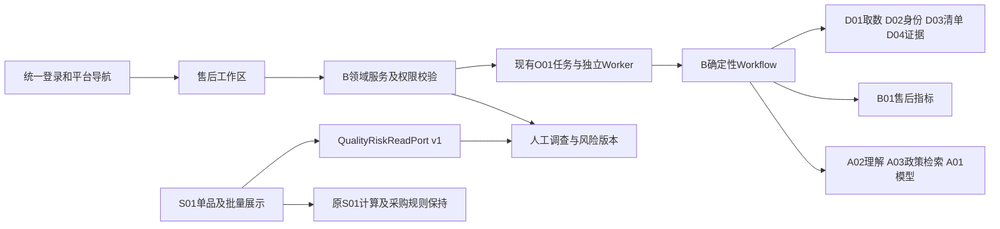
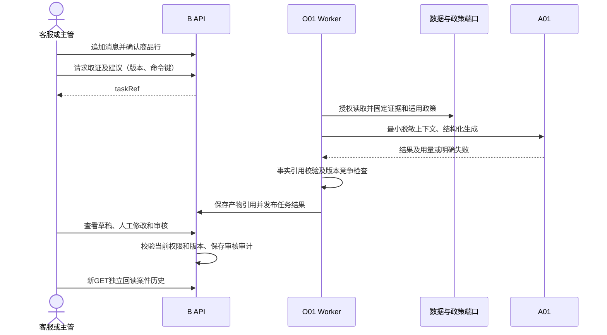

# 智能售后与客户体验分析 Agent V1.0 详细开发设计

B-DES-001 v0.2，2026-11-16，DESIGN_REVIEW；未编码、未迁移、未业务验收。唯一需求为[B-REQ-001/V1.0](../requirements/B_AFTER_SALES_V1.md)，D1—D5及AC不变。本次设计授权覆盖需求文件中历史“尚未授权详细设计”的停止点，但不授予实现。阅读顺序：[复用差距](../architecture/B_AFTER_SALES_REUSE.md)→[产品操作](../ui/B_AFTER_SALES_PRODUCT.md)→本设计→[阶段与覆盖](../planning/B_AFTER_SALES_PLAN.md)。

## 1. 产品与边界

在现有中台增加“智能售后与客户体验”工作区。客服完成案件取证与人工审核，运营完成两窗同口径分析，质量人员调查并确认风险，采购在原补货详情及批量结果中看风险证据。用确定性Workflow＋必要的单次模型调用；无自主循环、跨Agent会话或外部业务执行。

后续目录建议：`scenarios/after_sales/`拥有案件、分析流程和风险；D01/D02/D03/D04在现有`data/`下增量实现B资产；B01在`capabilities/metrics/`新增return_quantity_rate-v1；A02/A03在`capabilities/`下新增最小understanding/retrieval；G01/G02沿用现有服务。全部为拟建路径，不代表已有实现。

跨模块只通过公开端口；风险不进入S01 qualityDisposition、B01库存输入、B02约束、候选过滤或请购授权。消费已发布风险不是隐含执行B分析，不建设JOINT编排。

## 2. 人工与异步执行

同步API处理范围校验、消息追加、人工关联、审核、发布、调查、风险变更以及有界查询；外部ERP取数、资料导入校验、政策检索后的生成和体验分析走现有Worker。HTTP受理返回202 taskRef，前端沿公共任务接口轮询；参数只传对象／版本引用，不塞长正文。人工等待保存在B对象状态，不长时间持有Worker租约。

按§7.1首次消费者分阶段注册，最终场景为 `B_CASE_EVIDENCE_V1`、`B_CASE_ADVICE_V1`、`B_DATASET_VALIDATE_V1`、`B_EXPERIENCE_V1`。证据／导入任务零模型；建议和主题按获准预算。ExecutionContext.check、commit_data、租约与原task预算沿用；网络在事务外，提交时再验actor、scope、对象版本。持久step记录仅保存完成产物引用；同(task,step,inputHash)唯一。恢复先读产物；模型发送UNKNOWN不自动再次发送，预算预约不释放冒充未调用。

公共DomainResult拟增0.2.0：保留原字段并新增来源 `MIDDLEWARE_TEACHING_DATA` 及结构化sourceBundleRef。旧0.1.0仍按原规则解析，未知版本拒绝；TaskService发布／读取、领域验证及前端types同时增量适配，不能只改Literal。completeness沿用RULES_ONLY/PARTIAL/BLOCKED，AI和证据完整性放领域字段；不把技术SUCCEEDED等同完整业务结论。现有发布验证中S01特定假设必须通过Handler扩展点隔离，兼容用例先行。

## 3. 案件闭环

状态：OPEN→NEEDS_CLARIFICATION／EVIDENCE_PENDING→DRAFT_READY→REVIEW_PENDING→HANDLED；任意阶段可ESCALATED。消息追加形成caseRevision，不能覆盖原文；审核退回回到待修改。案件处理完毕只表示内部记录完成，不代表ERP工单关闭、退款或满意。

1. 从已授权工单／反馈／教学案件进入，保留标题与会话分别来源。用来源租户＋平台＋店铺＋完整订单号／ID查询候选；用户显式选订单明细和productId/SKU。多商品不自动分摊投诉。
2. 规则核验属性和诉求；USB尺码等冲突先澄清。对类别或属性未知，AI可建议补证但不能确定质量。修订关联追加原值、理由和actor。
3. Worker采集付款、实际发货及售后事实，保存业务时间、observedAt、完整性和缺域；追踪号不证明签收，申请不证明退款。客户陈述作为CLAIM，ERP事实作为OBSERVED，教学资料作为SIMULATED，不相互改写。
4. 服务端过滤政策候选，必要时按案件相关业务日而非简单当前日期匹配；当前撤销／不可访问版本始终禁用。缺业务日期则补证，不猜。冲突例外未解则降级人工。
5. AI只生成处理建议、澄清问题、回复草稿和引用；本地验证数字、币种、日期、商品、引用和承诺限制。新增消息或证据版本使旧草稿STALE；审核须基于当前caseRevision、snapshot及可用政策重新校验。
6. 实际用户修改／采纳／退回／升级，保存AI原稿与人工稿、差异、理由和真实审核者。保存响应后新GET独立回读；刷新／重启仍可读全部版本。无外发按钮、退款工具或ERP写动作。

安全信号先以确定性关键词／已识别标签及人工标记触发优先升级，模型可补充识别；不依赖样本阈值、不等待AI成功，不指导拆机、不宣告安全。人工处理与模型失败互不阻断，危险输入不能改变权限。

## 4. 完整教学数据与确定性统计

### 4.1 受控导入与来源

教学包是manifest＋规范JSON分块，声明schemaVersion、dataset/version、sourceNature、固定总体、每类count/hash、业务时区、商品属性、订单行、发货批次、履约完成标记、退货阶段事件、反馈及证据。ERP引用单独命名空间，不能宣称中台教学交易为ERP原生。教师答案独立权限资产，只供验收工具／教师，学生API、模型和检索不可读。

流程：创建DRAFT版本→分块上传→seal指纹→Worker验证→VALIDATED→另一读事务按清单回读并重算count/hash/关联→READBACK_VERIFIED→有权限人工activate。存在冲突则QUARANTINED，不能部分激活；旧版本不可覆盖。验证唯一性、外键、范围、类型、数量守恒、阶段因果时间、完整总体、缺页、属性、反馈对应和覆盖声明。重复块同hash幂等，异hash冲突。导入只写中台本项目域，不创建ERP订单。

兼容当前HTTP 64KiB上限：每块JSON含头≤48KiB、每包≤10000事实记录／10MiB，清单含分块序号与数量；任务参数≤16KiB只放引用。上限是可配置工程资源保护，不改变AC金样。附件只接受受控上传／已有授权引用，不下载任意URL、不执行内容。

### 4.2 统计算法（B01所有权）

统计键为(sourceNature,datasetId/version,sourceTenant,productId,SKU,storeId,warehouseScope)，明确仓库集合版本，不用空值代表所有仓。同订单重复SKU行先核真实身份和数量守恒，再汇总为订单-SKU。完整订单-SKU的唯一实际发货批次集合决定Q与最后实际发货t0；首笔出库兼容值不再相加。未完成履约不能伪装完成群组。

输入是不可变manifest、规则版本、两组`[S0,E0)`／`[S1,E1)`、T、W。两组须不重叠且等长（默认前后相邻窗），以t0入群；默认W=30×24小时，Asia/Shanghai解释后转UTC存储，来源无时区先准入确认。对固定目标集合逐项验证T≥t0+W及覆盖完整；不擅自缩小目标集合凑成熟。

每组至少20成熟订单-SKU且20件实际发货。主分母D=Σ唯一批次实发量；N=群组目标SKU在各自`[t0,t0+W)`的实收数量，received→refunded只计一次。申请、有效授权（authorized/received/refunded，排除draft/cancelled）、实收、实际退款及币种、关闭工单分别统计；授权辅助率明确自身事件窗。无SKU分摊凭证不输出SKU退款金额。

率用整数件数／Decimal或有理数保存，不用浮点或平均行百分比；判断异常用未舍入值：`(N1*D0-N0*D1)*10 >= D1*D0` 且 N1≥3（默认10个百分点）；展示舍入仅用于UI。规则配置更改W/门槛/阈值必须版本化，同输入同规则指标一致。

同源同真实键同内容去重，异内容冲突隔离；收货超实发、冲销未核、分批跨窗归属不清、缺页／覆盖不足／时区不明列unresolved并标受影响率UNKNOWN。分母0或缺失、群组未成熟／样本不足同样UNKNOWN，不显示0%。期前期后事件单列；若影响归属或完整性则停止相关率。已知计数可展示但标局部，不能静默剔除坏记录后称全量。

### 4.3 AI分类与调查

主题taxonomy-v1含尺码／描述／破损／物流／功能／兼容／安全／OTHER／UNKNOWN，多标签按feedbackId去重；分母为该筛选范围内唯一反馈数，注明是否含未分类数，多标签比例可超过100%，不以条数代替退货件数。订单级反馈无明细归属保持order-level，不复制给各SKU。

模型分类按小批次逐条ID输出，可人工修订，新classificationVersion留原分类和actor；失败项保留UNKNOWN，不影响可用确定性事实。分析报告固定数据／规则／分类／Prompt版本，记录正常与异常SKU、阶段计数、原始分子分母、成熟度、unresolved、证据、AI状态。AI解释只接程序指标，分开facts/hypotheses/alternativeExplanations/missingEvidence/nextSteps；迟到事件或规则改变产生新reportVersion及差异，不覆写旧报告。调查记录可引用案件或报告，保存补证与结论；阈值命中只产生待调查线索。

## 5. 政策及受控检索

四类首包必须齐全：尺码／描述、3C安全升级、退货资格时限费用例外、回复承诺与证据适用。政策稳定ID＋不可变version＋段落(sectionId,text,hash)；保存出处、平台／地区／类目／语言、有效期、scope、实际责任人。状态DRAFT→IN_REVIEW→PUBLISHED，published有未来生效时显示待生效；到期派生EXPIRED、撤销REVOKED；发布／撤销均明确人工命令。原文修订新版本。

A03最小实现先SQL精确过滤授权、来源、适用维度、生效区间，再基于标题／主题／段落关键词排序，最多8段／上下文上限内；无需Embedding。缺失适用条件拒用，不猜通配；通配只能是审核时明确发布的适用集合。检索前后及最终生成／审核均重验可用性。返回policyId/version/section/hash/原文和适用理由，不能只有相似度。

引用验证有两层：程序校验引用必须在本次允许集合且hash/版本/范围匹配；关键承诺用审核发布的结构化条款（条件、允许动作、限制）核对，生成只选择受支持建议代码与段落。自由解释无法确定支持时标待人工核对并禁止确定性承诺；人工审核要逐项看原文，不声称字符串检查能证明语义。规则冲突无明确优先依据时补证／升级，不让LLM选更宽松政策。

## 6. 风险生命周期与S01契约

suspected→confirmed或rejected；confirmed→closed／revoked／EXPIRED（派生）。默认确认起30天，可缩短不可无授权拉长；`validFrom <= now < validUntil`。重新发布产生新riskVersion和新人工确认，旧撤销版本不可原地复活。疑似不显示为有效风险，安全疑似仍进入优先人工队列。确认前验证合理商品属性、证据、调查结论、限制、观察窗、样本口径和实际actor。

风险scope每项是精确sourceTenant/productId/SKU/storeId，warehouseMode为EXPLICIT_IDS或ALL_STORE_WAREHOUSES；前者非空集合，后者明确声明该店各仓并保留授权范围版本。多店逐店确认依据，不使用跨店SKU通配。

`QualityRiskReadPort.v1.lookup(principalContext, objectIdentities[], consumptionContext, asOf)`：同进程服务端接口，B仓储内部实现，S01不导入B ORM。返回逐对象 `MATCHED | NONE | NOT_APPLICABLE | UNVERIFIED`、checkedAt、riskRefs/version、最小原因／来源／调查状态、validUntil及受控evidenceRef；无权对象对外使用统一不可用状态，不泄露是否存在或数量。仅完整成功查询可NONE，NONE也不等于安全通过。

consumptionContext由服务端会话和获准绑定解析，不信浏览器mode。正常ERP模式排除中台教学风险；教学消费逐次核用户、有效dataset/version、独立回读的ERP映射、binding版本及scope、风险状态。绑定变更／数据停用／授权撤销即时拒用，包括计数、摘要、导出和历史引用；历史可见性也受当前权限。不可用时不回退相似SKU／全租户。

S01结果在展示组装层附加独立`qualityRiskAdvisory`，不混入原计算参数／qualityDisposition／采购资格。新报告保存当时riskRefs和核查状态；当前页面额外查live状态，过期／失败为UNVERIFIED，旧快照只作历史。批量分块≤100对象，同一授权上下文、分块失败逐对象未核实、不丢对象；不进行N+1 ERP查询。列表打开、详情打开／返回可见时重查，最长60秒后前端将未重验提示置未核实；服务端每次仍验真实状态，不靠UI轮询保证有效性。无持久缓存／无缓存基础设施。

风险端口超时或B关闭，展示“风险未核实”，S01原结果及请购规则照常；不得把UNVERIFIED加成采购阻断条件。兼容验收对同一输入逐字段比对库存、销量、参考量、候选、采购资格和外部调用数，风险全生命周期都不改变它们。

## 7. 数据模型与迁移设计

以下是逻辑表设计，实施时经契约评审再建Alembic revision，当前0011为已存在末端，本轮不预占迁移编号。共用MySQL，不第二套库。所有业务表tenant_id、ID、created_at UTC(6)；可变聚合有revision作CAS；不可变版本有version、content_hash、created_by、source/scope版本。数量DECIMAL(20,8)（教学EA限制整数），金额DECIMAL＋currency，禁止float。

| 所有权／拟表 | 关键字段、关系与约束 |
|---|---|
| D01 `b_dataset_versions` | PK(tenant,dataset,version)，来源、manifest hash、state、coverage、timezone、scope_version、activated_by；相同版本不可覆盖 |
| D01 `b_import_chunks` | dataset外键、chunk_no/hash/count、验证状态；UNIQUE(datasetVersion,chunkNo)，seal后不可改 |
| D02 `b_subject_mappings` | dataset商品身份→ERP sourceTenant/productId/SKU/store/仓模式，独立回读证据、verified_at、revision；不是单SKU文本映射 |
| D02 `b_orders / b_order_lines / b_shipments` | source_namespace＋external_id唯一；lines有product/order/line真实引用；shipments有batch/line/qty/actual_at；订单-SKU完成与coverage保留独立依据 |
| D02 `b_return_events / b_feedback` | returnId/eventId/line或明确order-SKU、stage/qty/currency/amount/time/receiptRef；feedback原文、语言、行关联可空、evidenceRef；同键异hash冲突不覆盖 |
| D03 `b_input_manifests` | snapshot_id唯一，引用数据集／覆盖／映射／规则及资产hash、quality问题；唯一输入清单归D03，不复制任务报告 |
| D04 `b_evidence_refs` | evidence_id/version、producer/asset/version/section/hash、sourceNature/scope、可用性；只定位，不复制业务正文 |
| B `b_cases / b_case_messages` | cases状态、revision、目标身份及source refs；messages(case,sequence)唯一、role/language/source/body/attachmentRefs；修订追加消息版本 |
| B `b_case_links / b_advice_versions / b_case_reviews` | 多证据与关联修订；建议引用caseRevision/snapshot/policy/modelReceipt、AI原稿；reviews保存人工文本、决定／理由／actor／版本，外部状态分列 |
| A03 `b_policy_versions / b_policy_sections` | policy/version，生命周期、生效范围、教学属性、reviewer/publisher、不可变原文hash及结构化条款；段落唯一(version,section) |
| A02 `b_classification_versions` | feedbackId/version、taxonomy/prompt/modelReceipt、原标签／人工修订、不确定性；同输入及模型产物可复用但每次重验授权 |
| B01 `b_metric_results` | metric/version、snapshot、两窗/T/W/阈值版本、N/D、成熟样本、UNKNOWN原因／unresolved、证据引用；不另写库存指标 |
| B `b_analysis_reports / b_investigations` | 报告固定输入／metric／classification refs、解释及diffFrom；调查追加结论／补证／actor，关联案件或报告 |
| B `b_risks / b_risk_versions / b_risk_scopes` | 稳定risk id/current_version；版本状态、调查ref、有效期／确认人；scopes逐店仓依据及证据；旧版本不可更新结论 |
| G01 `b_teaching_bindings` | principal／dataset版本／mapping版本／消费模式／允许scope、起止及撤销revision；仅有绑定管理权限的人工创建，不由客户端选择自动生成 |
| B `b_commands / b_step_results` | UNIQUE(tenant,actor,commandKey)＋fingerprint/resultRef；step(task,step,inputHash)唯一。复用O01任务幂等，前者仅管同步人工领域命令，不复制任务状态 |

外键使用tenant复合键防跨租户；索引覆盖案件(state,updated)、风险(product,store,state,validUntil)、feedback(datasetVersion,product,store,time)及事件(orderSku,time)。数据正文在有权限资产中，审计只记录引用／差异hash。无级联删除ERP引用或历史版本；停用通过状态及权限，不破坏历史。

迁移按资料准入→案件政策→报告风险分批增表，单链由主集成人串行；无回填改写S01。新代码兼容旧数据无B行；先迁移后开flag。回退关闭B注册和导航，保留新表不执行破坏性downgrade；S01启动仅校验自己的必需能力，B readiness分离，避免B表缺失令S01全局503。数据库基础设施故障仍按原系统失败语义，不能承诺数据库坏时S01可用。

### 7.1 按首次消费者增量落地，不一次性建表

§7表格是V1最终领域约束清单，不是FOUNDATION建库清单。逻辑对象可合并在同一聚合的有约束JSON/子表中；以需查询、唯一约束、引用及独立版本为拆表依据，不能删来源/审计/版本约束来减少表数。

| 首次使用阶段 | 需要落地的数据/契约 | 明确延后 |
|---|---|---|
| PROTOTYPE | 静态合成样例和交互状态，仅本地HTML预览，无表/后端接口 | 不建任何数据库结构或公共运行端口 |
| FOUNDATION | g01_b_resource_grants及显式补权；O01的B任务授权适配、模块开关与壳；工作区固定配置无需专建表 | 不建完整教学交易投影、政策、报告或风险表；不预建通用D04台账、step表、所有B场景注册 |
| CASE | 案件/消息/关联/建议/审核、四类政策版本和段落、B_CASE两场景；案件取证首次需要的D03 manifest、D04授权解析和生产者适配；复用G02 | 同步命令幂等优先复用现有能力，确无适用端口才增b_commands；需要恢复多个步骤才增b_step_results，不复制O01状态。A02/A03仅实现案件所用端口，仍不建教学订单全集或统计表 |
| DATASET | dataset版本/导入块、完整订单行/发货/退货/反馈投影及回读验证；中台教学来源DomainResult兼容分派、B_DATASET场景；D03/D04追加教学资产适配 | 教学到ERP映射可在包内声明，独立核验及正式binding直到RISK消费才实现；不提前建风险状态表 |
| EXPERIENCE | 分类版本、B01售后metric结果、分析报告、报告调查记录及B_EXPERIENCE场景 | b_investigations先支持报告，案件侧调查入口在RISK增量接入，不为未来其他业务创建调查平台 |
| RISK | 案件调查入口、风险及不可变版本/逐店仓scope、b_subject_mappings的回读核验、b_teaching_bindings、G01对应动作 | 该阶段才实现QualityRiskReadPort v1供紧接S01阶段消费；无MQ/Outbox推送或通用跨Agent总线 |
| S01 | RiskReadPort的单品/批量展示适配及已有报告内风险引用；历史/当前查询 | 不新建S01风险缓存表，不写原指标/候选/采购表；不单独造第二份报告权威 |

迁移仅在对应消费者实现时增加，G01唯一写其授权表。CASE与DATASET可并行编写领域代码，公共manifest/解析器签名和迁移revision由主集成人串行协调；DATASET不迫使CASE产生虚假datasetRef，ERP案件清单可独立引用ERP来源/观测版本。公共契约版本化扩展及旧结果读取在首次消费者阶段一次验证，后续仅测新增分支，不反复重跑全平台。

## 8. API契约草案

统一前缀 `/api/b/v1`（实施时与现有/api/v1路由核对并冻结，不修改旧URL）。JSON请求拒绝未知字段；actor和mode不接受客户端自授。GET做同范围过滤及游标分页默认20／最多100。写入要求CSRF、Idempotency-Key、expectedRevision；同键同payload返原结果，异payload 409；并发版本409并保留用户编辑。任务响应沿现有TaskRef，报告响应含schemaVersion、sourceBundleRef、snapshotRef、evidenceRefs、limitations。

| 接口 | 输入→输出／动作权限 |
|---|---|
| GET `/workbench`、`/cases` | 授权范围和状态→待处理／审核／安全升级条目及计数；b:read，同范围过滤后才聚合 |
| POST `/cases`；GET `/cases/{id}` | sourceRef、客户原话、可选身份→caseId/revision；b:case:write；GET包括消息、事实缺口、建议、审核历史 |
| POST `/cases/{id}/messages`、`/links` | 原文/附件ref或精确订单行、修订理由→新revision；b:case:write |
| POST `/cases/{id}/evidence-jobs`、`/advice-jobs` | expectedRevision、snapshot/政策选择约束→202 taskRef；b:analyze，后者额外模型用途授权 |
| POST `/cases/{id}/reviews` | adviceVersion、人工文本、ACCEPT/RETURN/ESCALATE、理由→reviewRef；b:case:review，重验当前事实／政策，失效返回STALE_ADVICE |
| POST `/datasets`、`/{id}/versions/{v}/chunks`、`/seal`、`/validation-jobs`、`/activate`、`/deactivate` | manifest或有界块→版本／task；b:dataset:manage；activate要求独立回读凭证；导入返回不作为回读验收 |
| GET `/datasets/{id}/versions/{v}/manifest`、`/records` | 独立读取已持久化内容／校验计数；教师答案另权不可从records返回 |
| POST `/policies`、`/{id}/versions`、`/submit-review`、`/publish`、`/revoke`；GET `/policies` | 原文/适用维度/起止、责任人→不可变版本；编辑b:policy:write，发布b:policy:publish；每次明确人工动作 |
| POST `/analyses`；GET `/analyses/{id}/versions/{v}` | dataset/version、精确身份、两窗/T、ruleVersion→taskRef；b:analyze；GET含阶段数／率／原文钻取引用 |
| POST `/feedback/{id}/classifications` | 旧版本、人工标签及理由→新版本；b:investigate |
| POST `/investigations`、`/{id}/entries` | case/reportRef、证据和人工结论→追加调查；b:investigate |
| POST `/risks`、`/{id}/decisions` | suspected依据或expectedVersion、CONFIRM/REJECT/CLOSE/REVOKE、精确scope、validUntil、理由→riskVersion；b:risk:confirm用于决定 |
| GET `/risks`、`/{id}/versions/{v}` | 当前及历史分列，按当前授权解析；b:read；不将所有版本都显示成有效 |
| POST `/teaching-bindings`、`/{id}/revoke` | 精确mapping/dataset/version/principal/scope/有效期→binding版本；b:binding:manage，不能由分析请求隐式授予 |
| POST `/risk-lookups`；GET `/evidence/{id}/versions/{v}` | 有界身份集合→RiskReadPort结果；b:risk:consume与对象范围；证据每次当前授权，无任意URL直通 |

B动作及既有admin补权按§8.1执行；不能简单沿用非空SKU授权，也不能假定新增ALLOWED_ACTIONS会自动给旧账号补权。读取不存在和无权目标统一404；401会话失效、403动作不允许、409版本／命令冲突、422身份／数据规则非法、503能力不可用。业务码包括SOURCE_MIXED、IDENTITY_UNRESOLVED、DATASET_NOT_VERIFIED、POLICY_NOT_APPLICABLE、INSUFFICIENT_MATURITY、RISK_SCOPE_INVALID。率UNKNOWN是有效受限报告字段而非HTTP伪成功数据；ERP超时按域保存原因，失败不推导为无记录。

### 8.1 G01资源范围与既有admin增量补权（本轮复核）

真实限制：`governance/access/service.py::_scope`要求storeIds、warehouseIds、canonicalSkuIds、fields每项1—100条非空、禁通配；`g01_grants`主键只有(tenant,principal,action)，同一个tasks动作不能再插第二种scope覆盖原补货范围。`LocalAdmin.initialize`仅首次按ALLOWED_ACTIONS建grant，已有账号会报ADMIN_ALREADY_INITIALIZED；reset分支改密码、revision并作废会话，也不补grant；login只创建会话。因此不能用重登、重新initialize、reset或伪SKU解决B授权。

保留现有S01 `_scope`、ALLOWED_ACTIONS、g01_grants语义不变。由G01增最小B资源授权端口 `authorize_b_resource(connection,principal,action,resourceScope)`，复用同一`_assert_current`、principal/session和撤销锁顺序，不建第二套身份。B独立动作白名单（b:read、案件/政策/数据集/风险动作及b:tasks:create/read/cancel/execute），使用G01所属拟表`g01_b_resource_grants`：主键(tenant,principal,action,workspaceId)，资源约束JSON及revision/active；资源集合为显式ID，不接受*。不是把新B动作加入LocalAdmin现有“遍历所有动作自动授予”的循环。

BResourceScope v1必含schemaVersion、tenantId、workspaceId、resourceKind及资源ID或创建父资源；kind固定为CASE/POLICY/DATASET，资源ID由服务端查归属，不能由客户端声明拥有。授权覆盖三种情况：

| 操作 | 服务端授权范围与升级条件 |
|---|---|
| 尚无订单/SKU的案件 | 创建/读取/追加消息在明确售后workspace内，caseId归属和b:case:*动作检查；商品未关联是真实状态，不填空数组绕过旧_scope、不借S01集合哨兵。录入客户主张不授予ERP读取权限 |
| 政策编辑与发布 | workspace下POLICY资源及可管理policyIds/明确创建权限；不需仓/SKU。发布另外校验policy:publish、实际actor、适用范围、版本和原文；教师资料不可因工作区权限读出 |
| 数据集创建、分块与激活 | workspace下DATASET资源，创建父权限与逐dataset/version访问分开；版本为精确集合，未发布版本只有管理权限可见。activate须验证和独立回读；数据集权限不等于ERP映射或教学风险绑定 |
| 关联及取ERP证据 | 在案件权限之外叠加B sourceRead约束：sourceNature/sourceTenant、显式店及可读对象/字段。候选查找可用获准店级只读范围但不跨店全扫；选定后核真实productId/SKU/订单行和显式仓范围，按已核身份收紧。未映射canonicalSku时不假造该ID；不能借B读取扩大原S01范围 |

resourceScope不含客户正文；来源、dataset/version、属性字段以及关联变更都经服务端资产解析再授权。创建权限仅限该工作区的新对象，不是读任意对象；未知对象和无权统一404，计数/证据/导出先过滤后汇总。B风险及调查的动作在RISK阶段扩展同一白名单/端口，不先搭通用资源授权框架。

O01当前create/read/list/report/cancel均直接检查tasks:*，`_execution`用engineering:execute；仅增加B API授权不够。FOUNDATION给受信HandlerSpec增加可选taskAuthorization适配（BResourceScope v1），按注册scenario及持久化scope版本选择，不能由请求指定：B路径将创建、读取/列表、历史报告、取消、Worker start/checkpoint/commit、模型预算和发布复核映射到b:tasks:*及领域动作；旧场景未配置时保持原G01路径。混合任务列表逐行按各自策略过滤，不给客户端传入一个SKU scope就列所有B任务；未知版本/未注册策略拒绝，绝不回退legacy。首次消费者只有CASE，公共读取/恢复兼容检查随之交付，未消费的来源结果扩展留给DATASET。

已有admin补权由FOUNDATION后续实现一次可重复执行的本地管理命令（拟名`grant-after-sales`），不在本轮运行，不在登录/启动自动扩大权限。流程：读取已初始化g01_local_admin的真实principal_id和tenant→读取本机明确的B工作区/动作/来源范围配置→dry-run展示仅B增量→短事务按principal→授权行顺序锁定，验证原账号active→对缺失B grant逐项插入并记录G02审计→独立读取核对。命令键由(installation,tenant,principal,B授权配置版本/hash)确定；同版本同内容重复执行无新增，已存在不同范围报冲突，不覆盖现有撤销或人工收紧；后续变更走显式B授权修订并审计，不靠重跑旧配置复活。新安装也先正常建立admin，再通过同一显式补权路径按获准范围赋权。

该命令不调用initialize/reset/provision_fixture，不写password_hash、principal revision/active、sessions、原g01_grants及s01:requisition，不重建账户、不改签名密钥；现有会话继续有效，B权限来自每次当前grant核验，不需以登出代替授权刷新。失败整个B补权事务回滚，S01仍可用；B关闭或撤销不删除旧业务数据。必要定向验收：已有/新装admin、两次重跑/配置冲突/失败回滚、未关联案件与无SKU政策/数据集、跨工作区/数据版本/teacher负例；补权前后密码hash、principal revision、有效会话和全部S01 grant逐项不变，补货读取和请购资格不变。只在未来实现时测试，无需当前访问本机数据库。

## 9. AI上下文、校验和费用

| 用途／Prompt版本建议 | 输入与结构化输出 | 程序负责／失败降级 |
|---|---|---|
| b.case.understand.v1 | 脱敏有序消息、已核属性→intent、商品候选ref、标签、clarifications、安全信号 | 身份由人和证据确认；候选不自动绑定；失败人工澄清 |
| b.case.advice.v1 | 固定事实、CLAIM、检索段落及条款→replyDraft、adviceCode、citations、missingEvidence、escalation | 数字／事实／引用和承诺限制校验，失败不展示可采纳确定建议，仍可人工处理 |
| b.feedback.classify.v1 | feedbackId/语言/最小原文→逐ID多标签、UNKNOWN、原文span | 程序核ID全集／去重／span边界，坏项未知；保留模型原始与人工修订准确率分别验收 |
| b.experience.explain.v1 | 程序统计及许可证据摘录→事实引用、假设、替代解释、补证与建议 | 任何数值只能引用metricRef，不让模型计算率或判断缺陷；失败保留确定性报告 |

沿ModelRequest/ProviderRequest §9.1，toolSpecRefs=[]、cache OFF、temperature=0；两条消息封装system规则及user JSON上下文。使用现有1024输出上限，小批分类默认≤5条、上下文按UTF-8字节及网关Token上界预检。长会话保留全历史但只选相关近轮＋事实；选择记录及省略提示必须可查，早期安全信号和未决诉求不能丢。超限分步且仍在原task预算，不悄悄扩额度。

每次logicalCallId、attemptId、purpose、deployment/prompt/context/schema/allowance版本及receipt入G02；未知费用保持UNKNOWN。后续B真实调用前须独立批准用途与预算；默认mock/off，不能沿S01授权联网。恢复不复位预算，首败分析后有界重试，仅未发送可按原调用规则重试；已发送UNKNOWN走核查／人工。模型不得发工具、写ERP、发消息、发布政策或确认风险。外部模型输入去掉姓名、电话、地址、订单可复用秘密，替换稳定内部ref；日志和导出再脱敏。

## 10. 兼容、故障和启用门

B feature flag默认OFF、模型网络独立OFF；同一启动命令、API和Worker，不增加守护进程。API/Worker组合根共同注册，B配置异常转B不可用状态，原S01注册保留。前端壳加载B路由，关闭时展示未启用；不预建未来模块空页。B筛选/任务状态不污染S01。

故障按ERP事实域／政策检索／模型／导入／风险核查分开：显示原因、观测时刻、影响与下一动作；已有可信事实可留，不换Mock、不跨源补0。会话失效保留本机未提交草稿但不存敏感正文到localStorage，重新登录再验版本；证据失权返回不可访问而非继续展示旧内容。

必须实际验证后才启用：ERP明细与覆盖／时间语义；教学包回读；四类政策正文及发布；商品映射及绑定；B模型授权。完整三链设计不因条件未满足删减；启用项缺证据标BLOCKED或UNKNOWN，后续阶段继续交付能验证的中台教学闭环。当前无需求变更、破坏性数据库动作或必须重构S01的冲突需要负责人重新决定；政策内容与责任、具体映射绑定和未来模型预算须负责人在受控输入准备时确认，不能代签。
