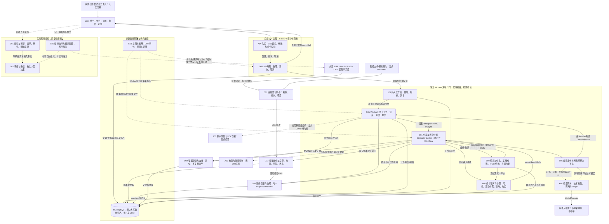
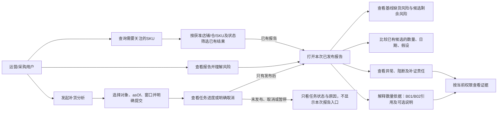
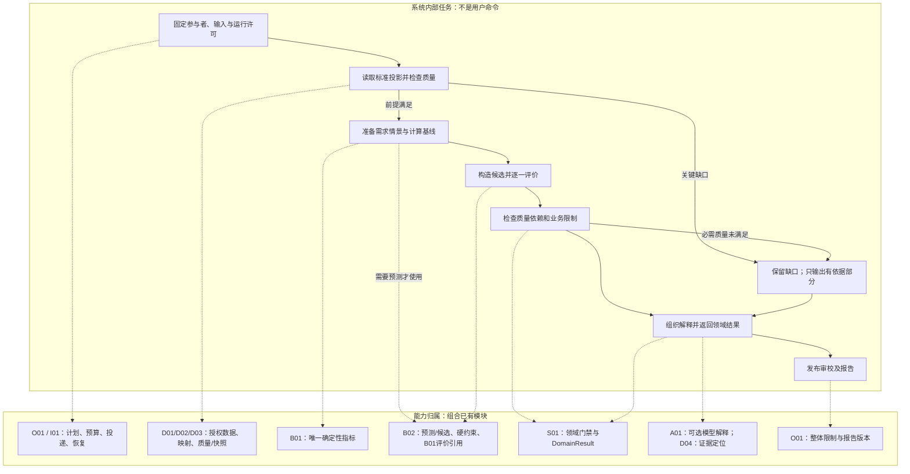
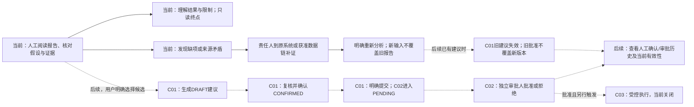
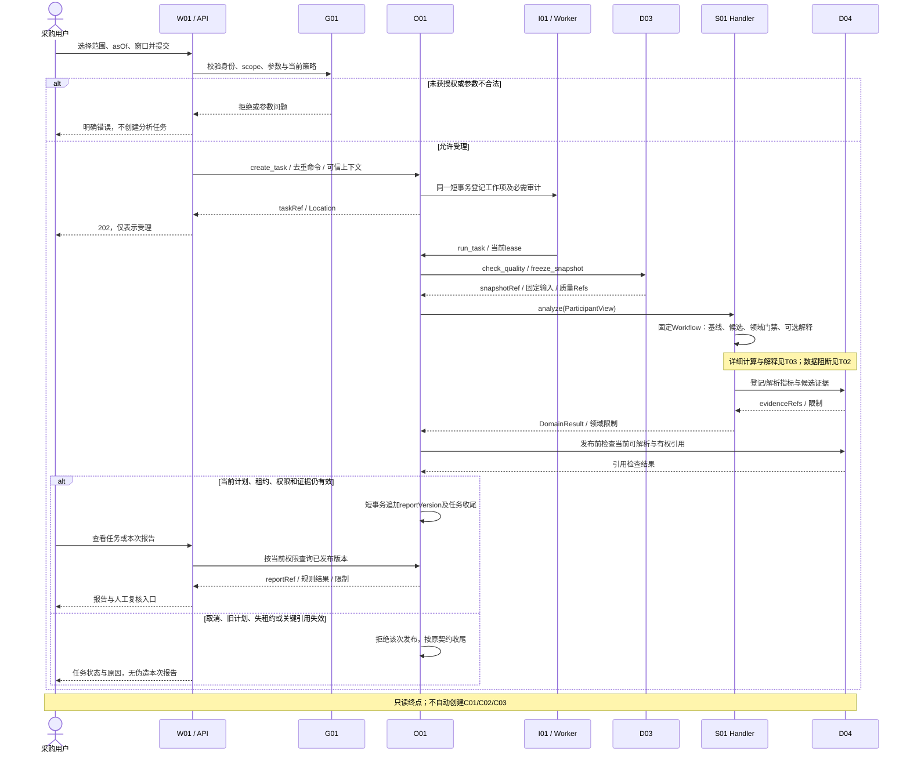
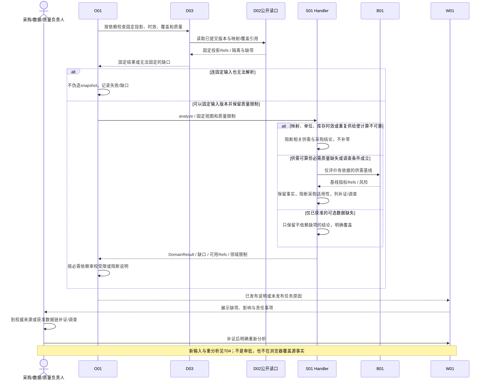
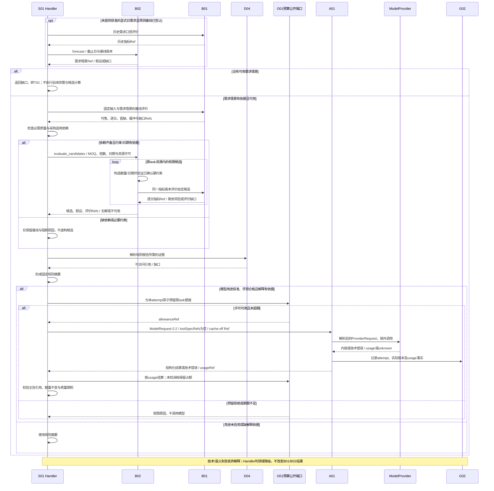
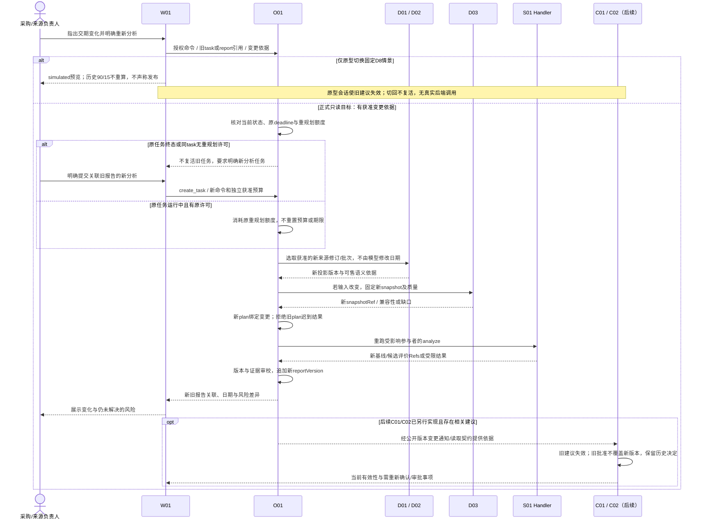
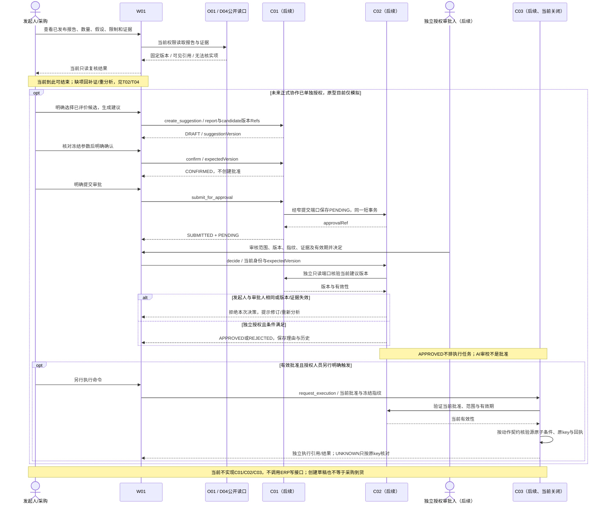

# S01 补货 Agent 专项详细设计

版本：0.1 · 日期：2026-11-11 · 对应任务：D-S01-01 · 第一阶段设计评审稿。

本文件是本轮唯一 S01 专项详细设计正文。它深化既有 S01 供需与库存分析，不替换需求、概要设计、AI 详设或产品原型规格。**本轮只交设计，未开展 ERP 接口调查、登录、模型调用、业务编码、正式前端修改、MVP 排期或开发 TODO 拆解。** 设计交付与业务开发完成、负责人验收分别记录，状态唯一见 [TASKS](../TASKS.md)。

“补货 Agent”是业务名称。当前目标形态为 **O01 调度的 S01 确定性 Workflow + B01 权威计算 + B02 候选方案 + 可选 A01 模型解释**。终点是可追溯的只读报告与人工复核；不自动生成业务建议、批准或采购单。

## 1. 阅读依据、权威与范围

### 1.1 依据索引与结论追踪

下文用 R、L、H、A、P、U、V 指代本表文件，并附章节。这里的引用仅便于定位，不构成第二套规范。

| 代号 / 权威材料 | 本设计直接采用内容 | 对应正文 |
|---|---|---|
| R：[需求文档 v0.2](../requirements/REQUIREMENTS.md) §3—10、§13—16 | 业务目标；S01-01—05；可售/供给/质量口径；AC-01—04/09—12；人工边界 | §2、§4、§6—10 |
| L：[总体逻辑架构 v0.2](../architecture/ARCHITECTURE.md) §2、§7、§9、§11—12 | 五层模块、唯一归属、模块化单体与扩展原则 | §3、§5、§9 |
| H：[概要开发设计 v0.2](../architecture/DEVELOPMENT_DESIGN.md) §5—9、§11—14 | AnalysisContext 0.2、ParticipantView、DomainResult、API 资源、存储/事务/恢复、人工终点 | §4—9 |
| A：[AI 模块详设 v0.2](AI_DETAILED_DESIGN.md) §3—6、§8—11、§14.1、§15—16 | S01 默认 Workflow、ModelRequest §9.1、共享预算、YIELD、可选解释与降级 | §3、§5、§7—9 |
| P：[PLAN](../PLAN.md) §2、§5—10；[DECISIONS](../DECISIONS.md) ADR-SEQ-001、ADR-MIN-001、OPEN-01—08 | S01 先行；公共能力按需；规则闭环无 C 轨硬依赖；S01 自有验收不代替 S02 MC | §1、§9—11 |
| U：[PRODUCT_SPEC v0.2](../ui/PRODUCT_SPEC.md)、[ALIGNMENT](../ui/ALIGNMENT.md) | 四页原型、历史报告与新任务区分、情景失效、模拟审批及未实现项 | §4、§6、§8、§10 |
| V：[DESIGN](../../DESIGN.md) §1—2、§6—9 | 对象→结论→风险→证据→操作；缺失不填零；视觉不授予权限 | §4、§6、§8 |
| [AGENTS](../../AGENTS.md)、[HANDOFF](../HANDOFF.md)、[COLLABORATION](../COLLABORATION.md)、[TASKS](../TASKS.md) D-S01-01 | 授权、接手、唯一台账、真实证据与停止点 | 本节、§11 |

接手事实：分支 `main`，基点 `895167c7c1b76db2e46209fa4480e4819e65a06f`；初始 `git status --short`、未提交 diff 与暂存 diff 均为空。当前已有 origin，指向既有项目 GitHub 仓库；早期 HANDOFF 的“无 remote”只表示当时事实。本轮不改 origin、不推送。实际执行者为 Codex，文档单人写入，无并行代理。

### 1.2 权威适用顺序与标记

本轮明确用户指令决定本轮授权范围；既有 R 的业务需求、L/H 的模块契约、A 的 AI 细化分别约束所属领域。P 中已生效 ADR-SEQ-001 仅调整实施顺序，不改冻结业务口径或原 MC；U 定义原型流程且不能覆盖后端契约；V 仅定义视觉；归档、旧计划、生成视图和历史聊天不作为新的业务事实。ERP 等源系统仍是相应数据域的业务事实权威。遇跨文件实质冲突，定位原文并进入 §10，不按“文档更新更晚”自行覆盖。

- **【沿用】**：已有明确边界或样例口径；不代表真实系统已实现或企业规则已签认。
- **【设计建议】**：本专项在既有架构内细化的字段、判断或交互语义，待负责人评审；不是已发布 API/数据库 Schema。
- **【待确认】**：缺企业事实、规则签认或契约验证，不能在实现中默默采用默认值。
- **【原型模拟】**：固定 fixture 和会话反馈，不能作为真实 ERP、模型、权限、审批或计算验收。
- **【后续扩展】**：另行评审与授权后才可实现/启用。

### 1.3 三种范围分开

| 范围 | 包含 | 不包含 / 当前事实 |
|---|---|---|
| 本轮文档交付 | 专项设计、嵌入 Mermaid、逐图讲稿、伪代码、待决问题、自检；必要索引/台账交接 | 没有业务实现；不调查真实接口，不写 MVP/开发 TODO |
| 当前 S01 只读目标【设计建议，待评审后另行开发】 | 授权范围选择、快照与质量、B01 基线、B02 有依据候选/评价、规则报告、证据和人工复核；LLM 可关闭 | 不执行 C01/C02/C03；不要求先建 S02、完整 S03、所有 A/B/C；不默认自然语言入口 |
| 原型及未来 | 原型四页用于演示；未来按需启用质量联合分析、建议/独立审批/另行执行、学习预测等 | 原型审批页不证明当前服务具备审批；未来目标不因画进图而获得授权 |

本文件不冻结 SKU/仓/单位、企业阈值、采购政策或技术小版本。缺口允许写成设计评审项，但相应生产结论/模型用途保持关闭。

## 2. Agent 定位与业务必要性

### 2.1 业务问题与价值

补货决策需要同时看“现在能卖多少”“未来还要卖多少”“已订但未收的货何时真正能卖”“新采购何时才能补上缺口”。这些信息可能分别在 OMS、WMS、ERP、CRM，也可能由同一软件承担。人工汇总时，最容易把库存镜像相加、把预留订单再扣一次、把到港当可售，或者只看总量够不够而漏掉中途缺货。数量看似合适，也可能因为质量调查或证据过期而不能采购。（R §3.3、§7.1、§9.2）

S01 的价值是把同一范围、时点、口径下的数据、计算、候选与限制组织成一份能核对的分析。采购人员能追问某个数量来自哪个指标版本，数据负责人能看到缺哪个字段，质量负责人能知道为什么需要调查，审计人员能重读当时报告。这里不预设准确率、节约金额或效率提升比例；收益需以后采集基线并做可比观察。（R §2.3）

### 2.2 人工与 Agent 辅助的区别

| 环节 | 传统人工方式可能的工作 | S01 辅助方式 | 人仍承担的责任 |
|---|---|---|---|
| 准备数据 | 跨系统导表，逐项识别时间/单位 | D01—D03 保留来源、映射、覆盖、快照和缺项 | 确认权威来源、歧义映射、真实业务变化 |
| 算数量和日期 | 个人表格计算，解释口径可能不同 | B01 统一计算；B02 提出有假设的候选并复用 B01 | 签认需求、缓冲、日期、约束口径 |
| 看风险 | 凭经验查缺货、延期和质量问题 | 同时显示基线风险、候选后的剩余风险与质量门禁 | 调查冲突、确认供应商承诺和例外 |
| 解释和比较 | 人工整理依据 | 固定规则报告；可选 LLM 把已知结果讲清楚 | 核实解释是否忠实、选择业务方案 |
| 形成动作 | 在原系统办理采购/审批 | 当前仅供复核；后续人工命令逐段进入 C01/C02/C03 | 选择、确认、独立审批、另行执行，不合并为一键自动采购 |

### 2.3 职责分工

**S01 负责什么：**声明补货所需数据和质量依赖；在固定输入上组织基线、候选、约束、风险及解释；判断哪些领域结论可用、哪些受限；以 DomainResult 交 O01。它是平台的供需领域插件，可为未来经营规划提供版本化结果，不是商品主账、采购审批系统或新的调度中心。（H §5；A §14.1）

**必须由程序规则完成什么：**身份/单位转换由 D02；完整性、覆盖和时效检查由 D03；可售、需求口径、逐日供需、首缺日、缓冲和缺口由 B01；MOQ/倍数与日期候选构造和约束搜索由 B02；服务端权限由 G01；发布条件、版本和预算由 O01 及对应所有者执行。缺失与零值不能混用，不能让模型代算数量或放宽约束。

**LLM 适合什么：**在已获准用途下，说明“为什么有这个候选”“与另一个候选有何差异”“哪些假设尚未确认”。只接收最小必要、已计算、可引用的事实/假设；输出辅助说明和风险措辞。它不决定采购量、供应承诺、质量安全、审批有效性或执行结果。当前不需要 LLM 意图分类器，也不需要多个 Agent 协商。

**人必须确认什么：**数据来源与业务口径；映射歧义；需求/交期/缓冲假设；质量冲突及调查结论；是否选择候选进入后续建议；未来建议参数和独立审批。人工看过报告不等于 C01 确认，更不等于 C02 批准；未来批准也不等于采购已执行。（R §10；H §13.1）

## 3. 整体设计思想与约束

### 3.1 从业务问题到有界 Workflow

先固定分析对象、asOf、业务窗口、单位和获准目标，再选择所需数据与计算。Workflow 游标沿用 `baseline → candidates → constraints → narrative`，数据准备/质量检查在进入 baseline 前完成；没有模型也能形成规则闭环。只有输入与已签认规则具备时才给相应结论，不以生成一段自然语言作为“分析成功”。（A §8、§14.1）

O01 只统一任务、参与者、计划、期限/预算、快照协调和报告发布；S01 内部步骤不挪给 O01。B01 不生成预测或搜索采购量；B02 不重复实现逐日余额。可选一次解释不需要 Runtime、Loop、Memory 或 Agent 平台。（R §6.1—6.2；P ADR-MIN-001）

### 3.2 数据、质量、供需与候选

1. **数据获取**：D01 按获准来源读取或接收受控文件，声明覆盖/失败；D02 做审核映射、状态/单位转换和版本化投影。该链是公共数据准备，不是每次点击必然实时调用 ERP。当前可设计模拟文件路线，不推定真实接口可用。
2. **质量检查**：D03 检查必需字段、身份、单位、时效、覆盖、重复及适用质量依赖，固定可解析的 manifest。缺映射/库存过旧/供给重复不是模型可补齐的文字缺口。
3. **供需分析**：在互斥分桶可靠时由 B01 算可售；已预留需求与未来新增需求分开；未收供给按预计可售日进入逐日评价。需求情景如需预测由 B02 产生并保留假设，不能由 S01/LLM 推测。
4. **候选与评价**：B02 根据明确需求、MOQ、倍数、日期、供应约束组织有限候选，逐候选调用相同 B01 版本。总量够但到得晚的候选仍显示中途缺货；未解决风险必须保留。
5. **质量门禁**：供需数据可算，不等于商品质量安全。必需信号缺失或调查条件成立时，保留能证明的供需事实，但阻断采购适用性；不因尚未实现完整 S03 就将质量依赖删除。（A §14.1）

### 3.3 解释、人工与失败

规则报告先列数值、日期、来源和限制，LLM 只是可选表现增强。模型关闭、超时、无额度或输出不可靠时，回到规则报告；B02 不可用时只保留有依据的 B01 基线；关键输入不足时不得补出候选。降级由 S01 判断领域影响，再由 O01 按必需/可选依赖判整体状态，A01 不返回 RULES_ONLY/BLOCKED。（H §7.2；A §9.2）

人通过报告知道缺什么、谁负责、怎样补证；补证回到来源或获准数据修订链，不让浏览器修改权威数值。输入变更归 D03 新快照；组织变化归 O01 新计划；重新发布归 O01 新报告。旧证据保留历史定位，但访问始终按当前权限。报告、日志、审批是不同记录，G02 日志不能代替业务资产。（H §8.4）

### 3.4 扩展方式

S03 已发布质量结果只有在范围、群组窗口、时点、版本和权限兼容时才可引用；如需新 S03 分析，S01 返回缺口，O01 显式增加参与者为 JOINT。未来 S08 复用 S01 的预测/候选引用，不能再造预测或互调 Handler。扩展来源用 D01/D02，扩展预测用 B02，扩展模型用 A01；均不改当前只读终点。（R §8.1；A §11、§14.1/14.8）

## 4. 输入、输出、质量及业务口径

### 4.1 逻辑输入设计

下表为【设计建议】的语义字段集合，供接口/业务评审核对，不是 ERP 字段清单、生产 OpenAPI 或 DDL。来源列只表示 R §7.1 的逻辑数据域，实际系统及字段一律待后续核实；本轮没有调用或调查接口。

| 逻辑输入 / 责任 | 必要内容及单位/时间 | 缺失或冲突的影响 | 依据 / 未冻结点 |
|---|---|---|---|
| 用户分析范围 / O01、G01 | tenant、store、warehouse、canonicalSku；asOf、窗口；命令去重标识 | 未授权/非法范围拒绝受理；空集合语义不自动扩为全量 | H §6.1—6.3；试点对象待确认 |
| 库存分桶 / D02 投影→B01 | onHand、reserved、frozen、unusable；单位、源记录/版本；分桶语义及映射版本 | 分桶非互斥、来源为镜像、单位不明时不能直接套公式 | R §9.2；真实分桶关系待确认 |
| 需求事实 / OMS 逻辑域→D02/B01 | 历史订单需求口径、状态/取消/退货适用规则；预留覆盖范围；窗口及覆盖 | 无法区分已预留和新增需求则阻断相关供需结论 | R S01-02；企业需求与窗口待确认 |
| 未来需求输入 / B02 或明确情景参数 | 逐日新增需求曲线、单位、截止日、事实/假设类型、算法/参数版本 | 无获准曲线或基线定义时不给未来首缺/候选；不能把缺值按零 | R §6.2；固定日需求只限既有演示 |
| 未收供给 / ERP 逻辑域→D02/B01 | 来源单行/批次身份、剩余未收量、状态、目的仓、预计可售日及依据 | 供给重复/状态不明/日期不可解释时不计入确定可用量，也不能静默删掉后称完整 | R §9.2；状态与去重键待确认 |
| 交期与可售日期 / 来源证据、B02 | 下单/生产/运输/到港/入库/质检节点若可得；最终可售日期及假设版本 | 到港日不足以推出可售日；无法证明日期的候选仅列缺口 | R S01-02/03；日历、时区、缓冲待确认 |
| 采购约束 / B02 | MOQ、订购倍数、适用供应商/SKU/单位、有效期；交期/其他获准硬约束 | 必需约束未知、非正或互相矛盾时不生成可复核采购候选 | A §14.1；不默认不存在上限/缺字段=无约束 |
| 质量依赖 / D03、S01；已有 S03 结果公开引用 | required/optional 策略版本；结果范围、成熟群组、截止时点、证据/有效性；调查条件 | required 未满足或规则未冻结，阻断质量安全与采购适用结论 | R S01-03/04、AC-04；不要求先开发全 S03 |
| 来源/覆盖 / D01—D03 | sourceUpdatedAt、observedAt、coverageThrough、sourceVersion、批次/修订、删除标记、质量规则版本 | “刚同步”不等于覆盖完整；无法固定可解析输入则不能发布相应完整结论 | R §9；H §8.4/9.1 |
| 版本与运行许可 / O01 | task/plan/participant/snapshot、场景/指标/策略/算法版本、期限、预算、当前授权、租约 | 旧计划、失租约、超期、撤权不得继续发布；重入不重置预算 | H §6/11/12；A §3/6 |

数量用有单位的精确数值；金额仅在未来具备币种/成本/报价口径时由 B01 计算。当前不凭库存乘虚构单价得到采购货值。所有 asOf/源时间/覆盖水位独立保存，UTC 存储与业务日/源时区分开。（H §8.3）

### 4.2 已有口径与待冻结规则

| 内容 | 当前能确定什么 | 本专项不得擅自决定什么 |
|---|---|---|
| 可售 | R §9.2：互斥且可靠转换时 `available = onHand − reserved − frozen − unusable`，唯一实现 B01 | 不把该式套在已净额字段/重叠分桶；负值是否允许、如何纠错及来源优先级待确认，不静默截为零 |
| 新增需求 | R S01-02：已预留需求不能再作为未来新增需求扣减；B01 管历史口径，B02 管未来曲线 | 订单销量、实际出库、净销售等选哪个；促销/断货修正；历史窗口/工作日算法 |
| 未收供给 | 只计范围内符合状态条件的未收量，已收部分不再计；按预计可售日进入模拟 | 状态白名单、剩余量换算公式、取消/退回/分批到货/迟到未收的具体政策；不把负剩余量自动夹零 |
| 交期/可售日 | 到港不等于可售；候选日期必须有依据或显式假设 | “到港+固定几天”或“采购+统一交期”；节假日、质检耗时、日期不确定性阈值 |
| 逐日评价 | B01 唯一计算；R AC-02/03 有演示预期 | 日初/日末、同日先供给还是先需求、缓冲末日和截单时点；不能把 UI fixture 当企业签认 |
| 目标/缺口 | AC-02 样例目标90、缺口15；B01 口径版本化 | 通用覆盖期/缓冲公式、窗口末库存政策、缺货后的需求积压/丢失策略及缺口是否非负截断 |
| MOQ/倍数 | B02 分别满足 MOQ 和订购倍数，给每候选 B01 评价引用 | 是否允许零采购、多供应商、价格阶梯/预算上限、MOQ 按行/单/供应商聚合、约束冲突时是否有例外 |
| 风险 | 已知日曲线的首缺、未满足需求等由 B01 返回；质量调查按已签认规则 | 不把“日末负净额”称实物负库存；缺货风险分级阈值及无缺货标志的枚举契约待冻结 |
| 质量 | R AC-04：同一成熟群组100单中12单投诉为12%投诉占比，不是缺陷率；达到已确认调查条件应先调查 | 12%不是通用阈值；无投诉/无结果不等于安全；required/optional 不由用户随意降级 |

### 4.3 基线演示的可复核边界

下列仅复述 R §14 AC-02/03，作为后续规则与界面讨论的固定演示，不是企业数据，不是本轮跑过 B01/B02 的证据。

| 项目 | AC-02 原计划 | AC-03 延期 | 说明 |
|---|---|---|---|
| 库存与可售 | 100−30−10−5=55件 | 同一初始分桶 | 预留30件不再在日新增需求中扣一次 |
| 新增需求与缓冲 | 每日10件，D0后7天，2天缓冲 | 同一演示输入 | 目标90为基线预期，不升级为企业通用公式 |
| 原未收供给 | 20件，D4可售 | 20件，D8可售 | 基线曲线包含该供给，不含新候选采购 |
| 候选 | MOQ10、倍数10；20件，D6可售 | 候选20件也改为D8可售 | 候选曲线额外加入候选供给，不重复加入原供给 |
| 已有验收预期 | 目标90、缺口15、候选20；B02调用B01逐日评价 | D6首次短缺，旧建议失效 | 不继续把历史90/15当延期重算结论 |

U 的固定表按“同日先供给再扣新增需求”展示：原计划基线 D1—D7 的日末净额为45、35、25、35、25、15、5；加入候选后 D6/D7 为35/25。延期时基线 D6 为−5，候选也未在 D6 进入供给，故同样短缺。这里是【原型模拟】的解释，正式日粒度/先后顺序/缓冲末日仍列 §10 Q02；U 将 D1 标为2026-11-11，而 R 只规定 D0 后7天，不能由界面日期自行确定生产 asOf 映射。

### 4.4 质量与安全降级矩阵

【设计建议】以下“允许”仅指可展示的只读结论，不是启用采购流程。具体规则版本、required/optional 和允许 PARTIAL/RULES_ONLY 的业务条件须签认；未签认时保守关闭相关结论。（R §6.1、NFR-06；H §7.2；A §14.1）

| 条件 | 可以保留的结果 | 必须阻断 / 人工介入 | 领域与整体处理 |
|---|---|---|---|
| 关键身份/单位不明、库存过旧、覆盖不足 | 已有原记录引用和明确“不足以分析”的说明 | 相关数量、首缺和采购候选；数据责任人修复 | S01 返回缺口；O01 给阻断说明，不能以旧数据冒称完整 |
| 供给重复或镜像无法区分 | 不受污染的历史事实，注明适用范围 | 污染供需计算与采购结论；D02/来源责任人核实 | 不能简单排除一行就称数据通过 |
| required 质量缺失/过期/冲突，或矩阵未冻结 | 前提合格时的供需基线与风险，明确“质量未判断” | 采购适用性、质量安全断言及转采购；质量人员补证/调查 | 不因 B01 有结果就输出可行动候选；整体受限或 BLOCKED 由 O01 判断 |
| 已达确认的调查条件 | 供需事实与调查证据，说明缺货仍存在 | 转采购；先质量调查，不能编造替代供应商承诺 | 不把12%投诉占比称缺陷率 |
| B02 不可用、缺 MOQ/日期等必需约束、无可行候选 | 输入足够时 B01 基线；列缺口/无解原因 | 未评价的采购数量/日期、声称最佳；采购核实约束 | “仅基线”是内容能力标记，不新增 Task State |
| 可选 LLM 关闭/失败/预算拒绝/语义不合格 | 已校验规则报告、B01/B02引用 | 丢弃不可靠解释，不改数量补救 | S01 标解释不可用；O01按已签认矩阵给 RULES_ONLY 等完整性 |
| 关键证据撤权/删除/无法解析 | 有权限的缺口说明；历史报告可显示受限标记 | 无依据结论、泄露源明细；责任人恢复合法引用或重分析 | O01 发布前重审；W01读取/导出时再次鉴权 |
| 取消、超期、失租约、旧计划、存储/必需审计失败 | 已持久化且仍可访问的历史版本及任务状态 | 新调用/旧运行发布；不得把工作项DONE当分析成功 | O01/I01依自身契约收尾；迟到输出不得复活任务 |

可选数据缺失只有在业务模板已明确它不影响特定结论时才允许局部输出。批量 SKU 的混合结果必须逐项标明覆盖和阻断，不能用“其余正常”替代未计算 SKU；批量受限报告的正式启用条件仍在 Q04/Q07 确认。

### 4.5 输出、页面与人工复核

| 输出内容 | 唯一资产/返回方式 | W01 展示语义 |
|---|---|---|
| 分析范围与数据基础 | O01 task/plan + D03 snapshotRef/qualityRef | 时点、窗口、单位、覆盖、simulated/真实类型、限制 |
| 基线可售/逐日曲线/首缺/缓冲/缺口 | B01 metricResultRefs，含指标版本和输入类型 | 基线与候选曲线分列；未知显示“不可用”及原因，不填0 |
| 候选与比较 | B02 scenario/candidate/evaluationRefs，评价引用 B01 | 数量、预计可售日、约束、假设、残余缺货风险；未给成本时不说最经济 |
| 风险和依赖 | S01 DomainResult 的摘要、constraints、证据Refs | 数据阻断、质量未满足、需要核实的责任事项 |
| 解释 | S01 固定模板摘要；可选模型解释及调用/版本引用 | 程序计算/来源事实/模型解释明确标记；模型失败仍可阅读规则结果 |
| 发布报告 | O01 reportRef/reportVersion，绑定领域结果与输入版本 | 202只表示受理；只有有权读取的已发布报告才有报告入口 |
| 人工复核 | 当前为阅读/核对并到来源补证；持久化复核记录如有需要另定契约 | 不新增一张与 C01/C02 重复的“复核批准表”；原型会话记录不当真实记录 |

沿用 U 的工作台、补货建议列表、详情与人工审批信息结构；当前只读目标中“补货建议列表”展示的是报告候选/风险，尚无 C01 建议对象。人工审批页只保留【原型模拟/后续扩展】含义。当前 UI 模拟成功任务只给会话产物ID、入口对照历史 report-v1，并没有新任务详情与真实版本查询；正式设计目标不得说成已实现。视觉继续采用 V，不改原型或选前端框架。

## 5. Agent 架构图

### 图 A01：S01 只读架构与后续人工边界

实线表示当前只读目标中的主要调用或数据流；虚线表示按需能力或后续扩展。所有节点是逻辑职责，除 API/Worker 的进程边界外不表示独立微服务；本图也不表示这些模块已经开发完成。



**逐字讲解稿（A01）**

“我们从最上方的采购人员开始看。用户先在统一工作台选择仓库、商品和时间，再发起分析。页面只负责提交和展示，不自己算库存。后端 API 先验证身份和范围，再把任务交给 O01。O01 的作用是记住这次分析用了哪个计划、哪份输入、多少预算，以及最终发布哪一版报告。

API 受理后，任务通过持久工作项交给独立 Worker。这样浏览器关闭或 API 重启，也不必靠页面继续运行。图中两处 O01 是同一模块在两个进程装配的不同用例：Worker 在本进程调用运行用例，不需要回调 API 来调度。O01 把受限的参与者视图交给 S01。S01 是补货流程的组织者，先调用 B01 计算基线，再请 B02 构造候选。B02 每次评价候选都回到同一个 B01，所以不会出现基线一种公式、候选另一种公式的问题。

再看左下方的数据链。外部系统只向 D01 提供授权读取的数据；也可以先使用明确标记的模拟文件。D02 负责商品身份、单位、状态和投影版本，D03 负责质量与唯一输入清单。S01 读取的是固定版本，不是运行一半再查询一个变化的 latest。D04 则告诉我们某条证据如何定位，它不再保存一份库存或指标。

右侧的大模型用虚线连接，表示解释是可选的。模型拿到的是已经计算的结果和可访问证据，不是采购权。它失败时，S01 仍可按条件返回规则结果；数据或质量不足时，该阻断的结论仍然阻断。最后只有 Handler 形成领域结果，O01 审校版本和证据后发布报告。

底部共用 MySQL 是物理存储复用，各模块仍只写自己的资产。权限和审计在每次敏感调用与发布时强制执行。最下面的建议、审批和执行都属于后续边界。用户选择、确认、独立审批和另行执行是不同动作，图中没有从模型通往采购写入的箭头。当前分析到只读报告就结束。”

## 6. 意图图：用户目标、内部任务与能力分开

这里的“意图”是对已存在业务操作目标的整理，不是新建自然语言分类体系。范围选择、筛选、查看、分析、取消等由明确界面命令触发。当前不增加聊天机器人、不从自由文本自动推断 SKU/范围、不经 LLM 路由 O01。图 I01—I03 各展示一类必要关系，内部步骤不包装为用户意图。（R §7.1、§10；U 四页与异常流程；A §14.1）

### 图 I01：当前用户操作意图



**逐字讲解稿（I01）**

“这张图只讲用户想完成什么。第一条是找到需要关注的 SKU。用户可以按店铺、仓库、商品或已有风险状态筛选，但筛选不会启动模型或重新计算库存。它只是帮助用户找到已有的、自己有权查看的结果。

第二条是发起新的分析。用户明确选择对象、时点和窗口后提交，系统先返回任务。此时用户可以查看进度或取消，不能因为看到受理成功就认为报告已经发布。只有真正发布后，才出现本次报告入口。暂停、取消或未完成时，页面应解释当前状态。原型现在的成功任务入口只是对照历史固定报告，这一点和正式目标必须区分。

第三条是阅读报告。用户既要看不补货会发生什么，也要看候选加入以后还剩什么风险。比较候选是在比较已有计算结果，不是让大模型现场决定数量。解释入口优先展示 B01 和 B02 的结果引用，必要时再附模型说明。

最后，用户还应能看到为什么被阻断、由谁补证，并按当前权限打开依据。证据无法访问时，应明确说明无法核实，不能把一张空白证据卡当成没有问题。这些都是清楚的界面操作，不需要增加意图识别模型。”

### 图 I02：内部 Workflow 任务与 Agent 能力映射



**逐字讲解稿（I02）**

“用户点击一次分析，内部会经过多项任务，但这些任务不应变成多个会互相聊天的 Agent。我们先固定参与者、输入和运行许可，这是 O01 与 I01 的职责。然后通过数据模块读取标准投影并检查质量，这一步的价值是让后面每个数字都有可靠的身份、单位和时点。

进入基线前，需要明确需求曲线。如果用户提供的是已获准的固定情景，可以直接作为假设输入；如果需要预测，则由 B02 先给出带版本的曲线，再交 B01 评价。B01 只评价给定输入，B02 才负责预测与候选。候选阶段继续调用同一 B01，所以这条能力边界贯穿整个流程。

接下来 S01 核对质量依赖和业务限制。即使库存数量能算，如果缺少必需的质量信号，也不能推出可以采购。图中的缺口路径仍可以返回能够证明的部分，但必须保留限制，不能靠解释把缺口补成一个肯定结论。

解释阶段既有固定规则摘要，也可以在获准时调用 A01。证据定位交给 D04。最终 S01 构造领域结果，O01 决定整体报告如何呈现并发布。虚线只表示任务使用哪项能力，不表示新增调度链，也不意味着这些公共模块必须一次全部实现。”

### 图 I03：人工复核与未来协作意图



**逐字讲解稿（I03）**

“这张图用实线和虚线把当前与后续分开。当前人工复核的意思是阅读报告、核对假设和证据。看完后可以结束，也可以指出缺项。需要修复的数据回到原系统或获准数据链，由责任人补证，再明确发起重新分析。我们不让用户在浏览器里把库存改成想要的数值，也不让一次复核覆盖已经发布的历史报告。

从选择候选开始，下面的路径都属于未来能力。只有用户明确选择，才会创建 C01 建议草稿；确认只形成 CONFIRMED。再点击提交，才有独立审批人处理的 PENDING。批准和拒绝由 C02 记录，模型审校不能替代这一步。

查看人工复核结果，在当前主要是查看报告限制和补证结果；查看持久建议确认或审批历史，则依赖未来 C01/C02。原型中已有的角色切换与会话记录，只是帮助理解流程，没有真实身份和后台记录。

即使批准，也还要另行触发执行，当前执行保持关闭。如果重新分析使输入或建议参数变化，旧确认和旧批准不能套到新版本上；历史决定应保留，同时显示它已经不再适用。这让人能追溯曾经决定了什么，又不会误把过去的决定当成今天的权限。”

## 7. 核心业务逻辑与 Python 风格伪代码

### 7.1 阅读约定与不变量

以下仅为文档伪代码，不提供可运行代码，不创建包/服务/表。函数名映射 H §5.1 的公开用例，参数/结果细化均【设计建议】；`policy`、`Ref`、`outcome` 等只是语义占位，不是新增公共协议。库存/逐日/目标缺口公式只调用 B01；示例中未知规则必须经已签认版本解析，否则返回缺口。异常结果与正常零值、无风险、无候选严格分开。

必须保持：

1. 分析执行前 `taskId/planVersion/participantId/snapshotId` 已绑定；`TaskRef` 只含 tenant/task 身份，planVersion 单列。
2. 数据及结果通过所有者公开读口与引用传递，不导入私有 ORM、不共享异步 Session。
3. 每个新步骤前检查当前授权、取消、deadline、计划/租约和资源；网络在数据库锁外，重试/恢复共用原 task 预算。
4. B01 结果附指标版本、单位、窗口及事实/假设输入引用；B02 每候选只保存其 B01 评价引用。
5. 只有 Handler 形成 DomainResult；本期不启用 Runtime。以后如启用，Runtime 只回 RunOutcome，YIELD 不发布。（A §3）

### 7.2 接收请求与数据准备

```python
# 输入：用户选择的对象/asOf/窗口；已认证身份；同一命令去重标识。
# 输出：202 + taskRef/Location，或未受理的认证/范围/参数/冲突错误。
def receive_replenishment_analysis(http_request, authenticated_principal):
    ctx = G01.authenticate_and_authorize(authenticated_principal, action="analyze:S01")
    scope = G01.derive_scope(ctx, http_request.requested_scope)
    validate_scope_and_window(http_request, scope)  # 空集合不隐式变全量
    template = O01.load_approved_s01_template()    # 用户不能删除required质量依赖
    command = validate_command_id_and_expected_content(http_request)
    # O01拥有受理事务，I01/G02各经自身公开服务参与；无源读取/模型网络调用。
    with O01.short_command_transaction():
        task_ref = O01.create_task(
            schemaVersion="0.2", scope=scope, window=http_request.window,
            participants=template.initial_participants,
            budget=template.frozen_limits, command=command,
            policyContextRef=ctx.policy_ref,
        )
        I01.enqueue(owner="O01", work_kind=template.registered_work_kind,
                    payload_ref=task_ref, dedupe_key=command.dedupe_key)
        G02.record_required_audit(task_ref, command, ctx)
    return accepted_202(task_ref)  # 重复同内容返回原受理引用；不同内容冲突


# 公共数据准备路径。输入：已授权批次请求/受控文件；输出：可用投影修订与覆盖。
# 不是S01临时抓取ERP；本轮既不调用也不调查真实接口。
def prepare_authorized_projection(source_request, scope, mapping_rule_refs):
    batch = D01.sync(source_request, scope)       # 传输只读，锁外网络
    if batch.technical_failure:
        return source_gap(batch.coverage, batch.error_ref)
    projection = D02.normalize_batch(batch.ref, mapping_rule_refs)
    # D02负责身份、单位/状态转换、来源权威、镜像选择、重复/删除与隔离。
    # 映射歧义不能由LLM确认；保留原值/版本和转换依据。
    if not projection.committed_usable:
        return mapping_or_coverage_gap(projection.issue_refs)
    # 仅已提交可用投影推进“可分析”游标，不以源读取完毕等同质量通过。
    return projection.revision_ref, projection.coverage_ref


# 输入：已受理task及合法lease；输出：调用Handler的固定视图，或受限收尾。
def dispatch_s01(task_ref, lease):
    task = O01.load_current_task(task_ref)
    O01.guard(task, lease)  # 终态、取消、期限、当前权限、计划与预算
    requirements = S01.declare_data_requirements(task.approved_parameters)
    quality = D03.check_quality(requirements, task.scope, task.as_of)
    snapshot = D03.freeze_snapshot(
        task.scope, task.as_of, quality.committed_input_refs, quality.ref
    )  # 唯一manifest；能固定的输入与缺项可记录，不能伪造缺失资产
    if not snapshot.can_resolve_fixed_inputs:
        return O01.finish_without_claiming_analysis_complete(snapshot.gaps)
    view = O01.bind_participant_view(task, snapshot.ref, lease)
    result = S01.analyze(view)                    # 不直接调B01代跑S01
    return validate_and_publish(task_ref, result, lease)
```

受理前错误沿用 H §6.3：未认证401、未授权403/统一404、参数422、版本/状态冲突409。已经受理后的数据阻断通过任务/报告查询表达，不让最初202暗含成功。若无法形成可解析快照，O01 可以记录失败/缺口，不能捏造 snapshotId 来满足结果字段。

### 7.3 S01 主 Workflow：领域判断与安全降级

```python
# 输入：O01受限ParticipantView；输出：绑定原task/plan/participant/snapshot的DomainResult。
def S01_analyze(view):
    guard_each_step(view)
    rules = load_reviewed_s01_policy_versions(view)  # 缺必需签认版本也算缺口
    manifest = D03.read_manifest(view.snapshot_id, view.current_policy)
    quality = D03.read_quality_for_snapshot(view.snapshot_id)
    inputs = D02.read_projection(manifest.fixed_projection_refs, view.effective_scope)
    gaps = check_required_inputs_and_rule_availability(inputs, quality, rules)

    # 不靠数据缺失时输出0来完成流程；只保留有独立依据的部分。
    if gaps.invalidate_supply_demand:
        return handler_domain_result(view, metrics=[], candidates=[],
            constraints=gaps.blocked_conclusions, evidence_refs=gaps.accessible_refs)

    demand = resolve_demand_scenario(inputs, rules, view)
    if demand.unavailable:
        # 如当前可售本身仍可靠，可有B01局部指标；不虚构未来需求/缺货日。
        partial_metrics = B01.evaluate_metrics(
            input_ref=inputs.inventory_ref,
            metric_definition_refs=rules.approved_available_only_metrics)
        return handler_domain_result(view, metrics=partial_metrics.refs, candidates=[],
            constraints=demand.missing_dependencies)

    baseline = B01.evaluate_metrics(
        input_ref=bind_given_inputs(inputs, demand.ref),
        metric_definition_refs=rules.approved_baseline_metrics,
        snapshot_id=view.snapshot_id,
    )
    # B01异常不是“零缺口”；不可把上次结果改个snapshotId作为新结果。
    if not baseline.valid_for_requested_conclusions:
        return handler_domain_result(view, metrics=baseline.safe_refs, candidates=[],
            constraints=baseline.quality_and_rule_gaps)

    quality_dependency = resolve_quality_dependency_via_approved_refs(view, rules)
    gate = S01.evaluate_business_dependencies(quality_dependency, rules)
    # 可使用兼容的已发布S03结果；若需新S03，只返回need-participant缺口。
    # 不由S01调用S03.analyze，也不反调O01调度。
    if not gate.allows_procurement_applicability:
        return handler_domain_result(view, metrics=baseline.refs, candidates=[],
            constraints=gate.blocked_conclusions_and_investigation,
            evidence_refs=quality_dependency.accessible_refs)

    guard_each_step(view)
    candidates = B02.evaluate_candidates(
        demand_scenario_ref=demand.ref, baseline_metric_refs=baseline.refs,
        supply_refs=inputs.supply_refs, constraint_refs=rules.purchase_constraint_refs,
        date_evidence_refs=inputs.saleable_date_evidence_refs,
        metric_definition_refs=rules.approved_baseline_metrics,
        task_resource_handle=view.resource_handle,
    )
    # 超时/缺约束/无解分别保留；基线可用不等于已经选出采购方案。
    checked = S01.check_candidate_refs_constraints_and_residual_risk(
        view, baseline, candidates, gate)
    narrative = explain_or_rules_only(view, baseline, checked, gate, rules)
    return handler_domain_result(
        view, metrics=baseline.refs, candidates=checked.valid_candidate_refs,
        constraints=merge_limits(gate, candidates, checked, narrative),
        explanation_ref=narrative.ref,
        evidence_refs=register_owned_output_locations_via_D04(baseline, checked),
    )
```

`handler_domain_result` 是 S01 的构造动作，不是 Runtime 接口。它不写 O01 状态，只返回领域引用及限制；质量阻断时本建议保守不展示可采购候选，需求本身允许保留事实和调查方向。若未来希望展示“计算可行但不可行动”的情景，必须有明确标签与降级矩阵，不得默认放开 C01。

### 7.4 B01：可售、需求、供给、缺货风险

```python
# 输入：固定输入Refs+指标口径版本；输出：MetricResultRefs及适用限制。
# 本段是B01内部责任示意；S01、B02与前端不得复制下面计算。
def B01_evaluate_supply_demand(request):
    definition = B01.resolve_metric_definition(request.metric_definition_version)
    data = read_owner_public_inputs(request.input_ref, request.snapshot_id)
    require_exact_units_mapping_coverage_and_rule_versions(data, definition)

    if not definition.proves_inventory_buckets_mutually_exclusive(data):
        return metric_gap("分桶不可直接相减；需D02/业务责任人核实")
    available = data.on_hand - data.reserved - data.frozen - data.unusable
    # 唯一已给公式：R §9.2。若源已经是净可售，须按获准映射，不再扣一次。
    definition.validate_available_value(available)  # 负值策略未冻结则报缺口，不夹零

    history = B01.evaluate_confirmed_historical_demand(data.demand_refs, definition)
    demand_curve = resolve_given_daily_new_demand(request.scenario_ref, definition)
    if not demand_curve.valid or not demand_curve.excludes_already_reserved_demand:
        return metric_gap("新增需求/预留关系未证明")

    supply = definition.select_eligible_unreceived_supply(data.supply_refs)
    # 仅选范围/状态/未收部分；镜像/重复/收货冲突须在D02/D03已被识别并可核对。
    if supply.ambiguous or not supply.dates_have_saleable_semantics:
        return metric_gap("未收供给或预计可售日不可核实")
    if supply.has_overdue_unreceived_without_approved_policy:
        return metric_gap("不能把过去的预计日期当成已经可售")

    # 以下调用版本化指标定义，不在本专项编造通用逐日/缓冲/积压公式。
    # 定义必须包含业务日、同日事件顺序、窗口端点、迟到供给和未满足需求策略。
    daily = definition.evaluate_daily_supply_demand(
        initial_available=available, new_demand=demand_curve,
        unreceived_supply=supply, candidate=request.explicit_candidate_or_none)
    first_shortage = definition.evaluate_first_shortage(daily)
    target_and_gap = definition.evaluate_buffer_and_gap(daily, request.buffer_policy_ref)
    return B01.save_owned_metric_result(
        available=available, history_ref=history.ref, daily=daily,
        first_shortage=first_shortage, target_and_gap=target_and_gap,
        input_refs=request.input_refs, scenario_ref=request.scenario_ref,
        definition_version=definition.version, units=data.units,
        input_kind=request.fact_or_hypothesis, quality=data.quality_ref)
```

这里只给有来源的可售公式；`evaluate_daily_supply_demand` 等故意不展开为未经签认的生产规则。只有正式指标定义具备所列语义后才能实现。首缺日与风险量来自 B01，不从 LLM 文字解析回填；无短缺、窗口外未知、不可计算必须能在结果契约中区分（Q02/Q07）。

### 7.5 B02：需求基线、候选、MOQ/倍数与评价

```python
def resolve_demand_scenario(inputs, rules, view):
    if inputs.has_approved_explicit_daily_new_demand:
        return fixed_hypothesis_ref(inputs.daily_new_demand_ref)  # 明示假设，非观测未来
    if not rules.has_approved_baseline_method_and_required_history(inputs):
        return unavailable("需求来源、窗口或基线规则待确认")
    # 历史事实口径引用B01结果；未来曲线由B02产生并记录截止日/窗口/算法版本。
    history = B01.evaluate_metrics(inputs.history_refs, rules.history_metric_refs)
    return B02.forecast(history.ref, rules.baseline_method_ref, view.resource_handle)


# B02内部伪代码。输入：曲线/基线/约束/日期依据；输出：候选、B01评价Refs或明确无解/缺口。
def B02_evaluate_candidates(request):
    constraints = load_reviewed_constraints(request.constraint_refs)
    if constraints.missing_required or constraints.invalid_unit_or_effective_period:
        return unavailable_candidates(constraints.issue_refs)
    if not constraints.moq_and_multiple_semantics_confirmed:
        return unavailable_candidates("MOQ聚合范围、倍数适用单位待确认")
    if not date_assumptions_supported_by_evidence(request.date_evidence_refs):
        return unavailable_candidates("不能由到港日或模型猜测可售日")

    candidates = construct_bounded_candidates_using_approved_strategy(
        request.demand_scenario_ref, request.baseline_metric_refs, constraints)
    evaluated = []
    for candidate in candidates.within_original_task_resource_limits():
        guard_each_step(request.task_resource_handle)
        if candidate.quantity > 0:
            if candidate.quantity < constraints.moq:
                continue
            if not exact_multiple_in_confirmed_unit(candidate.quantity, constraints.multiple):
                continue
        elif not constraints.explicitly_allows_no_purchase_case:
            continue
        # 这里只判候选约束；不在B02计算逐日余额、首缺、缓冲或派生缺口。
        if violates_other_confirmed_hard_constraints(candidate, constraints):
            continue
        evaluation = B01.evaluate_metrics(
            input_ref=bind_scenario_and_candidate(request, candidate),
            metric_definition_refs=request.metric_definition_refs)
        if not evaluation.valid_for_candidate_comparison:
            record_candidate_gap(candidate, evaluation.gaps)
            continue
        evaluated.append(B02.save_owned_candidate(candidate, evaluation.refs))

    if not evaluated:
        return no_feasible_or_evaluable_candidate_with_reasons()  # 不等于无需补货
    # 未获准目标函数/权重时并列展示，不编造综合分或“最优/最便宜”。
    return compare_by_approved_dimensions_or_unranked_table(evaluated, constraints)
```

AC-02 的15件缺口、MOQ10、倍数10可得到20件演示候选，但并不因此冻结所有供应商的舍入算法。正式候选构造需明确 MOQ/倍数单位、零采购情景、交期依据及其他硬约束；不能把所有未知字段视为“不限制”。数量满足约束和日期能避免缺货是两个问题，都应展示；延期候选有数量仍可能无法解决 D6 短缺。（R S01-02、AC-02/03；A §14.1）

### 7.6 A01 可选解释：输入限制、技术失败与语义校验

```python
def explain_or_rules_only(view, baseline, candidates, gate, rules):
    deterministic_report = S01.render_rule_summary(baseline.refs, candidates, gate)
    if not rules.explanation_use_is_approved_and_evaluated:
        return rules_only_content(deterministic_report, reason="模型用途未启用")
    guard_each_step(view)
    context = S01.build_minimal_context(
        metric_refs=baseline.refs, candidate_refs=candidates.refs,
        evidence_refs=D04.resolve_evidence(candidates.evidence_refs, view.current_policy),
        assumptions=candidates.assumptions, gaps=gate.gaps,
        trust_labels=True, omission_reasons=True)
    # 不传完整客户资料/源主账；外部文本仅为数据，不可改变权限和工具白名单。
    if context.missing_critical_support:
        return rules_only_content(deterministic_report, reason=context.gaps)

    logical_call_id = stable_call_id_for_this_explanation(view)
    attempt_id = new_attempt_id()
    allowance = view.budget_handle.reserve(logical_call_id, attempt_id,
                                         rules.verified_cost_upper_bound, view.deadline)
    if allowance.denied:
        return rules_only_content(deterministic_report, reason="解释额度/期限不可用")
    response = A01.invoke_model(ModelRequest(
        schemaVersion="0.2", logicalCallId=logical_call_id, attemptId=attempt_id,
        taskRef={"tenantId": view.tenant_id, "taskId": view.task_id}, queryRef=None,
        planVersion=view.plan_version, participantId=view.participant_id,
        snapshotId=view.snapshot_id, principalRef=view.principal_ref,
        policyContextRef=view.current_policy_ref, purpose=rules.approved_explanation_purpose,
        deploymentRef=rules.deployment_ref, promptRef=rules.prompt_ref,
        contextBundleRef=context.ref, outputSchemaRef=rules.explanation_schema_ref,
        requiredCapabilities=rules.required_capabilities, toolSpecRefs=[],
        parametersRef=rules.parameters_ref, allowanceRef=allowance.ref,
        deadline=bounded_utc_deadline(view.deadline, rules.provider_timeout),
        cachePolicyRef=rules.cache_off_ref, traceId=view.trace_id,
        parentSpanId=view.current_span_id))
    # A01按§9.1解析ProviderRequest；S01不能直接访问提供方或传自由messages覆盖引用。
    # G02记录本attempt usage；只有可靠记录后由原预算所有者结算。
    usage = G02.read_recorded_usage(response.usage_ref)
    view.budget_handle.settle_or_keep_unknown_reservation(allowance, usage)
    if response.technical_failure:
        return rules_only_content(deterministic_report, reason=response.error_ref)
    if response.tool_requests:
        return rules_only_content(deterministic_report, reason="本用途无工具许可")
    if not S01.validate_explanation_claim_refs_and_unchanged_numbers(
            response.validated_object, context, baseline, candidates, gate):
        return rules_only_content(deterministic_report, reason="解释无依据或改变事实")
    return accepted_auxiliary_explanation(response.ref, deterministic_report.ref)
```

此处所有字段沿用 A §9.1；不使用 `deadlineRef/parameters/toolSpecs/toolSpecsDigest` 作为逻辑请求别名。`purpose` 的实际枚举、解释 Schema 和语义校验覆盖属于待评审的 S01 用途配置，不宣布现已注册。推荐解释输出为“结论文字+支持它的 metric/candidate/evidenceRef+假设与限制”，数值由页面引用权威资产；不得让模型返回一组可覆盖 B01/B02 的数量字段。结构通过不等于语义正确，关键主张不能自动验证时需要人工复核或不用该解释。默认无动态工具、无重试润色循环；必要技术重试仍保留 logicalCallId、使用新 attempt 并计原预算。费用未知占额，不能按0结算。（A §6、§9、§13）

### 7.7 版本绑定、发布与恢复

```python
def validate_and_publish(task_ref, domain_result, lease):
    current = O01.load_current_task(task_ref)
    O01.guard(current, lease)  # 取消/终态/权限/期限/plan/lease
    validate_result_identity_and_versions(domain_result, current)
    if is_yield(domain_result):
        # 当前不启用暂停协议；未来仅经A §3.3兼容审查后的持久交接处理。
        if not current.reviewed_yield_protocol_enabled:
            return O01.reject_unsupported_handoff_without_report(domain_result)
        return O01.persist_reviewed_yield_handoff_without_report(domain_result, lease)
    evidence = D04.resolve_evidence(domain_result.evidence_refs, current.current_policy)
    # 证据重审/可能网络在锁外；对不可解析依据限制相应结论，不保留无支持肯定句。
    report_candidate = O01.compose_without_recomputing_domain_metrics(
        domain_result, evidence, current.approved_degradation_policy)
    with O01.short_publish_transaction():
        O01.assert_current_plan_lease_not_cancelled_and_compatible_outputs(current, lease)
        O01.assert_report_has_required_evidence_and_no_blocked_claims(report_candidate)
        report_ref = O01.append_report_version(report_candidate)
        O01.finish_task_with_separate_business_completeness(report_ref)
        G02.record_required_publish_audit(report_ref)
    return report_ref


def handle_new_input_or_parameter_change(task_ref, change_command):
    current = O01.authorize_and_load(task_ref, change_command)
    if current.is_terminal:
        # 终态不复活；重新分析需明确新任务，可关联旧报告。
        return require_explicit_new_analysis_with_history_link(current)
    if current.remaining_replans == 0 or current.deadline_exceeded:
        return O01.finish_or_limit_with_explicit_reason(current, "无重规划许可")
    # 新来源/映射/质量版本经D01/D02处理后由D03新snapshot；不能改旧manifest。
    # 仅假设/组织变化不假装来源改变；是否需新snapshot由输入依赖确定。
    snapshot_ref = D03.freeze_changed_inputs_if_needed(current, change_command)
    plan_ref = O01.replan_affected_participants(current, snapshot_ref, change_command)
    # 同task重规划消耗原额度，不延长deadline或重置usage。
    return O01.schedule_affected_runs_with_original_budget(plan_ref)
```

发布 `reportVersion` 只追加，不覆盖旧报告。新来源证据需要新 snapshot；仅组织/假设变化形成新 plan 并绑定相应 B02 参数版本，输入是否变化按 D03 定义确认；有新发布才有新 reportVersion。恢复只复用兼容、可访问的已完成产物，不把旧 B01 结果改标签冒充重算。W01 在读取、导出和回源时再次鉴权；最终发布事务还须防止撤权竞态，具体策略版本/有效性核验遵循 G01（Q07）。

任务状态沿用 QUEUED/RUNNING/SUCCEEDED/FAILED/CANCELLED；报告 COMPLETE/PARTIAL/RULES_ONLY/BLOCKED 表示内容完整性，二者不合并。阻断说明是否采用成功收尾的任务状态由 O01 契约冻结，本文不另创映射。无暂停需求不实现 YIELD 等待基础设施；若未来用它，参与者未完成，不可发布 partialOutputRef 为报告。（A §3；H §11—12）

### 7.8 技术异常不能转换为业务“正常”

§7.2—7.7 的端口返回可判别的成功/不可用/缺口结果；如适配层以异常表达技术失败，调用方必须先归一成对应技术事实，再按下表处理，不使用一个捕获所有错误后返回空列表/零值的兜底。

| 失败位置 | 责任及安全结果 | 不允许的自动补救 |
|---|---|---|
| D01读取、D02标准化或D03固定失败 | 各所有者保留批次/缺口，S01不能得到可靠输入时不计算；O01显示未完成原因 | 推进可分析游标、换成latest、伪造快照 |
| B01技术失败或指标规则不完整 | S01只返回此前可证明且输入兼容的产物及限制；无可靠基线不生成采购候选 | 把失败当0缺口、调用LLM算一次 |
| B02技术失败、资源超限或约束无解 | 分别记录原因；有可靠B01基线可降为仅基线，无解不等于无需采购 | 无限搜索、放宽硬约束、拿未评价数量补位 |
| A01调用抛错、输出/usage未决 | A01/G02记录发送前失败或发送后未知，原预算保持未决占额；S01丢弃解释，按条件保留规则报告 | 立即重复收费调用、按0结算、换模型扩地域 |
| 持久化/必需审计失败、发布条件冲突 | 所有者回滚该短事务；I01仅按原重试/期限/租约策略重入；发布前重审 | 展示未落库报告、让旧lease继续写、把技术失败标业务通过 |

只读步骤只有可证明可重入、版本匹配且原预算/期限允许时才重试；重用已完成产物须经兼容检查。未知技术异常交还 O01 的失败处理并留脱敏 trace，不包装为“无风险”。本轮没有冻结重试次数或实现异常处理代码。（H §7.2、§11—12；A §6/9）

## 8. 业务流程时序图与逐字讲解稿

图 T01—T04 是未来获准实现的只读目标设计，当前仅文档；图 T05 明确拆出当前复核、原型模拟与未来正式协作。图中“返回”均携带原 task/plan/participant/snapshot 关联；为可读性未重复画每次 G01/期限/租约/预算检查，但 §7.1 不变量在每个敏感步骤仍强制成立。

### 图 T01：正常补货分析、受理与发布



**逐字讲解稿（T01）**

“正常流程从用户明确提交开始。W01 和 API 先让 G01 验证身份、范围和参数。没有权限或者参数不合法，就在受理前返回原因，不会先创建一个任务再假装分析过。允许受理时，O01 把任务、持久工作项和必需审计放进同一个短事务。返回202只说明任务已被接收。

随后独立 Worker 领取工作项，用当前租约调用 O01。O01 协调 D03 检查质量并固定输入，再把同一 task、plan、participant、snapshot 的视图交给 S01。S01 内部完成领域流程，详细计算在后面的图展开。领域输出是引用和限制，不是一份可以绕过版本检查的自由文本。

发布前还要通过 D04 检查证据是否仍能解析、当前是否有权使用。为什么已经计算完还要检查？因为计算期间可能发生取消、重规划、撤权或证据失效。只有条件仍成立，O01 才追加报告版本并收尾。迟到结果不能覆盖新计划，也不能把取消任务重新变成成功。

用户查询时再次验证权限，得到本次已发布报告和限制。如果没有发布，就只能看到状态和原因。整条流程到报告结束，不会因为报告里有一个20件候选，就自动产生采购建议、审批记录或外部订单。”

### 图 T02：数据缺口、质量调查与人工补证



**逐字讲解稿（T02）**

“这张图解释为什么不能把所有异常都归成一句数据不足。D03 先根据场景声明检查已提交投影，既要看数值有没有，也要看映射、单位、覆盖和时效。如果连固定输入都无法解析，就由 O01 记录失败或缺口，不能生成一个假的快照编号。

第一类问题会让供需本身不可靠，例如库存过旧或同一供给重复出现。S01 此时阻断相关计算和采购结论，不能把缺失值当零，也不能随便去掉一条重复记录后宣布完整。第二类情况是供需可以计算，但质量依赖没满足，或者已经达到确认的调查条件。这里仍可以展示 B01 的库存与缺货风险，让采购知道业务压力存在；同时必须说明这不足以支持采购适用性，应该先补证或调查。

第三类才是已经被业务模板确认可选的数据缺失。只有不依赖它的结论可以保留，不能由用户临时把必需依赖改成可选。S01 把这些领域限制交给 O01，O01 再决定整体说明如何发布，不让 A01 的某个错误码直接决定业务状态。

人工介入点在报告缺口之后。数据或质量负责人回到权威来源处理问题，再明确发起重新分析。补证不是审批，也不会在原报告里直接改数。新结果必须有对应的新输入或计划版本，不能用一条已读提示掩盖原先的阻断。”

### 图 T03：候选评价与可选 AI 解释



**逐字讲解稿（T03）**

“先看需求从哪里来。如果已经有获准的日新增需求情景，就直接固定引用；如果需要预测，先由 B01 给历史需求事实口径，再由 B02 形成未来曲线。预测必须带截止日和算法版本。没有曲线依据时，不是让模型猜一个日销量，而是返回缺口。

拿到给定需求后，B01 计算基线。S01 检查质量和采购适用依赖，条件成立才请 B02 构造数量与日期候选。候选要分别满足 MOQ、订购倍数和其他已确认约束。每个候选都回到 B01 做逐日评价，因此20件即使总量足够，如果到 D8 才可售，仍可能解决不了 D6 的缺货。B02 返回候选和评价引用；无解或不可用也要保留具体原因。

S01 接着解析证据并形成固定规则摘要，到这里已经有不依赖大模型的可读结果。只有解释用途获准、评测合格并有依据时，才向原任务预算申请本次调用许可。额度不足就不调用，不能让解释另领一份预算。

A01 接收统一 ModelRequest，解析成提供方请求，再在数据库锁外访问模型。G02 记录实际版本和用量，原预算所有者负责结算；超时导致消耗未知时继续占额，不能按零费用处理。最后 S01 还要检查解释有没有改数、丢掉限制或引用不支持的结论。失败就回到规则摘要，不能为了让解释通顺而修改计算结果，更不能把模型说明当成采购批准。”

### 图 T04：供应商可售日期变化后的重新分析



**逐字讲解稿（T04）**

“供应商日期变化时，首先要分清是演示还是正式分析。当前原型切到 D8，只是看固定样例的差异，没有真实重新取数、B01 重算或发布。历史目标90和缺口15不能继续冒充延期后的新结论。会话里已有建议会失效，切回也不会复活旧批准。

正式只读目标中，用户需要明确提交变更依据和重新分析命令。如果原任务仍在运行且有重规划许可，就用原任务剩余额度和期限；如果已经结束或者没有许可，不能复活旧任务或偷偷重置预算，应由用户明确提交关联历史报告的新任务。

来源日期变化经 D01 和 D02 形成新的投影版本，D03 根据实际输入变化建立新快照。仅改变假设时则要绑定新的情景参数与计划，不能伪造一条来源更新。O01 组织受影响的 S01 重跑，并拒绝旧计划的迟到结果。新报告审校通过后追加发布，旧报告保留，所以能比较当时和现在的依据。

最下方是后续协作边界。如果将来已有真实建议和批准，由 C01/C02 通过自己的公开契约判定旧建议与批准是否仍适用。O01 不直接改审批表。供应日期变化会影响哪些对象、怎样原子核验，是后续契约需要评审的内容；不能只靠页面弹一次警告，就认为服务器已经完成作废。”

### 图 T05：当前人工复核与未来确认、审批、执行分离



**逐字讲解稿（T05）**

“上半部分是当前目标：采购人员打开已发布报告，核对数量、日期、假设、限制和证据。系统重新检查当前权限。看到报告只是理解分析，并没有发生 C01 确认或 C02 审批。需要补证就回到前面的异常与重分析流程，不新增一套复核批准系统。

下面整个可选区域都属于未来正式协作。第一步必须由用户明确选择一个已经评价的候选，才建立 DRAFT 建议。确认时核对冻结参数，形成 CONFIRMED，但还没有批准。再明确提交，才由 C01 作为提交协调者，通过窄端口让 C02 保存 PENDING，并在同一短事务里保持两边一致。

独立审批人查看对应版本、指纹、证据和有效期，再作出决定。C02 用单独只读端口核验当前建议，避免把整个 C01 服务互相注入而形成循环依赖。如果还是发起人自己批准，或者版本和依据已失效，就拒绝这次决策。通过模型审校不能越过这一关。

即使保存了 APPROVED，也不会自动排执行任务。另一次明确执行命令才进入 C03，由它核验当前批准与来源原子条件。结果不明时继续用原 executionKey 核对，不换键重发。当前这个区域全部没有真实服务实现，原型只演示会话状态。未来即便创建了 ERP 采购草稿，也只证明草稿创建，不能说采购已经完成或货已经到仓。”

## 9. 技术实现边界、公共复用与演进

### 9.1 所属能力与必要子集

| 类别 | 当前设计需要的能力 | 可复用给未来场景 | 本轮/首期不提前建设 |
|---|---|---|---|
| 平台代码底座 | API/独立Worker、配置/错误、MySQL短事务与迁移、I01持久投递/租约/恢复、G01最小权限、G02审计/Trace、O01任务/预算/报告 | 场景注册与参与者契约、授权读取、取消和版本发布 | 本轮均不编码；未来只建实际切片目录，不搭通用DAG、独立调度服务或完整IAM |
| 必要数据公共能力 | D01当前获准模式读取、D02本场景映射、D03质量/manifest、D04证据 | 后续来源和场景按公开端口复用 | 不一次接齐ERP/OMS/WMS/CRM，不复制主账/manifest，不自动创建向量/图索引 |
| 确定性业务公共能力 | B01供需指标；B02明确需求基线、候选/约束与B01评价引用 | S02/S08等采用相同给定输入评价与预测端口 | 不复制S01专用计算引擎，不先引大型求解器或未经验证学习预测 |
| 通用AI能力【按需】 | A01统一请求/提供方、Prompt/Context引用、预算/usage、最小用途评测 | 其他场景的获准模型用途 | 无模型也能规则分析；不默认A02/A03、RAG、工具、MCP、Memory、Agent Loop或多Agent |
| S01专属能力 | 数据/质量依赖声明、补货Workflow、领域门禁、候选比较维度、规则报告与可选解释模板、DomainResult | 通过已发布结果Refs供其他场景复用 | 不把领域步骤塞进O01或A01，不在S01私建审批/预算/任务系统 |
| W01业务表达 | 范围选择、报告/状态、证据、人工复核、阻断/未知反馈 | 统一工作台和证据组件 | 不选新框架/组件库，不改当前原型，不在前端计算权威指标 |
| 后续版本 | 显式JOINT质量分析、C01/C02/C03、学习预测、供应商/滞销深化、按需检索 | 既有模块内新增用例/提供方 | 单独设计、评审、授权；本专项不排MVP或开发TODO |

### 9.2 持久化、事务、可靠性和审计

沿用 H §8/11/12：MySQL 可共用物理实例，O01 保存任务/计划/领域结果关联/报告/预算，I01 保存投递/租约，D02 保存投影，D03 保存唯一 manifest，D04 保存定位与血缘，B01 保存指标，B02 保存情景/候选及 B01 评价引用。S01 不新增另一套任务库或快照表；是否需额外领域持久对象由实际消费者再评审，不在本轮列 DDL。

受理事务失败则不返回成功受理；发布失败则没有半份“已发布”报告。来源读取和模型调用在短事务外；异步分支不共享 Session。I01 至少一次投递配合所有者去重和条件发布，不声称 exactly-once。恢复检查当前权限、原计划/输入、已完成步骤和未决调用，避免重复收费或发布；取消在安全边界生效，迟到结果不复活。无暂停用例不为原型“暂停”演示提前实现 Runtime 持久等待。（H §11—12；A §3/6）

最小审计包括操作主体/范围、command/trace、task/plan/participant/snapshot、代码/场景/指标/算法/策略版本、B01/B02/evidenceRefs、模型用途/Prompt/Context/Schema/实际模型版本与 attempt/usage、降级原因和发布条件。无模型时相关版本显式 notApplicable，不伪造模型ID；日志脱敏，不保存秘密和隐藏推理过程，不以完整复制报告作为第二账本。来源删除/撤权需要引用可用性反馈，不能承诺永远重放。（A §3/12；H §8.4/14）

### 9.3 扩展准入与契约风险

新增供应商数据只扩 D01/D02 对应适配/映射，不让 S01 依赖厂商 SDK。新增 B02 算法必须记录训练截止、验证窗口、版本和回测证据；未经验证不说预测更准。新增解释用途须有数据许可、地域/留存、模型能力、费用上界和用途评测，缓存默认 OFF 且不创建缓存设施。A03 若确有检索用例，先权限过滤再回源，工具只有获准只读集合，无 C03、任意 SQL/shell/URL。（P §5—6；A §9—10）

本稿不改变公共架构或已冻结契约，未新增生效 ADR。§4 的字段、§7 的方法细化、解释 Schema、质量矩阵、来源变更与建议失效通知都属于待评审细化。未来若决定兼容增补或不兼容更改，必须在 DECISIONS 写消费者、Schema/数据、权限、阶段、测试、迁移/回退影响并由实际负责人评审，不能因伪代码出现字段就直接开发。

## 10. 待负责人确认的问题与真实差异

以下是设计决策问题，不是开发任务表。P0 表示未解决则相应生产结论/用途不能启用；不表示阻止本轮带缺口的专项设计交付。ERP 相关内容只登记依赖，不在本轮调查。

### 10.1 P0：业务事实、关键口径与安全门禁

| ID | 待确认问题 | 影响 / 保守处理 | 建议确认责任与依据 |
|---|---|---|---|
| Q01 | 试点租户/店铺/仓/SKU/单位；库存分桶是否互斥；ERP/WMS镜像与权威优先级；映射与精度 | 无法可靠算可售；不套公式/不相加镜像；不自动合并同名SKU | 采购、仓库、数据负责人；R §3.3/9.2、AC-01；OPEN-01 |
| Q02 | 需求事实/新增需求/预留的关系；基线窗口与预测方式；业务日/同日顺序/窗口端点/缓冲末日；负净额与积压、丢失需求和首缺语义 | 影响目标/缺口、曲线和候选效果；只沿用演示，不冻结通用公式；无规则版本则不出该指标 | 采购、运营、B01/B02契约负责人；R S01-02/AC-02/03；U 数据边界 |
| Q03 | 未收供给状态、去重身份、剩余量与分批收货；过去预计日期但未收怎样处理；交期终点、工作日、质检及可售日依据；MOQ/倍数适用范围 | 重复计入、迟到当现货或候选过晚；无依据日期不输出可采购候选；不猜承诺 | 采购、供应链、仓库及数据负责人；R §9.2；A V02/V03；OPEN-01/02 |
| Q04 | required/optional质量信号、有效期/来源/成熟群组、调查条件、局部/规则降级矩阵；没有S03时何种获准信号可用 | 缺信号不当安全，调查优先；可算基线与采购适用性分开；不把完整S03设为硬前置 | 质量/客服、业务负责人；R AC-04/NFR-06；A §14.1；OPEN-01 |
| Q05 | 各逻辑域实际由哪个系统提供；授权文件还是后续真实只读接口；源版本/覆盖/删除、单位/时区、真实字段与样例 | 本轮只能给逻辑输入；不能证明企业数据可得、及时或可重放。真实ERP品牌/版本/API均待核实 | IT/集成、源系统负责人；H §9；OPEN-02；本轮禁止接口调查 |
| Q06 | 当前只读目标是否包含候选比较与可选LLM；候选目标维度/优先级/硬约束；无解、仅基线、质量阻断怎样呈现 | 未定权重不排名“最优”；无模型采用规则报告；不从UI审批演示扩大权限 | 产品、采购、项目负责人；OPEN-06；U 负责人确认清单 |

### 10.2 P1：公开契约、运行和未来边界

| ID | 待确认问题 | 影响 / 当前处理 | 建议确认责任与依据 |
|---|---|---|---|
| Q07 | 逻辑字段如何落在AnalysisContext/MetricRequest/B02结果；无风险/未知/不可算的表达；报告完整性与Task State映射；批量部分结果、撤权发布竞态、变更后关联失效契约 | 不能由本稿直接冻结API/DTO；沿用公开端口与版本引用，重要变更先ADR/消费者评审 | O01、B01/B02、D03/D04、G01及集成人；H §5—8/12；A §3 |
| Q08 | 人工复核是否需持久备注；谁能看哪些字段/证据；真实身份、留存/删除、模型数据许可与地域 | 当前不新建复核批准系统；未授权不发送模型、不保留敏感数据 | 产品、数据/安全、业务负责人；OPEN-04/08；H §14 |
| Q09 | 任务deadline/重试/并发/租约/费用预算；解释用途Schema、金标准/硬失败、模型/Prompt/参数/价格版本及语义校验方案 | 未冻结不启无上限运行/模型用途；保留规则路径，费用未知占额 | 技术、运维、业务及模型用途负责人；OPEN-03/05；A §6/9/13 |
| Q10 | 未来C01/C02/C03何时另行授权；独立岗位/代理、金额/币种/有效期；新来源/参数变化的作废与再评价；源幂等/回执/原子条件 | 当前全部关闭；30件等人工调整未经B01/B02评价不得确认；旧批准不套新版本，UNKNOWN原key核对 | 业务管理、系统/协作模块负责人；R AC-10/11；H §12.3/13；OPEN-07 |
| Q11 | 正式页面与API契约、任意SKU/时点重算、新任务产物详情、完整版本历史、复核人员与业务样例 | 原型现有演示不足以证明目标可用；不修改原型或选框架，待产品/专项评审 | 产品、实际使用者、技术与负责人；U 尚未实现项；V |

### 10.3 文档差异、冲突与处理

| ID / 类型 | 已定位的差异 | 本轮处理与待决点 |
|---|---|---|
| X01 已有决策已解释的顺序差异 | H/A仍叙述原S02首批工程路径；P ADR-SEQ-001改为S01先行 | 沿用生效ADR，不把S02或全部公共能力设为S01设计前置；不重写基线或MC |
| X02 范围层级差异 | R §3/7.1/10描述完整首期产品含有限动作；当前AGENTS/P只读切片；U有模拟审批页 | 区分完整产品、当前切片和模拟演示，不认定服务已具备动作；C01/C02/C03另授权 |
| X03 本轮交付与旧任务建议范围差异 | 原D-S01-01提议scenarios路径及设计后拆切片；本轮用户指定agents主文档且禁止MVP/TODO | 按新指令只写本主文档，更新本任务文件范围，不创建旧路径副本、不拆实现任务；PLAN保留历史规划不在本轮重写 |
| X04 真实待决语义差异 | R AC-02规定D0后7天，未明示具体日历与同日事件顺序；U令D1=2026-11-11并采用先供给后需求 | 日序一致性/生产asOf转换须负责人签认，归Q02。保留两份原文，不把UI日期/事件顺序升格为业务冻结 |
| X05 展示不足并非新计算依据 | U/ALIGNMENT将90/15保留为历史指标，延期只固定表演示；新任务没有真实产物详情 | 延期需新B01评价，不能把旧90/15或会话成功作为新报告。归Q02/Q11，不改fixture补造结果 |
| X06 历史交接与实际Git差异 | 旧HANDOFF记录无remote；接手实测已有origin且工作区干净 | 记录当前事实，保留历史原文。本轮不处理发布，不由该差异推断任何远端同步状态 |

除以上事项，已读材料未发现需要本轮推翻总体架构的新增实质冲突。已有确认边界继续遵守；未冻结项保持待确认，不能因本稿用了【设计建议】就自动消除决策缺口。

## 11. 设计自检、评审边界与停止点

### 11.1 覆盖与复核索引

| 本轮要求 | 定位 | 自检范围与结论 |
|---|---|---|
| 定位/必要性/业务价值/职责与人工 | §2 | 已覆盖；未给未经验证收益或准确率数字 |
| 思想、数据/质量、规则/模型、风险/降级 | §3—4、§7 | 已覆盖；缺口与安全、供需与采购适用性分开 |
| 详细架构、流向、模块一致、当前/未来 | 图A01 | 1张架构图；模型无采购决定/下单通路 |
| 意图、内部任务、能力与未来分开 | 图I01—I03 | 3张意图图；无LLM意图分类器 |
| 输入输出、判断、异常及职责伪代码 | §7.1—7.7 | 覆盖请求、标准化、质量、供需、交期、候选、约束、解释、版本、发布与降级；无可运行业务代码 |
| 正常/阻断/候选与解释/交期变化/人工协作 | 图T01—T05 | 5张时序图；当前设计/原型/未来标记齐全 |
| 每张图紧跟独立逐字讲稿 | A01、I01—I03、T01—T05 | 共9张图、9份讲稿；按实际流向解释数据、存在理由、取舍、异常与人工 |
| 底座/AI/S01/复用与后续边界 | §9 | 按需复用，不先建平台、缓存、MQ、微服务、多Agent |
| 真实未知、ERP依赖、契约与冲突 | §10 | 分级列明影响，不改冻结需求，不调查真实接口 |
| 单一正文、必要索引、停止 | 本文件与TASKS/HANDOFF | 不生成专项HTML/PDF/SVG副本，不写MVP或开发TODO |

### 11.2 校验记录

本节只记录本稿作者自检，不代替负责人 DESIGN_REVIEW。Mermaid 校验采用仓库已有固定本地运行时，图源直接从本文9个代码块提取；在内存页面进行 parse/render，不维护独立图源或展示副本。执行结果在交付前填写，尚未取得结果的项目不得写 PASS。

| 检查 | 结果 | 证据边界 |
|---|---|---|
| Mermaid语法解析与实际SVG渲染、浏览器错误检查 | 待执行 | 仅证明本稿图源可渲染，不是业务实现 |
| 图表/讲稿一一对应、代码块/引用链接与禁用范围 | 待执行 | 作者文档结构和范围检查，不是独立业务签认 |
| `python docs/planning/build_docs.py` | 待执行 | 只刷新既有计划阅读版/从TASKS派生状态，不生成本稿展示副本 |
| `python docs/planning/check_plan.py` | 待执行 | 文档/台账/冻结基线等既有规则检查 |
| 真实ERP、模型、B01/B02工程、审批/执行、S01业务验收和MC | NOT_RUN | 本轮仅设计，未调查/调用ERP、未开发、未冒称真实业务验收 |
| 负责人独立设计评审 | NOT_RUN | 本稿待评审；Q01—Q11/X04等待签认 |

### 11.3 交付终点

本次交付只用于第一阶段专项设计评审。相关任务进入待评审状态，不标开发完成、不标 ACCEPTED；真实提交、检查和停止点由 TASKS/HANDOFF 记录。负责人可先评审模块职责、Workflow、图与伪代码，再签认关键业务口径和公开契约；未签认的内容继续按 §4.4 限制相应结论。

**完成后停止，等待负责人评审；不自动进入 ERP API 调查、MVP 实施计划、开发 TODO、正式前端或任何 A/B/C/S01 业务编码。**
