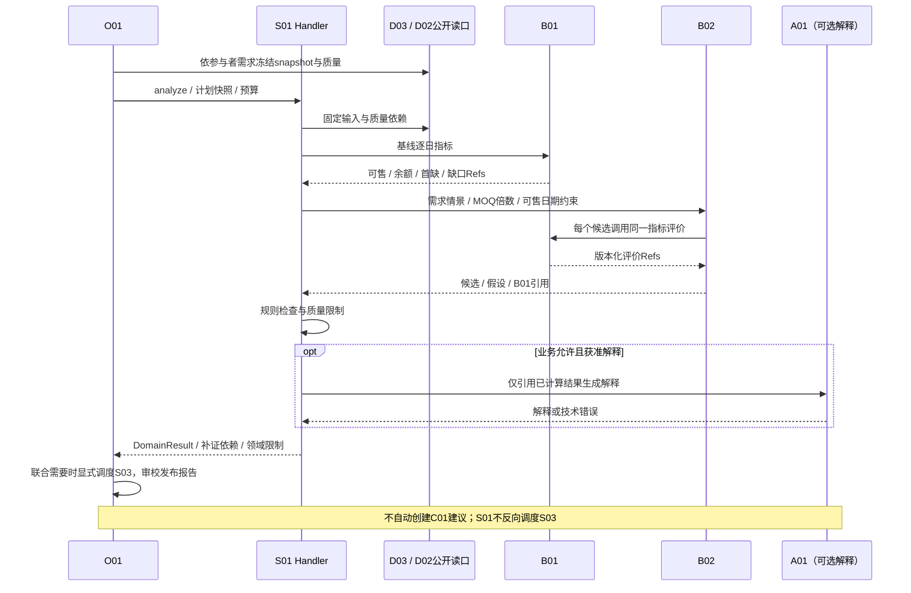
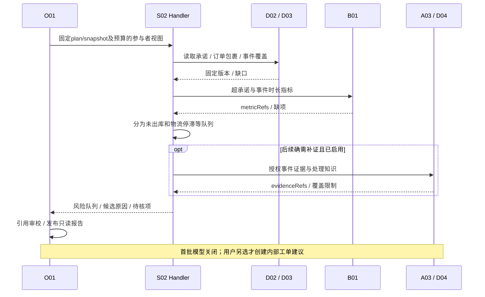
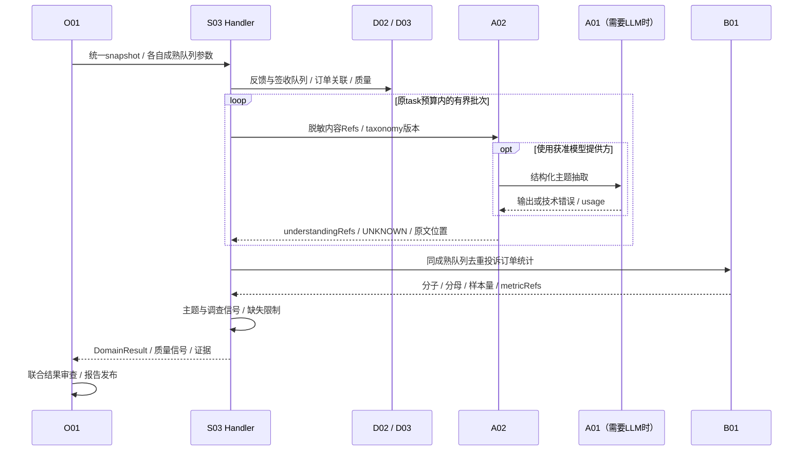
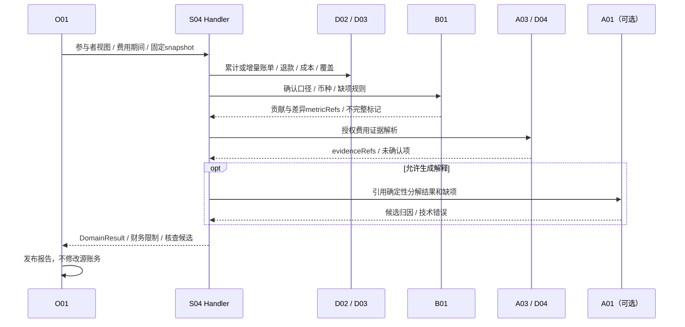
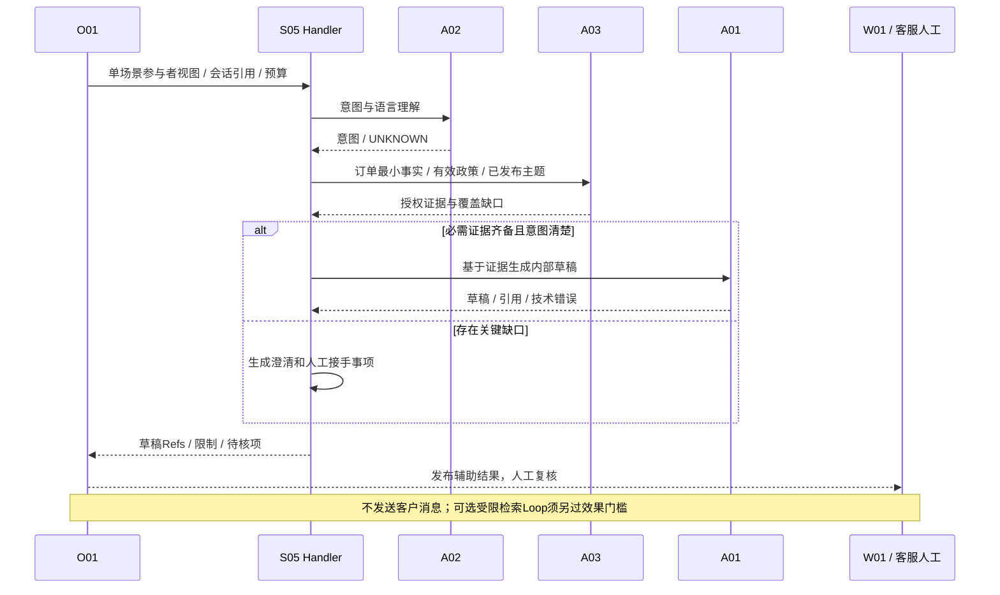
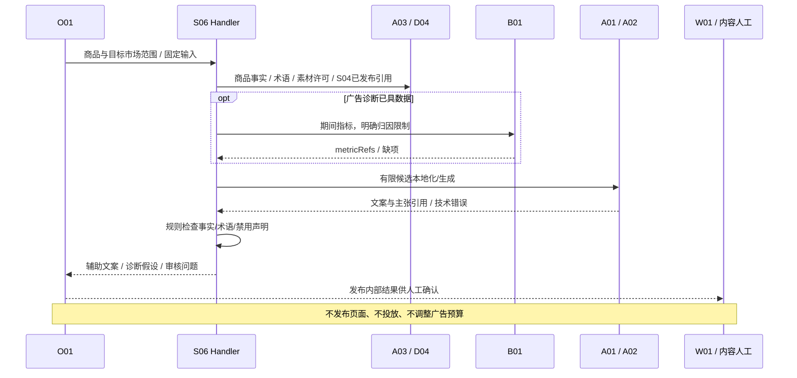
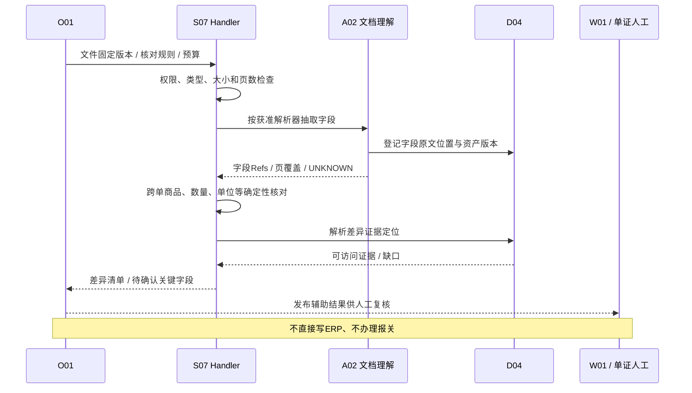
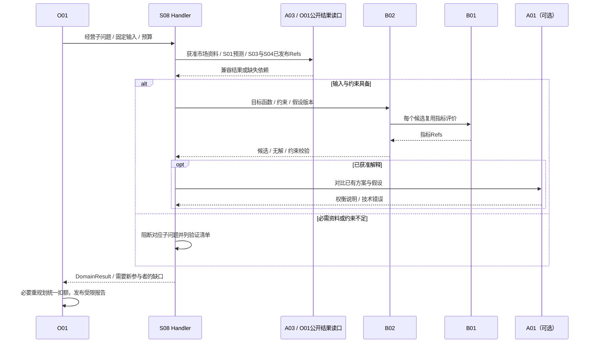
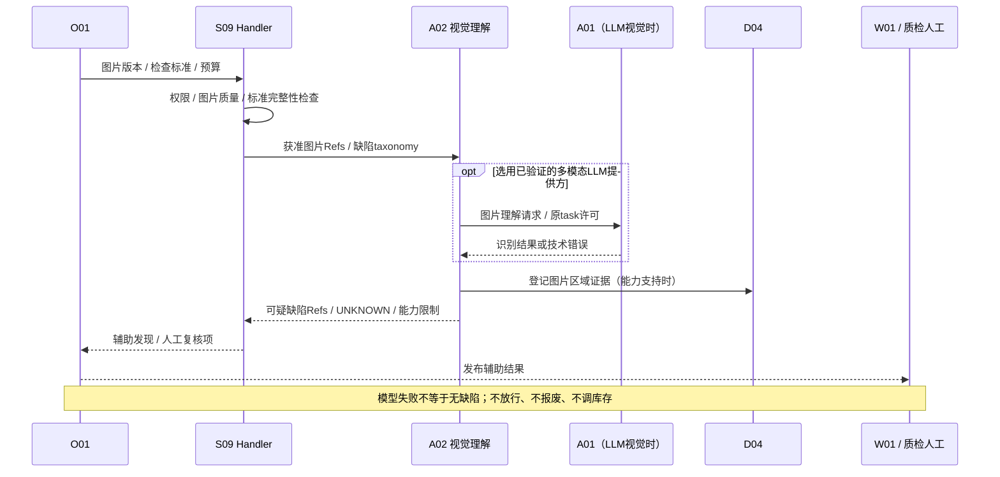
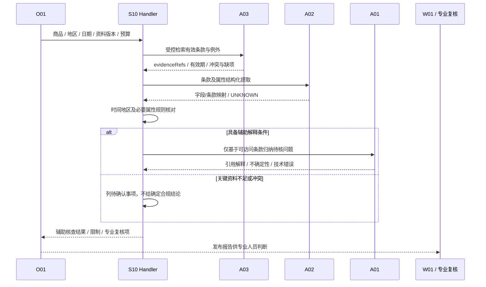

# S01—S10_Agent与Workflow设计

> 从[AI模块详细开发设计文档](AI_DETAILED_DESIGN.md) v0.2自动摘编，唯一维护源为正文；状态和未验证项与正文一致。

## 14 S01—S10 Agent / Workflow 逐场景设计

### 14.0 共同契约与逐场景边界

下列每个S都经O01 analyze，按ParticipantView固定task/plan/snapshot/预算，以DomainResult回O01；表中的“state”在无Agent时为Workflow游标，也由O01 checkpoint承载。公共只读工具名均为 §10 的拟议名，不代表已实现。每个场景只能用获准工具子集，模型/工具/重试共享 task 总预算。各图省略反复的 G01/预算/Trace 连线以便阅读，但在每次调用前/结果返回/发布时均强制执行；时序以相关能力未来启用为条件。

十个场景的只读终点均为已发布报告/辅助草稿及限制。候选方案不自动产生C01；只有用户另行选择才走C01确认、明确提交C02独立审批、另行触发C03。P1/P2设计并不新增写权限、模型能力或部署承诺。

| 场景 / 阶段 | 默认方案 | 自主Agent / 多Agent | 仅有证据后评估的扩展 |
|---|---|---|---|
| S01 / P0及原P1深化 | B01/B02确定性Workflow，可选结果解释 | 否 / 否 | 学习型预测归B02，不默认Agent化 |
| S02 / P0及原P1深化 | 事件与超承诺规则分流 | 否 / 否；首批无模型 | B02到货预测、可选解释 |
| S03 / P0 | A02批处理+B01成熟群组统计 | 否 / 否 | 多语言分批与标签质量提升，不另建统计Agent |
| S04 / P0及原P1深化 | B01贡献/费用核查Workflow | 否 / 否 | 核查规则和证据覆盖，不用LLM算账 |
| S05 / P1 | 意图澄清+固定RAG+人工草稿复核 | 默认否 / 否 | 单个受限只读ReAct，需胜过固定Workflow |
| S06 / P1 | 生成+确定性事实审校+人工确认 | 默认否 / 否 | 有界Evaluator–Optimizer或独立Reviewer，需证明增益 |
| S07 / P1 | A02字段抽取+跨单规则 | 否 / 否 | 专业解析器/语言扩展，非多个自主Agent |
| S08 / P2 | B02求解+B01评价+解释 | 默认否 / 否 | 单场景Plan-and-Execute/独立评审，仅专项验证 |
| S09 / P2 | A02视觉提供方+规则/人工 | 否 / 否 | 真实样本证明视觉能力，不引入自由Loop |
| S10 / P2 | 版本化RAG+条款比对+专业复核 | 默认否 / 否 | 单个受限补证ReAct；不默认联网或多Agent |

### 14.1 S01 供需与库存分析（P0；预测/滞销/供应商深化依原规划）

| 设计项 | 场景设计 |
|---|---|
| 目标 / 输入输出 | 输入店铺/仓/SKU、asOf、需求窗口、可售分桶、未收供给/可售日期、MOQ/倍数、质量依赖；输出B01逐日指标、B02候选及评价Refs、风险/替代方案/限制，不生成采购批准 |
| Agent / 多Agent必要性 | 不需要自主Agent或多Agent。确定性Workflow能表达计算、候选、质量门槛；可选一次LLM解释不构成Agent |
| 范式与理由 | Workflow→B01→B02→领域检查→可选解释。联合质量分析由O01显式S01+S03，不能让“采购Agent”私调“质量Agent” |
| 规则 / SQL / B / A职责 | D02公开读口取固定数据；D03检查映射/覆盖；B01计算可售/逐日余额/首次缺货/缺口；B02构造预测候选并调用B01评价；A03取授权规格/供应证据，不能重写公式 |
| 真正LLM步骤 | 仅把已计算候选、证据、假设解释为可读比较；不推测供应承诺、不算数量日期、不把缺质量信号解释为安全 |
| State / Context | 游标baseline→candidates→constraints→narrative；保留metric/forecastRefs、质量依赖满足情况；Context含单位/可售日/窗口/缺项/UNKNOWN和候选假设，不长期存动态库存 |
| 只读工具清单 | metric.read、evidence.resolve、knowledge.retrieve；projection.read仅冻结白名单字段；默认不启用模型循环/动态工具 |
| 权限 / 预算 | 店铺/仓/SKU及采购可见字段最小权限，私有库存/费用禁网关缓存；B02算力和可选模型都计获准task期限/资源，无额外Agent额度 |
| 失败 / 降级 / 人工 / 终止 | 缺映射、库存过旧、重复供给或必需质量缺失阻断可执行补货结论；B02不可用时仅有依据的B01基线，不虚构候选；解释失败可规则报告；质量阈值与来源矛盾人工调查 |
| O01及跨场景协作 | S03已有结果须口径/时效/权限兼容；确需重跑S03则O01变更participants成JOINT。领域结果归O01综合，质量调查优先级按已冻结业务矩阵 |
| 观测 / 验收 | 记录快照/指标/情景/质量依赖/模型版本。沿用AC-02可售55、目标90、缺口15、候选20及逐日B01评价；AC-03改D8到货应显露D6首次短缺；AC-04不称12%缺陷率。数字为基线演示，不是实测 |
| 未验证及启用门槛 | V02/V03真实库存分桶、供给终点/交期、MOQ/映射；V04质量依赖矩阵；学习型预测须滚动回测，未验证不声称有准确率/收益 |

### 14.2 S02 履约风险分析（P0；运输到货深化依原规划）

| 设计项 | 场景设计 |
|---|---|
| 目标 / 输入输出 | 输入订单/包裹映射、承诺时点、仓内与物流事件、催单；输出未出库/物流停滞待核队列、证据与责任线索，保留多包裹粒度 |
| Agent / 多Agent必要性 | 不需要；首批S02窄切片明确无模型。后续解释可选但不替代规则，无“仓库Agent+物流Agent” |
| 范式与理由 | 确定性Workflow/规则分流，事件时间与状态映射明确，可直接测试超时判定 |
| 规则 / SQL / B / A职责 | D02提供关联及乱序处理版本；B01评价超承诺/时长指标；S02按规则分流。A03只补授权事件/处理知识；B02运输预测仅原P1验证后加入 |
| 真正LLM步骤 | 汇总已证实事实与候选原因、说明待核差异；不用LLM判断已发货或断言物流方责任 |
| State / Context | 输入校验→metrics→queues→evidence→result；保留订单/包裹Ref、event cutoff、分流规则版本、缺口。Context不把旧事件压缩成新状态 |
| 只读工具清单 | metric.read、projection.read（承诺/事件白名单）、evidence.resolve、必要knowledge.retrieve；最小基座不注册模型工具 |
| 权限 / 预算 | 店铺/仓/订单字段权限，客户姓名/地址通常不必入模型；任务总预算与行数/事件窗口限制，首批modelCalls=0 |
| 失败 / 降级 / 人工 / 终止 | 承诺或包裹映射缺失标待核不瞎判超时；事件覆盖缺口不当“物流正常”；解释失败保留规则队列；超期/取消按安全点终止 |
| O01及跨场景协作 | 领域返回风险与证据，O01汇总；需要库存领域重算由O01显式S01，不能直接运行另一Handler。内部工单另行C01流程 |
| 观测 / 验收 | 首批对照MC01—MC12；AC-05中10张超时订单分6未出库/4物流停滞，另测多包裹/迟到事件/过期数据；不将候选原因当已证实责任 |
| 未验证及启用门槛 | 承诺时间/业务时区、事件覆盖/映射、真实物流来源待V02/V03。到货预测需B02真实样本及可售终点评价，不混入当前必建项 |

### 14.3 S03 客户体验分析 / VOC（P0）

| 设计项 | 场景设计 |
|---|---|
| 目标 / 输入输出 | 输入授权脱敏反馈、订单映射、店铺/SKU、成熟签收群组与观察窗；输出A02主题/UNKNOWN、B01去重投诉占比、样本量/证据及调查候选 |
| Agent / 多Agent必要性 | 不需要自主Agent；文本分批/多语言是A02理解工作流，不增加主题、统计和审校三个独立Agent |
| 范式与理由 | Workflow + 有界A02批处理 + B01统计；人工修订以A02新版本回溯，不在场景另写标签库 |
| 规则 / SQL / B / A职责 | D02负责订单关联；A02提取主题/语言/原文位置/置信度或UNKNOWN；B01负责成熟队列、投诉口径、去重订单分子分母；S03决定调查信号 |
| 真正LLM步骤 | A02中的多语言主题/意图理解、可选主题归纳；LLM不算投诉率，不合并商品身份，不把投诉认定商品缺陷 |
| State / Context | cohort/taxonomy固定→batch游标→understandingRefs→metricRefs→signal；Context保留原文位置、否定/语言、人工修订、窗口/分母和UNKNOWN比例，客户身份不跨批广播 |
| 只读工具清单 | evidence.resolve、metric.read、必要knowledge.retrieve；主体理解直接调用A02，无需让模型动态选择整库工具 |
| 权限 / 预算 | 反馈与订单权限交集、敏感最小化；批次并行/模型费用共享task额度，每批结果版本可复用，不能每条反馈新领完整预算；禁响应缓存客户文本 |
| 失败 / 降级 / 人工 / 终止 | 主题失败保留UNKNOWN及覆盖限制；无成熟分母不能输出确定占比；低置信关键主题人工复核；必需质量信号缺失则阻断依赖它的补货结论 |
| O01及跨场景协作 | 通过DomainResult/O01已发布领域引用提供质量信号；不调S01/S05。实际新增分析由O01显式JOINT，人工修订后重跑仍遵守快照/版本/重规划 |
| 观测 / 验收 | 分语言/主题的召回、UNKNOWN、人工修订、批次覆盖、分子分母可追。AC-06三工单不等于三投诉订单；AC-04演示100单12投诉为12%投诉占比，非缺陷率 |
| 未验证及启用门槛 | 真实分类体系/投诉定义/成熟窗/调查阈值、隐私与语种样本待V03/V09/V13；模型自报confidence不视为已校准概率 |

### 14.4 S04 贡献与费用分析（P0；账单核查深化依原规划）

| 设计项 | 场景设计 |
|---|---|
| 目标 / 输入输出 | 输入实收、成功退款、平台/履约费、成本、财务确认转回、币种/汇率与账单版本；输出贡献/差异分解、覆盖/缺项和内部核查候选，非净利润 |
| Agent / 多Agent必要性 | 不需要。财务口径/账单去重与分解均确定性，不能交“财务Agent”自行计算/改账 |
| 范式与理由 | Workflow→B01→受控证据→可选A01解释；账单规则/匹配按财务签认版本扩展 |
| 规则 / SQL / B / A职责 | D01/D02区分累计/增量、币种与来源；B01唯一Decimal贡献与差异指标；S04使用口径并组织解释；A03补费用证据，不生成新汇率/公式 |
| 真正LLM步骤 | 将B01结果及费用缺项描述为候选归因、核查问题；不补缺费用为0，不虚构广告订单归因或未经财务确认转回 |
| State / Context | coverage→metricRefs→decomposition→evidence→narrative；Context保留币种/实际估算/账单版本/确认转回/未知，不压缩掉负号和缺项 |
| 只读工具清单 | metric.read、evidence.resolve、projection.read（获准财务字段）、必要knowledge.retrieve；无修改账目/退款工具 |
| 权限 / 预算 | 财务字段、店铺、期间最小权限；费用及贡献禁止网关响应缓存；解释调用只用task原额度，无额外财务Agent预算 |
| 失败 / 降级 / 人工 / 终止 | 关键费用缺失为部分贡献，不命名净利润；币种/汇率未确认阻断对应比较；模型失败仍可规则表；来源矛盾财务复核 |
| O01及跨场景协作 | 发布领域结果供S06/S08按版本引用；需要新领域重算由O01调度。内部核查工单另行C01/C02/C03，不自动改账 |
| 观测 / 验收 | AC-07按确认事实依次19.23、−0.67、4.33 USD；无成本转回证据不加5。AC-08累计20→37.23只取37.23不相加；解释不得更改B01值 |
| 未验证及启用门槛 | 财务口径/实际估算/汇率/退款与成本转回/覆盖待V02/V03；未有账单接口或订单广告归因证据不虚构能力 |

### 14.5 S05 客服辅助（P1）

| 设计项 | 场景设计 |
|---|---|
| 目标 / 输入输出 | 输入授权会话片段、订单事实、商品知识、有效售后政策/语言；输出内部回复草稿、事实引用、待确认项和售后处理建议，不发送客户消息或承诺退款 |
| Agent / 多Agent必要性 | 起步不需要，Workflow可完成意图→取证→草稿。固定路径对复杂追问确有不足后才验证单个受限只读ReAct；多Agent无当前必要 |
| 范式与理由 | 有限Router/规则澄清+RAG生成；候选ReAct仅选择既有证据工具，不能执行售后动作或路由到隐藏场景 |
| 规则 / SQL / B / A职责 | D02固定订单视图；A02意图/语言理解；A03按权限查有效政策/知识及S03已发布结果；需要指标时复用B01，不重做VOC或退款计算 |
| 真正LLM步骤 | 多语言语义、语气和基于证据的草稿生成；不能自行作赔付/退货资格最终判断或补物流承诺 |
| State / Context | intent→evidence→draft→humanReview；可选Loop保存evidenceGap与工具游标。Context单用户/会话最小片段、政策生效日/适用地区和原文引用；不共享原始客服历史 |
| 只读工具清单 | knowledge.retrieve、evidence.resolve、projection.read（订单最小字段）、domain_result.read（S03兼容已发布）；metric.read按需，工具发现集合严格受限 |
| 权限 / 预算 | 客服岗位/店铺/客户订单关联与敏感字段控制；SESSION隔离，禁止网关缓存对话/客户草稿；单Loop原task共享预算且步数/工具/期限全有界 |
| 失败 / 降级 / 人工 / 终止 | 政策缺失/冲突、订单无法授权、意图不清时返回澄清/人工；不输出无依据承诺。模型不可用仅列可核查事实，不伪装完成多语言草稿；达到停止条件交人工 |
| O01及跨场景协作 | 读取S03有效已发布主题；若需重算S03由O01显式纳入。W01由客服复核草稿，客户发送仍在原业务系统，本文不扩展C03动作 |
| 观测 / 验收 | 意图分层、政策引用、无依据承诺率、语言人工通过、客户资料隔离、成本/停止原因；含注入客服文本不改变工具白名单、订单变更不被旧上下文覆盖 |
| 未验证及启用门槛 | 真实语言/售后规则/政策版本/客服权限/金标准待验证；ReAct与Workflow配对评测有收益才启用，不预设已达准确率 |

### 14.6 S06 内容与增长辅助（P1）

| 设计项 | 场景设计 |
|---|---|
| 目标 / 输入输出 | 输入已确认商品事实、术语、授权素材、目标语言/市场/渠道规则、广告期间数据和S04有效贡献引用；输出本地化文案/素材建议、广告诊断假设和审核问题，不发布/投放 |
| Agent / 多Agent必要性 | 单Workflow足够；候选生成不是必须Agent。事实Reviewer先用规则/人工；独立模型Reviewer仅效果增益被证明后启用，不默认多Agent |
| 范式与理由 | Workflow+有限候选生成；Evaluator–Optimizer仅条件验证，迭代共用总预算，禁止反复润色到费用耗尽 |
| 规则 / SQL / B / A职责 | A02抽取/翻译已有事实；A03查术语和获准规则；B01按确认口径读期间广告/贡献指标，B02仅已有获准模拟用例才调；S06不接管定价 |
| 真正LLM步骤 | 文案本地化、风格适配、候选素材说明和诊断假设；不夸大规格、生成无依据功效或伪造订单级广告归因 |
| State / Context | facts→locale→candidateRefs→validationIssues→finalDraft；保留事实映射/禁止声明/素材许可/市场适用范围，Reviewer仅接最小候选和事实Refs |
| 只读工具清单 | knowledge.retrieve、evidence.resolve、metric.read、domain_result.read（S04）；不得有publish、ad.create、budget.update类工具 |
| 权限 / 预算 | 商品/素材许可、店铺/渠道/财务字段限制；候选数与迭代数为task内切片，默认静态生成结果也不启缓存，确需低敏文本复用才按§9单项准入 |
| 失败 / 降级 / 人工 / 终止 | 商品事实/许可/市场规则缺失阻断相应文案；模型失败返回事实与审核清单；关键主张冲突必须人工；Reviewer未通过不自动修改到“通过” |
| O01及跨场景协作 | S04已发布贡献按版本/时间窗引用；新贡献分析由O01显式计划。定价属于S08，发布/投放不在本轮写范围 |
| 观测 / 验收 | 事实保持、术语、禁用声明、授权素材引用、语言人工复核、单位任务成本；增长收益须业务实验，不以文案评分代替转化提升 |
| 未验证及启用门槛 | 样本、品牌术语、渠道规则、素材授权、广告归因及审核标准待验证；模型Reviewer/多Agent只有同预算对照证实增益才启用 |

### 14.7 S07 单证辅助（P1）

| 设计项 | 场景设计 |
|---|---|
| 目标 / 输入输出 | 输入授权发票/装箱单等文件版本及业务核对规则；输出字段/页码位置、差异、UNKNOWN、人工复核清单，不办理报关或写ERP主数据 |
| Agent / 多Agent必要性 | 不需要；多文件解析优先A02有界并行，不是多个单证Agent。规则核对可以直接测试 |
| 范式与理由 | Workflow→A02抽取→确定性跨单校验→人工复核；自由工具Loop不会改善数量/单位规则可信性 |
| 规则 / SQL / B / A职责 | A02按实际材料选专业解析器/获准模型；D04定位字段；S07定义跨单关系规则；已有指标调用B01，文档字段匹配不另建财务指标引擎 |
| 真正LLM步骤 | 版式/语言理解、字段归一化建议和差异解释；关键数量、金额、单位/商品映射仍显式校验，不让模型自动确认主数据 |
| State / Context | documentRefs/hashes→parseBatch→fieldRefs→mismatchRefs→review；Context只含必要字段及来源位置，保留原值、归一化值、置信或UNKNOWN和人工修订 |
| 只读工具清单 | evidence.resolve、knowledge.retrieve（核对规则）、projection.read（需比对的获准对象）；解析经A02直接流程，不注册任意文件读写工具 |
| 权限 / 预算 | 文档租户/岗位/对象权限；附件大小/页数/解压比与解析超时有界；每文档/页成本计同task，私有单证不准响应缓存 |
| 失败 / 降级 / 人工 / 终止 | 关键字段低置信/UNKNOWN需人工确认；解析失败列未覆盖页，不能当无差异；单位/身份不明确阻断相应通过结论；恶意文件拒绝处理 |
| O01及跨场景协作 | 单证结果通过DomainResult返回，映射纠正回D02责任流程；内部调查另行C01，不改源单据/报关/审批链 |
| 观测 / 验收 | 字段exact match/定位、关键字段漏检、差异召回、人工改动和页覆盖；每关键字段有原文定位，低置信不自动“核对通过” |
| 未验证及启用门槛 | 文件版式/语言、真实样本、解析器能力/许可、规则与校准阈值待验证；不能据文档写了OCR就宣布已有准确率 |

### 14.8 S08 经营规划（P2）

| 设计项 | 场景设计 |
|---|---|
| 目标 / 输入输出 | 输入授权市场资料、S03/S04已发布结果、S01有效预测、成本/价格/仓网/业务约束；输出选品/定价促销/多仓候选、假设、B01评价/可行性限制和不确定性 |
| Agent / 多Agent必要性 | 当前不证明需要。每个子问题先Workflow+B02求解；复杂调研解释可评估单Plan-and-Execute；独立方案Reviewer/多Agent为未验证选项 |
| 范式与理由 | 确定性求解+有依据解释；LLM不能替代优化器、需求预测或O01跨场景编排。多个候选不自动等于多个Agent |
| 规则 / SQL / B / A职责 | B02统一构造/优化候选，B01评价假设指标；A03检索获准市场/知识；S01预测通过公开产物复用，不再预测；S08维护经营约束和选择说明 |
| 真正LLM步骤 | 授权资料比较、假设清单、方案权衡解释和问题澄清；不编造价格弹性/仓容/需求或将相关性作因果收益 |
| State / Context | subproblem→validatedConstraints→inputRefs→candidateRefs→comparison→review；Context区分事实/预测/假设，保留训练截止/预测窗/成本版本和无解原因 |
| 只读工具清单 | knowledge.retrieve、metric.read、evidence.resolve、domain_result.read（S01/S03/S04）；projection.read限获准仓网字段，不暴露改价/调仓工具 |
| 权限 / 预算 | 市场数据许可与敏感成本权限；求解资源/候选数/内部角色并发与模型共享原task配置；规划结果含私有经营假设禁止响应缓存 |
| 失败 / 降级 / 人工 / 终止 | 缺合法市场来源/预测/仓网约束时相应子问题阻断；无可行解明确返回；不能靠LLM松约束。模型失败保留求解器可解释产物，关键假设人工确认 |
| O01及跨场景协作 | 有效已发布结果优先复用；需新S01/S03/S04分析由O01显式JOINT并协调同输入/兼容性，不互调Handler；经营动作不自动审批或执行 |
| 观测 / 验收 | 候选约束满足率、B01唯一评价、无未来泄漏、已发布预测版本、假设清晰度、成本/时延；优化可行不等于供应承诺或真实收益，须专项业务对照 |
| 未验证及启用门槛 | 市场授权/需求响应/仓网/目标函数/真实基线/求解器能力均待验证；数据不足只输出验证方案，不虚构生产方案与盈利提升 |

### 14.9 S09 视觉质检辅助（P2）

| 设计项 | 场景设计 |
|---|---|
| 目标 / 输入输出 | 输入授权图片/拍摄条件、商品范围与已签认缺陷标准；输出可疑区域/类别/证据、UNKNOWN及人工确认项，不直接决定放行/报废/库存调整 |
| Agent / 多Agent必要性 | 不需要；视觉识别是A02提供方能力，多视角图像批处理不应包装为自主Agent团队 |
| 范式与理由 | Workflow→图片质量检查→A02视觉理解→规则与人工复核，避免自然语言Loop重复看图产生无依据自信 |
| 规则 / SQL / B / A职责 | A02扩展图像UnderstandingProvider，LLM视觉模型如需要仍经A01；D04定位图像/区域；S09维护标准与确认流程，统计指标有需求才走B01 |
| 真正LLM步骤 | 待验证视觉模型对缺陷描述/区域提示的辅助能力；不预设必能精准定位或读出尺寸，非LLM视觉模型也是候选 |
| State / Context | imageRefs/hash→captureQuality→inferenceRefs→reviewFlags；Context包含商品/缺陷标准版本、区域坐标系/尺寸、覆盖与UNKNOWN，图片元数据按最小必要处理 |
| 只读工具清单 | evidence.resolve、knowledge.retrieve（标准）；模型不取得相机控制/任意文件路径/库存写入，图像输入经A02公开契约 |
| 权限 / 预算 | 图片、商品、岗位与供应商敏感信息控制；图片数/分辨率/推理时长/多模态费用上界待验证，未知上界不启硬预算生产调用；不准网关缓存私有质检结论 |
| 失败 / 降级 / 人工 / 终止 | 模糊/遮挡/未见类别/模型不支持时明确UNKNOWN转人工；缺陷标准缺失不推断；技术失败不当“无缺陷”；最终决定由既有业务流程 |
| O01及跨场景协作 | 结果为辅助派生产物，后续场景按许可/版本引用；投诉主题不能反向成为已确认缺陷标签。C03无库存调整能力 |
| 观测 / 验收 | 按缺陷类别/商品/拍摄条件分层漏检/误报、区域定位（能力存在才测）、人工确认和未知率；重点缺陷漏检为独立门槛，不能被正常图片平均准确率掩盖 |
| 未验证及启用门槛 | 正负样本、缺陷定义、拍摄/标注一致性、模型能力/许可/算力和人工责任未具备，先专项验证，不宣称生产精度或GPU配置 |

### 14.10 S10 政策核查辅助（P2）

| 设计项 | 场景设计 |
|---|---|
| 目标 / 输入输出 | 输入商品属性、目标市场/地区、核查时点与获准官方资料版本；输出条款引用、适用性问题、冲突/缺项和专业复核清单，非最终合规结论 |
| Agent / 多Agent必要性 | 默认不需要，固定RAG+规则比对即可；多步跨条款补证的次序若确需自适应，才验证单受限ReAct。无必须多Agent证据 |
| 范式与理由 | Workflow检索有效政策→条款比对→可选生成；条件Loop只在已授权资料集中补证，不默认联网、全网抓取或独立法律Agent |
| 规则 / SQL / B / A职责 | A03负责有效时间/地区/资产版本过滤和证据，A02抽取条款/属性，S10维护核查项与专业复核规则；指标需求有真实用例才调B01 |
| 真正LLM步骤 | 有引用的条款归纳、属性/条款候选匹配与澄清；不能判定企业已合规、自动改变商品属性或声明政策已完成法律审查 |
| State / Context | jurisdiction/date/productAttrs→policyRefs→clauseMap→conflicts→review；Context保留生效/废止、发布主体、适用范围/例外和原条款位置，不能摘要掉关键否定/例外 |
| 只读工具清单 | knowledge.retrieve、evidence.resolve、projection.read（已授权商品属性）；无任意web/http或提交监管资料工具 |
| 权限 / 预算 | 商品/政策资料权限及用途，task共享期限/工具/token，条件Loop不扩范围；政策适用性结论禁响应缓存，仅可复用有效原文引用 |
| 失败 / 降级 / 人工 / 终止 | 资料过期/权威性不足/地区日期不明/条款冲突或必要属性缺失→待验证并专业复核；模型不可用列证据清单与缺口，不给最终结论；超限正确停止 |
| O01及跨场景协作 | 需要其他领域新分析由O01显式参与者，不在S10内部重新运行S07/S08；专业复核不等于C02批准某外部动作，本轮无监管提交写入 |
| 观测 / 验收 | 版本适用正确、claim级引用支持、例外/反证保真、过期资料拦截和拒答/澄清；专业人工评分独立于LLM-as-Judge；无依据确定合规为关键错误 |
| 未验证及启用门槛 | 政策来源授权/更新责任、地区/商品属性标准、专业负责人/金标准待确认；本文不新增法律判断或声称法规已核验有效 |

