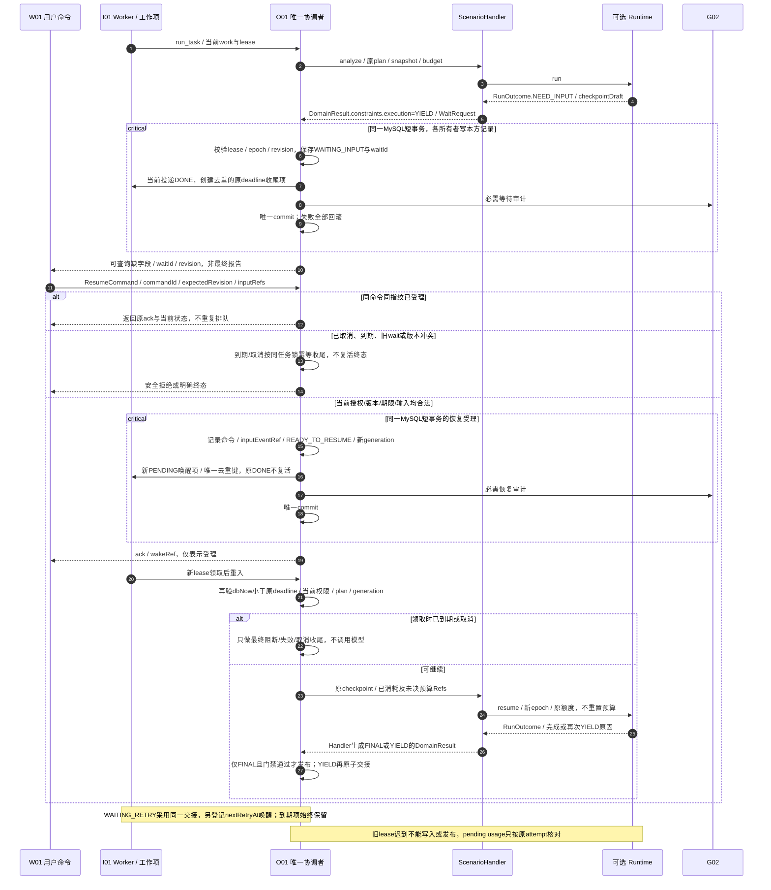

# 暂停与恢复交接协议

> 从[AI模块详细开发设计文档](AI_DETAILED_DESIGN.md) v0.2自动摘编，唯一维护源为正文；状态和未验证项与正文一致。

### 3.3 Agent 生命周期与持久恢复

1. **注册**：组合根加载已审核 AgentSpec，校验版本、工具实际存在、Prompt/schema 与模型能力、预算必填配置；动态用户上传不受理。相同 ID/version 内容冲突拒绝启动该能力。
2. **初始化**：O01 已有 task/plan/snapshot；Handler 检查领域前提并创建 runId 和空游标，绑定同一预算及版本。无调用需要时直接运行 Workflow。
3. **运行**：每个安全步骤前检查取消、deadline、当前 G01 权限、lease/fence、计划/输入适配、余额；结束后形成 checkpointDraft，由 O01 条件保存。网络请求在数据库锁外。
4. **暂停**：Runtime返回NEED_INPUT或RETRY_SCHEDULED，Handler转换为 `DomainResult.constraints.execution.disposition=YIELD`，携带检查点草案与等待条件；只有O01成功提交下述持久交接后phase才成为WAITING_INPUT/WAITING_RETRY。YIELD不得发布为报告或标记参与者完成。不新增公开PAUSED/WAITING任务状态。
5. **人工介入**：W01 展示缺字段、冲突证据和选择项，人工补充是有身份/commandId 的输入事件，不是批准。短期限内 O01 任务仍可处于 RUNNING，工作项释放执行资源；仅显式恢复命令或原 deadline 的收尾工作项唤醒，不按轮询重复调用模型。
6. **恢复**：O01 验证恢复命令去重、当前身份/计划/快照/版本/租约后，Handler 装载 stateSchema 相容的 checkpoint；先核对 pendingCall，不重新获得预算。超期则按策略发布受限/BLOCKED 报告或明确技术失败，终态不复活；继续分析需新的明确任务并关联旧任务。
7. **取消与终止**：排队取消或安全边界协作停止；供应商在途请求可尽力取消，usage 不明保留占额；迟到输出不得发布、不得复活 task。内部 run 结束无独立任务终态；Handler 输出领域结果，O01 发布报告。C03 在途/UNKNOWN 仍由 C03 核对，取消分析不能改变它。

恢复保留冻结输入的历史解释语义，同时按当前权限决定是否仍可访问；快照固定不意味着永久授权。依赖版本不可取得时停止自动恢复，返回需迁移/重新分析。状态迁移只允许经验证的 schema 迁移函数，不能反序列化 pickle 或旧任意对象。

#### 3.3.1 内部等待状态与唯一权威（D03）

`phase` 是O01检查点内的参与者执行游标，不是新任务表/状态权威。NEED_INPUT/RETRY_SCHEDULED是Runtime的一次返回原因；WAITING_INPUT/WAITING_RETRY是O01持久交接后的phase，二者不能互相冒充。RunOutcome本身不改变任务、工作项或发布状态。

| 内部phase / 触发 | O01持久化与交接 | I01工作项 / 报告行为 |
|---|---|---|
| ACTIVE / 合法领取后执行 | 绑定当前task/plan/participant/snapshot/checkpointRevision、ownerEpoch与当前lease；安全点保存进度 | 原工作项LEASED；未完成结果只作partialOutputRef，不发布 |
| WAITING_INPUT / NEED_INPUT且允许期限内澄清 | 保存waitId、typed missingFields/allowedResponses、resume条件和固定taskDeadline；保留已消耗/未知预留及最小产物Refs | 同一短事务中当前投递DONE、登记唯一到期收尾工作项和必需审计；任务仍RUNNING，参与者未完成，无“自动轮询模型”工作项 |
| WAITING_RETRY / RETRY_SCHEDULED且重试可证明安全 | 保存waitId、nextRetryAt、retryOrdinal/剩余上限、原因及原attempt/usage关联；未决计费先核对，不能重发 | 当前投递DONE；同事务按runAfter登记去重后的后续工作项及到期收尾项；I01的RETRY_WAIT仍只表达投递失败重投，不用作Agent业务等待状态 |
| READY_TO_RESUME / 恢复命令或到时重试被接受 | 锁定任务/检查点后校验当前权限、deadline、waitId/revision/plan，保存inputEventRef（如有）、resumeGeneration和唤醒去重键 | 原DONE投递不复活；新PENDING工作项只负责重新进入O01，不直接调用模型；到期收尾项保留 |
| ACTIVE / 新工作项获得新租约 | O01核验唤醒代际后将phase转ACTIVE，读取原产物/预算；pendingCalls先核对；依赖不相容不执行 | 新leaseToken，旧lease不能提交；重复唤醒仅返回当前状态/复用结果 |
| ENDED / 最终完成、取消、超期或不可继续 | FINAL且满足领域/证据门禁才有最终DomainResult；取消/失败/阻断收尾由O01决定，不复活终态 | 完成相应投递/终止无用待唤醒项；报告完整性与任务技术终态保持基线；未知模型费用另行核对，不阻止任务有界结束 |

【建议】`constraints.execution` 最小结构：`{schemaVersion:"0.2", disposition:"FINAL"或"YIELD", reasonCode, waitRequestRef或null}`。FINAL要求本领域输出完成且依赖检查通过或明确形成最终受限结论；YIELD要求typed WaitRequest存在，禁止作为可发布领域结果。WaitRequest仅指向O01接收的checkpoint草案/缺口，不使Runtime拥有持久化。旧消费者未声明支持YIELD时，注册校验应拒绝启用需要暂停的能力，不能忽略新字段后把YIELD当FINAL。

#### 3.3.2 持久交接、命令幂等和竞争（D03）

| 对象 / 所有者 | 字段级要求 | 原子性与拒绝语义 |
|---|---|---|
| O01 checkpoint / 等待条件 | taskId、planVersion、participantId、snapshotId、revision、ownerEpoch、phase、waitId、resumeGeneration、taskDeadline、missingFields/allowedResponses或nextRetryAt、retryOrdinal/上限、completedStep/partialOutputRefs、versionBundleRef、pendingCall/usage/allowanceRefs | 只保存受控Ref和执行元数据，输入正文仍按原所有者存储；不复制D03清单/G02成本事实/完整聊天 |
| O01接受的ResumeCommand | commandId、taskRef、planVersion、participantId、waitId、expectedCheckpointRevision、inputEventRefs、payloadFingerprint；身份由G01建立 | 唯一键 `(tenantId,taskId,commandId)`；同键同指纹返回原ack及当前任务状态，不新排队；同键异指纹409/COMMAND_CONFLICT |
| I01唤醒/到期工作项 | owner=O01，已注册分析重进入口，payloadRef指O01 task/checkpoint；wake键含task/participant/waitId/resumeGeneration/reason；到期键含taskId/frozenDeadline | 无任意函数/模型请求payload；新工作项不增加任务预算或整体重试额度；重复投递经O01检查waitId/代际后无副作用结束 |

暂停交接由O01作为唯一协调者，在共享MySQL**同一短事务**中按任务→检查点→工作项顺序锁定/校验当前plan、checkpoint revision、ownerEpoch和I01合法lease：O01写等待phase/Refs，I01经其公开端口写当前投递DONE及后续唤醒/到期项，G02写必需审计；唯一commit，失败全回滚。事务外不保留长租约等人。交接前崩溃仍由原工作项重入；交接提交后响应丢失时按waitId/revision复用既有交接，不再运行模型，也不重复新增唤醒项。所有权仍各写各表，不允许O01直接写I01/G02私表。

恢复命令在同一O01短事务中记录命令去重结果、受控inputEventRef/检查点READY_TO_RESUME、resumeGeneration、I01新唤醒项及审计，然后返回受理ack；ack不表示模型/业务完成。两条不同commandId竞争同一waitId/revision只允许第一条CAS成功，其余返回STALE_CHECKPOINT；相同命令重试可取原ack。用户只能填允许的缺字段/选项，不能更改scope、deadline或预算；需要新事实/改变依赖的输入必须先走O01重规划/D03新快照门槛，不得作为“恢复”静默混入旧输入。

期限以MySQL服务端UTC时间为准，在恢复受理、Worker重新进入、每次调用预留和最终发布前均检查 `dbNow >= taskDeadline`；等号视为超期。恢复受理早于期限但Worker领取已到期时，只执行到期收尾。取消/到期/恢复按同一任务锁及expectedRevision线性化：已提交取消/终态禁止恢复；到期先于有效恢复检查时拒绝受理；恢复先提交也不能延长期限，后续取消/到期会使待唤醒项失效。重复恢复命令在终态下只返回原ack与当前终态，不产生新执行。

新的执行取得新I01 leaseToken并更新O01 ownerEpoch；暂停交接提交即使原投递仍持旧token，也因DONE/epoch不符不能写checkpoint、预留新调用或发布。外部在途调用不能被租约撤回，迟到usage可以按原attemptId由G02幂等核对，迟到内容不得复活任务或覆盖新计划。未决费用保留原预留，不因等待/唤醒/取消释放成新额度。

到期工作项只调用O01收尾，不调用模型：按已冻结策略将有依据的有限信息整理为最终BLOCKED/PARTIAL报告（技术SUCCEEDED且业务受限），或无法安全发布时明确FAILED；取消保持CANCELLED。无获准降级规则时不能自行把未完成产物拼成报告，应选明确失败。I01投递耗尽经概要§11.3既有owner失败收尾处理，不新建监控/调度平台。O01任务读取/恢复及Worker重入遇到已到期RUNNING时也须先触发同一幂等收尾，G02监测到期未收尾与DEAD工作项并交既有值守责任人；故障恢复不能继续执行过期步骤。数据库不可用时不能承诺即时落终态，但不得接受过期新调用；恢复后优先收尾，禁止无期限延长RUNNING。到期/等待协议图见附录B（图18）。

## 附录 B 暂停与恢复交接示例（D03）

本附录只解释§3.3协议，不增加公开任务状态、队列服务或框架持久化。成功等待交接不是任务成功，恢复受理也不是领域分析完成。

| 协议验收编号 | 模拟竞争/故障 | 必须断言（未来实现验收） |
|---|---|---|
| WAIT-01 | 保存等待后、I01完成前、审计时或commit前失败 | 同事务全回滚，无“等待已保存但永无唤醒/到期项”半状态；重投不丢原预算 |
| WAIT-02 | 交接提交成功但返回丢失，旧Worker重试 | waitId/revision复用既有交接，当前投递DONE，旧lease不发布、不再次调用模型 |
| WAIT-03 | 同commandId同指纹重复、异指纹重复、两个command竞争同revision | 分别为同ack/无新工作项、COMMAND_CONFLICT、一个成功另一个STALE_CHECKPOINT |
| WAIT-04 | 恢复受理在期限前，Worker领取时恰等于deadline | 等号超期；无模型调用，幂等执行到期收尾，不因已受理而延期 |
| WAIT-05 | 取消/恢复/到期工作项三者交错、旧lease迟到 | 同任务锁和CAS只允许合法线性化结果；终态不复活；迟到结果不发布；未决费用不释放 |
| WAIT-06 | WAITING_RETRY新工作项多次投递/旧唤醒代际重复 | O01保存的retryOrdinal、总调用次数和预算不重置；旧generation无副作用结束 |
| WAIT-07 | 唤醒项/到期项投递耗尽或基础设施恢复 | 经既有owner失败收尾/读取和重进入口到期检查收尾；明确FAILED或获准最终受限报告，不允许无限RUNNING |
| WAIT-08 | YIELD携带看似完整partialOutputRef | 发布器拒绝YIELD；DomainResult只有Handler可构造，最终域结果需FINAL和证据/版本门禁 |
