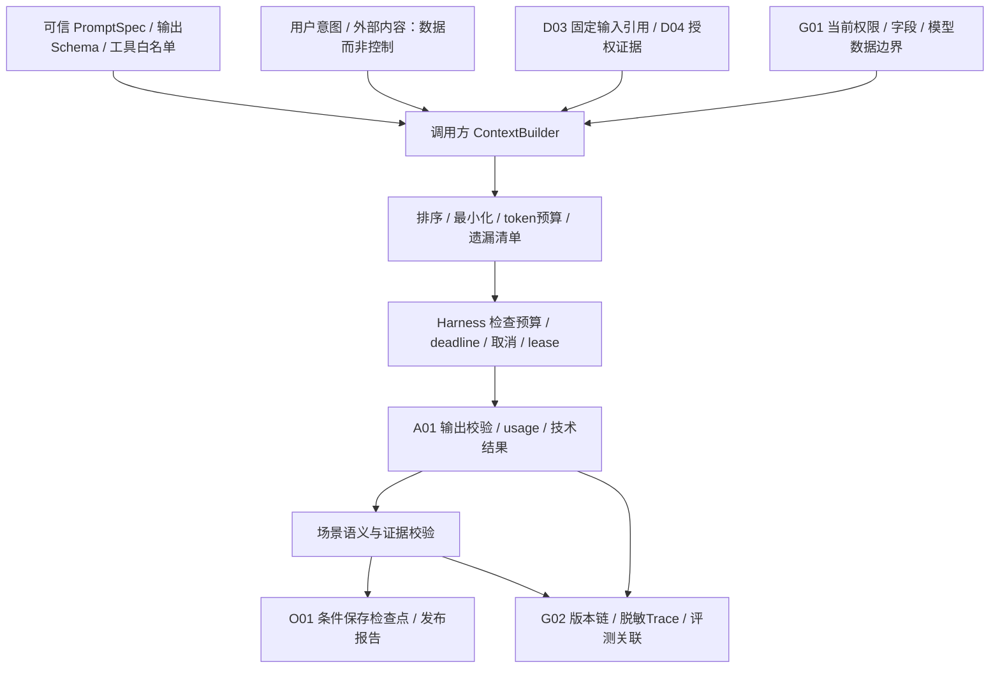

# 核心接口与权限隔离设计表

> 从[AI模块详细开发设计文档](AI_DETAILED_DESIGN.md) v0.2自动摘编，唯一维护源为正文；状态和未验证项与正文一致。

## 03 核心契约、状态、版本与错误

### 3.1 必要数据结构

以下字段是应冻结的语义，不是已发布 SDK。数据资产Ref携带 `tenantId/id/version`；可信模板/配置使用 `VersionedRef={id,version}` 并校验用途/适用租户；`TaskRef={tenantId,taskId}` 只表达任务身份，计划版本单列 `planVersion`，不能塞进TaskRef.version。范围与身份由服务端绑定；未知字段默认拒绝，不能使用任意 metadata 扩权。大内容使用受控 Ref，禁止跨层复制完整资产。

| 结构 / 所有者 | 必需字段 | 不变量与失败 |
|---|---|---|
| ParticipantView / O01 | 既有 taskId、planVersion、participantId、scenarioId/version、snapshotId、effectiveScope、policyContextRef、budgetHandleRef、deadline、traceId | 计划和快照执行前非空；来自 AnalysisContext 0.2 的受限视图；不是新的顶层任务上下文 |
| AgentSpec / 使用方场景 | agentId/version、ownerScenario、input/output/stateSchema、prompt/skillRefs、requiredCapabilities、allowedToolVersions、loopPolicyRef | 可信代码注册；不含任意类导入路径/可执行脚本；未实现能力不注册 |
| AgentState / 场景定义，O01 checkpoint 承载 | runId、roleId、stepOrdinal、phase、objectiveRef、contextManifestRef、pendingCallIds、toolResultRefs、partialOutputRef、stopReason、stateVersion | runId 为参与者内部步骤标识，无独立 task API；不保存隐藏思维链、密钥、源主账或完整聊天备份 |
| Checkpoint / O01 | checkpointId/revision、task/plan/participant/snapshot、lease/fence、agent/stateSchemaVersion、versionBundleRef、completedStepRefs、pendingCalls、usageRefs、resumeCondition | O01 唯一持久化；CAS 和当前租约保护；回滚本地状态不撤销供应商计费 |
| ContextBundle / 当前调用方 | contextId/schema、purpose、segments、tokenEstimate、omissionReasons、sourceVersionDigest、currentPolicyRef、expiresAt | segment 含来源/信任/敏感度/引用；不是 D03 第二份 manifest |
| RunOutcome / 场景内部 | COMPLETED、NEED_INPUT、RETRY_SCHEDULED、CAPABILITY_MISSING、LIMIT_REACHED、TECH_FAILED、CANCELLED、DEADLINE_EXCEEDED；outputRefs、checkpointDraft、consumptionRefs | Runtime只返回此内部结果；NEED_INPUT/RETRY_SCHEDULED是让出执行的原因，不是业务终态；Handler按§3.3映射DomainResult，不能当O01公开Task State |
| VersionBundle / O01 关联引用，各定义仍原归属 | codeArtifact、scenario、runtime、prompt/hash、contextPolicy、harness/loop、model/deployment、tool/schema、skill、knowledge/index、metric、taxonomy、policy、pricing、evaluationSet | 每项精确版本或显式 notApplicable；“latest”不能用作重放依赖；不复制各模块版本目录 |

Task State 仍为 O01 的 QUEUED/RUNNING/SUCCEEDED/FAILED/CANCELLED；报告 COMPLETE/PARTIAL/RULES_ONLY/BLOCKED 表示业务完整性；AgentState 表示内部执行游标；Checkpoint 是有版本的恢复记录；长期 Memory 仅是经确认且可撤销的偏好。这五者互不替代。

### 3.2 公共接口与失败语义

| 接口 / 所有者 | 调用者 → 输入 → 输出 | 失败处理 |
|---|---|---|
| ScenarioHandler.analyze / 各 S，O01 契约 | O01→ParticipantView→DomainResult | 返回缺失依赖/业务限制；技术异常有界重入，不在内部改 O01 任务终态 |
| Runtime.run / resume / 场景内部库 | Handler→AgentSpec+受限视图+state→RunOutcome | 参数/版本/权限不匹配停止；无后台线程自续跑，无自有预算 |
| save_participant_checkpoint / O01 公开窄控制用例【建议】 | Handler→expectedRevision+leaseToken+checkpointDraft→checkpointRef | 失租约、旧计划或 CAS 冲突拒绝；不允许 Runtime 写 O01 私表 |
| TaskBudgetHandle.reserve / settle / O01 | 场景、A02/A03 子调用、联合报告→callId/attempt/上界/期限→allowanceRef/结算 | 原子预留不足不调用；usage 未知保留占额；同 callId 结算幂等 |
| A01.invoke_model / A01 | 有权限调用方→ModelRequest（含allowanceRef）→ModelResponse 或 TechnicalError | 只映射技术错误；A01 验证许可，G02 记录 usage，不直接写 O01 预算表 |
| A01.describe_capabilities / A01 | 调用方→用途/已审核 deploymentRef→能力描述 | 未知/不可用/不满足返回 UNSUPPORTED_CAPABILITY，不假装等效 |
| A02.understand / A02 | 场景→内容引用+taskType+taxonomy+许可→understandingRef | 低置信/无法识别为 UNKNOWN；技术失败区别于语义 UNKNOWN；不伪造 confidence |
| A03.retrieve/query_semantic/invoke_read_tool / A03 | 场景/联合限定用例/即席→QuerySpec 或 ToolInvocation→结果/证据 | 拒绝权限、危险计划、越界输出；不自动拓展来源与工具 |
| D04.resolve_evidence / D04 | 消费者→evidenceRef+当前权限+版本约束→受控视图 | 不存在、撤权、删除、版本不符返回安全缺口，不能以缓存绕过 |
| G02.record_usage/trace/evaluate / G02 | 所有者→事件、callId/版本/引用→记录Ref | 必需审计不可写时禁新有费调用；调用后记录失败保留未决预留，通过既有工作项核对 |

A03 即席用例沿用 QueryRunContext 和本方预留/结算，不接收伪造 TaskBudgetHandle，也不调用 O01 创建假任务。两入口用 G01 获准分配约束，涉及跨入口共享硬总额时，未验证并发总额核算则关闭相关收费入口（概要 §6.4）。

`ScenarioHandler.analyze` 仍只返回既有 DomainResult；Runtime不构造DomainResult。本文的NeedInput / NeedReplan是其 `constraints` 中需O01处理的缺口/运行请求语义，不新增顶层返回类型或公开任务状态。§3.3将可选 `constraints.execution` 定义为有类型的 FINAL/YIELD 交接标记；只有 FINAL 才可作为发布候选，YIELD不计参与者完成。此字段须经兼容契约审查，不能靠任意JSON逃避类型与权限校验；未实现该协议时只允许无暂停的Workflow，不启用需暂停的Loop。

### 3.3 Agent 生命周期与持久恢复

1. **注册**：组合根加载已审核 AgentSpec，校验版本、工具实际存在、Prompt/schema 与模型能力、预算必填配置；动态用户上传不受理。相同 ID/version 内容冲突拒绝启动该能力。
2. **初始化**：O01 已有 task/plan/snapshot；Handler 检查领域前提并创建 runId 和空游标，绑定同一预算及版本。无调用需要时直接运行 Workflow。
3. **运行**：每个安全步骤前检查取消、deadline、当前 G01 权限、lease/fence、计划/输入适配、余额；结束后形成 checkpointDraft，由 O01 条件保存。网络请求在数据库锁外。
4. **暂停**：Runtime返回NEED_INPUT或RETRY_SCHEDULED，Handler转换为 `DomainResult.constraints.execution.disposition=YIELD`，携带检查点草案与等待条件；只有O01成功提交下述持久交接后phase才成为WAITING_INPUT/WAITING_RETRY。YIELD不得发布为报告或标记参与者完成。不新增公开PAUSED/WAITING任务状态。
5. **人工介入**：W01 展示缺字段、冲突证据和选择项，人工补充是有身份/commandId 的输入事件，不是批准。短期限内 O01 任务仍可处于 RUNNING，工作项释放执行资源；仅显式恢复命令或原 deadline 的收尾工作项唤醒，不按轮询重复调用模型。
6. **恢复**：O01 验证恢复命令去重、当前身份/计划/快照/版本/租约后，Handler 装载 stateSchema 相容的 checkpoint；先核对 pendingCall，不重新获得预算。超期则按策略发布受限/BLOCKED 报告或明确技术失败，终态不复活；继续分析需新的明确任务并关联旧任务。
7. **取消与终止**：排队取消或安全边界协作停止；供应商在途请求可尽力取消，usage 不明保留占额；迟到输出不得发布、不得复活 task。内部 run 结束无独立任务终态；Handler 输出领域结果，O01 发布报告。C03 在途/UNKNOWN 仍由 C03 核对，取消分析不能改变它。

恢复保留冻结输入的历史解释语义，同时按当前权限决定是否仍可访问；快照固定不意味着永久授权。依赖版本不可取得时停止自动恢复，返回需迁移/重新分析。状态迁移只允许经验证的 schema 迁移函数，不能反序列化 pickle 或旧任意对象。

#### 3.3.1 内部等待状态与唯一权威（D03）

`phase` 是O01检查点内的参与者执行游标，不是新任务表/状态权威。NEED_INPUT/RETRY_SCHEDULED是Runtime的一次返回原因；WAITING_INPUT/WAITING_RETRY是O01持久交接后的phase，二者不能互相冒充。RunOutcome本身不改变任务、工作项或发布状态。

| 内部phase / 触发 | O01持久化与交接 | I01工作项 / 报告行为 |
|---|---|---|
| ACTIVE / 合法领取后执行 | 绑定当前task/plan/participant/snapshot/checkpointRevision、ownerEpoch与当前lease；安全点保存进度 | 原工作项LEASED；未完成结果只作partialOutputRef，不发布 |
| WAITING_INPUT / NEED_INPUT且允许期限内澄清 | 保存waitId、typed missingFields/allowedResponses、resume条件和固定taskDeadline；保留已消耗/未知预留及最小产物Refs | 同一短事务中当前投递DONE、登记唯一到期收尾工作项和必需审计；任务仍RUNNING，参与者未完成，无“自动轮询模型”工作项 |
| WAITING_RETRY / RETRY_SCHEDULED且重试可证明安全 | 保存waitId、nextRetryAt、retryOrdinal/剩余上限、原因及原attempt/usage关联；未决计费先核对，不能重发 | 当前投递DONE；同事务按runAfter登记去重后的后续工作项及到期收尾项；I01的RETRY_WAIT仍只表达投递失败重投，不用作Agent业务等待状态 |
| READY_TO_RESUME / 恢复命令或到时重试被接受 | 锁定任务/检查点后校验当前权限、deadline、waitId/revision/plan，保存inputEventRef（如有）、resumeGeneration和唤醒去重键 | 原DONE投递不复活；新PENDING工作项只负责重新进入O01，不直接调用模型；到期收尾项保留 |
| ACTIVE / 新工作项获得新租约 | O01核验唤醒代际后将phase转ACTIVE，读取原产物/预算；pendingCalls先核对；依赖不相容不执行 | 新leaseToken，旧lease不能提交；重复唤醒仅返回当前状态/复用结果 |
| ENDED / 最终完成、取消、超期或不可继续 | FINAL且满足领域/证据门禁才有最终DomainResult；取消/失败/阻断收尾由O01决定，不复活终态 | 完成相应投递/终止无用待唤醒项；报告完整性与任务技术终态保持基线；未知模型费用另行核对，不阻止任务有界结束 |

【建议】`constraints.execution` 最小结构：`{schemaVersion:"0.2", disposition:"FINAL"或"YIELD", reasonCode, waitRequestRef或null}`。FINAL要求本领域输出完成且依赖检查通过或明确形成最终受限结论；YIELD要求typed WaitRequest存在，禁止作为可发布领域结果。WaitRequest仅指向O01接收的checkpoint草案/缺口，不使Runtime拥有持久化。旧消费者未声明支持YIELD时，注册校验应拒绝启用需要暂停的能力，不能忽略新字段后把YIELD当FINAL。

#### 3.3.2 持久交接、命令幂等和竞争（D03）

| 对象 / 所有者 | 字段级要求 | 原子性与拒绝语义 |
|---|---|---|
| O01 checkpoint / 等待条件 | taskId、planVersion、participantId、snapshotId、revision、ownerEpoch、phase、waitId、resumeGeneration、taskDeadline、missingFields/allowedResponses或nextRetryAt、retryOrdinal/上限、completedStep/partialOutputRefs、versionBundleRef、pendingCall/usage/allowanceRefs | 只保存受控Ref和执行元数据，输入正文仍按原所有者存储；不复制D03清单/G02成本事实/完整聊天 |
| O01接受的ResumeCommand | commandId、taskRef、planVersion、participantId、waitId、expectedCheckpointRevision、inputEventRefs、payloadFingerprint；身份由G01建立 | 唯一键 `(tenantId,taskId,commandId)`；同键同指纹返回原ack及当前任务状态，不新排队；同键异指纹409/COMMAND_CONFLICT |
| I01唤醒/到期工作项 | owner=O01，已注册分析重进入口，payloadRef指O01 task/checkpoint；wake键含task/participant/waitId/resumeGeneration/reason；到期键含taskId/frozenDeadline | 无任意函数/模型请求payload；新工作项不增加任务预算或整体重试额度；重复投递经O01检查waitId/代际后无副作用结束 |

暂停交接由O01作为唯一协调者，在共享MySQL**同一短事务**中按任务→检查点→工作项顺序锁定/校验当前plan、checkpoint revision、ownerEpoch和I01合法lease：O01写等待phase/Refs，I01经其公开端口写当前投递DONE及后续唤醒/到期项，G02写必需审计；唯一commit，失败全回滚。事务外不保留长租约等人。交接前崩溃仍由原工作项重入；交接提交后响应丢失时按waitId/revision复用既有交接，不再运行模型，也不重复新增唤醒项。所有权仍各写各表，不允许O01直接写I01/G02私表。

恢复命令在同一O01短事务中记录命令去重结果、受控inputEventRef/检查点READY_TO_RESUME、resumeGeneration、I01新唤醒项及审计，然后返回受理ack；ack不表示模型/业务完成。两条不同commandId竞争同一waitId/revision只允许第一条CAS成功，其余返回STALE_CHECKPOINT；相同命令重试可取原ack。用户只能填允许的缺字段/选项，不能更改scope、deadline或预算；需要新事实/改变依赖的输入必须先走O01重规划/D03新快照门槛，不得作为“恢复”静默混入旧输入。

期限以MySQL服务端UTC时间为准，在恢复受理、Worker重新进入、每次调用预留和最终发布前均检查 `dbNow >= taskDeadline`；等号视为超期。恢复受理早于期限但Worker领取已到期时，只执行到期收尾。取消/到期/恢复按同一任务锁及expectedRevision线性化：已提交取消/终态禁止恢复；到期先于有效恢复检查时拒绝受理；恢复先提交也不能延长期限，后续取消/到期会使待唤醒项失效。重复恢复命令在终态下只返回原ack与当前终态，不产生新执行。

新的执行取得新I01 leaseToken并更新O01 ownerEpoch；暂停交接提交即使原投递仍持旧token，也因DONE/epoch不符不能写checkpoint、预留新调用或发布。外部在途调用不能被租约撤回，迟到usage可以按原attemptId由G02幂等核对，迟到内容不得复活任务或覆盖新计划。未决费用保留原预留，不因等待/唤醒/取消释放成新额度。

到期工作项只调用O01收尾，不调用模型：按已冻结策略将有依据的有限信息整理为最终BLOCKED/PARTIAL报告（技术SUCCEEDED且业务受限），或无法安全发布时明确FAILED；取消保持CANCELLED。无获准降级规则时不能自行把未完成产物拼成报告，应选明确失败。I01投递耗尽经概要§11.3既有owner失败收尾处理，不新建监控/调度平台。O01任务读取/恢复及Worker重入遇到已到期RUNNING时也须先触发同一幂等收尾，G02监测到期未收尾与DEAD工作项并交既有值守责任人；故障恢复不能继续执行过期步骤。数据库不可用时不能承诺即时落终态，但不得接受过期新调用；恢复后优先收尾，禁止无期限延长RUNNING。到期/等待协议图见附录B（图18）。

### 3.4 错误与重放

【建议】统一错误信封 `{code,category,messageSafe,retryable,callId,traceId,owner,detailsRef}`。技术类包括 TIMEOUT、RATE_LIMITED、UNAVAILABLE、UNSUPPORTED_CAPABILITY、INVALID_OUTPUT、USAGE_UNKNOWN；控制类包括 POLICY_DENIED、BUDGET_DENIED、DEADLINE_EXCEEDED、STALE_PLAN、LEASE_LOST、SCHEMA_MISMATCH；业务缺口由 DomainResult.constraints 表达，不嵌入模型错误码。

`retryable=true` 仅表示技术上可能重试，还必须满足权限、同一预算/期限、已完成结果去重及计费核对。重放已保存产物与重新调用模型分别标记 `artifactReplay`/`providerReinvoke`；供应商别名漂移及采样使逐字复现不能保证。历史输出不覆盖，重新发布仍由 O01 创建 reportVersion。

### 5.4 复用、隔离和 Memory

| 内容 | 可复用范围 | 禁止行为 / 失效条件 |
|---|---|---|
| 不含业务数据的 Prompt/schema/可信 Skill | 经审核的代码制品可复用 | 模板中混入客户文本；修改同版本内容 |
| 企业内公开、不可变版本知识片段 | 同 tenant、双方有权限且用途/版本一致 | 默认跨企业共享；撤权/删除/失效后继续引用 |
| A02 已存理解产物 | 同内容版本/taxonomy/model/人工修订且当前授权相容 | 将标签当身份权威或自动补成缺陷事实；由 A01 另建标签库 |
| 动态库存/价格/费用/订单状态 | 当前固定 snapshot 的同一任务受限产物引用 | 当长期 Memory 或跨任务最新事实；缓存输出冒充当前可执行依据 |
| 客户资料/客服历史 | 单用户/会话和最小角色范围，仍需授权 | 完整聊天在其他用户/Worker角色之间广播；脱敏后自动公共化 |
| 审批/执行状态 | C01/C02/C03 当前公开视图，按用途实时复核 | 从 Memory/摘要/缓存推断批准有效或外部动作成功 |
| 用户语言/展示偏好 | 仅经确认的 tenant+user 偏好，当前请求优先 | 存隐含业务事实、敏感画像、跨租户经验池 |

当前不引入 Memory 服务或表。若确有偏好持久化需求，再明确现有 W01 用户设置等归属、确认/撤销 API、加密/留存/删除与 G01 权限后评审；禁用不影响业务执行。任务短期 state 与 checkpoint 从不视为长期 Memory。



### 9.1 ModelRequest / Provider 契约

| 对象 / 所有者 | 字段与使用方式 | 校验和失败 |
|---|---|---|
| ModelRequest / A01公共入口的逻辑请求 | 精确字段与类型见下表；引用模板/上下文/参数/工具，deadline为具体UTC时间 | 这是唯一公开请求契约，禁止同时接受引用和值两种别名；不把taskRef当计划版本 |
| ProviderRequest / A01内部已解析请求 | messages、parameters、outputSchema、toolSpecs及各digest、剩余timeout、实际deployment/modelRevision、原attempt审计绑定 | A01解析ModelRequest得到；仅传给适配器，不新增公共API/网关/预算；元数据不全部发送给提供方 |
| ModelProvider / A01端口 | describe_capabilities(deploymentRef)、invoke(providerRequest)、stream(providerRequest，获准时)、cancel(能力声明支持时) | 适配层只翻译为厂商HTTP/SDK请求并处理技术状态，不能回调A03执行工具；cancel不能保证不计费 |
| CapabilityDescriptor / A01 | provider/deployment/实际modelRevision、模态、窗口、输出上限、Schema子集、工具/流式/usage/cancel支持、地域与数据策略引用、校验日期 | 配置审核+小样本探测；能力发现不让模型自动联网找提供方；未知能力默认不支持 |
| ModelResponse / A01 | status、content或validatedObject、完整toolRequests、finishReason、providerRequestId、actualModelRevision、usageRef、cacheInfo、timings、versionBundleRef | 截断/拒答/异常输出不能伪装成功；同一次响应 content/toolRequests 互斥或共存按协议明确映射 |
| Usage / G02 | attemptId、input/output/cached/reasoning或其他计费维度（适用且已知）、数量/估算标识、currency、pricingVersion、actualCost或unknown、providerRequestRef | 不支持的维度记 unknown/notApplicable，不填0；Decimal 计费，控制金额与账单最终核对分开 |

**D01统一命名：逻辑ModelRequest只使用 `parametersRef`、具体 `deadline`、`toolSpecRefs`、`promptRef` 和 `contextBundleRef`；不接受逻辑层 `parameters`、`deadlineRef`、`toolSpecs` 或调用方自填 `toolSpecsDigest`。后四者分别是解析后的值/不再使用的别名/解析后的工具定义/服务器计算的摘要，不能混写在同一JSON中。**

| ModelRequest字段（schemaVersion="0.2"） | 类型与必填性 | 精确语义 / 解析与校验责任 |
|---|---|---|
| schemaVersion | 固定字符串"0.2" | 此细化契约草案版本，非AnalysisContext版本；未知/额外字段拒绝 |
| logicalCallId / attemptId | 非空字符串 / 非空字符串，均必填 | logicalCallId标识一次语义模型调用，重试保持；每次可能收费发送有新attemptId；工具反馈是新的逻辑模型调用并保留parentSpan/前序关联 |
| taskRef / queryRef | `TaskRef={tenantId,taskId}` / `QueryRef={tenantId,queryId}`，恰好一个非null | 只标识所属正式任务或即席运行；TaskRef没有version字段，不承载planVersion，不将一个plan当新task |
| planVersion / participantId / snapshotId | 字符串或null；正式领域调用三者必填 | O01分别校验当前计划、参与者和输入；O01联合报告participantId可null且purpose必须为获准联合报告；即席planVersion/participantId为null，snapshotId按QuerySpec固定输入要求 |
| principalRef / policyContextRef | `{tenantId,principalId}` / `{id,version}`，必填 | 服务端绑定发起主体与当前G01策略引用；用户/模型不可自签；A01调用前复核当前授权 |
| purpose | 获准用途枚举字符串，必填 | 例如A02_VOC_CLASSIFICATION；不能借用途改写权限/计价/预算 |
| deploymentRef | VersionedRef `{id,version}`，必填 | 指审核配置版本；A01解析为provider、具体deployment/modelRevision与能力集，不能将latest当不可变模型 |
| promptRef | VersionedRef，必填 | 指可信PromptSpec版本，所有者为使用方；A01校验manifest中的contentHash并计算resolvedPromptDigest；不再出现Prompt/hash等字段别名 |
| contextBundleRef | 受控DataRef `{tenantId,id,version}`，必填 | 指已最小化、来源/信任/遗漏可追溯的ContextBundle；A01校验当前授权/有效性并渲染消息 |
| outputSchemaRef | VersionedRef，必填 | 指输出JSON Schema及语义用途；解析后在ProviderRequest中为outputSchema及outputSchemaDigest |
| requiredCapabilities | 去重的能力枚举数组，必填，可为空 | 与用途/Schema/工具共同验证，不满足明确拒绝，不静默删约束 |
| toolSpecRefs | VersionedRef数组，必填，可为[] | 指本次允许暴露的A03只读工具精确版本；空数组表示无工具；不是模型生成的工具请求列表 |
| parametersRef | VersionedRef，必填 | 指已审核参数配置；解析后parameters包含具体temperature/maxOutputTokens等支持值，缺省在A01展开后计入digest；模型不可改引用/参数 |
| allowanceRef | 受控DataRef，必填 | 指原O01任务或A03查询已预留的**本attempt**许可；A01核验相同tenant/task或query/attempt/费用上界，Provider适配不得再次领额 |
| deadline | RFC3339 UTC时间字符串，必填 | 本attempt绝对截止，≤task/query原deadline且不可放宽；A01解析为 `timeoutMs=min(剩余deadline,获准providerTimeout)`；非正则不发送，没有deadlineRef字段 |
| cachePolicyRef | VersionedRef，必填 | 指审核策略配置（如id=cache-off/version=1）；OFF是策略内容，不是与Ref混用的字符串枚举 |
| traceId / parentSpanId | 非空字符串，必填 | 串联调用与工具反馈；仅在内部审计绑定使用，不因此把全部业务标识写入模型正文 |

解析顺序为：校验ModelRequest形状/引用身份→复核当前task或query/plan/权限/许可与deadline→解析精确版本的Prompt/Context/Schema/parameters/toolSpecRefs→校验模型能力和信息最小化→生成ProviderRequest/digest→再次检查剩余deadline→锁外发送。`ProviderRequest.messages`是PromptSpec和ContextBundle共同渲染的消息，不能另有一份自由messages覆盖逻辑请求；`toolSpecsDigest=SHA256(规范化后toolSpecs)`由A01计算，连同resolvedPromptDigest、contextDigest、parametersDigest、outputSchemaDigest用于追踪和缓存Key，不作为可改变工具集合的输入。

ProviderRequest内部最小分区：`payload={modelRevision,messages,parameters,outputSchema,toolSpecs}`；`control={attemptId,logicalCallId,allowanceRef,deadline,timeoutMs,taskRef或queryRef,planVersion,participantId,snapshotId,traceId,parentSpanId,digests}`。ModelProvider只将能力合同允许的payload与timeout翻译给厂商，控制分区保留在本地，不把权限引用/密钥/客户身份原样加到提示词。它仍是A01内部结构，不能由场景绕过ModelRequest直接调用。usage/技术状态回到同一attempt，G02记录后由原预算所有者结算；解析失败未发送与发送后费用未知分开记录。

模型选择由获准配置确定性筛选：用途/数据地域→模态/结构化/工具能力→已评测版本→可用限额→获准优先级。无满足者返回 UNSUPPORTED_CAPABILITY/UNAVAILABLE；模型不决定选择更昂贵或更广数据传输范围。云端需 V09/V13 数据/条款/配额证据；本地需模型许可、硬件、并发/效果、运维与实际协议证据，两者都不预设更便宜或更安全。

### 10.1 角色与注册

Skill 是可信方法/模板及有限资源的版本化包，由使用场景或 A02/A03 持有；Tool 是服务器能力的窄包装，A03 管目录与执行门面；Function Calling 是 A01 适配的模型提案协议。三者不是三个任务平台，也不赋予权限。

| 契约 / 所有者 | 最小字段/职责 | 调用与失败 |
|---|---|---|
| ToolSpec / A03，业务实现仍原所有者 | name/version、owner、purpose、input/outputSchemaRef、readOnly=true、dataDomains、requiredScopes、sensitivity、maxRows/bytes、timeoutPolicy、costClass、idempotency/dependencies、implementationRef | 可信组合根注册；implementationRef指已审核实现绑定而非动态导入字符串；C03或任意副作用工具注册即失败 |
| ToolRegistry / A03 | register、resolve、select_allowed；校验唯一ID/version/hash与实际可用状态 | 工具暴露为任务/用途/当前权限的交集；发现不表示自动可调用；不向模型暴露全部系统目录 |
| ToolInvocation / A03 | invocationId、logicalCallId/attempt、toolRef、arguments、serverBoundContext、allowanceRef、deadline、trace/parentSpan | tenant/scope/snapshot/principal从服务端上下文绑定，模型同名字段拒绝；不接受任意URL/SQL/脚本 |
| ToolExecutor / A03 | 校验、权限、参数/输出限制、超时、调用公开能力、审计 | 失败返回参数/权限/版本/超时/能力错误；不自动安装工具、改参数扩权或转C03 |
| ToolResult / A03 | invocationId/status、typedData或artifactRef、evidenceRefs、sourceVersions、coverage/observedAt、truncation/unknown标记、usageRef | 输出再鉴权与限额；截断不当完整数据，出错不回空数组冒充“无风险” |
| SkillSpec / 实际使用方 | skillId/version/hash、owner、triggerPredicate、input/outputSchema、requiredCapabilities、allowedToolRefs、promptRefs、budgetSlicePolicy、evalSuite、compatibility | 加载条件为已排期用例+版本兼容+授权+工具可用；不携任意可执行下载/安装脚本 |

### A.1 类型、关联与技术输出

| 字段类 | 设计类型 / 约束 | 拒绝条件 |
|---|---|---|
| tenant/principal/session/task/query/participant/run/call/attempt | 非空不透明字符串；ModelRequest精确字段以§9.1为唯一维护位置；taskRef与queryRef恰好一个非null | TaskRef仅{tenantId,taskId}；planVersion是相邻独立字段，不得使用TaskRef.version存plan；不接受调用方自签可信身份 |
| 版本/hash/Ref | DataRef={tenantId,id,version}；VersionedRef={id,version}；Prompt引用统一promptRef；摘要由A01解析后计算 | “latest”、空版本、同版本不同hash、不兼容stateSchema禁止恢复/缓存；TaskRef/QueryRef是身份引用例外，无version |
| deadline / created / observed / coverage | UTC时间带语义，deadline只能缩短 | 服务端时钟校验，过期不能调用；sourceUpdatedAt不得冒充coverage |
| 数量/费用与计价 | token/call/row/byte为非负有界整数；金额Decimal字符串+币种+pricingVersion | 负数、溢出、无上界、计价未知不允许承诺费用硬封顶 |
| toolRequests | 有界数组；每项id/name/version/arguments符合获准ToolSpec | 部分流式参数、重复id异指纹、未知工具、writeOnly/副作用工具拒绝 |
| content/validatedObject/toolRequests | 明确finishReason；组合形式按提供方能力合同校验 | 拒答/截断/格式失败不能以空对象标成功；结构通过后还需语义/证据校验 |
| evidenceRefs / outputRefs | 有界数组，每项当前可解析且有权限、版本/快照相容 | 无权引用不能作为不透明id透传到模型/他用户；缺重要证据阻断相应claim |

下例是调用方构造的逻辑请求示意，标识和日期均为模拟字段，不能直接发送；实际限额来自预留许可。`deadline`是具体UTC绝对时间，假设原taskDeadline不早于此值；参数使用parametersRef，工具使用toolSpecRefs，二者在ProviderRequest中才解析为值。没有有效许可就拒绝调用。

```json
{
  "schemaVersion": "0.2",
  "logicalCallId": "voc-call-success",
  "attemptId": "voc-attempt-success-1",
  "taskRef": {"tenantId": "tenant-fixture", "taskId": "task-voc-success"},
  "queryRef": null,
  "planVersion": "plan-voc-1",
  "participantId": "p-s03",
  "snapshotId": "snapshot-voc-fixture-1",
  "principalRef": {"tenantId": "tenant-fixture", "principalId": "user-voc-fixture"},
  "purpose": "A02_VOC_CLASSIFICATION",
  "policyContextRef": {"id": "policy-voc-fixture", "version": "1"},
  "deploymentRef": {"id": "model-fixture", "version": "1"},
  "promptRef": {"id": "a02.voc.classify", "version": "1"},
  "contextBundleRef": {"tenantId": "tenant-fixture", "id": "context-voc-success", "version": "1"},
  "outputSchemaRef": {"id": "a02.voc.output", "version": "1"},
  "requiredCapabilities": ["structured_output"],
  "toolSpecRefs": [],
  "parametersRef": {"id": "generation-voc-fixture", "version": "1"},
  "allowanceRef": {"tenantId": "tenant-fixture", "id": "allowance-voc-success-1", "version": "1"},
  "deadline": "2026-11-11T04:00:30Z",
  "cachePolicyRef": {"id": "cache-off", "version": "1"},
  "traceId": "trace-voc-success",
  "parentSpanId": "span-a02-success"
}
```

此JSON就是§9.1的ModelRequest，**不再使用deadlineRef，不传parameters、toolSpecs或toolSpecsDigest，不把plan放入TaskRef**。A01解析parametersRef/promptRef/contextBundleRef/outputSchemaRef/toolSpecRefs，得到ProviderRequest；从具体deadline计算剩余timeout。附录C复用这份成功请求并给出字段解析、输出及usage；A02的业务UNKNOWN和模型技术错误分字段表达。最终DomainResult仍带基线task/plan/participant/snapshot引用，不使用此ModelRequest代替AnalysisContext。
