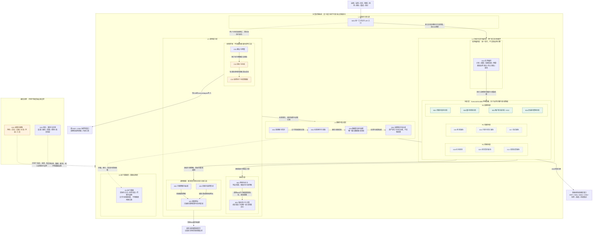
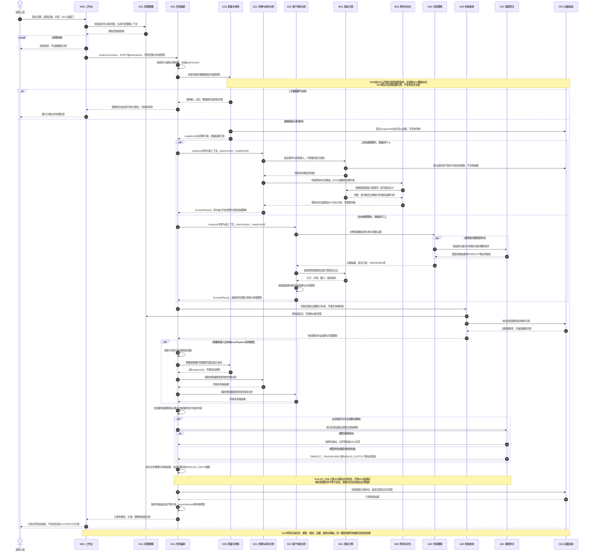
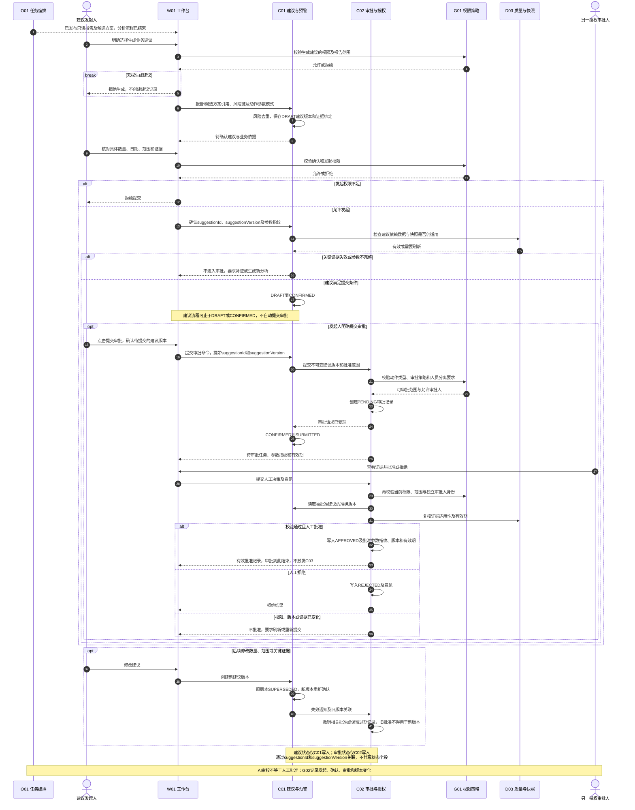
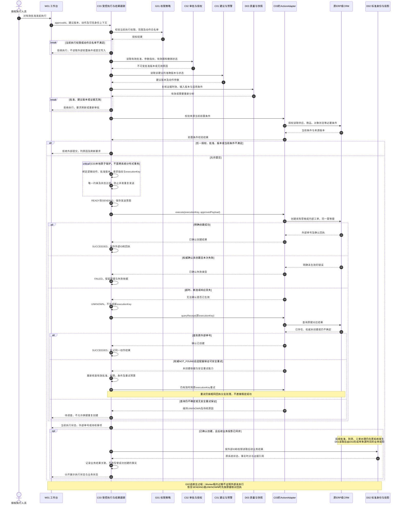
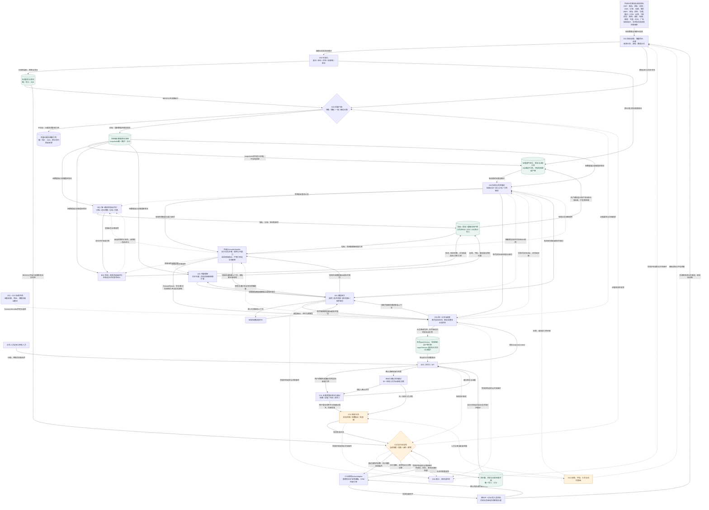
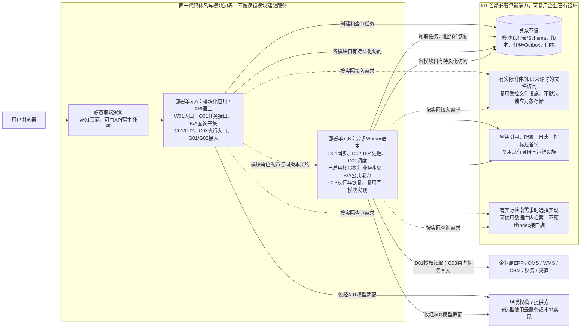

# 跨境电商智慧中台 AI 应用项目总体逻辑架构与流程设计

> 文档编号：AIH-ARCH-DRAFT-001 ｜ 版本：0.2 ｜ 日期：2026-11-11 ｜ 状态：R01—R09 修订稿，待独立复核
>
> 依据：[《跨境电商智慧中台 AI 应用项目需求文档草案》v0.2](../requirements/REQUIREMENTS.md)。本次按R01—R09定点修订职责、上下文和图示；保留S01—S10、17个公共模块、22项业务规划及原有分期，不因补货试点收缩完整产品范围。
>
> 结论：完整产品按 S01—S10 场景及 17 个公共模块设计；首期以模块化单体和异步 Worker 实施。通过稳定契约扩展场景与提供方，不将每个逻辑模块变成独立微服务，也不提前部署所有未来技术组件。

## 01 设计口径与阅读说明

### 1.1 保持原分层与编号

需求文档采用五层逻辑架构。本文件将 L2 的“场景层”和“任务编排层”分别展开，二者仍同属 L2，不重新编号为六层。基础设施层对应原 L5“运行基础层”。

| 需求文档层级 | 本文件展开方式 | 模块编号 |
|---|---|---|
| L1 体验与接入层 | 工作台及 API 入口 | W01 |
| L2 场景与任务编排层 | 场景层 + 任务编排层，分别展示 | S01—S10；O01 |
| L3 通用能力层 | 领域计算、通用智能、协同控制 | B01/B02；A01—A03；C01—C03 |
| L4 数据与集成层 | 接入、身份投影、质量快照、证据血缘 | D01—D04 |
| L5 运行基础层 | 基础设施适配与承载 | I01 |
| 横向治理 | 全链路权限、审计、观测和评测 | G01/G02 |

图中的“原系统”“模型提供方”“ActionAdapter”“数据库”等不增加新的公共模块编号。端口、适配器、存储和 Worker 是实现角色，不能与业务模块数量直接等同。

### 1.2 图示语义

- 总体逻辑图展示职责、主要调用和受控边界，省略重复的返回箭头；完整数据方向见数据流图。
- 时序图展示代表性调用顺序，参与者是逻辑职责，不代表网络进程。领域并行度默认2、整体重规划次数默认1，均可按获准配置调整；总参与者数与并行度分别管理。
- 数据流图中实线表示业务数据或产物，虚线表示调度、授权、校验或运行支持。
- 标记 P1/P2 的场景和技术选项表示可分期实现，不代表现已上线或首期必须部署。
- 所有图使用 Mermaid 基础 flowchart/sequenceDiagram 语法；图源与离线 SVG 随文提供。语法参考：[流程图](https://mermaid.js.org/syntax/flowchart.html)、[时序图](https://mermaid.js.org/syntax/sequenceDiagram)。

## 02 完整系统总体逻辑架构图

下图覆盖全部场景、公共模块、外部系统和治理能力。统一路径为 W01 → O01 → 所选 ScenarioHandler → 公共能力 → 场景领域结果 → O01 报告。场景声明证据/依赖并执行业务步骤，O01 不旁路场景重做计算或分类，场景不反向调用 O01 调度其他场景；跨场景复用通过 O01、公开结果或版本化事件完成。

### 2.1 架构约束

1. O01 负责统一计划、调度及跨域综合，场景执行业务步骤和领域失败影响判断。O01只可直接协调D03/D04以及调用A01/A03完成明确的联合报告解释/补证，不直接重跑领域B01/B02/A02步骤；统一查数W01→A03是独立受控查询，不是场景任务旁路。
2. B01唯一实现给定事实或情景输入下的逐日供需评价；B02生成预测、情景及约束候选，并调用B01评价。所有模型调用经A01，A01只返回技术结果；场景/O01分别决定领域限制和整体业务降级。
3. D02 不重建原业务主账；D03唯一保存输入数据版本清单，D04只保存资产定位与派生血缘；O01维护计划和报告及所引用产物，不复制输入清单、完整指标或标签资产。
4. 只有 C03 可触达外部业务写入端口；D01 是读取同步能力。ActionAdapter 由 C03 注册和调用，不能被 A01/A03 当作工具直接使用。
5. G01/G02 覆盖图中全部调用边界。图中虚线连接是治理作用示意，不表示依靠一次入口鉴权即可信任后续调用。
6. 图中模型提供方、存储和索引是可替换实现；并不要求企业同时部署本地模型和云模型。

### 2.2 O01内部分工

O01内部依次承担任务受理与参与者选择、计划/依赖/预算管理、D03快照协调及受影响重跑、领域结果综合与整体业务状态判定、引用审校和报告发布。这些是原O01内的职责，不新增模块、服务或独立通用引擎。领域步骤和领域降级仍由相应场景执行；O01只组合结果，不维护第二套业务公式。

## 03 共性流程一：跨领域只读分析

以“某 SKU 是否补货，同时客户投诉上升”为代表：O01 从同一 AnalysisContext 的 participants 中选择 S01/S03，协调共同快照和参与者上下文。图中两域并行只是默认配置下的例子，更多参与者可分批；其他场景复用同一调度链及公共能力。

**复用边界：**B01统一计算给定输入下的指标，B02预测并组织候选、复用B01评价；A02理解内容，A03检索与受控查询，A01返回模型调用技术结果。场景判断领域业务影响，O01综合请求级业务状态并持有任务/报告及产物引用。场景不互调私有服务，也不各自生成审批流程；模型故障的空结果不能证明“无风险”。

## 04 共性流程二：业务建议与人工审批

S01 的采购草稿建议、S02 的履约工单建议、S03 的质量调查建议和 S04 的财务核查建议均使用同一套 C01/C02 流程，仅动作类型、参数模式、业务规则和审批策略不同。

**状态一致性：**C01 拥有 DRAFT、CONFIRMED、SUBMITTED、SUPERSEDED、CANCELLED；C02 拥有 PENDING、APPROVED、REJECTED、EXPIRED、REVOKED。工作台聚合显示，不复制一套场景专用审批台账。

只读分析、建议确认、人工审批和受控执行是四种独立流程终点：分别为O01已发布报告、C01建议状态、C02审批决策、C03创建回执/明确失败/待核未知。APPROVED不等于已执行，SUCCEEDED不等于最终业务完成；图04仅在另一授权执行触发后开始。

## 05 共性流程三：受控执行、未知恢复与业务结果

执行流程只允许 C03 使用 ActionAdapter。首期动作类型仅为 ERP 采购草稿、CRM 内部工单；图中的外部系统可为同一企业现有系统，不代表另建业务平台。

**执行前条件的准确性：**D03 的分析快照不能代替原系统当前条件校验。适配器若能在提交时做条件版本校验，应将前置版本/指纹随提交发送；若无法排除校验与提交之间的变化，必须记录剩余不确定性并按动作风险评审。缺少可靠幂等或回执查询保证的写入适配器，不进入首期上线范围。

**执行状态归属：**READY、SENDING、SUCCEEDED、FAILED、UNKNOWN 仅由 C03 维护。批准失效由 C02 维护；模型和 Worker 不自行授予批准。SUCCEEDED 只表示草稿/工单创建成功，不表示采购已获批、商品已到仓或客户问题已解决。

## 06 完整系统数据流图

该图覆盖所有场景使用的公共数据路径，不意味着每次分析都遍历所有节点。快照是固定输入清单和版本关系，不要求物理复制每条原始数据；证据账本保存可解析引用及派生血缘。实体、指标、标签、报告和动作各有唯一写入归属。

### 6.1 数据流的关键限制

- 图中“经数据端口读取固定版本”必须结合 D03 的快照清单，通过 D02/D04 公开契约取数，不允许业务模块查询对方私有表。
- SNAP到公共能力的实线表示所选场景调用时读取固定输入，不表示D03主动调度这些能力；领域调用控制路径统一为O01→场景→公共能力。联合报告补证单独标注，不能当成另一条领域执行路径。
- A03 的结构化查询经过语义层、只读校验和服务端范围过滤；指标结果仍由 B01 计算。索引不能绕过证据权限和撤权处理。
- A01/A02 的输出是派生解释或标签；只有原系统记录和已确认口径才提供相应业务事实。所有报告区分事实、计算和推断。
- A01按调用来源分别向O01、场景、A02或A03返回该请求的模型输出/技术错误，不广播同一结果。领域步骤由场景调用，O01直接调用仅限联合报告解释/补证；业务降级不在A01中执行。
- ART 为图示分组，不是一张全模块共写的产物表；B01、B02、A02 各有自己的数据写入边界。
- I01统一承载图中逻辑数据资产；此处不为每个资产再绘制一条物理存储连线。物理部署见第09节，权限和审计仍在各模块边界强制执行。
- ActionAdapter 的结果先返回 C03 服务边界，再由 C03 持久化 EXEC；适配器不能直接写执行台账。
- BAD 保存质量问题与引用，原始内容和标准投影不被静默改写。人工纠正映射后生成新版本并重跑受影响分析。
- C02 的批准、C03 的创建回执、D01/D02 读到的后续业务状态是三种不同证据；不能相互替代。

## 07 公共模块职责、依赖、契约与扩展机制

以下端口名是对需求文档契约的细化建议，尚未冻结为生产 API。保留原有 ScenarioHandler、SourceConnector、MetricDefinition、Forecast/OptimizerProvider、ModelProvider、UnderstandingProvider、Retrieval/QueryProvider、ActionAdapter 的归属。

| 模块 | 唯一职责 | 上游使用者 / 输入 | 下游依赖 | 公开契约与扩展方式 |
|---|---|---|---|---|
| W01 统一工作台 | 问题、报告、证据、建议和审批的统一入口 | 业务、审批、集成、审计人员 | O01、C01—C03、G01；通过公开查询读取运行视图 | Workspace/API：请求范围、taskId、reportRef、版本；扩展视图和表单模式，不自算指标或建立场景审批账本 |
| O01 任务编排 | 参与者、计划/预算、快照协调、领域调度、跨域业务状态及报告 | W01任务、已注册场景、受控任务触发 | 所选ScenarioHandler、D03/D04、G01/G02；A01/A03仅用于联合报告解释/补证 | AnalysisContext、ScenarioHandler、DomainResult、AnalysisResult；不旁路场景调用B01/B02/A02执行业务步骤，不生成重复领域实现 |
| D01 连接器与同步 | 来源授权读取、游标、去重、失败恢复和完整覆盖 | 原系统、授权文件；同步配置 | 厂商读取适配器、G01、I01；向D02交付记录 | SourceConnector：sourceId、domain、read(cursor,scope)、同步模式、asOf、coverageThrough、错误类别；新增厂商适配器 |
| D02 标准身份与投影 | canonicalId、审核映射、状态/单位转换及标准投影 | D01来源记录、人工确认的映射版本 | D04、I01；向D03/B01/B02/A03/C03提供公开读视图 | MappingPort、ProjectionReadPort：来源ID、租户、版本、权威域和范围；扩展有版本的域适配，不能猜名称合并 |
| D03 数据质量与快照 | 质量门槛、隔离引用、唯一输入版本清单及有效性复核 | O01快照请求；C01/C02/C03复核请求 | D01覆盖、D02投影、D04定位、G01、I01 | QualityCheck、SnapshotManifest、ValidityResult；不维护计划/报告版本，不复制事实或报告 |
| D04 证据登记与血缘 | 证据ID、生产资产版本定位、权限及派生关系 | D02/D03/B01/B02/A02等生产者；场景/O01/A03读取者 | 来源拥有者的公开解析端口、G01、I01 | EvidenceRef、registerDerived、resolve；只引用snapshotId及生产资产，不复制清单、指标或报告正文 |
| B01 指标语义与计算 | 给定事实/情景输入下的唯一确定性评价，含逐日余额、首次缺货日及缺口 | 场景、B02情景评价、A03受控查询 | D02/D03/D04、G01、I01 | MetricDefinition、MetricQuery、MetricResult；历史/基线/候选使用同一指标定义，不生成预测或候选方案 |
| B02 预测与优化 | 需求/交期预测、情景及候选构造、约束方案搜索 | 场景业务参数与约束 | B01唯一指标评价、固定输入数据端口、D04、I01 | Forecast/OptimizerProvider：预测、候选参数、B01评价引用、版本和回测；不另写逐日供需计算 |
| A01 模型网关 | 提供方适配、输出模式校验、技术超时/限额、费用及技术错误 | 场景/理解/检索调用；O01仅联合解释 | 经授权模型提供方、G01/G02、实际凭据引用 | ModelProvider、ModelRequest/Response及TIMEOUT等技术错误；不返回RULES_ONLY或其他业务降级决策 |
| A02 内容理解与抽取 | 分类、聚类、翻译、字段抽取、置信度和修订 | 场景提供的授权内容或证据引用 | A01或非LLM理解提供方、D02/D04公开内容端口、I01 | UnderstandingProvider、ContentRef、ExtractionResult；扩展语言、文档、视觉任务，不接管分母或商品身份确认 |
| A03 检索与受控查询 | 权限感知知识检索、语义查询与引用返回 | O01及统一查询入口，场景证据需求 | G01、D02/D04、B01；需要模型规划时仅调用A01 | Retrieval/QueryProvider、QueryPlan、EvidenceBundle；扩展文本、关系或索引提供方，图查询不强制图数据库 |
| C01 建议与预警 | 风险去重、建议版本、确认、责任交接和效果关联 | W01明确生成/确认建议命令及O01报告引用；独立获准的规则预警任务 | D03/D04、C02、G01、I01 | Suggestion、RiskKey、Confirm/Submit；只读报告不自动建建议，不拥有批准权 |
| C02 审批与授权 | 人员分离、决策、批准指纹、有效期及撤销 | C01不可变建议版本、W01独立人员决策 | C01、D03/D04、G01、I01；供C03读取批准 | ApprovalRequest/Record、validateApproval；扩展已评审策略，不把AI审校当批准、不调用写适配器 |
| C03 受控执行与结果跟踪 | 唯一外部写入口、键及请求指纹、回执恢复、结果关联 | W01授权触发；获准执行任务 | C01/C02、D03、G01、ActionAdapter、D02业务投影、I01 | ActionAdapter：execute/queryReceipt/前置条件/业务状态引用；新动作需独立业务、权限及恢复评审 |
| G01 权限与策略 | 身份、角色、企业/店铺/仓库/字段/工具/动作范围 | 各层和适配边界的授权请求 | 身份提供方及策略配置、I01 | PolicyContext、authorize、scopeFilter；服务端可信上下文、默认拒绝；扩展策略类型需回归验证 |
| G02 审计、观测与评测 | 版本、链路、模型质量、费用、异常和恢复证据 | 所有模块受控事件、固定业务样本及人工评价 | I01日志和指标承载；按G01控制查看 | TraceEvent、AuditEvent、EvaluationCase/Result；新增场景评测集和指标，不另建场景日志系统 |
| I01 运行基础 | 实际持久化、任务领取/恢复、凭据与运行日志/备份承载 | 各数据/任务拥有模块的已知需求 | 现有存储、身份和运维设施；文件/检索按实际接入使用 | 保留实际模块数据访问和任务恢复边界，不预建Repository/Index/Queue/Blob/SecretRef通用接口族；后续替换须有明确需求 |

### 7.1 统一上下文、结果和事件

| 契约 | 必须包含 | 控制规则 |
|---|---|---|
| AnalysisContext | schemaVersion、taskId、analysisMode、participants、scope、window、planVersion、snapshotId、policyContextRef、budgetPolicyVersion、有效budget | 权威定义和完整示例见需求文档8.1节；SINGLE恰一参与者、JOINT至少两参与者；不保留根级单场景假设 |
| SnapshotManifest | D03的snapshotId、数据域/范围、来源及映射版本、asOf、observedAt、coverageThrough、质量规则/结果引用、缺项 | 仅固定数据输入；不复制O01计划、指标版本定义、报告正文或D04证据台账 |
| MetricResult | metricId/Version、值、单位/币种、维度、窗口、分母、缺项、证据、snapshotId及适用的B02情景参数版本引用 | 禁止“同名不同义”和缺项填零；情景结果注明假设，不当成已发生事实；AI只能引用结果 |
| DomainResult / AnalysisResult | participantId、场景版本、planVersion、snapshotId、领域结论、指标/预测/标签/证据引用、业务限制；报告另有reportVersion | 领域结果返回O01；不复制生产资产；技术失败由领域及整体编排分别判定业务影响 |
| Suggestion / ApprovalRecord | 建议ID及版本、参数指纹、范围、证据、主体、有效期、批准/撤销记录 | C01/C02分别唯一写入状态；新参数不能消费旧批准 |
| ExecutionRecord | executionKey、逻辑动作标识、批准版本、请求指纹、状态、外部ID、回执和业务结果引用 | C03唯一维护；并发提交由唯一约束和状态比较阻止重复 |
| 版本化事件 | eventId、schemaVersion、producer、tenantId、aggregateId/Version、occurredAt、traceId、payloadRef | 单一生产者；消费者去重。使用进程内事件或数据库任务/Outbox即可，不要求首期部署消息中间件 |

工具调用、MCP、Skills、Memory 是复用方式，不新增平行业务引擎。MCP 不替代 G01；Skills 是版本化方法模板；Memory 只保存经确认可撤销的偏好，不永久缓存昨天的库存或批准作为今日事实。

SINGLE与JOINT共用一个AnalysisContext，场景拿到的是其中本参与者的获准视图，不另建一套独立任务上下文。共同asOf只是观察锚点，需求预测与成熟投诉群组保留各自业务窗口；参与者数据需求由D03一起固定。planVersion与有效预算由O01维护，snapshotId仅由D03维护。

模式按实际执行场景数区分，不按来源数量区分。单场景可以复用有效的已发布领域结果；若需执行新的依赖场景，则显式进入participants并作为JOINT记录，规划后新增参与者遵循计划版本和重规划预算，不能在SINGLE任务中隐含另一个场景。

预算定义见需求文档8.3节：maxDomainParallelism默认2（正整数）、maxReplans默认1（非负整数），由获准配置和G01策略约束确定有效值。更多参与者分批运行；原计划/快照内查询受工具预算约束，不机械地把每次查询算重规划；改变参与者/依赖或纳入新数据引发重跑计入整体重规划。补证与审校共享同一额度。调整需依据时延、费用、限流、资源、失败率和评测，冻结配置版本，不由模型自行放宽。

### 7.2 唯一数据归属

| 数据资产 | 唯一写入模块 | 共享方式 |
|---|---|---|
| 来源台账、同步记录、游标、覆盖水位 | D01 | 来源状态查询与标准事件 |
| 统一身份、映射、标准投影及转换版本 | D02 | 公开只读视图及版本化记录 |
| 质量结果、隔离问题引用、输入数据版本清单 | D03 | snapshotId及固定清单唯一维护在D03；向其他模块提供引用和有效性结果 |
| 证据、权限标签、生产资产定位及派生血缘 | D04 | EvidenceRef经当前权限解析；仅引用快照及产物，不复制其内容 |
| 指标定义、口径与指标结果 | B01 | MetricDefinition/MetricResult |
| 预测、情景参数及优化结果 | B02 | 带版本/假设的结果和B01指标引用；逐日指标资产仍属B01 |
| 理解标签、字段位置、置信度、人工修订 | A02 | 带证据位置的结构化结果 |
| 任务计划、领域结论及产物引用、综合报告 | O01 | planVersion/reportVersion及snapshotId/产物/证据引用；不另存原始资产 |
| 建议、预警、确认、责任交接 | C01 | Suggestion及公开状态 |
| 审批、批准、拒绝、撤销 | C02 | ApprovalRecord |
| 执行键、指纹、回执、业务结果关联 | C03 | ExecutionRecord及业务状态引用 |
| 权限策略 | G01 | 策略版本和受控判定接口 |
| 审计、运行观测、评测记录 | G02 | 按权限查询的审计和质量视图 |

W01 不复制业务主账；A01 的运行记录交 G02，配置和提供方版本经治理管理；A03 的索引是可重建技术投影，保留 D02/D04 的事实及权限归属。I01 可用同一物理数据库或文件设施承载这些资产，但不能让各模块任意写入同一业务表。

D03回答“用了哪些版本的数据”，D04回答“这些证据在哪里、从何而来”，O01回答“如何组织任务、发布哪版报告”。输入数据改变生成新snapshotId；任务组织改变生成新planVersion；重新发布形成新reportVersion。规则/指标/标签定义版本仍由生产模块维护，不能由这三个模块重复维护。跨版本结果仅在依赖兼容性被验证后复用。

## 08 代表性场景如何复用

| 代表场景 | 独有业务逻辑 | 复用的公共链 | 防重复开发约束 |
|---|---|---|---|
| S01补货 + S03质量联动 | 判断补货数量、到货日与质量调查是否冲突 | O01调度S01/S03 → 场景调用公共能力 → 报告；用户选择后分别进入C01、C02、C03 | B02对候选调用B01评价；S03质量信号交O01综合，不另写分类器或审批表 |
| S02履约风险 | 区分未出库、物流停滞和多包裹差异 | D02关联、B01超时指标、A03证据、C01风险去重、C02/C03内部履约工单 | 不另建包裹主账、通用通知平台或订单取消执行器 |
| S04费用异常 | 分析贡献下降与账单差异 | B01口径、D04血缘、A01解释、C01—C03财务核查工单 | 不让模型算金额，不将贡献或工单成功当净利润/问题解决 |
| S05客服辅助 | 将商品、订单及有效政策组织成回复草稿 | A02理解、A03检索、A01生成、G01权限、O01结果管理 | 复用S03已发布主题结果；首期不新增自动对客发送 |
| S07单证辅助 | 核对发票、装箱单中的商品和数量等关系 | A02文档提供方、D04字段位置、G01权限、统一人工复核和C01—C03 | 单证规则归场景；OCR抽取不直接写ERP或确认主数据 |
| S08多仓经营规划 | 价格、采购、调拨和仓网方案的经营约束 | S01已发布预测、B01成本、B02优化、O01综合、D03固定输入 | 不重做预测引擎；新增经营动作仍需单独动作评审 |

## 09 逻辑模块与物理部署单元

### 9.1 首期建议部署映射

采用一个业务应用代码体系，按运行角色启动 API 与 Worker。它们是部署单元，使用同一套模块实现与契约；不是为每个场景或公共模块部署一个微服务。

图中实线承载已明确的数据持久化、任务恢复及凭据/运维需求；虚线的文件、检索实现按实际接入启用，不要求新增独立产品或先定义统一技术接口。任务可用现有数据库持久化调度，检索可用数据库内能力。所有来源读取和写入仍按模块职责进行；即使共进程，模型工具也拿不到C03写入能力。本次只澄清部署边界，不增加服务拆分或概要开发设计。

I01仅保留三类明确需求：D01—D04/B01/B02/A02/O01/C01—C03的数据及版本持久化；O01/C03等任务领取和恢复；凭据、审计观测与备份承载。文件访问和检索实现以已接入资料为依据；独立队列、向量存储、通用Blob/Repository接口或跨存储通用适配层不因未来可能用到而成为当前交付项。业务连接器、模型及检索提供方等已有合理扩展契约保留。

### 9.2 部署约束与拆分条件

| 对象 | 首期做法 | 何时考虑独立部署 |
|---|---|---|
| S01—S10场景 | 同一应用内注册插件，按阶段启用 | 有独立容量、发布或隔离证据后再评审；不能因场景多就拆服务 |
| O01、B01/B02、A01—A03 | 保持逻辑包与契约；耗时任务在Worker执行 | 模型调用或优化任务需要独立伸缩、专用资源或故障隔离 |
| D01—D04 | 独立模块，按任务运行；避免阻塞交互API | 大规模同步、独立网络边界、持续积压或隔离要求 |
| C01/C02/C03 | 分开职责与数据拥有者，首期可同一代码体系 | 写入风险要求独立凭据/网络边界，或审计与可用性要求需要隔离执行宿主 |
| G01/G02 | 策略与观测统一，不按场景复制 | 优先复用企业身份/监控；专用服务只按真实规模和治理需要建设 |
| 数据存储 | 可共用物理实例，但私有表、写入归属和契约不混合 | 资源竞争、合规隔离、恢复目标或容量有明确分离需求 |

部署角色的数据库凭据、外部凭据和工具白名单应尽量收敛。模块化单体中的语言级接口隔离不等同于进程级安全边界；如写入动作风险要求更强隔离，可将 C03 放到受限执行 Worker，同时继续复用其契约和代码，不拆分全部模块。

## 10 未来能力与按需技术选项

| 未来能力 | 稳定扩展点 | 当前应预留的设计 | 触发后才评估的技术组件 |
|---|---|---|---|
| 学习型销量、交期预测 | B02 Forecast/OptimizerProvider | 截止时点、特征、区间、算法版本与回测接口 | 专用训练/推理服务、特征平台；首期不必部署 |
| 图关系检索 | A03 Retrieval/QueryProvider | 关系查询计划、范围过滤、路径证据格式 | 只有关系查询收益及容量验证后才引入图数据库；可先查关系表 |
| 大规模语义检索 | A03 Retrieval/QueryProvider | 权限标签、版本、重建和撤权策略；不预建I01通用Index端口 | 独立向量数据库或搜索集群；不是RAG的必备独立部署单元 |
| 单证抽取与视觉质检 | A02 UnderstandingProvider | 文件/图片引用、字段位置、置信度和人工确认 | OCR服务、视觉模型、GPU；S07/S09实施时按任务评估 |
| 多仓优化与促销模拟 | B02优化提供方、S08约束模板 | 目标函数、业务约束、假设与场景结果 | 专用求解服务或算力池；首期确定性推演即可 |
| 新渠道、第三方仓、物流或市场资料 | D01/D02来源与域适配 | 来源台账、授权、状态映射、单位和权威域 | 获得实际来源和接口后新增连接器，不提前部署TMS/全网爬虫 |
| 大吞吐事件分发 | 版本化事件、I01已有持久任务需求 | eventId去重与可恢复消费；有真实吞吐需求再评审队列适配，不预建Queue接口族 | 消息队列或流平台；数据库任务满足需求时不新增 |
| 本地模型与模型路由 | A01 ModelProvider | 能力声明、结构化输出、预算和失败状态 | 私有推理服务、GPU或多模型路由器；选型后部署 |
| MCP、Skills和受限Agentic检索 | A03/O01/通用工具端口 | 审核注册、版本、权限、预算及停止条件 | 有跨应用复用需求再部署MCP端点，不等同于新增业务服务 |
| 自动退款、调价、投放或对客发送 | C03 ActionAdapter，关联C02策略 | 动作类型、人工授权、幂等、前置条件和回执契约 | 作为新需求单独评审；不是当前已授权或必须开放的功能 |

扩展按“业务需求获批 → 数据和权限具备 → 提供方注册 → 契约与业务回归 → 灰度 → 按需部署”推进。不能从技术清单反推当前必须建设的组件。

## 11 完整产品需求覆盖与分期

### 11.1 22项候选需求逐项追踪

| 需求草案第5.2节编号 | 需求与唯一主归属 | 主要公共复用能力 | 建设阶段 |
|---|---|---|---|
| 1 | 补货与缺货预警：S01 | B01/B02、D01—D04、O01、C01—C03 | P0 |
| 2 | 履约异常分析：S02 | D02事件关联、B01、A03、C01—C03 | P0 |
| 3 | VOC与商品问题：S03 | A02、B01、D04、O01、C01—C03 | P0 |
| 4 | 经营贡献分析：S04 | B01、D01—D04、A01/A03、C01—C03 | P0 |
| 5 | 商品映射与质量诊断：D02/D03分职责 | 审核映射、质量门槛及快照 | P0 |
| 6 | 销量预测：S01 | B02、B01、D03/D04 | P1 |
| 7 | 滞销库存治理：S01 | B01/B02、S04已发布贡献结果 | P1 |
| 8 | 供应商风险：S01 | B01/B02、D02/D04 | P1 |
| 9 | 运输到货风险：S02 | B02、D01/D02事件及C01预警 | P1 |
| 10 | 多语言客服：S05 | A01—A03、O01、G01 | P1拓展 |
| 11 | 售后处理辅助：S05 | S03已发布主题、A03、B01、统一协同 | P1拓展 |
| 12 | 页面本地化：S06 | A01/A02/A03、D04、统一人工确认 | P1拓展 |
| 13 | 广告诊断与素材：S06 | S04已发布贡献、B01、A01/A02 | P1拓展 |
| 14 | 费用账单核查：S04 | B01费用口径、D04、C01—C03 | P1 |
| 15 | 单证核对：S07 | A02、D04、统一复核和协同 | P1拓展 |
| 16 | 自然语言查询与知识助手：W01+A03 | A01、B01、D02/D04、G01 | P1，P0提供必要查询子集 |
| 17 | 跨部门异常协同：C01—C03 | O01报告、D04证据、G01/G02 | P0提供必要子集 |
| 18 | 市场与选品：S08 | 授权来源、S03/S04已发布结果、B02 | P2 |
| 19 | 定价与促销模拟：S08 | B01/B02、D03固定假设、O01 | P2 |
| 20 | 多仓布局优化：S08 | S01已发布预测、B02优化 | P2 |
| 21 | 图片辅助质检：S09 | A02视觉提供方、D04及人工确认 | P2 |
| 22 | 政策风险检查：S10 | A03有效版本检索、A01辅助归纳及专业复核 | P2 |

“已发布结果”通过 O01 的公开结果引用/事件以及 D04 的证据解析共享，消费者不直接访问场景私有表，也不能把昨日预测当作当前源事实。

### 11.2 与需求草案首期功能和验收的一致性

| 需求草案条目 | 本设计落点 |
|---|---|
| S01-01—05；AC-02/03/04 | 图02共同快照与B01/B02；图03建议审批；图04受控草稿/调查及失效处理 |
| S02-01—04；AC-05 | D02订单包裹投影、B01超时口径、S02候选原因、统一内部履约工单 |
| S03-01—04；AC-04/06 | A02主题/UNKNOWN、B01成熟群组去重、O01质量联动、D04原文引用 |
| S04-01—04；AC-07/08 | D01/D02账单语义适配、B01金额及缺项、O01报告、统一财务核查 |
| AC-01/09；NFR-01/02/03 | G01多边界校验、D02映射隔离、D04引用、A03检索与工具策略 |
| AC-10/11；NFR-04 | 图03版本绑定、图04当前条件与原键回执恢复、C01/C02/C03分开写入 |
| AC-12；NFR-05/06/09 | A01技术错误；场景领域限制与O01业务降级；可配置有效预算；G02评测及提供方回归 |
| NFR-07/08 | I01运行与恢复、G02队列/来源/执行未知观测；容量和RPO/RTO待评审冻结 |

### 11.3 分期不改变最终模块归属

- **M0：**冻结场景、来源权威域、接口、指标、权限、规模及质量目标。
- **M1：**构建 D01—D04、B01、必要 B02、A01—A03、G01/G02 和基础工作台。实现首期必要子集，不一次完成所有算法和数据源。
- **M2：**交付 S01—S04、O01只读报告；用户选择时生成C01建议，分别验收两个流程终点，用业务金标准验证效果和成本。
- **M3：**开放 C02/C03 及两类通过幂等/恢复验收的写适配器；不满足条件的来源保持只读分析和导出建议。
- **M4：**按数据、收益和验证结果扩展 P1/P2；仍复用同一任务、计算、检索、建议、审批和执行能力。

## 12 接口演进、评审及一致性约束

1. 注册清单包含标识、版本、输入输出模式、所需域、允许工具、权限、费用/时长预算和建议动作类型；通过审核代码注册、依赖注入或受控配置扩展，不支持任意代码上传。
2. 公共模式携带 schemaVersion。新增可选字段需兼容验证；删除、改名或语义变化发布新主版本。历史任务、报告、批准和执行记录保留原版本依赖。
3. 场景接入前查重：相同取数、公式、理解、审批或恢复逻辑必须复用；只增加业务约束、特征和输出模板。确需新公共能力时，先说明与已有模块的职责差异。
4. 扩展契约验证与业务回归分开：前者验证模式、权限和适配能力；后者验证补货、履约、VOC、贡献的真实样例及未知处理。模型自评分不能代替业务复核。
5. 未冻结项沿用需求草案第16节，并补充必需/可选业务依赖、各级降级允许条件、初始预算默认值的业务接受度和调整规则、证据留存及删除后历史引用处理。技术边界已按R01—R09澄清，这些企业事实和取舍仍需业务确认，不在本文擅自给出生产承诺值。
6. 本文件不新增首期退款、库存调整、对客发送、自动调价或投放权限。未来动作须单独评审 C02/C03 契约与审批策略。

交付物包含本 Markdown、六份独立 Mermaid 图源、六份离线 SVG、HTML 阅读版及与源需求指纹绑定的校验清单。HTML嵌入SVG，阅读时不依赖远程CDN；Mermaid运行包仅用于本地构建和校验，不是产品运行架构的必部署组件。
