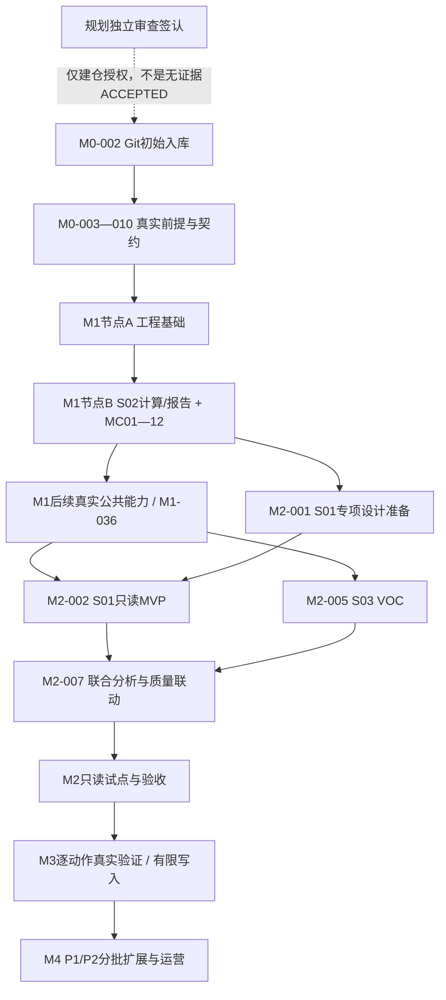

# 完整智慧中台分阶段开发计划 v0.1

日期：2026-11-11（Asia/Shanghai）。状态：本轮规划草案已提交待独立审查，未获具体实施授权；不初始化业务工程、不开发补货Agent、不部署、不创建全部代码目录。

## 1. 依据、结论与范围

仅以用户本次明确确认已通过审查的以下五份文件为依据。保留原页眉历史状态，不修改基线；不追读它们链接的旧修订、旧代码、其他项目或历史会话。下列别名用于TASKS.baselineRefs定位，不是完成证据；章节/验收编号以源正文为准。

| 别名 | 授权文件 / 版本 | 本规划使用位置 |
|---|---|---|
| PRD | [需求文档](../智慧中台AI应用项目_需求文档草案.md) v0.2 | §3—10、§13—16：22候选、模块/场景、AC/NFR与阶段 |
| ARCH | [总体逻辑架构](../智慧中台AI应用项目_总体逻辑架构与流程设计.md) v0.2 | §2—9、§10—12：依赖/唯一归属、流程、扩展与分期 |
| FSR | [可行性报告](../智慧中台AI应用项目_可行性分析报告.md) v1.0 | §4—9、§10—15：真实验证/容量/资源/成本收益及阶段门槛 |
| HLD | [概要开发设计](../智慧中台AI应用项目_概要开发设计文档.md) v0.2 | §4—16、§19：最小基座/MC/ER/持久任务/事务/启用条件 |
| AI | [AI详细设计](../智慧中台AI应用项目_AI模块详细开发设计文档.md) v0.2 | §3/6—15、附录A—C：统一请求、运行预算、Workflow、评测与VOC切片 |

五份输入指纹见[baseline-manifest.json](planning/baseline-manifest.json)。本轮只新建本项目管理文件；Git项目事实源不替代外部系统的业务主账。已有设计认可不代表企业数据/接口、模型、容量或收益已经验证。

完整范围按M0—M4分解为**初版96项任务**：M0 10、M1 36、M2 16、M3 12、M4 22。每项的目标、优先级、依赖/并行、交付/代码归属、验收/必要测试、风险/门槛、状态/实际证据唯一维护在[TASKS.md](TASKS.md)。本计划不手工维护完成率；当前状态和任务依赖从台账生成，见[状态视图](generated/STATUS.md)与[完整依赖图源](generated/DEPENDENCIES.mmd)。这些数字表示初始工作分解，不表示承诺工期或同时开工人数。

## 2. 原阶段与退出门槛不变

| 阶段 / 初版任务 | 目标和任务范围 | 主要退出/启用门槛 |
|---|---|---|
| M0 / M0-001—010（10） | 规划审查/Git事实源、技术兼容、S02夹具/契约、真实来源授权/样本、权威域/指标、权限/数据许可、质量预算、动作保障调查 | M0-010签认原M0数据/授权/责任和基本价值条件；接口缺失不能靠Mock通过；不做业务初始化 |
| M1 / M1-001—036（36） | 001—010为节点A工程；011—020为节点B最小S02业务闭环；021—028真实只读接入/投影/质量证据；029—035必要B01/B02/A01—A03/G02 | M1-020完成原最小基座MC；M1-036分别证明真实读取、公共能力和获准AI用途，才能进入M2实现。A/B不是新阶段 |
| M2 / M2-001—016（16） | B后准备S01专项设计，公共就绪后实现S01 MVP；完整S02/S03/S04、联合分析、W01、C01建议；安全/评测/容量/只读发布 | M2-016四场景只读/建议达到冻结质量/费用/安全门槛；不自动开启审批或写入，不将工单创建计为问题解决 |
| M3 / M3-001—012（12） | C02、C01/C02单事务、C03与两类逐动作适配；UNKNOWN/原键核对、人工界面、真实源竞态与受控发布 | ERP采购草稿和CRM内部工单各自真实证明条件/幂等/回执/岗位后才启用；M3-012完整交付依赖两个独立门槛，不因一个通过开放另一个 |
| M4 / M4-001—022（22） | 既有P1深化、A03即席深化；S05—S07 P1；S08—S10 P2；技术按需评估和分批上线/运营 | 每用途有授权数据、金标准/专业复核、质量/费用、安全/运维证据。没有证据就延期，完整范围保留，不假装十场景同时上线 |

阶段准备可并行，阶段实现/启用不得越门槛。M2-001特意允许在B后、M1后续真实公共能力建设期间做S01设计准备；M2-002代码MVP仍依赖M1-036。M3某动作无法启用时保持TODO/BLOCKED和关闭，M3完整验收不得虚标；可继续不依赖它的只读研究准备，但正式推进/改变阶段退出需项目评审，并更新任务/ADR，不能私自删除依赖。

工期、人月、报价、收益不在本轮冻结。可研窗口只是情景示算；需M0真实接口、数据量、有效人员容量和等待时间后估算。这里给出的是**依赖约束关键链**，缺任务时长/资源分配前不能宣称已算出数值工期的关键路径。

## 3. 里程碑A：工程基础闭环

对应M1-001—010。交付FastAPI、真实MySQL/InnoDB、独立Worker、I01持久工作项、最小O01受理契约、G01测试身份/范围、G02必需审计及迁移/运行/故障证据。

A不是业务场景验收。正式S02 Handler尚未实现时，生产分析API应明确不支持，不注册伪Handler、不静态返回DomainResult/报告。为可执行地验证“HTTP→持久化→独立Worker→完成/查询”的技术链，M0-004先冻结**仅测试装配的工程工作项探针**：复用I01表/公开用例与G01/G02、两进程和真实事务；不增加公共任务平台、生产探针API、第二张业务任务表或新模块；不扮演ScenarioHandler。测试入口只在tests装配中存在，生产组合根不注册。若团队选择另一种等效驱动，须在实施前冻结，不能用Mock持久化替代。

O01 task/plan/work/审计原子性可先做真实MySQL契约/集成验证；**正式POST analysis-task成功受理、领域执行及报告的正向MC证据留B完成**。A测试探针处理完成不等于O01正式业务任务成功。

最低验收：干净库显式迁移；两个独立PID可分别停止；API重启不丢持久工作项；Worker停启/双实例/旧lease/有界重投/回滚可证明；配置和日志无明文秘密。A不要求前端工程、B02、模型、A03即席、C01—C03、缓存、框架、Redis/MQ/索引。通过后在Git上留下可重现基点和限制，由M1-010独立评审。

## 4. 里程碑B：业务计算最小闭环

对应M1-011—020，在A通过后增加D01 simulated批次、D02身份/事件投影、D03质量与固定快照、D04可解析证据、B01一项履约确定性评价、S02真实Handler、O01 SINGLE调度/取消/报告、W01正式任务/报告API。

实际路径必须为 `正式API→task/plan/work/审计原子落库→Worker→O01→S02.analyze→B01与固定数据/证据→DomainResult→O01持久报告→API重读`。只允许源连接器/输入夹具模拟；MySQL、事务、任务、权限、租约、Handler调用、指标、snapshot/evidence/report持久化均不能模拟。首批模型/外部写动作关闭；JOINT只保留兼容契约，未实现时明确拒绝。

M1-019逐项复验MC01—MC12，M1-020完成B节点独立验收；A+B合起来才是概要原“最小可运行代码基座”，不是A单独算已完成。

| MC | A可形成的工程预验证 | B最终验收责任 / 证据 |
|---|---|---|
| MC01 | 真实迁移、API/Worker独立启动/ready | M1-019在最终B制品再次验证 |
| MC02 | 无正式S02数据域，不标通过 | M1-011/012批次/映射/投影；M1-019复验 |
| MC03 | O01事务/DTO契约预验证；不以测试探针冒充正式受理 | M1-018/019：已授权POST正式分析202+同tenant task/plan/work/审计 |
| MC04 | 真实MySQL回滚基础/任务用例故障预验 | M1-019正式分析受理中断点全回滚 |
| MC05 | 持久工作项停启/重启预验 | M1-019正式taskId在API/Worker重启后仍可执行 |
| MC06 | 无真实S02/B01，不标通过 | M1-016/017/019证明O01→S02→B01同trace/plan/snapshot |
| MC07 | 不标业务计算/快照/证据通过 | M1-013—017/019：A风险/B不误报、manifest/指标/引用/报告可解析 |
| MC08 | 仅技术工作项查询，不是正式report | M1-018/019重启重读报告，且无自动建议/审批/执行记录 |
| MC09 | I01双Worker/lease预验 | M1-019正式任务重复处理不重复发布，旧Worker不能覆盖 |
| MC10 | 有界投递/owner通知基础预验 | M1-019只读崩溃、报告提交后重入、超限有明确收尾 |
| MC11 | 测试身份/scope/未注册类型拒绝预验 | M1-019正式报告/证据/场景与质量缺口全链负例 |
| MC12 | 配置/日志/技术取消基础预验 | M1-019正式任务安全取消、不复活与完整交接 |

MC全部是未来工程验收，目前没有实际通过证据。五份基线已有的文档/图示检查不能填入MC的PASS。

## 5. B之后的S01路径与首个AI切片

**B→M2-001 S01专项设计→公共就绪M1-036→M2-002只读MVP→M2-003真实试点/质量联动→M2-007联合分析。** S01专项设计须细化业务字段/窗口、质量依赖、可售分桶、每日曲线、供给预计可售日、MOQ/倍数、候选解释和验收；不重设计已认可的默认Workflow。

B01的权威逐日指标归M1-029，B02基线/候选归M1-030，场景代码只使用结果及领域约束。S03尚无有效质量结果时，S01可展示有依据的供需事实/候选限制，但不能把质量信号缺失解释为安全，更不能转外部采购动作。M2-003依赖M2-005的S03有效结果，再做真实质量联动复核。

首个真实AI公共切片是M1-031预算→032 A01→033 A02 VOC，按AI详设附录C成功/技术失败/语义UNKNOWN与usage/审计契约验证；它**在B后且获数据/模型用途许可后实施**。模拟JSON/Schema演算不算真实模型效果。Prompt/Context/Schema/版本及Golden Dataset随真实使用方实现，Cache OFF且不创建缓存设施；Runtime/暂停恢复/多Agent不为此切片强制落地。

## 6. 关键依赖与并行边界

建仓前先取得本计划独立审查及仅建仓授权；M0-002按该外部签认启动，不要求尚无Git时先标M0-001 ACCEPTED。签认入库后再完善两项验收，M0退出硬依赖M0-001，避免启动死锁和无证据接受。

主要约束链：

1. 审查签认→M0-002→技术/夹具/来源/口径/权限/预算调查→M0-010。
2. M1-001→002→003/004→005→006→007→008→009→010（A）。
3. A→011→012→013→014/015→016→017→018→019→020（B）。
4. B后并行：真实源021—026→027→028；指标029→030；预算031→网关032→A02 033；A03 034与G02评测035；合到036。
5. B后S01设计001可提前准备；M1-036后S01/S02/S03/S04实现可按文件所有权并行，合到M2-007联合分析；S01真实质量联动须S03结果。
6. M2 UAT/安全/AI质量/容量→运维部署→受限只读试点→M2-016；继而M3岗位/事务/执行核心。ERP/CRM适配可与公共恢复/安全机制按目录并行；各动作在自己的真实源启用门槛合流，最终完整阶段验收为M3-012。
7. M4用途各有独立数据/设计门槛，P1/P2可按无依赖子问题分批；M4-022是全范围汇总验收，不要求等待它才为已获批用途分批发布。

完整task.dependsOn由台账生成，不在此图重复维护所有边。并行条件不是“不同任务ID就能同时改”：同模块不同文件仍需契约稳定；迁移、依赖锁、bootstrap、公共Schema和TASKS等共享资源串行。M1六个真实读取适配可在源授权/最小契约冻结后按独立目录并行；M1-027须等待所需各源。资源/真实前提不足时不得用新增中间件/Agent绕过。

逐动作独立性：M3-007/009以真实MySQL和受控ActionAdapter fixture验证共用恢复/安全机制，不宣称真实源条件通过。M3-010再汇合ERP真实适配证据，M3-011再汇合CRM真实适配证据；ERP启用不硬依赖CRM适配通过，反之亦然。完整M3-012仍要求两项分别通过；一个动作受阻不将另一个已满足门槛的动作自动关闭，也不伪称完整阶段已完成。

## 7. S01—S10与22候选覆盖

| 场景/需求 | 核心开发与扩展任务 | 选型/限制保持 |
|---|---|---|
| S01 / 1、6、7、8 | M2-001—003；M1-029/030；M4-001—003 | 默认Workflow，B02→B01；不开发自主补货Agent，候选不等于采购 |
| S02 / 2、9 | M1-011—020窄切片；M2-004；M4-004 | 规则分流、事件粒度；预测按P1验证 |
| S03 / 3 | M1-024/033；M2-005 | A02理解+B01成熟群组统计；UNKNOWN/投诉率不当缺陷结论 |
| S04 / 4、14 | M1-025/029；M2-006；M4-005 | B01唯一贡献/费用，不算净利润或自动改账 |
| D02/D03 / 5 | M0-006、M1-012/013/027/028 | 映射与质量各自唯一归属，非业务Agent |
| S05 / 10、11 | M4-007/008，复用S03已发布结果 | 默认固定RAG/草稿人工复核，不对客发送/退款 |
| S06 / 12、13 | M4-009/010，复用S04 | 内容/广告辅助，不自动发布/投放 |
| S07 / 15 | M4-011/012 | A02抽取+规则+人工，不OCR改ERP/办理报关 |
| W01+A03 / 16 | M1-034、M2-008、M4-006 | 必要子集先行；完整即席有请求/周期/并发额度 |
| C01—C03 / 17 | M2-009、M3-001—012 | 四终点独立，仅两类获准动作 |
| S08 / 18、19、20 | M4-013—016 | B02求解+B01评价；定价/调仓不自动执行 |
| S09 / 21 | M4-017/018 | A02视觉+人工，模型失败非无缺陷，无库存写入 |
| S10 / 22 | M4-019/020 | 有效版本RAG+条款比对+专业复核，非最终合规结论 |

M4-021仅评估高级能力真实需要，结论可为不引入。若有证据需实施Loop、缓存或新索引，先形成ADR和独立获准任务（追加稳定ID），明确使用方/预算/隔离/验收再开发；不能把“评估任务ACCEPTED”当“技术组件已实现”。

## 8. 最初五个任务与当前授权边界

| 顺序 | 任务 | 依赖/可并行与最小结果 |
|---|---|---|
| 1 | M0-001 规划与协议独立审查 | 当前提交REVIEW；需审查意见和范围签认。无Git时不虚写ACCEPTED |
| 2 | M0-002 Git事实源落地 | 仅在独立审查签认及建仓授权后，确认根/白名单/秘密排除/初始提交；本轮不执行 |
| 3 | M0-003 兼容版本冻结 | 002完成后，锁定运行版本与实际兼容证据；不创建完整业务目录 |
| 4 | M0-004 S02夹具/最小契约冻结 | 002完成后，可与003/005并行；固定A超承诺/B不超、A探针/B正式场景边界与MC期望 |
| 5 | M0-005 真实来源授权/字段样本 | 002完成后，可与003/004并行；形成源责任、授权/读取/覆盖和缺口证据，不用Mock替代 |

这五项是审查后的建议执行顺序，不表示本轮已获具体实施授权。其余M0门槛/负责人/权限/预算任务不可因“前五项”而跳过。当前Git不存在/无开发commit及文档验证事实见[HANDOFF](HANDOFF.md)与[初始观察](planning/initial-workspace-observation.json)。

## 9. 管理协议、检查与变更

开始/结束/接手按[AGENTS](../AGENTS.md)和[COLLABORATION](COLLABORATION.md)。每个任务结束要留下实际实现提交、测试命令/环境/输入/结果、未完成项和交接，状态只在TASKS改；提交后生成STATUS/DEPENDENCIES。本轮没有开发提交，不能编造SHA或将规划自检填成开发测试。

待冻结决策逐项见[DECISIONS](DECISIONS.md)，包括Git/版本/节点A驱动/业务口径与真实源/身份数据许可/预算与降级/门户/动作保障/部署与恢复/评审资源/CI。公共契约变更先影响评估与独立审查，消费者锁版本再并行；不是让各AI自行作一份“临时统一接口”。

CI最小设计见[CI_RULES](CI_RULES.md)，只校验文档完整性、DAG、状态/验收证据/生成漂移和边界，不预建复杂项目管理平台。当前文档工具只生成状态与验证规划，未创建业务CI工作流、src、migrations、部署或全部测试目录。

本轮交付文件清单见[FILES](planning/FILES.md)，实际文档检查见[validation-report](planning/validation-report.json)。完成后等待独立审查，再依明确任务授权推进。
