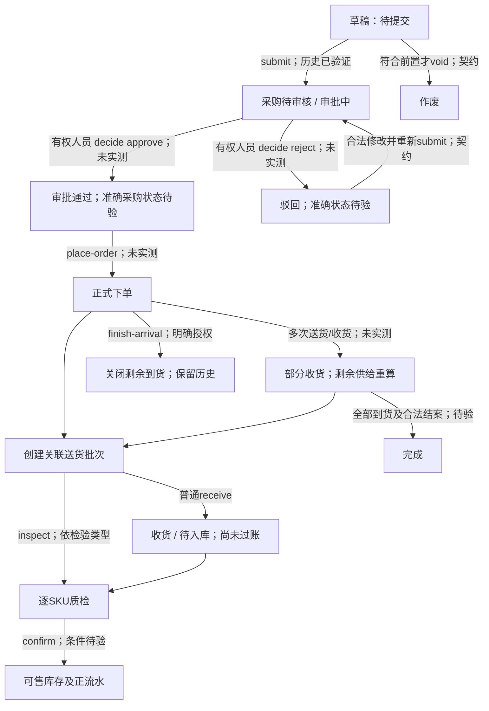

# P3 ERP采购能力验证与可行性分析

调查日期：2026-11-13（Asia/Shanghai）。执行人：Codex，单人。任务：`D-S01-P3-ERP-SURVEY-01`，状态只读 [TASKS](../TASKS.md)。分支 `codex/p3-erp-capability-survey`，最新 main/origin/main 基点 `db13298f7f85efbffa6e034bc3d7d2262de26e39`。未修改 P1/P2 算法、前端、ERP 数据或模型配置。

## 1. 结论摘要

**ERP 有通过正式 API 完成“采购申请→审批→下单→送货→收货/质检→库存确认”的契约基础，但我们尚未合法实测完整采购闭环，不能宣布 48→16+32 已成功。** 本轮只有认证和读取：36 次 HTTP 尝试，其中认证 4 次、GET 32 次（含契约探测），业务变更 0、模型 0。失败及不足均保留。

已经证实的是：自有仓库可以不传采购 ID 查询采购列表，返回商品明细；自有 36 件采购仍为“待审核”，关联审批“审批中”，已收 0、待收 36，计划到货 2026-11-15。采购、审批详情与独立回读一致。**待收 36 不等于有效在途 36**。36 也不满足箱规 8，不应直接审批。当前可售余额仍为快充线 6、马克杯 81；原销售出库凭证对应两条真实负流水可读取。

最主要的 P2/P3 缺口有四项：

1. D01 正式监控只读预登记 `purchaseIds`，不是自动发现；名单为空就构造空集合，无法证明 ERP 没有新采购。现有清单不可作为提交前冲突检查。
2. 采购 API 没有明确结构化店铺、销售备货用途字段；当前权限目录的源端行级隔离支持列表也不包含采购单。完整同范围归属及其他人员新增采购尚未闭环。
3. D02 自有数据适配没有正式下单/部分收货的有效剩余供给与可售 ETA 映射；已收待检待入库需要另行表示，不能丢失或重复计供给。采购正向入库还会触发当前仅支持销售扣减的库存对账保护。
4. B01 可按已规范化供给的可售日期逐日计算；B02 对“总量够但晚到、中间缺货”只给风险，不给补救数量。首版可展示风险报告，但该类可执行建议仍缺策略，不能据此宣称无需补货。

建议先落实正式审批人与范围/用途/可售日期证据，再授权一张独立、满足 MOQ/整箱的 48 件采购做 16+32 闭环。不要在旧 36 件上代签决定或直接改累计数。本报告交 REVIEW，不启动 P3。

## 2. 证据标准与调查边界

| 标记 | 本报告含义 |
|---|---|
| VERIFIED | 真实教学 ERP 已验证；仅覆盖所列账号、范围、样本和操作 |
| CONTRACT_ONLY | 本地接口契约支持，相关业务动作尚未实测 |
| BLOCKED | 已知授权、权限或业务前置条件阻挡实测；不表示 ERP 不支持 |
| NOT_SUPPORTED | 对明确的接口/调用方式有不支持证据，不扩大到整个 ERP |
| UNKNOWN | 当前证据不足，需补充核验 |

代码检查和离线 PASS 另标“离线”，不使用 VERIFIED 冒充真实 ERP。来源统一为 `SIMULATED_BUSINESS_DATA_IN_TEACHING_ERP`；这是真实教学 API 中的仿真经营事实，不是现实交易或企业准入。

本地未跟踪 `docs/ERP-openapi.yaml` 原样保留，内容为 JSON，版本 5.1.0，SHA256 `15f7fd5da950860d1a84cb4dda038b7165fa493914c5eb42dd7b265f18b8e128`，与 P3 准备所读版本一致。本次 `/api/v1/data-contract` 的资源 schema 摘要仍与历史值一致；这不证明所有 workflow 实现与本地文档逐项相同。尝试 GET `/openapi.json` 返回 404，部署 OpenAPI 获取路径 UNKNOWN，不能因此认定采购接口不存在。

证据入口：[summary.json](../evidence/P3-ERP-CAPABILITY/summary.json)、[离线结果](../evidence/P3-ERP-CAPABILITY/offline-results.json)。摘要列出每次请求路径、状态、时间、响应 SHA256 和私有原文定位，不公开认证响应、凭据或其他角色资料。`R2:n` 表示第二轮只读探测第 n 次调用，`S:n` 为补充探测，`L:n` 为精确流水探测；完整定位见 summary.runs。

## 3. 采购接口能力矩阵

以下路径均相对于固定教学 ERP。GET 空集合只证明该次查询所涵盖范围，不证明所有采购或所有状态不存在。

| 接口 | 契约/字段或效果 | 验证结果与边界 |
|---|---|---|
| GET `/api/v1/purchase-orders` | `limit/offset`、`field/q/match`、`warehouse_name/status_text`，`items/total`，内含 `item_list` | **VERIFIED**：自有仓库不带 ids 返回 1398；精确仓库字段与直接仓库参数结果一致。状态筛选待审核 1、待提交 0。R2:8—10、S:3—4 |
| 同接口 `field=sku&match=exact` | 商品在明细，头字段无 sku | **NOT_SUPPORTED**：此精确查询方式 HTTP400“精确查询需要指定有效字段”（R2:18）；不表示不能通过分页明细发现 |
| GET `/api/v1/purchase-orders/{id}` | 单头/明细/累计/计划到货 | **VERIFIED**：1398 多次独立详情一致，R2:11/20、L:4 |
| GET `/api/v1/record-context/purchase-orders/{id}` | `record/items/related/timeline` | **VERIFIED**：关联仓库308、商品218、审批1806和提交节点。契约限制最多40关联、每关系30候选，不可替代完整采购/收货发现 |
| POST `/api/v1/purchase-orders` | 仅合法待提交草稿；普通 CRUD 不自动过账 | **VERIFIED（历史自建样本）**：旧批次正式创建并独立回读1398；本轮不新建。当前契约所有字段组合不据此全验收 |
| PUT `/api/v1/purchase-orders/{id}` | 草稿可维护；审批后核心字段锁定，预计到货/备注等有限维护 | **CONTRACT_ONLY**；本轮未修改数量、日期或其他字段 |
| POST `/api/v1/workflows/purchase-orders/{id}/submit` | `{}`，提交审批，驳回可重提，同状态复用 | **VERIFIED（历史自有流程及本轮回读）**：1398提交节点与1806审批时间一致；未新发submit |
| GET `/api/v1/approvals`、`/{id}` | `business_no/business_type/status_text/submitted_at/decided_at` | **VERIFIED**：按原采购业务号查询1806，列表与详情一致，未决定；R2:13—14 |
| POST `/api/v1/workflows/approvals/{id}/decide` | 必填 `{"decision":"approve"}` 或 `{"decision":"reject"}`，决定不可反转；关联采购/FBA计划必须存在 | **CONTRACT_ONLY；实际执行 BLOCKED**：本轮无代签授权，未发送，包括无效请求探测也未做 |
| POST `/api/v1/workflows/purchase-orders/{id}/place-order` | `{}`，已审批且合法状态才下单；保留审计，非外部交易接口 | **CONTRACT_ONLY（成功链）**；旧待审1398调用409为历史已知保护，本轮未重复当故障或重发 |
| POST `/api/v1/workflows/purchase-orders/{id}/void` | `{}`，无到货/入库时合法作废，审计/同状态幂等 | **CONTRACT_ONLY**；是否允许作废当前待审单及如何收束旧审批需授权实测 |
| GET `/api/v1/purchase-amendments` | `purchase_id/state` 等，变更链可读 | **VERIFIED（读取及空集合）**：1398无变更。变更创建→submit→approve/reject→apply为 **CONTRACT_ONLY**，有独立权限 |
| GET/POST `/api/v1/supplier-deliveries`，GET `/{id}` | 按采购业务号关联，逐SKU `item_list`、`total_qty/received_qty` | 列表 **VERIFIED**：自有采购返回0；创建/详情业务样本 **CONTRACT_ONLY** |
| POST `/api/v1/workflows/supplier-deliveries/{id}/receive` | 普通收货产生待入库单，不自动过账；禁止累计超收；重复复用；多SKU部分收货要逐SKU数量 | **CONTRACT_ONLY；执行 BLOCKED**。requestBody只给开放对象，实际部分量请求契约需先确认，不能猜 `received_qty` 参数 |
| POST `/api/v1/workflows/supplier-deliveries/{id}/inspect` | `item_list:[{sku,available_qty,defective_qty}]`，逐SKU质检；供应商预检不能直接 receive | **CONTRACT_ONLY；执行 BLOCKED** |
| GET `/api/v1/inbound-orders`、`/{id}` | `purchase_order_sn/quantity/available_qty/defective_qty/qc_status/item_list` | 列表 **VERIFIED**：1398关联0；非空采购入库详情/状态 **CONTRACT_ONLY** |
| POST `/api/v1/stock/inbound-orders/confirm` | `{"ids":[入库单ID]}`，逐单事务，`data.fail/failList/reused` | **CONTRACT_ONLY；执行 BLOCKED**。不能仅看HTTP200或code=0 |
| GET `/api/v1/inventory` | `quantity/available`及店仓/商品关系 | **VERIFIED**：1137为6/6，1138为81/81；不是采购入库正向实测 |
| GET `/api/v1/stock/ledger` | `resource/record_id` 或 `sku/warehouse_name` 等 | **VERIFIED（精确原销售凭证）**：L:3返回两条负流水。宽SKU+仓查询12秒超时，宽集合完整性 **UNKNOWN**；没有采购正流水证据 |
| POST `/api/v1/workflows/purchase-orders/{id}/payment-history` | 文档明确为空体只读结算视图，包含 `arrival_closure.cancelled_qty` | **CONTRACT_ONLY**：虽然为查询，本轮未调用；不将缺少取消量当0 |
| POST 同前缀 `finish-arrival` | `{"reason":"..."}`，结束剩余到货，保留已收/付款并阻止后续收货 | **CONTRACT_ONLY；执行 BLOCKED**，不是普通撤销/可逆测试动作 |

### A. 能否自动完整发现采购

当前样本证明：可以按已核验仓库列采购，再过滤 `item_list[].sku`，无需业务人员提供采购 ID。查询没加供应商或创建人条件；未来不能因供应商不同排除冲突。自有样本只含一张单、一条SKU行，故**多张非空分页、多SKU行、其他人员直接ERP新增单均 UNKNOWN**。接口契约支持有界分页，跨人员能力有基础但尚无对应实测，不因这次只查到旧单就宣称完整验证。

建议未来采集流程：先解析授权租户和精确仓库ID→独立核验仓名→在该范围按合法分页读取所有相关状态（不得仅查已下单或近期日期）→校验总数/分页偏移/去重/明细覆盖/租户/仓关系→逐SKU匹配→补齐店铺、用途、审批及收货关联→形成有版本的本次关系证据。`purchase_user`是业务字段，不是创建人认证或归属证明。没有本地源码可证明服务端稳定排序/快照隔离，不能假定两页间不漂移。

发现的单据作为既有监控SKU的关联业务事实核验和留痕，不自动增加监控SKU、仓库或扩大共享租户范围。仅依赖人工预登记采购ID不满足新要求；这一关系发现变更需后续评审现有范围契约。当前调查未改注册表。

分页超限、total改变、空页提前、重复/冲突ID、未知状态、明细不完整、店铺/用途不明、接口故障：明确标记覆盖不足并保留缺口报告，不返回“无采购”。分析可输出受限报告；完整有效在途计算依赖必要证据。只有确认“同范围待审批”才触发产品重复提交阻断；无法核验是独立的数据/权限安全阻断，不能偷换成“任何草稿都阻断”。

## 4. 采购完整状态机与权限

下图是**契约流程图**，非已实测状态枚举。当前真实字面值只确认旧草稿“待提交”（历史）、采购“待审核”和审批“审批中”。批准后、下单后、部分/完成/驳回/作废的准确 `status_text` 尚未实测，不在适配层预先冻结。

质检顺序由供应商预检/仓库质检类型决定，图不表示所有场景固定“先收后检”。是否还存在独立上架/可售放行，及 `confirm` 对质检门的精确校验，均 UNKNOWN；不能从字段名承诺即时可售。

### 权限矩阵

本轮 `/me` **VERIFIED** 当前为 administrator、`permissions=["*"]`，技术上广权不等于业务上可代签。`/access/catalog` 与 `/access/roles` 已真实读取；下表是目录/角色配置观察，**未切换账号验证各角色执行**，普通账号是否另有成本字段/行级限制仍需实测。不公开自定义角色或他人账号详情。

| 动作 | 目录权限 | 观察到的标准角色/当前边界 |
|---|---|---|
| 采购列表/详情 | `purchase-orders:read`；金额还涉及 `costs:read` | purchasing、finance具备；标准readonly/operator/warehouse当前未含该采购读取权限，不能按名字推断 |
| 采购创建/编辑 | `purchase-orders:write`，金额维护涉及 `costs:write` | purchasing；本轮未写 |
| 提交 / 下单 / 作废 / 结束到货 | `purchase-orders:action:submit/place-order/void/finish-arrival` | purchasing包含；本轮禁止执行 |
| 审批查看 | `approvals:read` | 多个标准角色包含；本轮当前账号读取成功 |
| 审批决定 | `approvals:action:decide` | 所读标准角色均未见该动作；administrator通配。真正独立审批人/授权安排 **BLOCKED**，不可伪装approver文本 |
| 送货创建/收货/质检 | `supplier-deliveries:write`、`:action:receive/inspect` | warehouse有receive/inspect，purchasing仅相关维护；本轮均未执行 |
| 入库确认 | `inbound-orders:action:confirm` | warehouse包含；本轮未执行 |
| 流水 / 付款历史 | `stock:read` / `purchase-orders:action:payment-history` | 标准基础角色/finance；精确原出库流水当前账号实测成功，付款历史未实测 |
| 采购变更申请/审核/应用 | `purchase-amendments:create/submit/approve/reject/apply` | 目录存在，当前普通角色分配与实际执行待专门落实，不自动授予 |

当前 `scope_supported_resources` 有inventory、inbound、sales、warehouse等，**没有purchase-orders、approvals、supplier-deliveries**；目录说明对受限账号无法安全映射的接口返回403。结论是采购端行级隔离/受限账号可用性 UNKNOWN，有目录风险证据；不是已经用受限账号证明“不支持”。须老师确认独立账号/租户或源端隔离方案。不得为通过测试创建账号、改角色或读取其他人的业务记录。

## 5. 采购数量、到货与可售字段映射

| 含义 | ERP来源与证据 | 进入计算的条件/缺口 |
|---|---|---|
| 金额 | `purchase-orders.amount`，明细 `unit_price/amount` | 与quantity分开；本样本86.4 USD=36×2.4，不能作为数量 |
| 采购SKU数量 | `item_list[].sku/quantity` | **VERIFIED** 当前单SKU36；头没有独立可靠总采购quantity。多SKU按真实行定位，不把头累计分摊到每个SKU |
| 头已收/未收 | `received_qty=0/pending_qty=36` | **VERIFIED** 字段值；待审也有pending，故不能直接映射有效在途。逐SKU累计受控来源尚待验 |
| 取消/关闭未到数量 | `PurchaseSettlement.arrival_closure.cancelled_qty` | **CONTRACT_ONLY**；需查询结算/关闭及逐行关联。不能始终用“订购−已收”忽略结束到货 |
| 计划到货 | 采购头 `planned_arrival="2026-11-15"` | **VERIFIED** 可读日期；不是供应商承诺或可售日期。日期时区、边界和变更审计须落实 |
| 设置/更新日期 | Write schema `planned_arrival`；审批后预计到货允许有限维护，变更提案也含此字段 | **CONTRACT_ONLY**，本轮未改；普通修改或变更流程按当时合法阶段选择 |
| 行级到货日期 | `item_list`为开放对象，无明确强类型日期字段 | **UNKNOWN**；开放对象不等于服务端承诺支持逐行日期语义 |
| 供应商承诺交期 | 没有明确 `supplier_confirmed_arrival` 等命名字段/回执 | **UNKNOWN**，需要老师/供应商流程证据，不能用报价lead_days代替 |
| 送货数量/实收 | delivery `item_list/total_qty/received_qty` | **CONTRACT_ONLY**；同采购多次送货及逐SKU分配要实测 |
| 待检、良品、不良 | inbound `inspected_qty/available_qty/defective_qty/qc_status`，delivery `inspection_type/qc_status` | **CONTRACT_ONLY**；已收到、已良品、已过账分别核验 |
| 当前物理/可售 | inventory `quantity/available`，当前6/6与81/81 | **VERIFIED** 当前余额；不能把收货回执直接加到available |
| 采购入库凭证 | inbound确认与stock ledger正流水 | **CONTRACT_ONLY**，目前只有原销售负流水真实证据 |
| 审批时间 | approval `submitted_at/decided_at` | **VERIFIED** 提交2026-11-13T05:23:17+00:00（北京时间13:23:17），决定为空 |
| 正式下单时间 | `order_time`及准确place-order审计节点 | 本样本order_time为2026-11-10但采购11月13日才创建且仍待审，**VERIFIED** 不能拿该字段当实际下单事件；成功下单时间证据 **UNKNOWN** |

规范化有效供给至少需要真实行身份、同租户/商品/店仓/销售用途、已正式生效的采购状态、未关闭/取消剩余、独立回读的逐行数量，以及可信**预计可售日期**。审批通过待下单不因本条待审批规则阻断，但不自动当有效已下单供给。

部分收货时应分三段核对：仍未收到的采购剩余；已收到但尚未可售的待检/入库批次；已入可售库存。后两者不能都算在途，也不能把待入库批次完全遗漏。必要时形成不同日期的规范化供给行，来源共用真实采购行并保留批次身份，防止D02按同一supplyId误去重。具体拆分键与可售规则须后续评审，不改B01公式。

## 6. 真实验证及尚不能验证的分批收货

| 观察 | 最小证据 | 标记 |
|---|---|---|
| 仓库发现与边界页 | R2:8 limit1/offset0 total1；R2:9 offset1返回空、total仍1；R2:10直接仓参数同一ID | VERIFIED；非空多页 UNKNOWN |
| SKU精确过滤 | R2:18 HTTP400 | NOT_SUPPORTED（仅此查询方式） |
| 关联采购/审批 | R2:11/12/13/14/20与L:4：1398↔1806，36件待审、独立回读无状态漂移 | VERIFIED；店铺/用途仍非结构化证明 |
| 送货、入库、变更 | R2:15/16/17，各total0 | VERIFIED（该查询返回空），非业务动作成功 |
| 当前库存 | R2:19，真实inventory ID1137/1138 | VERIFIED（6、81）；本轮不重新跑模型/浏览器建议 |
| 原销售业务凭证/流水 | L:2 sale1153929→outbound1135474；L:3 ledger1268669/1268670分别−9/−4，前后余额差正确 | VERIFIED（出库）；不能替代采购正流水 |
| 宽范围ledger查询故障 | S:5按自有SKU/仓，12秒TimeoutError；无响应正文 | UNKNOWN（完整集合），原失败保留；改用原凭证精确GET200，不宣称宽查询恢复 |
| 调查脚本首轮错误 | 首轮仓库字段名KeyError，认证1+GET6后停止；修正name另开R2 | 辅助脚本FAIL保留，不是ERP业务失败，零变更 |

48→16+32 各步骤均**未执行**。契约说明允许累计防超收、单SKU部分收货、多SKU逐行送货、重复复用及显式入库确认，但仍存在需老师/有权人员配合的实测空白：

1. 独立48件合规草稿（MOQ12、箱规8）由授权业务人员提交；有权审批人实际决定approve，独立GET采购/审批/时间线核对准确状态、时间和ID，再由采购角色place-order。旧36不得直接批准；合法void/修正/重提需另批并检查原审批最终状态。
2. 先确认receive真实请求体。优先建立同采购下独立送货批次16，明确 `item_list=[{sku,quantity:16}]`、total16，按实际检验类型走inspect/receive，不伪写累计。分别GET送货、采购、入库，确认头/行实收16及剩余32，核对可售库存是否尚未变化。
3. 由仓库合法确认良品入库，检查逐项failList和正流水、库存增量16；再创建第二批32，沿同流程确认剩余0、库存累计增量48。每阶段单独回读，不只看最终余额。若有不良品/未检，应按真实数量和可售条件调整预期，不能强行要求全可售。
4. 在明确获准后以**同一原单据**重放receive/confirm，验证reused且唯一库存流水、余额无重复增加；模拟超收/多SKU分配/并发需单列有界负例，不在业务样本上猜参数或绕状态机。超时先查原送货和入库/ledger再决定，不新建第二单重试。
5. 采购头累计、逐SKU累计、批次库存/流水和取消/关闭历史交叉对账；任一超收、漏算、重复、来源漂移或不完整就停止，保留FAIL，不推进下一步。付款/外部发货通知不属于该验证方案。

## 7. 现有 D01/D02/B01/B02 差距与十场景

代码定位：[D01自有采集](../../src/commerce_hub/data/sync/owned.py)、[D02自有投影](../../src/commerce_hub/data/projection/owned.py)、[规范化去重](../../src/commerce_hub/data/projection/__init__.py)、[D03质量](../../src/commerce_hub/data/quality/__init__.py)、[B01](../../src/commerce_hub/capabilities/metrics/__init__.py)、[B02](../../src/commerce_hub/capabilities/forecasting/__init__.py)。本轮91项相关离线测试PASS，0失败/错误/跳过；另有10组规范化场景和8种自有状态输入观察，均明确离线，不构造ERP成功结果。

| 场景 | 当前能力与证据 | 差距/ERP结论 |
|---|---|---|
| 1 无采购 | 自有空purchaseIds可计算；离线规范化55库存、90需求、MOQ12/箱规8→40件 | 空登记不等于源无采购；真实完整无采购发现 UNKNOWN。40是独立工程例，不改原48 |
| 2 未提交草稿 | 自有适配排除草稿、在途0，离线PASS；历史ERP待提交存在 | 不应触发待审阻断；P3提交守卫尚未实现，不能因草稿存在阻止 |
| 3 同范围待审批 | 自有待审36排除在途、P1/P2报告仍可生成；真实状态 VERIFIED | 新建/提交守卫未实现；已确认同范围才按产品规则阻断，范围未知单独提示核验失败 |
| 4 已下单且及时足量 | B01/B02规范化OPEN48、及时日期：gap0、无缺货、无候选，离线PASS | 自有D02遇非白名单状态整体阻断，尚无真实ERP有效在途正向计算；CONTRACT_ONLY/UNKNOWN |
| 5 已下单但晚到 | 同OPEN48晚至2026-11-21：总gap0、11月18日起中间缺货、无候选，离线PASS | `INTERMEDIATE_SHORTAGE_POLICY_UNDEFINED`：只能报告风险，补救建议不可用；真实链UNKNOWN |
| 6 部分收货 | 离线假设55+已可售16=71、未收32，只算在途32，期末13；未把16再算供给 | 仅规范化假设，ERP16+32未实测；待检批次/日期/入库对账缺口，BLOCKED（执行授权） |
| 7 取消或驳回 | 规范化CANCELLED剩余0不计供给；自有“已取消”排除，离线PASS | 当前自有“已驳回”输入会整体BLOCK，而非仅排除；需真实状态映射，驳回并非应永久挡分析 |
| 8 多张采购、不重复 | 两独立规范化供给行24+24=48；同supplyId相同镜像去重WARN、冲突BLOCK，离线PASS | ERP行级唯一键/同SKU多行/多批收货拆分及多单分页UNKNOWN，不能只用orderId或sku去重 |
| 9 他仓/非销售用途 | 规范化外仓阻断离线PASS；真实仓库身份核验成功 | 自有D02强制登记供应商，可能错误挡合法其他供应商；用途映射未实现，不能把所有非销售采购忽略为无库存影响 |
| 10 分析后ERP变化 | 每个新分析任务重新采集，未知状态/覆盖不足已有质量阻断离线PASS | 没有P3确认/提交前重新查询/重算/版本比对动作；跨客户端检查与提交原子性UNKNOWN |

现有权威公式保持不变：B01按OPEN供给的availableDate先到货再减当日增量需求、负数结转；在途指标只含计算窗口内到货，不代表ERP全部未来在途；总缺口仍按目标需求减库存减窗口内有效供给。B02仍按MOQ/整箱构造并用同一B01评估候选。若总gap>0，即使候选仍有中途缺货，也保留评价风险；不能把“生成候选”解释为风险已解决。

可复用D01分页/只读传输、D02单位/身份/重复保护、D03不可变快照和质量门、D04证据、B01逐日评价、B02约束候选，以及G01/O01/G02权限/任务/审计。自有D02目前库存对账为“期初−已验证销售=当前库存”，新采购正流水必须补入合法对账来源；也要覆盖内部领用等非销售库存变动，不能改余额或删保护凑通过。不需要重写权威计算器或建立另一套通用执行平台。

## 8. P3 人工业务复核的实现条件

负责人本轮已确定的产品规则按 [DECISIONS](../DECISIONS.md) 本轮增量执行，不再把它们当待讨论规则：

| 环节 | 后续实现条件（本轮未开发） |
|---|---|
| 展示与复核 | 保存AI原数量、B01/B02快照/规则版本；业务人员可原样确认或输入最终量/调整原因，不覆盖原始结果 |
| 硬约束 | 服务端重新用有效报价MOQ与商品箱规验证最终数量、单位和关系；原因只留审计，不让LLM评价合理性 |
| 同范围守卫 | 按租户、SKU行、目标仓、销售备货用途及实际店铺关系完整查ERP；仅待领导审批触发重复新建/提交阻断。草稿、驳回、取消、完结不触发，已批准待下单/已下单不直接触发但要分析有效供给 |
| 范围与日期 | 来源ID/关系可追溯，不按供应商拆开冲突范围；用途不明、ETA不可信、分页不完整明确返回相应缺口。S01只创建销售备货采购，仍反映非销售出库对可售库存的影响 |
| 提交前重验 | 新鲜ERP查询和有效在途计算、MOQ/箱规/权限/版本/状态比对；变化时标旧建议失效/需重新确认，不能静默拿旧48提交 |
| 幂等和竞态 | 原业务键、最终确认修订号、ERP采购/审批ID与UNKNOWN恢复；需验证源端唯一键及是否有原子“检查待审+提交”能力。中台单机锁不能保证他人ERP同时提交不冲突 |
| 审批分离 | 中台业务复核不等于领导批准；正式提交后由合法独立审批人决定。创建/修改/提交与decide/place-order/receive/confirm分别授权，D01继续只读 |

本轮实际同范围产品守卫未实现，`procurementEligible=false`及企业四门BLOCKED保持；采购状态映射/晚到应对属于后续适配与策略评审，不能为测试通过修改公式。

## 9. 下一阶段可执行方案

**可以直接进入后续开发的明确内容（需负责人下一条P3开发指令，本轮不启动）：** 复用既有契约保存原建议/人工修订/原因，校验MOQ与整箱、权限/审计/版本和旧建议失效；明确“待审才冲突”的服务端守卫接口及完整性失败响应；在获准范围内实现采购分页/明细读取与证据留存的最小适配。范围/状态/日期未知应保持显式阻断，不先接通真实提交。

**需要先补充验证：** 自有范围多页、多单、多SKU和其他人员直接创建的采购发现；正式状态字面值及每行稳定ID；receive真实请求体；供应商承诺/计划到货/质检/可售日期区别；已收待入库批次和关闭剩余；48→16+32的独立回读/唯一正流水/幂等；有限故障、重复和并发检查。普通lead_days和头pending不能代替这些证据。可先完成离线适配，但不能签为ERP闭环。

**需要老师和有权业务人员配合：** 确定独立审批主体、采购/仓库角色和实际授权；确认采购店铺/销售用途的权威记录方法，采购/审批/送货行级范围如何隔离；明确旧36的合法收束方案；批准独立48件试验的创建、提交、决定、下单、送货、质检、入库及原单重放动作。独立账号若触发采购路由scope_denied，须源端解决或明确获准隔离方案，不能通过改角色/绕过权限取证。

最值得先做的是**“落实审批人和范围/可售语义→批准一张合规独立48件单→16+32全链路回读”**，该试验同时解除有效在途、部分收货和库存正流水三项核心未知。只开发P3按钮不能替代这些事实。晚到补救策略可另立小决策，未确定前保持风险报告，不许AI编造桥接采购量。

本轮全局规范已整合为 [ERP_SIMULATION_DATA_POLICY.md](../standards/ERP_SIMULATION_DATA_POLICY.md)，并在AGENTS引用；不另建数据管理平台。完成报告、证据、文档检查和本地提交后停止REVIEW；不合main、不自动执行采购或扩8/30SKU，不宣称S01整体验收。
