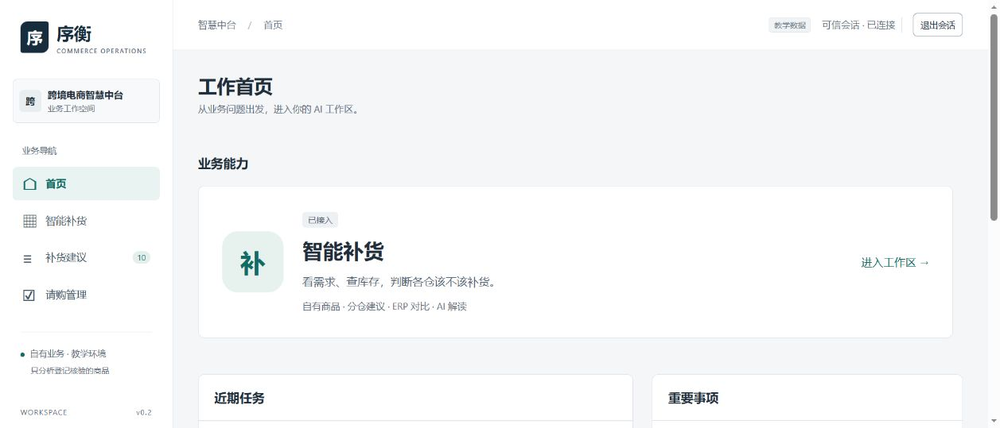
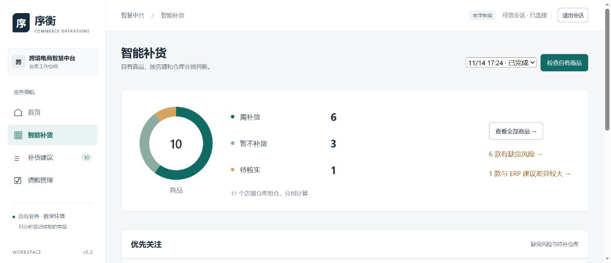
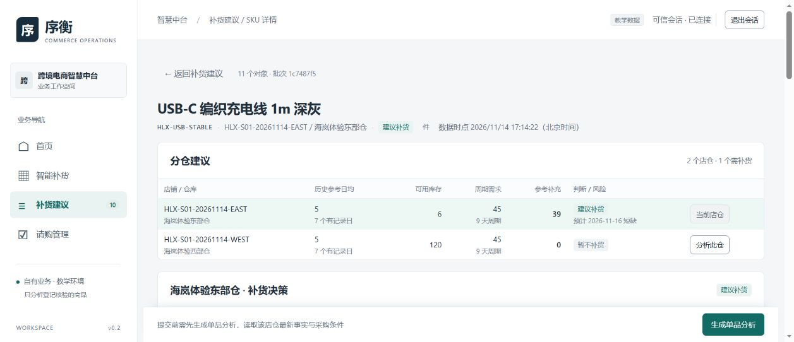

# S01 产品体验版：使用与评审

2026-11-14，`codex/s01-product-demand-rebuild`；固定实现 `6679d4e`。交付状态 **REVIEW**，等待产品负责人评审，不合 main。

## 打开与体验

当前持续运行入口：<http://localhost:5175/#/home>，API 8768。账号 `admin`，沿用本机原密码，默认会话 8 小时；以后在当前项目双击 `Start-Platform.cmd` 持续启动，停止使用 `Stop-Platform.cmd`。请使用本评审分支目录。

1. 首页只展示已接入的业务能力、近期任务和重要事项。点击「智能补货」进入独立工作区。
2. 本轮完整批次为 `1c7487f5868040099b2d2a32b309e867`：[打开工作区](http://localhost:5175/#/workbench?batch=1c7487f5868040099b2d2a32b309e867)。看到 **10 款商品、11 个店仓对象**；按商品统计为 6 款需补、3 款暂不补、1 款待核实。同一商品可以东仓缺、西仓足。
3. 进入「补货建议」，按下表搜索 SKU，打开分仓详情。先看库存与参考补充，再看历史销量图、ERP 对比和采购条件。参考补充量与满足 MOQ/整箱的采购候选分别展示。
4. 首页近期任务中已有线缆、阅读灯、收纳包三份真实 AI 解读，直接打开即可，无需重新付费生成。新建分析会联网重读最新业务事实。
5. 本轮验收未点击提交请购。分析和候选不代表已采购，人工确认与 ERP 审批仍独立。

## 场景逐个体验

以下为 11 月 14 日真实教学 ERP 回读结果，后续新增销售或库存变化会改变结论。新商品统一品牌「海岚优选」，保留正常商品名，仿真批次标识在业务键及审计中。

| 商品 / SKU | 型号 | 可用库存 | 体验重点与预期判断 |
|---|---|---:|---|
| USB-C 编织充电线 / `HLX-USB-STABLE` | HC60-1M-GY | 东 6 / 西 120 | 每仓连续 7 天稳定销售。东仓参考补 39、整箱候选 40；西仓补 0。ERP 东建议 16，差 23；西建议 0 一致。各仓独立计算。 |
| 帆布拉链收纳袋 / `HLX-TOTE-SAFE` | CT28-IV | 180 | 稳定销售但库存充足，补 0；ERP 建议 0 一致。 |
| USB 调光阅读灯 / `HLX-LAMP-SURGE` | DL5-WH | 8 | 逐日销量 2、2、3、4、8、12、16；参考补 53、候选 56。AI 提醒均值可能掩盖上涨，以及加急/调拨；ERP 无建议仍可分析。 |
| 304 随行杯 / `HLX-CUP-SLOW` | TC420-GN | 60 | 销量下降，最近可信记录已间隔 11 天；保留低可信历史参考，补 0，不因缺最新记录使分析失效。 |
| 软木双面桌垫 / `HLX-MAT-SPARSE` | DM6030-NT | 4 | 12 天跨度仅 4 个销售日期；区间参考日均 1、记录日均 3，明确未知日期；参考补 5、候选 8。 |
| 铝合金折叠手机支架 / `HLX-STAND-NEW` | PS90-SL | 1 | 仅一天售 2 件，样本少、可信度低；参考补 17、候选 20，不能当成稳定需求承诺。 |
| 双层数码收纳包 / `HLX-CASE-NOQUOTE` | EC22-NV | 3 | 有销量库存，但报价已停用；按明确的 14 天假设仍可看需求 56、参考补 53。无采购候选，不可提交；AI 解释先补齐有效采购依据。 |
| USB-C 四口扩展坞 / `HLX-HUB-PENDING` | UH4-GY | 10 | 只有未支付待审核订单，未出库；缺可信销售，待核实，不能把未支付数量当销量或把缺记录当零需求。 |
| 原 USB-C 100W 线缆 / `HL-CBL100-2M` | 保留原资料 | 6 | 参考补 45、候选 48，但既有 2 张待审核和 1 张正式采购触发防重复；采购用途/归属不明仍需核对。正式采购待收 48 未被擅自抵扣。 |
| 原陶瓷马克杯 / `HL-MUG350-WH` | 保留原资料 | 81 | 保留原历史，参考补 0。 |

数据范围严格为登记核验的自有商品。新增 8 款、9 个店仓关系，加旧 2 款共 10 款、11 对象；不是扫描共享约 150 万条订单后的结果。

## 真实数据与模型验证

通过正式教学 API 创建/补全批次 `HLX-S01-20261114`，登记数据集 `hailan-s01-experience-20261114`。商品补齐品牌、型号、分类、材质、规格、尺寸重量、包装及采购资料，Listing、供应商/报价、销售、财务凭证、出库与库存关系均独立回读。22 笔已支付并发货销售、47 条库存流水完成归属与余额核验；另 1 笔未支付单明确排除。保留旧两款有效资料及历史。本轮 **0 采购写入**，无请购提交、审批、下单或采购收货。

历史销售保留 10 USD 教学促销价，当前挂牌价与报价成本已补齐；不倒改已过账金额。ERP 建议 706/707/708 是明确标记的人工仿真场景，验证对比能力，不能当成 ERP 自动预测算法实测。真实对象 ID、逐仓关系及清理定位见 [dataset.json](../evidence/S01-PRODUCT-EXPERIENCE/dataset.json)。已过账对象清理需要另行授权并遵循 ERP 状态机，不直接删除流水。

最终批次 42 次 HTTP 均 200，批量 0 模型、0 业务写；真实 MySQL 中封存报告指纹、回读和发布审核通过。三次当前真实配置 `deepseek-flash` 均成功，共 **7,225 Token**（线缆 2,362、收纳包 2,299、阅读灯 2,564）；费用仍 **UNKNOWN**，本轮 $0.15 风险预约保留，旧授权及未知费用不清零。建议引用真实库存、销量、仓库、ERP 差值和采购约束，LLM 不计算权威数量。

请购异步回读中或失败时关闭提交；结果未知不能通过新分析绕过，同业务对象由后端串行保护。真实旧线缆采购用于页面防重复验收；丢响应/UNKNOWN/并发等异常采用隔离 ERP 样例与真实 MySQL 定向测试，未制造真实未知提交。

固定实现后受影响后端 **65 PASS**、前端 **60 PASS**、类型与生产构建通过。此前兼容 39 PASS 在最后两个修复前执行，另行标记，不冒充新版本全量回归。历史失败证据保留。详情见 [verification.json](../evidence/S01-PRODUCT-EXPERIENCE/verification.json)。

## 实际界面

首页：

补货工作区：

同款双仓：

## 影响体验的剩余问题

- 教学租户共享，其他人可能修改业务对象；应用登记控制分析范围，不能保证 ERP 侧独占。
- 新销售记录须通过现有登记核验流程纳入，当前不自动扫描共享历史。图片与 HS 编码同旧两款一样尚未提供，不虚构认证资料。
- 旧批次 `55872f18…` 保留了修复前浮点尾差导致的报告校验失败。请用上方最终批次或重新检查；历史报告未篡改。
- 请购管理沿用最近 20 个单品任务逐条回读；未核实在途不抵扣，不提供自动审批/下单。企业正式业务准入与有效在途正向净扣仍未签认。
