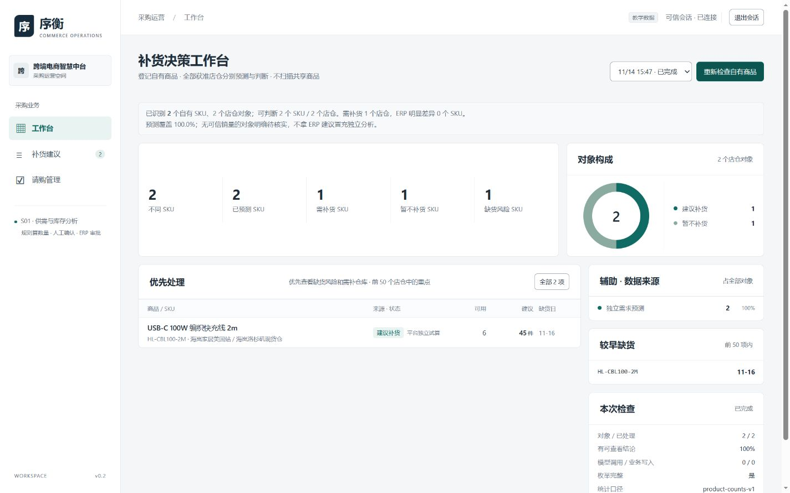
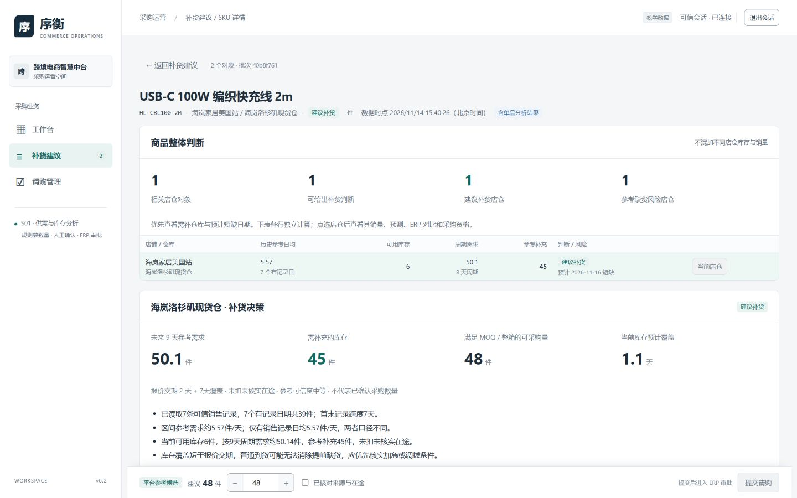

# S01 自有商品补货决策产品交付

2026-11-14；`D-S01-PRODUCT-01`，最终交负责人和星星产品评审，REVIEW，不合main。基线为已含WorkBuddy V3的远端main `f9bc45f721c961774bbc40bad19f8786519ad449`；实现 `ce50e51`、修复 `617fee3`，最终页面文案 `3219ce0`。唯一验收台账为TASKS，本报告不代签负责人接受。

## 产品结果

根据负责人“那就用自有商品吧”的最新决定，当前仅分析已登记并核验的两款商品及全部登记店仓。真实清单为2SKU、2个SKU×店铺×仓库对象，实际同属1店1仓；两者均能形成独立需求预测和补货判断。没有扫描共享百万订单、自动纳入未登记仓或扩8/30SKU。

| 自有商品 | 历史销量与范围 | 当前可用 | 主规划需求 | 参考补充库存 | 采购候选 | 判断 |
|---|---|---:|---:|---:|---:|---|
| HL-CBL100-2M 快充线 | 11/06—11/12，7有记录日/39件 | 6 | 9天约50.14件 | 45 | 48，MOQ12/整箱8 | 建议补货；参考覆盖约1.1天，短于报价交期2天 |
| HL-MUG350-WH 马克杯 | 11/06—11/12，7有记录日/19件 | 81 | 11天约29.86件 | 0 | 无正采购候选 | 当前暂不补货；参考覆盖约29.8天 |

ERP均未提供适用原生建议，页面明确显示“ERP未提供”，不作为零件建议；平台照常形成上述结果。可比ERP有量、零量、冲突及算法未知用隔离样例验证，未冒称这两SKU具备真实ERP有量正样本。

最终真实批次 `40b8f761dbb44fa997b0d842c5a598d7` 从页面发起，经真实API、独立Worker、MySQL和教学ERP完成；15HTTP、全部200，采集11.76秒，0模型/0ERP业务写。7张登记订单同时包含两SKU，完整按精确ID读取，不把7张单误计成14张。平台统计为预测2SKU/2对象、可判断2SKU/2对象、需补1、不补1、风险1。

单品刷新 `559bcb30d0234a258f5e39b29f3d940f` 为13HTTP、`explainAI=false`、0模型/0ERP写，仍为45参考/48候选。MySQL模型尝试与预算、采集方法、每份原始捕获SHA独立回读核对；原始响应留在Git忽略私有目录，公开证据为教学字段投影。

前期自有探查及首轮批次各15HTTP；首轮发现周期小数向上取整误多1件后，修正为累计需求舍入再逐日差分，保留B01/B02公式。最终7天线缆需求39/库存6，参考33件；14天需求78/参考72件。最终主周期45/候选48未变。先前共享调查取消记录仍保留，不用它的221SKU/977对象充当当前交付覆盖数。

## 使用与旧版改善

工作台先显示需补、不补、风险与逐仓任务；点击KPI进入一致的商品筛选。商品详情包含全部已登记店仓表、每仓历史与周期情景、库存曲线、原因、ERP对比和采购资格。列表按SKU聚合，库存与销量不跨仓混算。单品无AI刷新、显式AI解读分开。

| 原行为 | 本版行为 |
|---|---|
| 最新完整日缺销量，两自有SKU只能显示历史参考 | 使用全部登记可信历史，不要求连续到昨天；今天没有新单仍可形成有假设的参考判断 |
| 供应商/MOQ/报价缺失导致分析与执行一起停 | 预测、库存补充、采购候选、人工最终量分开；采购缺口不阻止需求试算 |
| 规则/ERP来源和技术质量主导首页 | 显示SKU与店仓口径、需补/不补/风险、优先仓库；来源作为辅助 |
| ERP无建议时缺少独立业务结论 | 平台先按历史/库存计算，再独立比较ERP；不编造ERP算法 |
| 单品刷新与调用模型容易混淆 | 默认不调用AI，只有明确“生成AI解读”才尝试模型；无模型仍有规则解释 |

具体步骤见[简洁使用说明](../runbooks/s01-product-demand.md)。日常双击Start-Platform，使用原本机admin密码。本轮评审实例localhost:5175/API8768，持续启动并保留历史；其他旧端口实例不会自动切成本分支。没有修改或重置真实密码。

## 真实页面验证

Edge复用了有效admin会话，验证服务重启/页面刷新恢复、工作台→业务筛选→两SKU详情→逐仓表→ERP对比→规则说明→无AI单品刷新→采购资格。已验证49件不满足整箱倍数，提交保持禁用；恢复48件后仍需人工勾选确认。本轮没有点击提交、创建采购、审批、下单或收货。

1440×900和1024×768已检视，页面无整体横向溢出，宽表保留内部滚动；浏览器console error为0。长页截图超时，已保存可读的实际视口截图，不伪造长截图。未重新输入真实admin密码；独立鉴权集成测试覆盖密码登录，本轮真实会话复用与重启恢复分别记录，不混称重新登录实测。

ERP对比、马克杯、1024布局、采购约束截图与DOM见 `docs/evidence/S01-PRODUCT/`。真实AI本轮未新增付费调用；显式AI合成网关测试通过，规则业务解释已真实展示，不沿用历史付费记录冒称本版真实AI验收。

## 回归与工程边界

固定617fee3后全量后端860项：859通过、1项基础队列瞬时领取返回None失败（`test_explicit_new_owner_version_can_start_without_old_delivery_rebinding`），没有错误或跳过；随后原样复验该基础组40项全部通过，未改队列实现或删断言。疑似共享运行环境瞬时锁竞争，根因未证明，**不是一次全绿回归**。原始FAIL与复验XML/输出完整保留，交独立评审关注。首轮859项的5FAIL也保留：4个历史兼容测试显式固定为旧采集版本后断言原样通过，另1个基础队列瞬时失败复验通过。

本版自有Handler/API/单品/聚合筛选、采购前同范围重读、漂移拦截和安全Mock请购幂等路径通过。最终测试提交679a846另增显式AI业务解释及有Provider仍禁止无AI刷新调用的合成验证，产品定向25项通过；这条新用例不在先前860全量数量内。单位测试另覆盖缺报价仍预测、库存缺失只预测、稀疏/陈旧/状态/重复冲突、跨仓隔离、ERP有无/冲突，以及不凭空填零。1000SKU与部分结果崩溃恢复工程测试在上述全量中通过；它们是合成ERP+真实隔离MySQL，不能称为1000真实自有SKU或真实多仓验收。前端53项、类型与生产构建在3219ce0通过。文档生成与18项检查通过；具体命令和原始结果见verification.json及XML。

## 已知限制与评审重点

- 只覆盖登记salesIds的全部历史。未来新增订单、商品或店仓须走既有登记/核验流程，不会自动扫描租户补入；不宣称全部相关订单已被发现。
- 真实自有清单只有一个仓。多仓独立计算与SKU统计有隔离样例验证，真实多仓验收仍缺正样本。
- 需求是可解释参考估计，不是企业已签认预测。未知日期不填零；以首末记录跨度作参考分母，同时显示有记录日均情景、样本年龄和假设。
- 当前库存以唯一登记记录的ERP available字段为准；不声称全历史守恒已通过，多记录不擅自合计。接口之间非原子快照。
- 已读取线缆正式采购48件，但可售日期/店铺归属未确认，未抵扣；采购人员必须核对，参考45和候选48均不是自动应采购数量或已审批数量。
- 原有请购台账仍是最近20条单品分析逐条回读，非ERP全量采购清单。本轮未整体重构此模块。
- 四企业门保持BLOCKED。本轮教学产品验证完成并提交REVIEW，负责人/星星接受待办；不自动合main。
