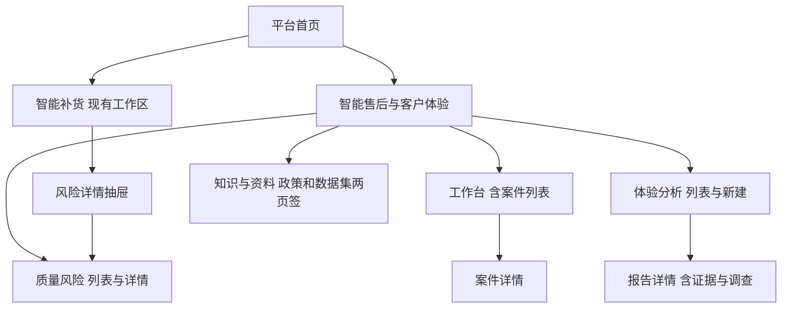
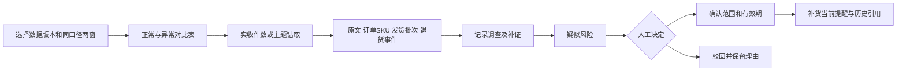

# B V1.0 产品操作与界面设计

2026-11-16，产品设计待评审，非已上线页面。需求：[B-REQ-001](../requirements/B_AFTER_SALES_V1.md)；实现细节：[B-DES-001](../agents/B_AFTER_SALES_DESIGN.md)。延续现有App/V2Shell/HomePage、hash路由和DESIGN.md，正式Vue页面不在本轮范围。

## 1. 使用者的一天

客服登录平台，在首页进入“智能售后与客户体验”，首先看今天要处理的案件和安全升级事项。打开案件后，左侧读客户原话，中间核实商品及订单证据，右侧修订回复草稿。审核保存后重开，仍能区分客户主张、AI原稿和实际人工决定；系统没有外发或退款执行入口。

运营在同一工作区切换“体验分析”，选教学数据版本和商品店铺，明确两窗与成熟度。结果把正常商品和异常商品放在同口径表中，点实收件数能看到构成它的退货收货事件，再点回发货批次和原文；从“待调查异常”创建调查，不把异常当缺陷。

质量人员沿调查补证，确认适用商品、单店及仓库范围后显式确认风险。采购仍在原补货工作区，单品和批量都能看到当前适用提醒；打开证据抽屉后回到原商品、筛选、批次和采购编辑状态，原数量及采购资格保持不变。

## 2. 信息架构



平台首页仅展示已有模块入口和各模块最近任务，不拼一套跨来源统计。导航上层为“平台首页／智能补货／智能售后”，工作区内才出现业务子导航。未来模块按同一入口配置添加，不提前显示利润／广告空页。案件列表融入售后工作台，调查嵌入案件／报告／风险详情，避免为每个后端对象新开页面。

建议路由 `#/after-sales`、`/after-sales/cases/:id`、`/after-sales/analyses`、`/after-sales/analyses/:id`、`/after-sales/risks`、`/after-sales/risks/:id`、`/after-sales/knowledge?tab=policies|datasets`。URL保存非敏感筛选／页码／版本；不含客户原文和凭据。现有 `/suggestions` 等URL保持兼容，不强制整体迁移路由体系。跨模块returnTo仅允许站内白名单路由。

## 3. 页面布局和主操作

| 页面 | 主内容及业务用途 | 主操作与状态 |
|---|---|---|
| 售后工作台 | 顶部范围／来源；安全升级置顶；待处理、待补证、待审核队列页签；案件表列问题／目标商品、真实状态、更新时间／责任动作。旁区列待调查异常和有效风险入口 | 新建／关联案件；点击条目继续工作。计数只来自当前授权过滤后集合，不做一排重复卡片 |
| 案件详情 | 对象头含来源、caseRevision、关联状态；客户会话时间线；证据页签（订单／商品、付款发货、售后、政策）；草稿和审核区 | 先“确认目标商品”，再“取证／生成建议”；正文可编辑，“保存并采纳”明确仅保存内部记录。退回／升级有理由字段 |
| 体验分析 | 已保存报告列表，新建表单先来源版本，再店铺／SKU／明确仓库、两窗、截止时间、教学规则版本；预览固定目标覆盖与成熟条件 | 受理后显示真实任务阶段；缺证据仍可产生受限报告，不伪造正常率 |
| 分析报告 | 范围和版本／限制在顶；两窗对比表含成熟订单-SKU、实发、实收、率和百分点差；阶段计数／期外事件；主题表；调查区 | 点击N/D钻取、点击主题看去重原文、记录调查／生成疑似风险。固定数据与规则才可版本对比 |
| 质量风险 | 当前有效／疑似待调查／历史页签；商品身份、单店仓范围、来源／有效期／实际确认人，历史和当前状态分列 | 疑似仅调查；确认弹窗列证据、限制、逐店依据、仓库模式、默认30天。驳回／关闭／撤销必须理由，不出现“认证通过” |
| 知识与资料 | 政策四类及生命周期、原文段落和适用性；数据集版本、固定总体、校验问题、独立回读及绑定状态 | 创建草稿／提交审核／发布为分开动作；导入预检→验证→独立回读→激活，失败可下载脱敏问题清单 |
| 补货风险区 | 现有详情结论旁的紧凑提示；批量增加风险状态列／查看入口；抽屉显示最小证据、调查、来源及有效期 | 不新增采购勾选或阻断；查不到当前状态显示“未核实”，不是绿色“无风险”。风险抽屉关闭恢复焦点，不重置采购编辑 |

分析默认用对比表即可。可选的双点率图仅用于直观看两窗变化，同时标N/D与门槛并提供表格；UNKNOWN不画0点。主题表直接支持原文钻取，不再增加重复饼图。退货事件时间线用于解释多阶段、重复与期外归属，有明确排错用途。无装饰性仪表盘。

## 4. 案件关键交互草图

```text
返回工作台  [来源/数据版本] 案件ID · 待澄清              实际操作者：admin
客户原话与消息       核实对象／证据                 回复草稿与人工审核
原主题保留           订单/店铺/明细候选              AI状态、引用及限制
逐轮语言/附件        商品属性 vs 客户诉求           原稿 | 人工修订
追加澄清             事实、缺失、观测时间            待补材料/升级建议
                     政策版本/适用条件/原文          [保存并采纳] [退回] [升级]
底部：消息、关联修订、AI及人工处理历史（独立于ERP状态和资金状态）
```

多候选用明确选择面板，不自动选第一项；多商品须选目标行。USB尺码冲突原位说明“当前诉求与已核实属性不符，请澄清”，保留原话和修订理由。无政策时替换主操作说明“可记录澄清／转人工，不能承诺处理资格”。安全信号在消息进入时即置顶优先人工处理，不等待统计或AI任务。

生成期间可继续录消息，旧任务结果若对应旧revision则标“内容已更新，草稿需重生成”，不能覆盖新输入。人工草稿单独暂存在内存；离开未保存弹出确认。保存失败保留文本，网络不确定先按命令键查结果，刷新GET确认后才提示保存成功。

## 5. 从异常追溯到风险



金样演示：异常SKU显示1/40→12/40、2.5%→30%、+27.5个百分点；正常SKU显示1/40→1/40、差0。点击12进入12件对应收货证据，不进入12条任意投诉。29天未成熟、样本不足等显示已知计数＋UNKNOWN原因；不能画正常／异常颜色结论。AI假设和人工调查始终与确定性指标分区。

教学绑定管理嵌在资料详情：显示dataset/version→已独立回读商品店仓映射→允许实际用户／消费模式／有效期；只有获准动作可激活。普通用户选择数据集只发起使用请求，不能创建绑定。正常模式看不到教学风险有效提醒或受限计数。绑定失效时旧报告可按权限看历史，不再当当前提醒。

## 6. 通用状态与异常

| 状态 | 页面行为／恢复动作 |
|---|---|
| 未启用 | 入口说明本模块尚未启用，现有补货可正常使用 |
| 未关联／资料不足 | 明确缺少订单、商品、政策或覆盖域；保留手工澄清和调查入口 |
| 排队／运行 | 沿真实任务状态显示，不编造百分比；双击命令同键，能离开后从最近任务恢复 |
| 部分完成 | 单列可用事实／指标和未完成AI或缺域，不把“任务成功”写成结论完整 |
| 失败 | 原位错误、观测时间、影响、下一动作；401重登、403联系授权、429/503有限重试；不提示“无记录” |
| 版本冲突 | 保留输入，提示新版本差异，用户重读后提交；不静默覆盖同事或新消息 |
| 查询风险失败／超核查期限 | 当前风险未核实，历史快照折叠为历史；S01原计算及采购界面继续可用 |
| 无适用风险 | 只表明本次完整查询无匹配记录，不表明商品安全 |
| 失效／撤销／关闭 | 时间边界清楚，历史可追溯；不使用“恢复正常”“已安全” |

沿现有视觉规范，未知与风险必须有文字，禁用原因就近显示，证据可键盘打开。1440并列案件三栏，1024改证据／草稿上下排列，820及以下保持主操作可达、表格自身滚动，窄屏抽屉全宽。返回、刷新、版本深链和会话恢复均纳入后续体验验收；不把DESIGN.md早期“未选定框架”描述当成当前Vue3不存在。

导出按当前权限重新读取并脱敏、带来源与版本和UNKNOWN限制；采购摘要不含客户身份。计数、原文、附件、历史引用统一授权，失权后不得继续展示内存旧敏感内容。

## 7. 正式Vue前的轻量原型阶段

新增D-B-PROTOTYPE-01，作为设计计划中的下一交付，不是本轮开始编写原型；本轮仅完善设计/任务。交付单份可双击预览的`prototypes/b-after-sales/index.html`（可配少量本地CSS/JS），使用现有视觉规范与合成标注样例，不建立独立网站、不接真实API、不读取客户记录、不持久写数据库；产品负责人可点选场景审核，正式Vue编码须在相关路径体验确认之后。无需再开展大规模视觉研究或创建一套组件库。

| 必须可体验的页面 | 最小交互及正负状态 |
|---|---|
| 售后工作台 | 从平台入口进入、切待处理/待补证/待审核、优先安全事项、打开案件；空态和受限可理解 |
| 案件处理 | 未关联订单/SKU的客户原话→选订单行/澄清冲突→证据及政策→AI草稿模拟→人工编辑/审核→重开历史；无政策/安全升级/失败与过期草稿 |
| 体验分析 | 选固定来源版本/两窗→正常与异常对比→点N/D及原文→调查；显示2.5%→30%与正常对照、未成熟UNKNOWN，不将样例冒充ERP事实 |
| 补货风险展示 | 单品和批量入口，风险抽屉与返回原筛选/数量；suspected无有效提醒、confirmed提醒、撤销/到期历史分列、查询失败未核实，参考100始终100 |

状态切换是清晰标注的原型演示，不冒充真实权限/模型/业务验收；覆盖键盘和1024/1440布局、返回上下文即可，不增加正式全量浏览器回归。产品审核产物为关键路径可用性意见及必要修订，不替代AC-01—03；无需为普通字段逐个审批，也不要求审批尚不存在的数据库。后端FOUNDATION可按已冻结契约独立准备，但任何正式Vue页面进入实现前须完成原型相关流程审核。
