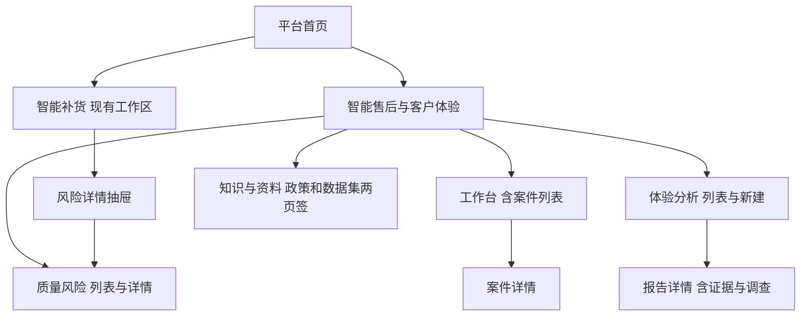
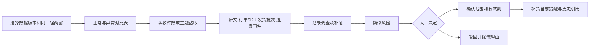

# B V1.0 产品操作与界面设计

2026-11-16，依据负责人实际体验意见修订产品原型；冻结需求和详细设计保持不变，本次方向待负责人确认，正式 Vue 尚未开发。需求：[B-REQ-001](../requirements/B_AFTER_SALES_V1.md)；实现细节：[B-DES-001](../agents/B_AFTER_SALES_DESIGN.md)。延续现有App/V2Shell/HomePage、hash路由和DESIGN.md，正式Vue页面不在本轮范围。

## 1. 使用者的一天

客服登录平台，在首页进入“智能售后与客户体验”，首先看今天要处理的案件和安全升级事项。打开案件后，左侧读客户原话，中间核实商品及订单证据，右侧修订回复草稿。审核保存后重开，仍能区分客户主张、AI原稿和实际人工决定；系统没有外发或退款执行入口。

运营切换“体验分析”，首先看哪些商品退货异常、本期与上期退货率及变化幅度，再看AI反馈总结、可能原因、证据与建议。正常对照商品可点开；统计口径和规则版本折叠在“指标说明 / 数据依据 / 高级详情”。从退货证据追到发货和原文，再创建调查，不把异常当缺陷。

质量人员沿调查补证，确认适用商品、单店及仓库范围后显式确认风险。采购仍在原补货工作区，单品和批量都能看到当前适用提醒；打开证据抽屉后回到原商品、筛选、批次和采购编辑状态，原数量及采购资格保持不变。

## 2. 信息架构



平台首页仅展示已有模块入口和各模块最近任务，不拼一套跨来源统计。导航上层为“平台首页／智能补货／智能售后”，工作区内才出现业务子导航。未来模块按同一入口配置添加，不提前显示利润／广告空页。案件列表融入售后工作台，调查嵌入案件／报告／风险详情，避免为每个后端对象新开页面。

建议路由 `#/after-sales`、`/after-sales/cases/:id`、`/after-sales/analyses`、`/after-sales/analyses/:id`、`/after-sales/risks`、`/after-sales/risks/:id`、`/after-sales/knowledge?tab=policies|datasets`。URL保存非敏感筛选／页码／版本；不含客户原文和凭据。现有 `/suggestions` 等URL保持兼容，不强制整体迁移路由体系。跨模块returnTo仅允许站内白名单路由。

## 3. 页面布局和主操作

| 页面 | 主内容及业务用途 | 主操作与状态 |
|---|---|---|
| 售后工作台 | 顶部范围／来源；安全升级置顶；待处理、待补证、待审核队列页签；案件表列问题／目标商品、真实状态、更新时间／责任动作。旁区列待调查异常和有效风险入口 | 点击已有售后记录继续工作，按来源、商品、订单及处理状态展示；内部教学创建放入独立“教学与异常演示”，不提供消费者入口。计数只取授权范围 |
| 案件详情 | 来源、客户问题、已核业务事实与待核信息、AI建议和人工审核；版本及关联证据按需展开 | 受信来源已定位商品时直接查看建议；仅订单级多商品歧义需选本订单明细，首次确认不必理由；纠正已有A→B关联须理由且保留原关联。草稿人工审核后仅保存内部记录 |
| 体验分析 | 已保存报告列表，新建表单先来源版本，再店铺／SKU／明确仓库、两窗、截止时间、教学规则版本；预览固定目标覆盖与成熟条件 | 受理后显示真实任务阶段；缺证据仍可产生受限报告，不伪造正常率 |
| 分析报告 | 异常商品优先、本期退货率、上期退货率、变化幅度；AI客户反馈总结、已核事实／可能原因、证据及处理建议；口径与规则在高级详情 | 从本期／上期退货证据、评价原文及关联售后记录查询依据；创建调查。固定数据与规则才可版本对比 |
| 质量风险 | 当前有效／疑似待调查／历史页签；商品身份、单店仓范围、来源／有效期／实际确认人，历史和当前状态分列 | 疑似仅调查；确认弹窗列证据、限制、逐店依据、仓库模式、默认30天。驳回／关闭／撤销必须理由，不出现“认证通过” |
| 知识与资料 | 政策四类及生命周期、原文段落和适用性；数据集版本、固定总体、校验问题、独立回读及绑定状态 | 创建草稿／提交审核／发布为分开动作；导入预检→验证→独立回读→激活，失败可下载脱敏问题清单 |
| 补货风险区 | 现有详情结论旁的紧凑提示；批量增加风险状态列／查看入口；抽屉显示最小证据、调查、来源及有效期 | 不新增采购勾选或阻断；查不到当前状态显示“未核实”，不是绿色“无风险”。风险抽屉关闭恢复焦点，不重置采购编辑 |

分析默认用对比表即可。可选的双点率图仅用于直观看两窗变化，同时标N/D与门槛并提供表格；UNKNOWN不画0点。主题表直接支持原文钻取，不再增加重复饼图。退货事件时间线用于解释多阶段、重复与期外归属，有明确排错用途。无装饰性仪表盘。

## 4. 案件关键交互草图

```text
返回工作台  [来源/数据版本] 案件ID · 待澄清              实际操作者：admin
客户原话与消息       核实对象／证据                 回复草稿与人工审核
原主题保留           订单/店铺/明细候选              AI状态、引用及限制
逐轮语言/附件        商品属性 vs 客户诉求           原稿 | 人工修订
追加澄清             事实、缺失、观测时间            待补材料/升级建议
                     政策版本/适用条件/原文          [保存并采纳] [退回] [升级]
底部：消息、关联修订、AI及人工处理历史（独立于ERP状态和资金状态）
```

来源有可靠商品ID、SKU、店铺及必要订单明细时自动展示已核关联，不要求客服重复确认。仅有多商品订单而无法确定诉求目标时，候选严格限制本订单受信明细，首次核实无强制理由。不允许从其他店铺、订单任意挑选。无可靠订单或商品证据时先补证／澄清；人工纠正已有关联须原因，原关联、修订人和历史保留。USB尺码冲突移至独立教学异常入口，说明“当前诉求与已核实属性不符，请澄清”，保留原话，不作正常默认路径。无政策时替换主操作说明“可记录澄清／转人工，不能承诺处理资格”。安全信号在消息进入时即置顶优先人工处理，不等待统计或AI任务。

生成期间可继续录消息，旧任务结果若对应旧revision则标“内容已更新，草稿需重生成”，不能覆盖新输入。人工草稿单独暂存在内存；离开未保存弹出确认。保存失败保留文本，网络不确定先按命令键查结果，刷新GET确认后才提示保存成功。

## 5. 从异常追溯到风险



金样演示首先显示棉质宽松上衣本期30%、上期2.5%、上升27.5个百分点；正常对照保持2.5%→2.5%。点击退货证据进入12件实际收货事件，再追发货与原文，评价和工单不代替退货件数。29天未成熟或19订单-SKU不足时，主界面显示“数据不足，暂时无法判断”及等待／补证下一步，不显示0%或无异常。AI反馈总结、已核事实、可能原因与人工调查分列；高级详情保持冻结的1/40→12/40、30×24小时、20/20、10个百分点且3件、来源隔离及去重定义。

教学绑定管理嵌在资料详情：显示dataset/version→已独立回读商品店仓映射→允许实际用户／消费模式／有效期；只有获准动作可激活。普通用户选择数据集只发起使用请求，不能创建绑定。正常模式看不到教学风险有效提醒或受限计数。绑定失效时旧报告可按权限看历史，不再当当前提醒。

## 6. 通用状态与异常

| 状态 | 页面行为／恢复动作 |
|---|---|
| 未启用 | 入口说明本模块尚未启用，现有补货可正常使用 |
| 未关联／资料不足 | 明确缺少订单、商品、政策或覆盖域；保留手工澄清和调查入口 |
| 排队／运行 | 沿真实任务状态显示，不编造百分比；双击命令同键，能离开后从最近任务恢复 |
| 部分完成 | 单列可用事实／指标和未完成AI或缺域，不把“任务成功”写成结论完整 |
| 失败 | 原位错误、观测时间、影响、下一动作；401重登、403联系授权、429/503有限重试；不提示“无记录” |
| 版本冲突 | 保留输入，提示新版本差异，用户重读后提交；不静默覆盖同事或新消息 |
| 查询风险失败／超核查期限 | 当前风险未核实，历史快照折叠为历史；S01原计算及采购界面继续可用 |
| 无适用风险 | 只表明本次完整查询无匹配记录，不表明商品安全 |
| 失效／撤销／关闭 | 时间边界清楚，历史可追溯；不使用“恢复正常”“已安全” |

沿现有视觉规范，未知与风险必须有文字，禁用原因就近显示，证据可键盘打开。1440并列案件三栏，1024改证据／草稿上下排列，820及以下保持主操作可达、表格自身滚动，窄屏抽屉全宽。返回、刷新、版本深链和会话恢复均纳入后续体验验收；不把DESIGN.md早期“未选定框架”描述当成当前Vue3不存在。

导出按当前权限重新读取并脱敏、带来源与版本和UNKNOWN限制；采购摘要不含客户身份。计数、原文、附件、历史引用统一授权，失权后不得继续展示内存旧敏感内容。

## 7. 正式Vue前的轻量原型阶段

2026-11-16 正式启动授权后，D-B-PROTOTYPE-01 本轮交付可点击原型，当前仅等负责人一次操作方向确认；不代记业务验收。入口与体验路径见[原型说明](../../prototypes/b-after-sales/README.md)，公共后端接续见[运行说明](../runbooks/b-after-sales-foundation.md)。原型为可双击预览的`prototypes/b-after-sales/index.html`（可配少量本地CSS/JS），使用现有视觉规范与合成标注样例，不建立独立网站、不接真实API、不读取客户记录、不持久写数据库；产品负责人可点选场景审核，正式Vue编码须在相关路径体验确认之后。无需再开展大规模视觉研究或创建一套组件库。

| 必须可体验的页面 | 最小交互及正负状态 |
|---|---|
| 售后工作台 | 从平台入口进入、切待处理/待补证/待审核、优先安全事项、打开案件；空态和受限可理解 |
| 案件处理 | 正常已关联工单→直接看商品、事实、政策及模拟AI建议→人工审核；订单多商品歧义才核实，已有错误关联纠正须原因；缺关联、USB冲突、安全升级、无政策、失败和旧草稿均保留 |
| 体验分析 | 商品评价／反馈→商品分析→退货异常、AI反馈总结及可能原因→证据→调查；本期30%、上期2.5%、上升27.5个百分点，数据不足通俗解释。订单未知保持未知，口径折叠，不冒充ERP数据 |
| 补货风险展示 | 单品和批量入口，风险抽屉与返回原筛选/数量；suspected无有效提醒、confirmed提醒、撤销/到期历史分列、查询失败未核实，参考100始终100 |

状态切换是清晰标注的原型演示，不冒充真实权限/模型/业务验收；覆盖键盘和1024/1440布局、返回上下文即可，不增加正式全量浏览器回归。产品审核产物为关键路径可用性意见及必要修订，不替代AC-01—03；无需为普通字段逐个审批，也不要求审批尚不存在的数据库。后端FOUNDATION可按已冻结契约独立准备，但任何正式Vue页面进入实现前须完成原型相关流程审核。


## 8. 本次原型纠偏与数据能力依据（2026-11-16）

这是ERP上层企业内部AI辅助工作区。默认入口是已有工单与待办，不要求员工重录，不假设消费者直接向中台提问。系统可可靠完成的关联不转嫁人工；异常只在确有歧义、缺失、冲突或人工纠正时处理。原型全部使用合成记录，无ERP或真实模型连接。

| 数据类别 | 已有证据支持的能力 | 未知及本原型边界 |
|---|---|---|
| ERP已有售后工单 | 冻结需求B-DATA-03记载工单115397已验证与多商品订单关联；本机接口资料列出customer-tickets列表／详情、record-context关系查询。工单字段含id、tenant_id、ticket_no、platform、store_name、subject、status_text、owner、order_sn及时间 | 工单标准字段没有直接商品行或SKU；不能假定每单可靠定位，标题也不是完整会话。原型“已核实关联”是场景A的模拟服务端结果，不宣称此上衣工单来自实测ERP。关系查询声明不等于每条关系可靠，仍须核租户/店/订单/商品明细 |
| ERP商品评价／客户反馈 | 历史D-S01-LIVE-01/source-index.json有GET /api/v1/customer-voice的200；api-report/data-matrix记店范围限定日评价2条。本机受控fixed-observation-capture的reviews样本2行、complete=true，字段名包括id、platform、store_id/name、listing_id、sku、title、body、rating、business_date、related_id/no、source_record_key、visibility、handling_status/version/note。仅核对字段，不发布原文或ID | 不据related_id/no推断订单或订单明细；精确productId映射、完整覆盖、其他日期和当前可用性、feedback类型实际读取未在本轮核实。未取得ERP完整成熟退货群组。本原型评价全部标“中台模拟”，未接ERP |
| 中台独立教学资料与内部案件 | 冻结需求允许独立订单／商品／反馈／退货教学金样及内部教学案件；原型合成ID均带DEMO或TEACHING语义，独立标来源 | HTML仅演示，不等于已完成受控教学导入、独立回读、正式激活或真实商品绑定。教学统计不混入ERP；相关教学工单不跳入ERP模拟工单证据 |

本机未跟踪docs/ERP-openapi.yaml本轮按负责人要求只读核对，未修改或提交；它仅是接口契约资料，不作为真实调用证明。其GET /customer-voice声明reviews来自product_reviews、feedback来自seller_feedback，二者不由工单推断；列表items是开放对象，不能仅据契约假定所有关联字段已测。历史受控样本与公开摘要位置及指纹随本轮测试记录保存，不复制完整业务响应。本轮没有新增ERP联网调查或写入。

主要路径：工作台默认ERP已有工单模拟→上衣详情直接查看建议；待补证队列→多商品订单仅选本订单明细；关联依据中才有纠正入口且必填原因。商品反馈→商品体验分析，评价缺订单时只关联商品；退货异常→AI分析／原文和退货收货证据→调查→人工确认风险→补货提醒。教学创建、USB诉求冲突、失败、权限、生命周期与历史版切换统一在顶栏“教学与异常演示”。

本次仅修正产品交互和表达，与冻结业务范围无实质冲突；需求、统计定义及技术设计不变，FOUNDATION.F1/F2、正式Vue和后端不改。方向确认仍待负责人体验，不自动进入后续开发。
